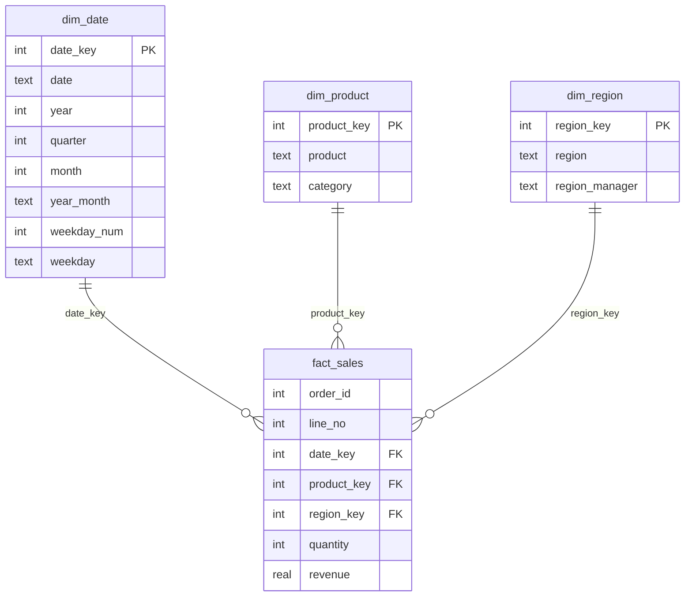
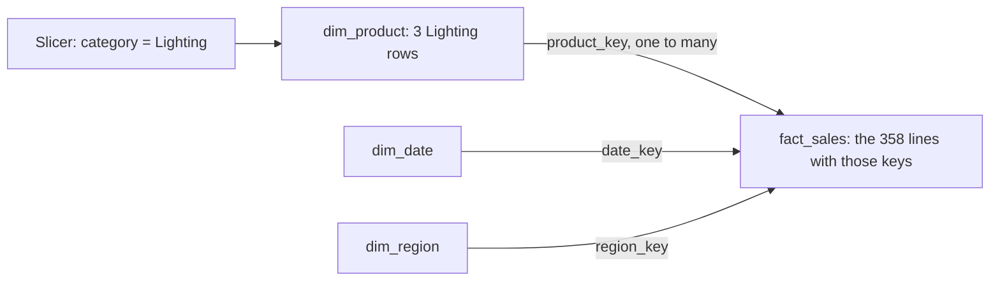

# Model the data a dashboard needs

How do you turn one flat export of order lines into tables a dashboard can slice by date, product and region without double counting?

## Before you start

- **Level:** 2 (intermediate).
- **Time:** about 2 hours.
- **Builds on:** [GROUP BY from raw rows](../../01-sql/01-group-by-from-raw-rows/), [Joins without losing rows](../../01-sql/02-joins-without-losing-rows/) and [Window functions](../../01-sql/03-window-functions/) (for `ROW_NUMBER`).
- **You need:** Python 3.9 or newer. Nothing to install: the test uses the `sqlite3` module that ships with Python.

## The problem

You are the analyst at Larkspur Home, an online homeware shop with four sales regions. Hana, the head of operations, wants a Power BI dashboard of revenue by month, category and region by the end of next week. The order system gives you one wide export, `transactions`, with the product name, category, region and region manager repeated on every order line. Last time someone pointed a dashboard straight at that export, two things went wrong. The daily revenue chart jumped from Saturday to Monday as if Sundays did not exist, and the "orders" card showed 1,241 when the shop had 620 orders, because it counted order lines. You will build a proper star schema, then fix both visuals on top of it.

## In plain words

Think of a supermarket receipt. Each line says what you bought, how many and the price. The receipt does not print the shop's address and the full product description on every line; it points to them. A **star schema** organises data the same way. One table holds the lines you add up (the receipt lines). Small side tables hold the descriptions you filter by (products, regions, days of the year).

- A **fact table** has one row per event you measure, here one row per order line. It holds **keys** (numbers that point to a side table) and **measures** (numbers you add up, such as quantity and revenue).
- A **dimension table** has one row per thing you filter or group by: one row per product, per region, per calendar day. It holds the descriptive text.
- The **grain** is the sentence that says what one fact row is. Here: "one row per order line".
- A **key** is the column that identifies a row. A **surrogate key** is a plain integer (1, 2, 3) the model assigns, instead of joining on long text.
- **One to many** means one row on one side matches many rows on the other: one product appears on many order lines.

## What you will build from scratch

- A date dimension with one row per calendar day, including days with no sales, and a weekday column.
- A product dimension and a region dimension, each with an integer surrogate key.
- A fact table at the grain of one row per order line, holding only keys and numbers.
- The first dashboard visual, revenue by month and category, built from the star schema.
- An orders card that counts each order once, and a weekday chart where Sunday shows 0.
- Checks that the model's totals match the raw export exactly.

The data in `data/` is synthetic. `make_data.py` builds it with a fixed random seed: 1,241 order lines from 620 orders across 2025, with no shipments on Sundays.

## The idea

A dashboard tool like Power BI or Tableau works best on a star schema: one fact table in the middle and several dimension tables around it. Each dimension has a one to many relationship to the fact table, through a key.



`||--o{` reads "exactly one on this side, zero or more on that side". Write the grain down first. Every check in this lesson follows from it: the fact table must have exactly as many rows as the raw export has order lines, and `(order_id, line_no)` must be unique.

### Why a star and not the flat export

The flat export already has every column, so why split it?

1. **Filters flow one way, from a dimension to the facts.** A slicer on category picks rows in `dim_product`, those rows pick their `product_key` values, and the keys pick fact rows. In Power BI that is the default single direction filter, from the one side to the many side. Every fact table that shares the dimension is filtered by the same slicer.



2. **Several fact tables can share one dimension.** Next quarter Hana will add monthly sales targets per region. Targets have a different grain (one row per region and month), so they cannot sit on order lines without repeating on every line. As a second fact table, they join to the same `dim_date` and `dim_region`, and one region slicer filters sales and targets together. Dimensions shared like this are called **conformed dimensions**.
3. **Dimensions hold rows the facts do not.** A date table must contain every day, so a daily chart shows Sunday as zero instead of skipping it. Power BI checks that a table you mark as the date table has unique, non-blank, contiguous dates ([Set and use date tables in Power BI Desktop](https://learn.microsoft.com/en-us/power-bi/transform-model/desktop-date-tables), Microsoft Learn, read 31 October 2026), and its classic time intelligence functions (next lesson) walk that calendar.
4. **Text is stored once.** "Pendant Light", "Lighting" and "Amara Osei" live in one dimension row each. The fact table repeats only small integers, which keeps it narrow and fast to scan.
5. **Totals stay honest.** If the fact table is at the right grain, `SUM(revenue)` over any slice equals the same slice of the raw data. That is the test you run every time you change the model.

## Walk through

Each query below runs on the raw `transactions` table plus the tables the earlier steps create. The block under each query is what sqlite3 returns.

Step 1. Check the grain of the raw data. If `(order_id, line_no)` is unique, the raw table is at order line grain already.

```sql
SELECT COUNT(*) AS line_rows, COUNT(DISTINCT order_id || '-' || line_no) AS unique_lines, COUNT(DISTINCT order_id) AS orders
FROM transactions
```

```text
line_rows  unique_lines  orders
1241       1241          620
```

Both counts are 1,241, and there are 620 orders. A fact table grouped by `order_id` would have 620 rows and would lose the product on every line.

Step 2. Build the date dimension with a recursive CTE (a query that adds one row, then repeats on the row it just added). `SELECT DISTINCT order_date` would give only the 313 days with sales. The calendar from 1 January to 31 December 2025 has 365.

```sql
CREATE TABLE dim_date AS
WITH RECURSIVE days(date) AS (
  SELECT MIN(order_date) FROM transactions
  UNION ALL
  SELECT date(date, '+1 day') FROM days
  WHERE date < (SELECT MAX(order_date) FROM transactions)
)
SELECT
  CAST(strftime('%Y%m%d', date) AS INTEGER) AS date_key,
  date,
  CAST(strftime('%Y', date) AS INTEGER) AS year,
  (CAST(strftime('%m', date) AS INTEGER) + 2) / 3 AS quarter,
  CAST(strftime('%m', date) AS INTEGER) AS month,
  strftime('%Y-%m', date) AS year_month,
  CAST(strftime('%w', date) AS INTEGER) AS weekday_num,
  substr('SunMonTueWedThuFriSat', 1 + 3 * CAST(strftime('%w', date) AS INTEGER), 3) AS weekday
FROM days
```

`strftime('%w', date)` is SQLite and gives 0 for Sunday up to 6 for Saturday. The `substr` picks three letters out of a 21 letter string. PostgreSQL writes `EXTRACT(DOW FROM date)` and `to_char(date, 'Dy')`, and SQL Server `DATEPART(weekday, date)`.

```sql
SELECT COUNT(*) AS days, MIN(date), MAX(date) FROM dim_date
```

```text
days  MIN(date)   MAX(date)
365   2025-01-01  2025-12-31
```

Step 3. Build the product and region dimensions. `DISTINCT` collapses the repeated text, and `ROW_NUMBER()` hands out the surrogate key.

```sql
CREATE TABLE dim_product AS
SELECT ROW_NUMBER() OVER (ORDER BY product) AS product_key, product, category
FROM (SELECT DISTINCT product, category FROM transactions)
```

```sql
CREATE TABLE dim_region AS
SELECT ROW_NUMBER() OVER (ORDER BY region) AS region_key, region, region_manager
FROM (SELECT DISTINCT region, region_manager FROM transactions)
```

```sql
SELECT (SELECT COUNT(*) FROM dim_product) AS products, (SELECT COUNT(DISTINCT product) FROM transactions) AS product_names,
       (SELECT COUNT(*) FROM dim_region) AS regions
```

```text
products  product_names  regions
10        10             4
```

That gives 10 products and 4 regions. If a product appeared with two categories, `DISTINCT` would return two rows for it and the key would no longer identify one product. Comparing the row count with `COUNT(DISTINCT product)` catches that.

Step 4. Build the fact table. Swap every piece of text for its key and keep the numbers.

```sql
CREATE TABLE fact_sales AS
SELECT
  t.order_id, t.line_no, d.date_key, p.product_key, r.region_key, t.quantity,
  ROUND(t.quantity * t.unit_price, 2) AS revenue
FROM transactions t
JOIN dim_date d ON d.date = t.order_date
JOIN dim_product p ON p.product = t.product
JOIN dim_region r ON r.region = t.region
```

```sql
SELECT * FROM fact_sales LIMIT 3
```

```text
order_id  line_no  date_key  product_key  region_key  quantity  revenue
10001     1        20250101  9            2           4         51.0
10001     2        20250101  2            2           3         420.0
10002     1        20250101  2            3           2         280.0
```

Only integers and one decimal number. The test checks that: a text column in `fact_sales` fails it.

Step 5. Reconcile. The model must give the same totals as the raw export. If an inner join had dropped rows (say a product missing from `dim_product`), this is where you would see it.

```sql
SELECT COUNT(*) AS fact_rows, SUM(quantity) AS units, ROUND(SUM(revenue), 2) AS revenue FROM fact_sales
```

```text
fact_rows  units  revenue
1241       3152   194175.25
```

Step 6. Build the visual from the model. This is what a matrix with `year_month` on rows and `category` on columns asks the engine for. The first four rows:

```sql
SELECT d.year_month, p.category, ROUND(SUM(f.revenue), 2) AS revenue
FROM fact_sales f
JOIN dim_date d ON d.date_key = f.date_key
JOIN dim_product p ON p.product_key = f.product_key
GROUP BY d.year_month, p.category
ORDER BY d.year_month, p.category
LIMIT 4
```

```text
year_month  category  revenue
2025-01     Decor     1375.0
2025-01     Lighting  7580.5
2025-01     Storage   2046.0
2025-01     Textiles  5350.0
```

Step 7. The orders card. The fact table is at order line grain, so one order with three lines is three rows. Count distinct order ids. DAX writes the same thing as `DISTINCTCOUNT(fact_sales[order_id])`.

```sql
SELECT r.region, COUNT(DISTINCT f.order_id) AS orders, COUNT(*) AS order_lines, ROUND(SUM(f.revenue), 2) AS revenue
FROM fact_sales f
JOIN dim_region r ON r.region_key = f.region_key
GROUP BY r.region
ORDER BY r.region
```

```text
region  orders  order_lines  revenue
East    157     315          45355.5
North   148     310          48063.5
South   159     304          51213.5
West    156     312          49542.75
```

The four regions add up to 620 orders and 1,241 lines.

Step 8. The daily chart. Start from the calendar and LEFT JOIN the facts, so a day with no sales keeps its row. `COALESCE` turns the missing sum into 0.

```sql
SELECT d.date, d.weekday, ROUND(COALESCE(SUM(f.revenue), 0), 2) AS revenue
FROM dim_date d
LEFT JOIN fact_sales f ON f.date_key = d.date_key
WHERE d.date BETWEEN '2025-01-01' AND '2025-01-07'
GROUP BY d.date, d.weekday
ORDER BY d.date
```

```text
date        weekday  revenue
2025-01-01  Wed      840.0
2025-01-02  Thu      687.0
2025-01-03  Fri      312.0
2025-01-04  Sat      27.5
2025-01-05  Sun      0.0
2025-01-06  Mon      310.25
2025-01-07  Tue      354.0
```

Sunday 5 January is there with 0. The same pattern by weekday gives a chart where Sunday has its own bar, at zero:

```sql
SELECT d.weekday_num, d.weekday, COUNT(DISTINCT d.date_key) AS days, ROUND(COALESCE(SUM(f.revenue), 0), 2) AS revenue
FROM dim_date d
LEFT JOIN fact_sales f ON f.date_key = d.date_key
GROUP BY d.weekday_num, d.weekday
ORDER BY d.weekday_num
```

```text
weekday_num  weekday  days  revenue
0            Sun      52    0.0
1            Mon      52    36887.5
2            Tue      52    28651.5
3            Wed      53    32550.25
4            Thu      52    35546.0
5            Fri      52    30694.25
6            Sat      52    29845.75
```

52 Sundays, all at 0. Wednesday has 53 days because 2025 started on a Wednesday.

### The same model in Power BI (reference only, not run in this course)

In Power BI you load `transactions` in Power Query, use Reference to make the product and region tables, Remove Duplicates on them, and draw one to many relationships from each dimension to the fact table. The date table is usually a DAX calculated table, which you then mark as the date table:

```dax
Date =
ADDCOLUMNS (
    CALENDAR ( MIN ( transactions[order_date] ), MAX ( transactions[order_date] ) ),
    "Year", YEAR ( [Date] ),
    "Quarter", QUARTER ( [Date] ),
    "Month", MONTH ( [Date] ),
    "YearMonth", FORMAT ( [Date], "YYYY-MM" ),
    "Weekday", FORMAT ( [Date], "ddd" )
)

Orders = DISTINCTCOUNT ( fact_sales[order_id] )
```

`CALENDAR` does what the recursive CTE does: it returns every day between two dates, sales or not. In Tableau you would build the same relationships on the Data Source page.

## Common mistakes

**1. Counting order lines as orders (the trap from the problem).** The fact table is at line grain, so a plain count counts lines.

```sql
SELECT COUNT(order_id) AS orders_wrong, COUNT(DISTINCT order_id) AS orders FROM fact_sales
```

```text
orders_wrong  orders
1241          620
```

1,241 against 620: the card is double the truth, and nothing errors. Whenever the thing you count (orders) is coarser than the table's grain (lines), you need `COUNT(DISTINCT ...)` or a separate fact table at order grain.

**2. Building the calendar from the sales.** `SELECT DISTINCT order_date` gives 313 days and no Sundays, so the daily chart joins Saturday to Monday and the weekday chart has six bars. Generate every day, as in step 2.

**3. Counting days with `COUNT(*)` after the LEFT JOIN.** Each fact row repeats its day, so `COUNT(*)` counts lines, not days.

```sql
SELECT d.weekday, COUNT(*) AS days_wrong, COUNT(DISTINCT d.date_key) AS days
FROM dim_date d
LEFT JOIN fact_sales f ON f.date_key = d.date_key
GROUP BY d.weekday_num, d.weekday
ORDER BY d.weekday_num
```

```text
weekday  days_wrong  days
Sun      52          52
Mon      224         52
Tue      214         52
Wed      219         53
Thu      196         52
Fri      199         52
Sat      189         52
```

Monday shows 224 "days". Only Sunday looks right, because a day with no sales still keeps exactly one row, with NULLs on the fact side.

**4. Trusting keys that are rebuilt on every load.** The keys in this lesson come from `ROW_NUMBER() OVER (ORDER BY product)`, recomputed each time the model is built, and the fact table finds them by joining on the product name. Rename "Cotton Rug" to "Area Rug" and it sorts first: it takes key 1, and Ceramic Vase moves from key 1 to key 2. A saved report or a second fact table that stored the old keys now points at the wrong products. Real warehouses keep a key map table, so a product keeps its key forever, and join on a stable id from the source system (a SKU code), not on a name.

**5. Not reconciling.** An inner join to a dimension that is missing a value drops fact rows silently. Step 5 is not optional: compare rows, units and revenue with the export every time.

## Your turn

Open `exercise.sql` and write `dim_date`, `dim_product`, `dim_region`, `fact_sales`, `revenue_by_category_month`, `orders_by_region` and `revenue_by_weekday`. The test runs each of the first four as `CREATE TABLE <name> AS <your query>`, so write plain SELECT queries, without the CREATE TABLE line.

```
python3 test_lesson.py
```

Run it from this folder. The test checks the calendar has no gaps, the keys are unique, the fact table is at order line grain and holds only keys and numbers, every key resolves, the totals match the raw export, orders are counted once and Sunday appears with 0. It runs every check three times: on the committed data, on a second dataset that `make_data.build()` creates with another seed, and on a four line table with a gap day, a zero quantity and a tie.

Stretch: add a `fact_targets` table with one row per region and month (make up a target per region), join it to `dim_date` on the first day of the month and to `dim_region`, and write one query that shows revenue and target side by side by region and month.

## Check yourself

1. What is the grain of a fact table, and why do you decide it first?
2. Why does a date dimension need days with no sales?
3. When would you store a measure on a dimension instead of a fact table?
4. Your fact table has 1,180 rows and the raw export has 1,241. What do you check first?

<details>
<summary>Answers</summary>

1. The grain is what one row of the fact table represents, for example one order line. Every join, key and total depends on it. If you mix grains, such as order lines and order headers in one table, sums double count, and counts of the coarser thing (orders) need `COUNT(DISTINCT ...)`.
2. Charts by day or week would skip those days instead of showing zero, and time intelligence such as year to date and same period last year needs a continuous calendar to shift along. Power BI refuses to mark a date table with gaps.
3. Almost never. Numbers you add up belong in the fact table. A dimension can hold fixed attributes such as a product's list price or a region's headcount, but you then aggregate them with care because they repeat per dimension row, not per event.
4. The inner joins. Some raw rows have a product, region or date that is missing from a dimension, so the join dropped them. Find them with a LEFT JOIN and a `WHERE key IS NULL` filter.

</details>

## What to tell the stakeholder

"The new model reconciles to the order export: 1,241 order lines from 620 orders, 3,152 units and 194,175.25 of revenue in 2025. The orders card now counts 620 orders (it counted lines before), and Sundays appear as zero because the warehouse does not ship on Sundays and orders are dated by ship date, so a Sunday order shows up on Monday."

## In real job postings

In the Real Analyst Jobs data drop of 25 October 2026, India had 1,174 analyst postings. Of the 900 that list tools, 39% ask for Power BI and 34% for Tableau, and SQL leads at 70% ([data/job-market/2026-10](../../../data/job-market/2026-10/)). See the [Power BI skills page](https://realanalystjobs.com/skills/power-bi).

## Next

[02 DAX measures from scratch](../02-dax-measures-from-scratch/)
