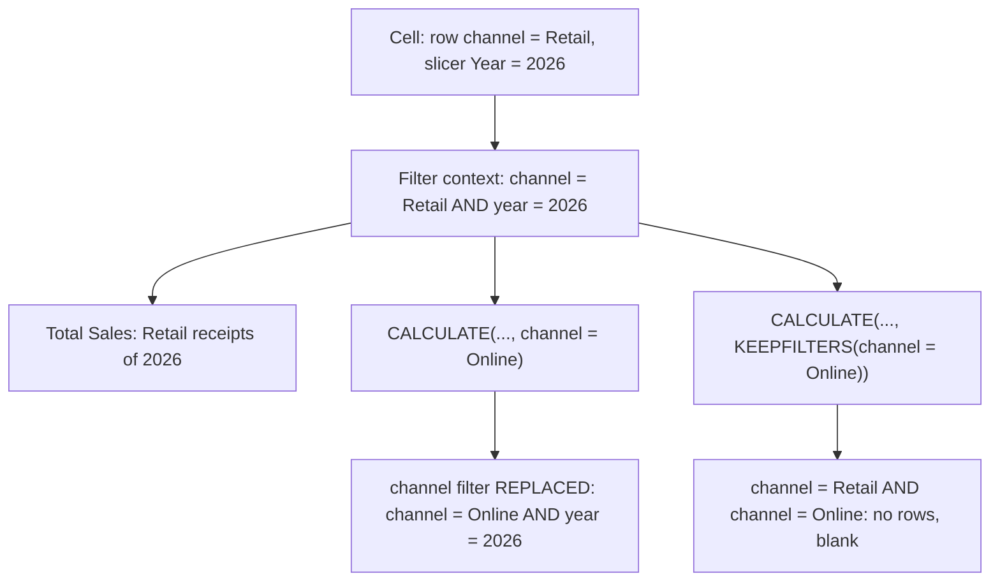

# DAX measures from scratch

What does a Power BI measure actually compute, and how do you get the same Total Sales, filtered sales, share, year to date and growth on last year numbers without Power BI?

## Before you start

- **Level:** 2 (intermediate).
- **Time:** about 2 hours.
- **Builds on:** [Model the data a dashboard needs](../01-model-the-data-a-dashboard-needs/) (the date table), [GROUP BY from raw rows](../../01-sql/01-group-by-from-raw-rows/) and [Window functions](../../01-sql/03-window-functions/) (`SUM(...) OVER`, `LAG`).
- **You need:** Python 3.9 or newer. No Power BI: every measure is rebuilt in sqlite3 SQL, and the DAX is shown next to it as a reference.

## The problem

You are the analyst at Brightwater Coffee, a roaster that sells beans, equipment and subscriptions online and from one retail shop. Femi, the finance lead, sends you a Power BI report a contractor built and asks you to check its numbers before the board pack goes out on Monday. The report has Total Sales, Online Sales, each category's share of all sales, Sales YTD and a growth on last year card, and it has a Year slicer. The roastery closed for a refit in March 2025, so nothing shipped that month, online or from the shop, and Femi suspects the March 2026 growth figure is wrong. You will rebuild every measure in SQL and compare.

## In plain words

Picture a pile of receipts and a matrix on a whiteboard with one row per sales channel. To fill the cell "Retail, 2026", an assistant picks out the Retail receipts from 2026 and adds them up. That pile of receipts is the cell's **filter context**: every filter that applies to that one cell, from its row and column headers, the slicers and the page. A **measure** is the instruction "add up the amounts", and the engine follows it once per cell, each time on a different pile.

- **CALCULATE** is a note attached to the instruction: "before adding, change the pile". `CALCULATE([Total Sales], sales[channel] = "Online")` says "use the Online receipts instead". On the Retail row it throws away the Retail pile and takes the Online one: it **replaces** the channel filter.
- **KEEPFILTERS** changes the note to "keep only the Online receipts from the pile you already have". On the Retail row nothing is left, so the cell is blank.
- **ALL** (or its newer name **REMOVEFILTERS**) says "ignore the filter on this one column". Other filters, such as the Year slicer, stay.
- **Blank** is DAX's empty value, like NULL in SQL. It is not 0.

## What you will build from scratch

- `SUM` as a measure: one total per category.
- A `CALCULATE` style filtered measure, first where the visual does not show channel, then on a matrix by channel, where it replaces the row's filter.
- The `KEEPFILTERS` version, which intersects instead.
- A share of all categories (`ALL` or `REMOVEFILTERS` on category) that still respects a Year slicer.
- Year to date (`TOTALYTD`) over a calendar with no gaps.
- Same period last year (`SAMEPERIODLASTYEAR`) and growth, where a missing month gives a blank, not a wrong number.

The data in `data/` is synthetic. `make_data.py` builds it with a fixed random seed: 1,191 orders from January 2025 to September 2026, with none in March 2025.

## The idea

A DAX measure is not a column. It is a formula that the engine evaluates once for every cell of a visual, inside that cell's filter context. So a measure is a function: `measure(filters) -> number`. SQL can do the same thing if you map each kind of filter to the right part of a query:

- slicers and page filters are the `WHERE` clause,
- the visual's rows and columns are the `GROUP BY`,
- a measure that needs a different filter for one value is a `CASE WHEN` inside the aggregate, or a window function over the grouped rows.

SQL runs in that order: WHERE first, then GROUP BY, then window functions over the grouped result. That order is what makes the mapping work.

Here is one cell of the matrix you will build: channel on rows, Year slicer set to 2026.



The year filter survives both versions. Only the filter on the column named inside CALCULATE changes.

| DAX | What the engine does | SQL that does the same |
|---|---|---|
| `SUM(sales[amount])` in a visual by category | keep the rows of the cell's category (and slicers), then add | `SUM(amount)` with `GROUP BY category`, slicers in `WHERE` |
| `CALCULATE([Total Sales], sales[channel] = "Online")` | set the channel filter to Online. A filter already on channel (row, column or slicer) is **replaced**; filters on other columns stay | channel not on the visual: `SUM(CASE WHEN channel = 'Online' THEN amount ELSE 0 END)` in the same GROUP BY. Channel on rows: `SUM(SUM(CASE WHEN channel = 'Online' THEN amount END)) OVER (PARTITION BY <the visual's other fields>)` |
| `CALCULATE([Total Sales], KEEPFILTERS(sales[channel] = "Online"))` | **intersect** with the filter already on channel | `SUM(CASE WHEN channel = 'Online' THEN amount END)` in the same GROUP BY: NULL where the row is not Online |
| `CALCULATE([Total Sales], ALL(sales[category]))`, or `REMOVEFILTERS(sales[category])` | remove the filters on category only; slicers and other columns still apply | `SUM(SUM(amount)) OVER (PARTITION BY <the visual's other fields>)`, with the same `WHERE` |
| `TOTALYTD([Total Sales], 'Date'[Date])` | sum from 1 January of the year to the last date in the current filter context | a running sum `PARTITION BY year ORDER BY month` over a gap free calendar |
| `CALCULATE([Total Sales], SAMEPERIODLASTYEAR('Date'[Date]))` | shift the dates in the filter back one year | join each month to the month with the same number one year earlier |
| `DIVIDE(a, b)` | a / b, or blank when b is 0 or blank | `CASE WHEN b = 0 OR b IS NULL THEN NULL ELSE a / b END` |

`SUM(SUM(amount)) OVER ()` reads from the inside out: the inner `SUM` is the ordinary group total (one per category), and the outer `SUM ... OVER ()` adds those group totals across every row of the result. Because it runs after WHERE, it keeps the slicer. When the visual has more fields (say month on columns as well), `PARTITION BY month` keeps the month filter and removes only category.

The override rule is Microsoft's: a filter argument on a column that is already filtered overwrites that filter, and KEEPFILTERS makes CALCULATE add to the existing filters instead of replacing them ([CALCULATE function](https://learn.microsoft.com/en-us/dax/calculate-function-dax) and [KEEPFILTERS function](https://learn.microsoft.com/en-us/dax/keepfilters-function-dax), Microsoft Learn, both read 31 October 2026). `ALL(Column)` removes filters from the named columns while other filters still apply ([ALL function](https://learn.microsoft.com/en-us/dax/all-function-dax), read 31 October 2026), and `TOTALYTD` evaluates the year to date in the current context ([TOTALYTD function](https://learn.microsoft.com/en-us/dax/totalytd-function-dax), read 31 October 2026).

The time intelligence rows depend on a date table with every day (lesson 01). `SAMEPERIODLASTYEAR` shifts dates on the calendar. It does not count back twelve rows. That difference is the March 2026 bug.

## Walk through

Each query runs on the `sales` table. The block under each query is what sqlite3 returns.

Step 1. SUM and a filtered SUM, in a table with category on rows and no slicers. Channel is not on this visual, so CALCULATE has no channel filter to replace, and a `CASE WHEN` inside the SUM gives the same number. Equipment sold 64,936.73 in total and 42,177.38 of that online.

```sql
SELECT
  category,
  ROUND(SUM(amount), 2) AS total_sales,
  ROUND(SUM(CASE WHEN channel = 'Online' THEN amount ELSE 0 END), 2) AS online_sales
FROM sales
GROUP BY category
ORDER BY category
```

```text
category       total_sales  online_sales
Beans          17043.59     11847.24
Equipment      64936.73     42177.38
Subscriptions  33925.19     23809.56
```

You cannot use `WHERE channel = 'Online'` here, because that would also filter `total_sales`. CALCULATE changes the filter for one measure only, and `CASE WHEN` inside the SUM does the same.

Step 2. Now put channel on rows and set the Year slicer to 2026. The slicer becomes the WHERE clause. `online_sales` is plain CALCULATE: it replaces the row's channel filter, so the Retail row shows the online total too. `online_keepfilters` is the KEEPFILTERS version: Retail AND Online leaves no rows, so it is NULL.

```sql
SELECT
  channel,
  ROUND(SUM(amount), 2) AS total_sales,
  ROUND(SUM(SUM(CASE WHEN channel = 'Online' THEN amount END)) OVER (), 2) AS online_sales,
  ROUND(SUM(CASE WHEN channel = 'Online' THEN amount END), 2) AS online_keepfilters
FROM sales
WHERE substr(order_date, 1, 4) = '2026'
GROUP BY channel
ORDER BY channel
```

```text
channel  total_sales  online_sales  online_keepfilters
Online   35685.9      35685.9       35685.9
Retail   19005.95     35685.9       NULL
```

The Retail row reads 35,685.90 of "Online Sales". That surprises people in a report, and it is a classic interview question. It is also useful: it is how you put a fixed comparison number on every row.

Step 3. Share of all categories, with the Year slicer still on. `ALL(sales[category])` removes the category filter only, so the denominator is 2026 sales of all categories, 54,691.85, not all-time sales.

```sql
SELECT
  category,
  ROUND(SUM(amount), 2) AS total_sales,
  ROUND(SUM(SUM(amount)) OVER (), 2) AS all_categories,
  ROUND(SUM(amount) / SUM(SUM(amount)) OVER (), 4) AS share_of_all
FROM sales
WHERE substr(order_date, 1, 4) = '2026'
GROUP BY category
ORDER BY category
```

```text
category       total_sales  all_categories  share_of_all
Beans          8099.62      54691.85        0.1481
Equipment      30518.32     54691.85        0.558
Subscriptions  16073.91     54691.85        0.2939
```

Equipment is 0.558 of 2026 sales, and the three shares add up to 1.

Step 4. Year to date. Build a list of every month first, so March 2025 exists with 0 sales and the running total carries through it. Then run the sum inside each year.

```sql
WITH RECURSIVE months(m) AS (
  SELECT '2025-01'
  UNION ALL
  SELECT strftime('%Y-%m', date(m || '-01', '+1 month')) FROM months WHERE m < '2026-09'
),
monthly AS (
  SELECT months.m AS year_month, COALESCE(SUM(s.amount), 0) AS sales
  FROM months LEFT JOIN sales s ON substr(s.order_date, 1, 7) = months.m
  GROUP BY months.m
)
SELECT year_month, ROUND(sales, 2) AS sales,
  ROUND(SUM(sales) OVER (PARTITION BY substr(year_month, 1, 4) ORDER BY year_month), 2) AS ytd_sales
FROM monthly
ORDER BY year_month
```

```text
year_month  sales    ytd_sales
2025-01     6048.13  6048.13
2025-02     4647.86  10695.99
2025-03     0.0      10695.99
2025-04     5876.75  16572.74
2025-05     6096.74  22669.48
2025-06     5992.69  28662.17
2025-07     5356.87  34019.04
2025-08     5083.99  39103.03
2025-09     4504.27  43607.3
2025-10     7193.63  50800.93
2025-11     5133.09  55934.02
2025-12     5279.64  61213.66
2026-01     4941.96  4941.96
2026-02     5392.52  10334.48
2026-03     5626.59  15961.07
2026-04     5635.3   21596.37
2026-05     6960.86  28557.23
2026-06     6536.69  35093.92
2026-07     6819.16  41913.08
2026-08     7978.67  49891.75
2026-09     4800.1   54691.85
```

YTD is 10,695.99 at the end of February 2025, stays 10,695.99 in March, and restarts at 4,941.96 in January 2026. In the exercise, take the first and last month from the data instead of typing them.

Step 5. Same period last year. Join each month to the month one year earlier by date, not by position.

```sql
WITH monthly AS (SELECT substr(order_date, 1, 7) AS year_month, SUM(amount) AS sales FROM sales GROUP BY 1)
SELECT cur.year_month, ROUND(cur.sales, 2) AS sales, ROUND(COALESCE(ly.sales, 0), 2) AS sales_ly,
  CASE WHEN ly.sales IS NULL OR ly.sales = 0 THEN NULL
       ELSE ROUND((cur.sales - ly.sales) * 100.0 / ly.sales, 1) END AS growth_pct
FROM monthly cur
LEFT JOIN monthly ly ON ly.year_month = strftime('%Y-%m', date(cur.year_month || '-01', '-1 year'))
WHERE cur.year_month >= '2026-01'
ORDER BY cur.year_month
```

```text
year_month  sales    sales_ly  growth_pct
2026-01     4941.96  6048.13   -18.3
2026-02     5392.52  4647.86   16.0
2026-03     5626.59  0.0       NULL
2026-04     5635.3   5876.75   -4.1
2026-05     6960.86  6096.74   14.2
2026-06     6536.69  5992.69   9.1
2026-07     6819.16  5356.87   27.3
2026-08     7978.67  5083.99   56.9
2026-09     4800.1   4504.27   6.6
```

January 2026 is -18.3% on January 2025, February is +16.0%, and March is NULL. NULL is the honest answer: there was no March 2025 to grow from. One difference to know: this query shows `sales_ly` as 0 for March, while the DAX `Sales LY` measure is blank there. On a card, 0 says "last year we sold nothing" and blank says "there is no number", so decide which one the report should show and say so in the tooltip.

### The same measures in DAX (reference only, not run in this course)

These assume a `'Date'` table marked as the date table and related to `sales[order_date]`.

```dax
Total Sales = SUM ( sales[amount] )

Online Sales = CALCULATE ( [Total Sales], sales[channel] = "Online" )

Online Sales Keep = CALCULATE ( [Total Sales], KEEPFILTERS ( sales[channel] = "Online" ) )

Share of All = DIVIDE ( [Total Sales], CALCULATE ( [Total Sales], REMOVEFILTERS ( sales[category] ) ) )

Sales YTD = TOTALYTD ( [Total Sales], 'Date'[Date] )

Sales LY = CALCULATE ( [Total Sales], SAMEPERIODLASTYEAR ( 'Date'[Date] ) )

Growth % = DIVIDE ( [Total Sales] - [Sales LY], [Sales LY] )
```

`REMOVEFILTERS ( sales[category] )` and `ALL ( sales[category] )` do the same job inside CALCULATE; Microsoft recommends REMOVEFILTERS when your tool has it. `DIVIDE` returns blank when `[Sales LY]` is blank, which is what the `CASE WHEN` in step 5 does. Tableau has the same ideas as table calculations: a running total restarting every year, and a year over year percent difference.

## Common mistakes

**1. Counting back twelve rows for last year (the trap).** `LAG(s, 12)` takes the value twelve rows up. That only means "twelve months ago" if no month is missing.

```sql
WITH m AS (SELECT substr(order_date, 1, 7) AS ym, SUM(amount) AS s FROM sales GROUP BY 1)
SELECT * FROM (
  SELECT ym, ROUND(s, 2) AS sales, ROUND(LAG(s, 12) OVER (ORDER BY ym), 2) AS wrong_ly
  FROM m
) WHERE ym >= '2026-01'
ORDER BY ym
```

```text
ym       sales    wrong_ly
2026-01  4941.96  NULL
2026-02  5392.52  6048.13
2026-03  5626.59  4647.86
2026-04  5635.3   5876.75
2026-05  6960.86  6096.74
2026-06  6536.69  5992.69
2026-07  6819.16  5356.87
2026-08  7978.67  5083.99
2026-09  4800.1   4504.27
```

January 2026 gets NULL, February gets January 2025 (6,048.13), and March gets February 2025 (4,647.86). Because March 2025 has no row, every month up to March is shifted by one. A growth card built on this would say March 2026 grew 21%, when there is nothing to compare it with. Shift the calendar, as in step 5.

**2. Mapping ALL(category) to a subquery over the whole table.** `(SELECT SUM(amount) FROM sales)` starts again from every row, so it drops the Year slicer too. That is what `ALL()` with no arguments would do, not `ALL(sales[category])`.

```sql
SELECT
  category,
  ROUND(SUM(amount) / (SELECT SUM(amount) FROM sales), 4) AS share_wrong,
  ROUND(SUM(amount) / SUM(SUM(amount)) OVER (), 4) AS share_of_all
FROM sales
WHERE substr(order_date, 1, 4) = '2026'
GROUP BY category
ORDER BY category
```

```text
category       share_wrong  share_of_all
Beans          0.0699       0.1481
Equipment      0.2633       0.558
Subscriptions  0.1387       0.2939
```

The wrong shares add up to 0.4719, so the pie chart is less than half full. Without a slicer both versions give the same numbers, which is why this bug survives until someone clicks the slicer.

**3. Thinking CALCULATE adds a filter.** If you believe CALCULATE adds `channel = Online` to the row's `channel = Retail`, you expect 0 or blank on the Retail row and write a `CASE WHEN` in the GROUP BY. Power BI shows 35,685.90 there (step 2). The `CASE WHEN` matches CALCULATE only when channel is not on the visual and not sliced. If you want "add", write KEEPFILTERS.

**4. Showing 0 where DAX shows blank.** `COALESCE(..., 0)` and `ELSE 0` turn "no rows" into 0. Compare the `online_keepfilters` NULL in step 2 with `ELSE 0` in step 1: in step 1 every category had online sales, so it did not matter, but a category with no online sales would show 0 in SQL and blank in Power BI. Know which one your SQL produces before you compare it with the report.

## Your turn

Open `exercise.sql` and write `sales_by_category`, `share_with_year_slicer`, `channel_matrix`, `sales_ytd` and `sales_vs_last_year`.

```
python3 test_lesson.py
```

Run it from this folder. The test recomputes every measure with Python loops over the raw rows, including the month with no sales and the Year slicer. It runs every check on the committed data, on a second dataset from `make_data.build()` with another seed, and on a six row table with a zero amount, a tie and a year with no online sales (where CALCULATE gives blank on every row).

Optional, in Power BI Desktop: load `data/sales.csv`, build the channel matrix with a Year slicer on 2026 and the three measures from the DAX block, and check that your visual shows the numbers in step 2.

## Check yourself

1. What is filter context?
2. On a matrix with channel on rows, what does `CALCULATE([Total Sales], sales[channel] = "Online")` show on the Retail row, and why?
3. Why is `SUM(SUM(amount)) OVER ()` a better SQL match for `ALL(sales[category])` than `(SELECT SUM(amount) FROM sales)`?
4. Should a growth card show 0% or blank when last year had no sales?

<details>
<summary>Answers</summary>

1. The set of filters that apply when a measure is evaluated for one cell: the row and column headers of the visual, slicers, and page and report filters. The same measure gives a different number in each cell because each cell has a different filter context.
2. The online total for the slicer's period, the same on every row. A boolean filter argument replaces any existing filter on the same column, so the row's `channel = Retail` is overwritten by `channel = Online`. Filters on other columns, such as the year, stay. `KEEPFILTERS` would intersect the two and give blank.
3. `ALL(sales[category])` removes only the category filter. The window runs after WHERE, so it keeps the slicers and adds up the categories in the current result. The scalar subquery reads the whole table and ignores every filter, which is `ALL()` with no arguments.
4. Blank (NULL). Growth from nothing is undefined. 0% says sales were flat, which is false, and a huge percentage from a near zero base misleads too, so many teams also hide growth below a minimum base.

</details>

## What to tell the stakeholder

"I rebuilt every measure from the raw orders. The one to fix is the March 2026 growth card: a measure that counts back twelve months shows +21%, because it compares March 2026 with February 2025. There were no sales in March 2025 because of the refit, so March growth should be blank; January is -18.3% and February +16.0%. One caveat for the category shares: they must remove the category filter only, or they stop adding up to 100% as soon as someone picks a year in the slicer."

## In real job postings

In the Real Analyst Jobs data drop of 25 October 2026, Power BI was asked for in 39% of the 900 India analyst postings that list tools, against 24% of the 2,056 US postings that list tools ([data/job-market/2026-10](../../../data/job-market/2026-10/)). See the [Power BI skills page](https://realanalystjobs.com/skills/power-bi) and the [Power BI vs Tableau study](https://realanalystjobs.com/research/power-bi-vs-tableau-job-postings-2026).

## Next

[03 Tableau LOD expressions in SQL](../03-tableau-lod-expressions-in-sql/)
