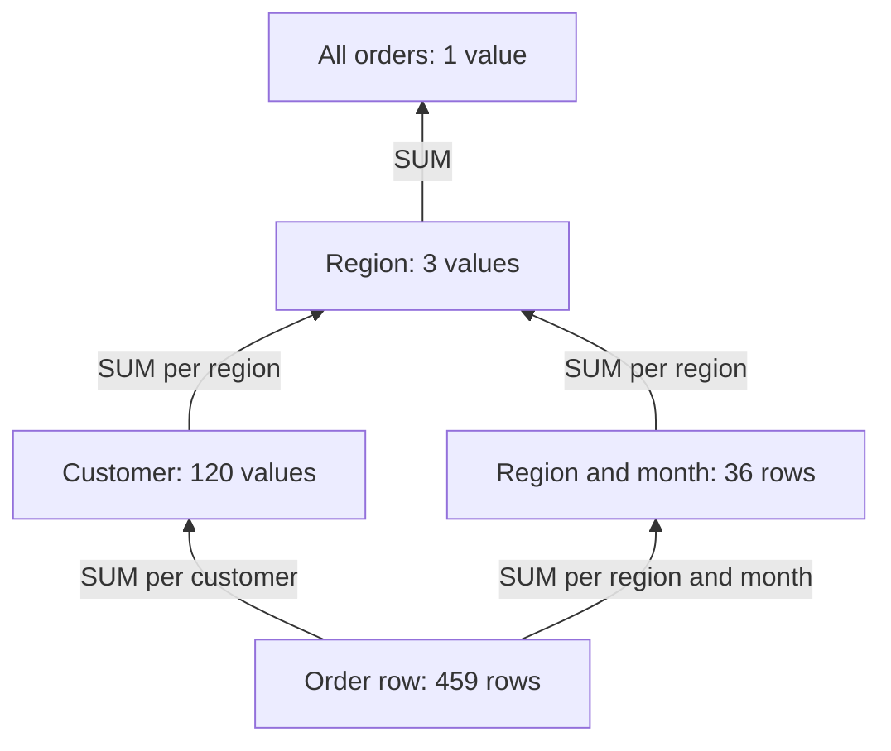
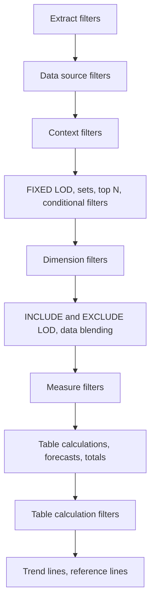

# Tableau LOD expressions in SQL

How do you compute a number at a different level of detail from the chart it sits in, such as each customer's first order month in a chart by month, or a region's total in a chart by customer?

## Before you start

- **Level:** 2 (intermediate).
- **Time:** about 2 hours.
- **Builds on:** [GROUP BY from raw rows](../../01-sql/01-group-by-from-raw-rows/), [Window functions](../../01-sql/03-window-functions/) (`SUM(...) OVER (PARTITION BY ...)`) and [DAX measures from scratch](../02-dax-measures-from-scratch/) (filters as WHERE, visual fields as GROUP BY).
- **You need:** Python 3.9 or newer. No Tableau: every expression is rebuilt in sqlite3 SQL, and the Tableau version is shown next to it as a reference.

## The problem

You are the analyst at Kestrel Outdoor, a shop that sells hiking gear to 120 customers in three regions: Alpine, Coast and Lakes. Sofia, the marketing manager, has a Tableau workbook with three questions she cannot get right before Friday's campaign review: how many new customers arrived each month, how much a typical customer spends in each region, and what share of the region's sales each month and each customer brings. Her first try counted distinct customers per month, which counts every returning customer again. Tableau answers these with level of detail (LOD) expressions. You will rebuild each one in SQL, so you know exactly what the workbook should show.

## In plain words

Think of a school's marks. One row is one test mark. You can add marks up per student, per class or for the whole school. That choice is the **level of detail**: which rows get added together.

- A report card page for one class shows one line per student. If you want the class average printed on every student's line, you compute it at class level, then copy it onto each line. Tableau calls that **FIXED** at class: the number is pinned to a level you name, whatever the page shows.
- To get "the average student's total" for each class, you first add each student's marks (one step finer than the page), then average the students. That is **INCLUDE** student.
- On a page with one line per class and term, you might want the class's whole-year total next to each term. You drop the term from the grouping (one step coarser). That is **EXCLUDE** term.

In Tableau, the **view** is the chart you build, and its level of detail is the set of dimensions on rows, columns and the marks card (a **dimension** is a field you group by, such as region or month; a **measure** is a number you add up). A plain `SUM([Amount])` is computed at the view's level. An LOD expression is computed at another level and handed back to the view.

## What you will build from scratch

- `FIXED` at customer: each customer's first order month, and new customers per month from it.
- `INCLUDE` customer: the average customer's total sales in each region, which is not the average order.
- `EXCLUDE` month: each month's share of its region's full year.
- `FIXED` at region in a view by customer: each customer's share of their region.

The data in `data/` is synthetic. `make_data.py` builds it with a fixed random seed: 459 orders in 2025 from 120 customers.

## The idea

### The granularity ladder

Every number lives on a rung of a ladder. Going up adds rows together. Customers belong to exactly one region here, so the ladder is clean.



The three LOD keywords say where to compute, relative to the view:

| Expression | View | Computes at | Then |
|---|---|---|---|
| `{FIXED [Customer ID] : MIN([Order Date])}` | any | customer, whatever the view shows | used as a value or a dimension (first order month) |
| `{INCLUDE [Customer ID] : SUM([Amount])}` | region | region plus customer, one rung finer | the view aggregates it back up, here with `AVG` |
| `{EXCLUDE [Month] : SUM([Amount])}` | region and month | region, one rung coarser | the region total repeats on every month row |
| `{FIXED [Region] : SUM([Amount])}` | customer | region, one rung coarser | the region total repeats on every customer row |

In SQL, a level of detail is a GROUP BY:

- **FIXED** at a level: a `GROUP BY` that level in a subquery, then join or aggregate its result.
- **INCLUDE**, finer than the view: `GROUP BY region, customer_id` in an inner query, then `GROUP BY region` with `AVG` outside.
- **EXCLUDE** or a coarser FIXED, next to finer rows: a window, `SUM(sales) OVER (PARTITION BY region)`, which keeps the rows and repeats the coarser total on each.

### Tableau's order of operations

Tableau applies filters and calculations in a fixed order, from top to bottom ([Tableau's Order of Operations](https://help.tableau.com/current/pro/desktop/en-us/order_of_operations.htm), Tableau help, read 31 October 2026):



The interview point: `FIXED` is computed before ordinary dimension filters, so filtering the view to December does not change a FIXED value. Only a context filter, which runs earlier, does. `INCLUDE` and `EXCLUDE` come after dimension filters, so they respect them. In SQL you choose the same thing by where the WHERE clause sits: inside the subquery that does the FIXED grouping (a context filter) or outside it (a dimension filter).

## Walk through

Each query runs on the `orders` table. The block under each query is what sqlite3 returns.

Step 1. FIXED at customer. Customer C001 ordered four times, first in November 2025, so the first order month is `2025-11` on every one of C001's rows. The first five customers:

```sql
SELECT customer_id, MIN(substr(order_date, 1, 7)) AS first_order_month
FROM orders
GROUP BY customer_id
ORDER BY customer_id
LIMIT 5
```

```text
customer_id  first_order_month
C001         2025-11
C002         2025-03
C003         2025-09
C004         2025-10
C005         2025-07
```

Step 2. New customers per month. Count customers by their first month.

```sql
SELECT first_order_month, COUNT(*) AS new_customers
FROM (
  SELECT customer_id, MIN(substr(order_date, 1, 7)) AS first_order_month
  FROM orders
  GROUP BY customer_id
) firsts
GROUP BY first_order_month
ORDER BY first_order_month
```

```text
first_order_month  new_customers
2025-01            14
2025-02            13
2025-03            13
2025-04            12
2025-05            7
2025-06            11
2025-07            14
2025-08            4
2025-09            9
2025-10            13
2025-11            10
```

The months add up to 120, one per customer. No customer is new in December: every start date in this data falls before it.

Step 3. INCLUDE customer. Sum per customer first, then average the customers in each region.

```sql
SELECT region, COUNT(*) AS customers, ROUND(AVG(customer_sales), 2) AS avg_customer_sales
FROM (
  SELECT region, customer_id, SUM(amount) AS customer_sales
  FROM orders
  GROUP BY region, customer_id
) per_customer
GROUP BY region
ORDER BY region
```

```text
region  customers  avg_customer_sales
Alpine  41         526.65
Coast   40         477.45
Lakes   39         504.31
```

The average Alpine customer spent 526.65 in 2025.

Step 4. EXCLUDE month. Group to region and month, then put the region total on every row with a window. The first three rows:

```sql
SELECT region, year_month, ROUND(sales, 2) AS sales,
  ROUND(SUM(sales) OVER (PARTITION BY region), 2) AS region_sales,
  ROUND(sales / SUM(sales) OVER (PARTITION BY region), 4) AS pct_of_region
FROM (
  SELECT region, substr(order_date, 1, 7) AS year_month, SUM(amount) AS sales
  FROM orders
  GROUP BY region, year_month
) monthly
ORDER BY region, year_month
LIMIT 3
```

```text
region  year_month  sales   region_sales  pct_of_region
Alpine  2025-01     461.15  21592.84      0.0214
Alpine  2025-02     804.26  21592.84      0.0372
Alpine  2025-03     996.89  21592.84      0.0462
```

Alpine's year is 21,592.84, and January 2025 is 0.0214 of it.

Step 5. FIXED at region in a view by customer. The same window, one level down. The top three customers:

```sql
SELECT customer_id, region, ROUND(customer_sales, 2) AS customer_sales,
  ROUND(SUM(customer_sales) OVER (PARTITION BY region), 2) AS region_sales,
  ROUND(customer_sales / SUM(customer_sales) OVER (PARTITION BY region), 4) AS share_of_region
FROM (
  SELECT customer_id, region, SUM(amount) AS customer_sales
  FROM orders
  GROUP BY customer_id, region
) per_customer
ORDER BY region, customer_sales DESC, customer_id
LIMIT 3
```

```text
customer_id  region  customer_sales  region_sales  share_of_region
C092         Alpine  1582.27         21592.84      0.0733
C055         Alpine  1410.22         21592.84      0.0653
C034         Alpine  1400.02         21592.84      0.0648
```

C092 is Alpine's biggest customer at 1,582.27, which is 0.0733 of the region.

### The same calculations in Tableau (reference only, not run in this course)

```tableau
// Step 1: First Order Month. Put it on Columns as a continuous month,
// and COUNTD([Customer ID]) on Rows for step 2.
DATETRUNC('month', {FIXED [Customer ID] : MIN([Order Date])})

// Step 3: in a view with Region on Rows, use AVG of this field.
{INCLUDE [Customer ID] : SUM([Amount])}

// Step 4: in a view with Region on Rows and the order month on Columns as an
// exact date (MONTH-YEAR, so May 2025 and May 2026 stay apart).
// The robust version names the level to keep:
SUM([Amount]) / SUM({FIXED [Region] : SUM([Amount])})
// The EXCLUDE version names the level to drop. Its date expression must match
// the month pill in the view, or Tableau does not treat them as the same field:
SUM([Amount]) / SUM({EXCLUDE DATETRUNC('month', [Order Date]) : SUM([Amount])})

// Step 5: in a view with Customer ID on Rows.
SUM([Amount]) / SUM({FIXED [Region] : SUM([Amount])})
```

`SUM` around a coarser LOD does not multiply it: Tableau repeats the value once per mark, and changing the aggregation to AVG or MIN gives the same result ([Overview: Level of Detail Expressions](https://help.tableau.com/current/pro/desktop/en-us/calculations_calculatedfields_lod_overview.htm), read 31 October 2026). Tableau's help also warns that a date expression typed by hand inside an LOD may not match the field on the shelf ([Create Level of Detail Expressions](https://help.tableau.com/current/pro/desktop/en-us/calculations_calculatedfields_lod.htm), read 31 October 2026). That is why the FIXED version is the safer choice for step 4. Check the EXCLUDE version in Tableau before you publish it. The FIXED and EXCLUDE versions also differ on filters: a dimension filter on month changes the EXCLUDE total but not the FIXED one.

Power BI does the same with `CALCULATE` and filter removal: `ALLEXCEPT(orders, orders[region])` plays the part of FIXED at region.

## Common mistakes

**1. Counting active customers as new customers (Sofia's first try).** Distinct customers per month counts every returning customer again.

```sql
SELECT substr(order_date, 1, 7) AS year_month, COUNT(DISTINCT customer_id) AS active_customers
FROM orders
GROUP BY year_month
ORDER BY year_month
LIMIT 3
```

```text
year_month  active_customers
2025-01     14
2025-02     17
2025-03     16
```

February 2025 had 17 active customers but only 13 new ones (step 2). Over the year the active counts add up to 322 for 120 customers, because one customer is counted in every month they buy.

**2. Averaging orders when the question is about customers.**

```sql
SELECT region, ROUND(AVG(amount), 2) AS avg_order
FROM orders
GROUP BY region
ORDER BY region
```

```text
region  avg_order
Alpine  135.8
Coast   125.65
Lakes   132.89
```

The average Alpine order is 135.80, but the average Alpine customer spent 526.65, because customers place several orders. `AVG([Amount])` in a view by region is the first number. The INCLUDE expression gives the second.

**3. Filtering before you find the first order.** Sofia filters the view to December and asks how many new customers came in. If the first order month is computed after the filter (a dimension filter with INCLUDE, or in SQL a WHERE inside the subquery), every December buyer looks new.

```sql
SELECT
  (SELECT COUNT(*) FROM (
     SELECT customer_id, MIN(substr(order_date, 1, 7)) AS m FROM orders GROUP BY customer_id
   ) WHERE m = '2025-12') AS new_in_december,
  (SELECT COUNT(*) FROM (
     SELECT customer_id, MIN(substr(order_date, 1, 7)) AS m FROM orders
     WHERE substr(order_date, 1, 7) = '2025-12' GROUP BY customer_id
   )) AS wrong_new_in_december
```

```text
new_in_december  wrong_new_in_december
0                44
```

0 against 44. FIXED is computed before dimension filters precisely so this does not happen. In SQL, find each customer's first order on all the data, then filter.

**4. An EXCLUDE that does not match the view.** `{EXCLUDE MONTH([Order Date]) : ...}` names the month of the year (1 to 12), while a view with exact months (May 2025) uses a different date field. If the expression does not match a dimension in the view, there is nothing to exclude, and the "region total" can quietly equal the month's own sales. Check the numbers in Tableau, and prefer `{FIXED [Region] : ...}` when you know the level you want, as in the reference block.

## Your turn

Open `exercise.sql` and write `customer_first_month`, `new_customers_by_month`, `avg_customer_sales_by_region`, `region_month_share` and `customer_share_of_region`.

```
python3 test_lesson.py
```

Run it from this folder. The test recomputes each level of detail with Python dictionaries over the raw orders. It runs every check on the committed data, on a second dataset from `make_data.build()` with another seed, on a six order table with a tie and a one-customer region, and on an empty table.

Optional, in Tableau: connect to `data/orders.csv`, build the view for step 5 with the FIXED expression from the reference block, and check that C092 shows 0.0733 of Alpine.

## Check yourself

1. What is the difference between FIXED, INCLUDE and EXCLUDE?
2. Why is the average customer's sales different from the average order value?
3. You filter a Tableau view to one month and a FIXED value does not change. Why, and how do you make it change?
4. How would you write `{EXCLUDE [Month] : SUM([Amount])}` in SQL without a window function?

<details>
<summary>Answers</summary>

1. FIXED computes at exactly the dimensions you list and ignores the view. INCLUDE computes at the view's dimensions plus the ones you list, so it is finer than the view. EXCLUDE computes at the view's dimensions minus the ones you list, so it is coarser.
2. Customers place more than one order. The order average divides total sales by orders, the customer average divides by customers. In Alpine that is 135.80 against 526.65.
3. FIXED is computed before ordinary dimension filters. Add the filter to context (context filters run before FIXED), or use INCLUDE or EXCLUDE, which come after dimension filters. In SQL, the filter must sit inside the subquery that does the FIXED grouping.
4. Compute region totals in a GROUP BY region subquery and join it back to the region and month rows on region.

</details>

## What to tell the stakeholder

"New customers per month add up to 120 for 2025, one per customer, and February brought 13 new customers, not the 17 the workbook showed: the old count included returning buyers. The average Alpine customer spent 526.65 over the year, about four orders' worth at 135.80 per order. These are first orders by order date, so a customer who bought before 2025 would be counted as new in this data."

## In real job postings

In the Real Analyst Jobs data drop of 25 October 2026, the US had 2,789 analyst postings. Of the 2,056 that list tools, 36% ask for Tableau and 24% for Power BI, so Tableau leads in the US ([data/job-market/2026-10](../../../data/job-market/2026-10/)). See the [Tableau skills page](https://realanalystjobs.com/skills/tableau) and the [US analyst jobs page](https://realanalystjobs.com/jobs/data-analyst-jobs-in-usa).

## Next

[04 Draw a chart from scratch](../04-draw-a-chart-from-scratch/)
