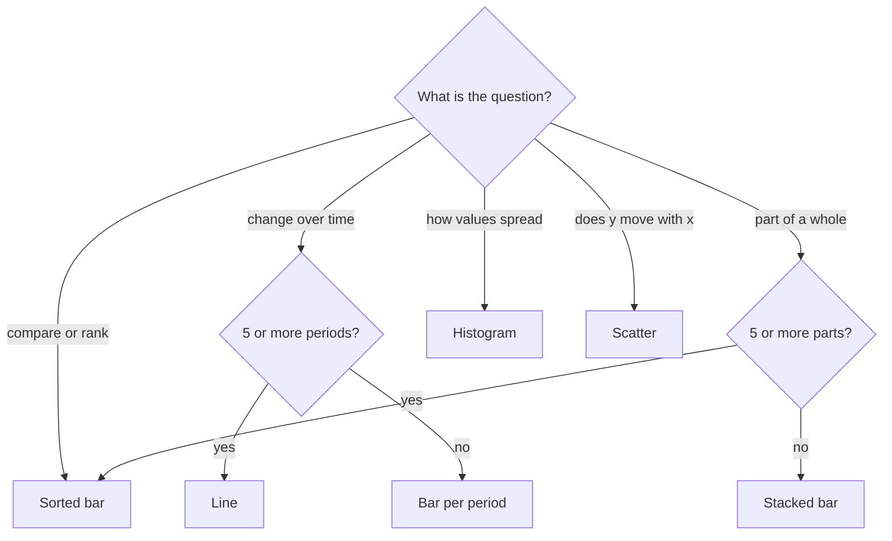
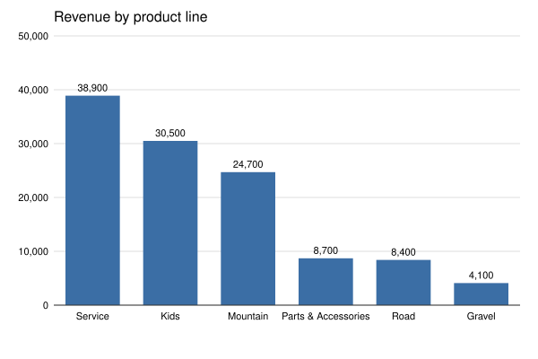
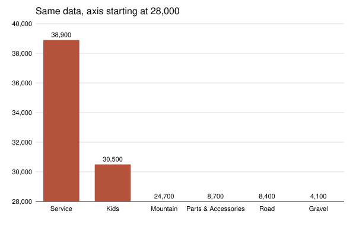

# Draw a chart from scratch

What does a dashboard tool do when it turns a table into a bar chart, and which chart should you pick in the first place?

## Before you start

- **Level:** 1 (beginner).
- **Time:** about 2 hours.
- **Builds on:** nothing from the SQL lessons. It is the one lesson in this phase written in Python.
- **You need:** Python 3.9 or newer. Nothing to install.

**Just enough Python.** This lesson uses Python before the [Python phase](../../05-python-for-analysts/) teaches it. You will meet a list (`[a, b, c]`), a pair of values called a tuple (`("Kids", 30500)`), a function (`def name(...):`), a `for` loop, `%` to put numbers into text, and `csv.DictReader` to read a CSV file. Each step below explains the line it uses. If these look new, the Python first steps in [Start here](../../00-start-here/) cover them in an hour, then come back.

## The problem

You are the analyst at Juniper Bikes, a bike shop with six product lines. Leo, the owner, wants revenue by product line on one slide for the bank meeting on Wednesday, and he has asked for it "in 3D, with the axis zoomed in so the differences pop". Power BI and Tableau draw bars for you, but they also let you make every one of those mistakes. You will write the chart yourself in plain Python, as an SVG file, so you know what every pixel means: the axis scale, the bar order, the labels and the zero line. Then you will explain to Leo why the chart is flat and starts at zero.

## In plain words

Imagine a class photo where the children stand against a height chart on the wall. You can compare them because everyone stands on the same floor. Now crop the bottom half of the photo away: a child who is a little taller suddenly looks twice as tall, because you only see the top of each head. A bar chart whose axis does not start at zero is that cropped photo.

- An **axis** is the ruler along the side of a chart. A **tick** is a marked number on it. The **baseline** is the zero line the bars stand on.
- A **bar chart** shows each value as a bar. Its length is the value, measured from zero.
- **SVG** (scalable vector graphics) is an image written as text. A browser reads lines such as `<rect x="100" y="50" width="60" height="200"/>` and draws a rectangle. GitHub shows SVG files as pictures.
- A **pixel** is one dot of the image. This chart is 600 pixels wide and 400 tall.

## What you will build from scratch

- `nice_max`: round the largest value up to a readable axis maximum (50,000, not 38,900).
- `axis_ticks`: evenly spaced ticks from zero to that maximum.
- `sort_rows`: largest bar first, with a stable tie breaker.
- `bar_chart_svg`: an SVG bar chart with a title, gridlines, tick labels, bars that start at zero, value labels and category labels.
- `choose_chart`: a first-pass chart choice for six common questions, as a decision table.

The data in `data/` is synthetic. `make_data.py` builds it with a fixed random seed: revenue for six product lines.

## The idea

### Choosing the chart

Pick the chart from the question, before the tool. `choose_chart` writes these rules as code:



- **Comparing or ranking categories** (which product line sells most): bars, sorted. Each value becomes the position of a bar's end along one shared axis, so the reader compares every value against the same ruler.
- **Change over time** (how revenue moved by month): a line. Time is ordered, and the slope shows the change. With only a few periods that are separate totals, such as four quarters, bars are fine.
- **Part of a whole** (how revenue splits by channel): with two to four parts, one stacked bar shows the split. With five or more, the slices get too thin to compare, so use sorted bars of each part.
- **Distribution** (how order sizes spread): a histogram, which counts how many values fall into each range.
- **Relationship** (do bigger discounts bring bigger orders): a scatter plot, one dot per item.
- **No 3D.** Perspective makes the front bars look bigger than the back ones and hides values behind other bars. The extra dimension carries no data.
- **No dual axes without a reason.** Two y axes with different scales let you make any two lines look related by stretching one of them. Use two charts side by side, or index both series to 100, unless the two measures are tightly linked and the reader knows both scales.
- **Bars start at zero.** A bar's length is the value. If the axis starts at 28,000, a bar for 38,900 looks four times as long as a bar for 30,500, when it is about 1.3 times as large. A line chart may zoom in, because a line encodes position and slope, not length.

What `choose_chart` does not cover: it is a checklist for six common questions, not a designer. It does not know your audience, how many series you have, whether the labels are long, or whether a plain table would serve better than any chart. Maps, heatmaps, small multiples and pie charts are not in it. The thresholds (5 periods, 5 parts) are judgment calls, written down so they can be tested and argued with.

### Drawing it

An SVG is text. A bar is a rectangle: `<rect x y width height>`. SVG's y axis points down, so y = 0 is the top of the image. That gives the three formulas the whole chart rests on:

```
axis_max   = nice_max(largest value)
bar height = value / axis_max * PLOT_HEIGHT
bar y      = BASELINE - bar height          (BASELINE is the y of the zero line)
```

`nice_max` picks the smallest number at least as big as the largest value of the form m x 10^k with m in 1, 2, 2.5 or 5. For 38,900 that is 50,000. Five equal steps then put ticks on 0, 10,000, 20,000, 30,000, 40,000 and 50,000.

The contract the test checks, with the image 600 by 400:

| Constant | Value | Meaning |
|---|---|---|
| `LEFT`, `TOP` | 60, 40 | margins for tick labels and the title |
| `PLOT_WIDTH`, `PLOT_HEIGHT` | 520, 300 | the area the bars live in |
| `BASELINE` | 340 | `TOP + PLOT_HEIGHT`, the zero line |

Each bar gets a slot of `PLOT_WIDTH / number of bars`, and fills the middle 70% of it.

## Walk through

Run each block from this folder, in order, in one Python session (type `python3`, then paste). The block under each one is what it prints.

Step 1. Load the table and sort it. `csv.DictReader` reads each line of the file as a dictionary keyed by the header, so `r["revenue"]` is the revenue column as text, and `int(...)` turns it into a number. `sorted(..., key=...)` sorts by whatever the key function returns. The `lambda r: (-r[1], r[0])` is a one-line function: minus the value (so the largest comes first), then the label (so ties come out A to Z).

```python
import csv

with open("data/product_line_revenue.csv", newline="") as f:
    rows = [(r["product_line"], int(r["revenue"])) for r in csv.DictReader(f)]

rows = sorted(rows, key=lambda r: (-r[1], r[0]))
print(rows)
```

```text
[('Service', 38900), ('Kids', 30500), ('Mountain', 24700), ('Parts & Accessories', 8700), ('Road', 8400), ('Gravel', 4100)]
```

Service leads at 38,900, then Kids at 30,500 and Mountain at 24,700. Sorting is a design decision: unsorted bars make the reader do the ranking. The tie breaker keeps the order the same on every run when two values are equal.

Step 2. A nice axis maximum. Find the power of ten just below the value, then try 1, 2, 2.5, 5 and 10 times it.

```python
def nice_max(value):
    if value <= 0:
        return 1
    power = 1.0
    while power * 10 <= value:
        power *= 10
    while power > value:
        power /= 10
    for m in (1, 2, 2.5, 5, 10):
        if m * power >= value:
            return m * power

print(nice_max(38900), nice_max(42), nice_max(1234), nice_max(0.3))
```

```text
50000.0 50.0 2000.0 0.5
```

The second `while` loop matters for values below 1: for 0.3 it walks the power down from 1 to 0.1.

Step 3. Scale a bar, and see what a truncated axis does. `rows[:2]` is the first two rows; `for label, value in ...` unpacks each pair.

```python
PLOT_HEIGHT, BASELINE = 300, 340
axis_max = nice_max(38900)
for label, value in rows[:2]:
    h = value / axis_max * PLOT_HEIGHT
    print(label, "height", round(h, 2), "y", round(BASELINE - h, 2))

honest = 38900 / 30500
truncated = (38900 - 28000) / (30500 - 28000)
print("Service vs Kids, true ratio", round(honest, 2), "ratio of bar lengths from 28,000:", round(truncated, 2))
```

```text
Service height 233.4 y 106.6
Kids height 183.0 y 157.0
Service vs Kids, true ratio 1.28 ratio of bar lengths from 28,000: 4.36
```

Service is 233.4 pixels tall and Kids is 183.0. With the axis starting at 28,000, Service's bar would be 4.36 times as long as Kids', for a real gap of 1.28 times.

Step 4. Write one bar as SVG. Text inside a tag goes through `escape`, which turns `&` into `&amp;`. A value inside an attribute (`data-label=...`) goes through `quoteattr`, which also adds the surrounding quotes and copes with a `"` inside the label. Without them, the label `Parts & Accessories` makes the file invalid XML and the browser refuses to draw it.

```python
from xml.sax.saxutils import escape, quoteattr

label, value = "Parts & Accessories", 8700
h = value / axis_max * PLOT_HEIGHT
bar = '<rect class="bar" data-label=%s x="%.2f" y="%.2f" width="%.2f" height="%.2f"/>' % (quoteattr(label), 100, BASELINE - h, 60.67, h)
print(bar)
print(escape(label), quoteattr('The "Pro" line'))
```

```text
<rect class="bar" data-label="Parts &amp; Accessories" x="100.00" y="287.80" width="60.67" height="52.20"/>
Parts &amp; Accessories 'The "Pro" line'
```

`%s` and `%.2f` are slots in the text: `%s` takes the value as it is, `%.2f` a number with two decimals. `quoteattr` chose single quotes for the label that contains double quotes, so the XML stays valid.

Step 5. Put it together. Wrap the pieces in an `<svg>` element, draw the gridlines and ticks first so the bars sit on top, then each bar with its value above and its label below, then the zero line. Check that the result parses as XML.

```python
import xml.etree.ElementTree as ET

parts = ['<svg xmlns="http://www.w3.org/2000/svg" width="600" height="400">', bar,
         '<line class="baseline" x1="60" x2="580" y1="340" y2="340" stroke="#333"/>', "</svg>"]
svg = "\n".join(parts)
ET.fromstring(svg)  # raises an error if the SVG is not valid XML
print(len(svg), "characters of valid SVG")
```

```text
254 characters of valid SVG
```

`bar_chart_svg` in the exercise does this for every row, with the exact class names listed in its docstring.

Step 6. Draw both charts to files. `draw_charts.py` calls `bar_chart_svg` for the honest chart, and draws the same bars on an axis from 28,000 for comparison. Once your exercise passes, run it on your own code:

```
python3 draw_charts.py
```

It writes `my_chart.svg` and `my_chart_truncated_axis.svg`; open them in a browser. The two images below were made the same way from the worked answer, with `CHECK_SOLUTION=1 python3 draw_charts.py`:

| Bars from zero (honest) | Axis from 28,000 (misleading) |
|---|---|
|  |  |

On the right, Service looks four times the size of Kids, and four product lines vanish because they are below the axis floor.

### The same chart in Power BI and Tableau (reference only, not run in this course)

```text
Power BI: Clustered column chart. X axis = product_line, Y axis = Sum of revenue.
  More options (...) > Sort axis > Sum of revenue, Sort descending.
  Format > Y axis > Range > Minimum = 0. Data labels = On.

Tableau: product_line on Columns, SUM(revenue) on Rows, mark type Bar.
  Sort descending by SUM(revenue). Edit Axis > Include zero (on by default).
  Label marks with SUM(revenue).
```

Both tools start a bar axis at zero by default. Both let you override it, which is the change to refuse.

## Common mistakes

**1. Zooming the axis of a bar chart (the trap).** Step 3 and the pictures above show it on this data: from 28,000, Service's bar is 4.36 times as long as Kids', for a real ratio of 1.28. The numbers on the bars are still right, which is why nobody notices. If small differences matter, show them as a separate number or use a dot plot or line, which encode position, not length.

**2. Forgetting to escape labels.** One `&` in a product name and the SVG does not draw at all. A `"` inside an attribute breaks it too, which is why attributes use `quoteattr`.

**3. Bars that hang from the top.** SVG's y grows downward. If you set `y = value / axis_max * PLOT_HEIGHT`, tall values end up low on the image. The bar's top is `BASELINE - height`.

**4. Sorting alphabetically by habit.** Alphabetical order makes the reader hunt for the biggest bar. Sort by value, unless the categories have a natural order (sizes, age bands, months) or people look up a known name.

## Your turn

Open `exercise.py` and fill in `nice_max`, `axis_ticks`, `sort_rows`, `choose_chart` and `bar_chart_svg`. The constants and the `fmt` number formatter are already there.

```
python3 test_lesson.py
```

Run it from this folder. The test parses your SVG as XML and checks the bar order, every bar's height against the axis, that every bar starts at the zero line, that `data-value` is the input value, the tick labels, the value and category labels, and that negative values are refused. It draws the chart for the committed data, for a second dataset from `make_data.build()` whose axis tops out at 25,000, for a tie with quotes in a label, for one bar and for all zeros, and it checks `choose_chart` on the boundary cases (four periods, five parts).

Stretch: write `line_chart_svg(points, title)` for twelve months of revenue, where the axis may start above zero, and draw it with the same constants.

## Check yourself

1. When is it fine for an axis not to start at zero?
2. A stakeholder wants revenue and conversion rate on one chart with two y axes. What do you suggest?
3. Why sort a bar chart by value instead of alphabetically?
4. Your chart has twelve months on the x axis. Bars or a line?

<details>
<summary>Answers</summary>

1. On a line chart or a dot plot, which encode values by position, not length. Small changes in a large number, such as a temperature or a stock price, are readable there. Bars must start at zero because their length is the value.
2. Two charts aligned on the same x axis, or one chart with both series indexed to 100. A dual axis lets the scale choice invent a correlation, so use it only when the reader already knows both measures and the link between them.
3. The question is usually which is biggest and by how much. Sorted bars answer it without the reader scanning back and forth. Sort alphabetically only when people look up a known category, and keep a natural order (sizes, age bands, months) when the categories have one.
4. A line, because time is ordered and the question is about the trend. Bars for time are acceptable for a few periods where each is a separate total, such as four quarters.

</details>

## What to tell the stakeholder

"Service is our biggest line at 38,900, about 1.28 times Kids at 30,500, and Mountain is third at 24,700. I kept the chart flat and the axis at zero: zoomed in from 28,000, the same numbers would make Service look more than four times bigger than Kids and hide four of the six lines, and the bank will read the bars, not the labels."

## In real job postings

In the Real Analyst Jobs data drop of 25 October 2026, the US had 2,789 analyst postings. Of the 2,056 that list tools, 36% ask for Tableau, 24% for Power BI and 48% for Python. In India, Power BI leads Tableau, 39% to 34% ([data/job-market/2026-10](../../../data/job-market/2026-10/)). See the [Power BI vs Tableau study](https://realanalystjobs.com/research/power-bi-vs-tableau-job-postings-2026) and [Python data analyst jobs](https://realanalystjobs.com/jobs/python-data-analyst-jobs).

## Next

[05 Python for analysts](../../05-python-for-analysts/)
