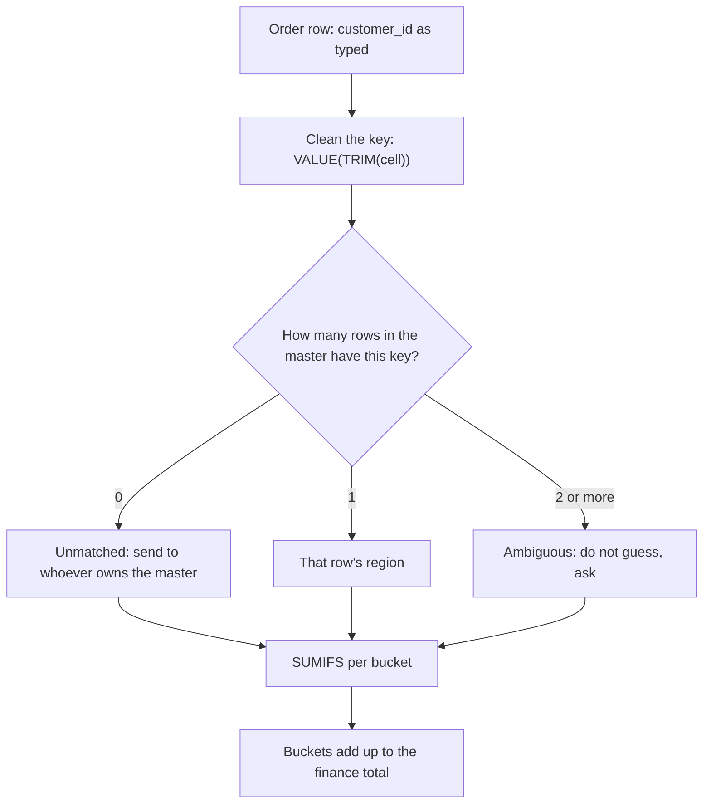

# Lookups and SUMIFS like Excel

Why does the VLOOKUP total not match finance?

## Before you start

- **Level:** 1 (beginner). About 2 hours.
- **You need:** Python 3.9 or newer. Nothing to install. Excel or Google Sheets only for the optional export task.
- **Builds on:** [06 Python for spreadsheet people](../../00-start-here/06-python-for-spreadsheet-people/) (a list of rows, a loop, your own SUMIF) and [02 Joins without losing rows](../../01-sql/02-joins-without-losing-rows/) (a key, an unmatched row, a duplicate key). A lookup is a join written as a formula.

## The problem

Larkspur Coffee, a fictional coffee chain, also sells beans wholesale to about 55 cafe accounts in four regions. Every month Sam, the sales lead, takes the October order export, adds each order's region with a VLOOKUP against the customer master, and totals the regions with SUMIFS. This month the four regions add up to 128,246.29, but finance says October wholesale revenue was 166,447.25. Sam's regional bonuses are paid from his sheet, so the gap is about 38,000 in someone's pocket. He needs to know by Friday which number is right and why the other one is not.

The files in `data/` are synthetic, built by `make_data.py` with a fixed seed: `orders.csv` (358 orders) and `customers.csv` (56 rows).

## In plain words

Think of the contacts on your phone. Someone texts you from a number, and the phone looks the number up to show a name. If the number was saved as `+91 98200 12345` and the text arrives from `9820012345`, the phone shows no name, even though it is the same person. If you saved the same number twice, once as "Ravi work" and once as "Ravi gym", the phone shows whichever it finds first. And if you ask it for "the closest number to this one", it will happily show you a stranger's name.

A spreadsheet lookup has the same three problems.

- A **lookup** finds a key in one table and returns another column from the same row. VLOOKUP and XLOOKUP are Excel's lookup functions.
- A **key** is the column that says which row is which, here `customer_id`.
- The **customer master** is the one table that is supposed to hold every customer once.
- **Exact match** returns a row only when the key is equal. **Approximate match** returns the row with the largest key that is not bigger than the one you asked for, and only makes sense on a sorted column.
- **#N/A** is what Excel shows when a lookup finds nothing.
- **SUMIFS** adds up the numbers in one column on the rows where every condition holds, for example "amount where region is North".
- A **number stored as text** looks like `1042` but is text, so it never equals the number 1042. A **trailing space** is an invisible space at the end of a cell: `1042 ` is not `1042`.
- To **reconcile** is to show that two numbers that should agree do agree, or to explain every unit of the gap.

## What you will build from scratch

- `vlookup`: exact match (first match wins) and approximate match (largest key at or below), with `#N/A` and `#REF!`.
- `xlookup`: exact match with an `if_not_found` value.
- `normalize_key`: the Excel fix `=VALUE(TRIM(cell))` in Python.
- `sumifs`: several conditions joined with AND, text and blank cells skipped.
- `naive_region_totals`: what Sam's sheet does today, so you can see the gap.
- `duplicate_keys`, `assign_region` and `region_totals`: the fixed sheet, where every order lands in exactly one bucket and the buckets add up to finance.

## The idea

Finance adds the `amount` column. Sam adds the same column, but only on rows where his lookup found a region. So the region totals equal finance only if every order finds exactly one region. Four things break that:

1. **Text keys.** Phone orders are typed in by hand, and the id lands as text (`"1042"`). VLOOKUP compares a number with text and finds nothing: `#N/A`.
2. **Trailing spaces.** Some typed ids also carry a space (`"1042 "`). Also `#N/A`.
3. **Keys missing from the master.** Two new accounts ordered before anyone added them. `#N/A` is the honest answer here.
4. **Duplicate keys.** Customer 1032 is in the master twice, once in East and once in South, because it moved and the old row was never deleted. Exact match takes the first row and never tells you there was a second.

SUMIFS by region quietly ignores every `#N/A` row, because `#N/A` is not "North". Nothing on the sheet looks wrong. The money is just not in any region.

The fix is to clean the key on both sides first, then send every order to exactly one bucket:



The last box is the check that makes the sheet trustworthy: one extra cell that subtracts the finance total from the sum of the buckets and must show 0.

**Exact or approximate.** Approximate match is not a broken exact match. It is the right tool for bands: discount tiers, tax slabs, commission rates, where you want "the band this quantity falls in". It is the wrong tool for ids, because a missing id gets its neighbour's answer instead of `#N/A`. VLOOKUP uses approximate match when you leave out the fourth argument, and Microsoft's help page says the first column must then be sorted ([VLOOKUP function](https://support.microsoft.com/en-us/office/vlookup-function-0bbc8083-26fe-4963-8ab8-93a18ad188a1), read 31 October 2026). XLOOKUP defaults to exact match and searches first to last ([XLOOKUP function](https://support.microsoft.com/en-us/office/xlookup-function-b7fd680e-6d10-43e6-84f9-88eae8bf5929), read 31 October 2026). The same VLOOKUP page also warns about leading and trailing spaces and about numbers stored as text.

**SUMIFS.** `SUMIFS(sum_range, criteria_range1, criterion1, ...)` puts the range to add first, then pairs of range and condition, and a row counts only when every condition holds. A condition may start with an operator, such as `">=10"` or `"<>West"` ([SUMIFS function](https://support.microsoft.com/en-us/office/sumifs-function-c9e748f5-7ea7-455d-9406-611cebce642b), read 31 October 2026). Written out:

```
SUMIFS(amount, region, "North", qty, ">=10")  =  sum of amount[i] over every row i
                                                where region[i] = "North" AND qty[i] >= 10
```

Our version compares text exactly. Spreadsheets add rules of their own (the help page describes `?` and `*` wildcards), so test a condition on a few rows before trusting it.

**How the files keep numbers and text apart.** A CSV file is only text. In this lesson's files a quoted cell is text and an unquoted cell is a number, the way a spreadsheet keeps the two kinds of cell apart. Python's `csv.QUOTE_NONNUMERIC` reads them back that way: unquoted cells become floats (decimal numbers), quoted cells stay text.

## Walk through

Run each block from this folder, in order, in one Python session (type `python3`, then paste). The block under each one is what it prints.

Step 1. Read both files and look at the keys. `csv.DictReader` gives one dictionary per row, keyed by the header. `quoting=csv.QUOTE_NONNUMERIC` turns unquoted cells into numbers. `repr(...)` prints a value with its quotes, so you can see text and spaces.

```python
import csv

def read_sheet(path):
    with open(path, newline="") as f:
        return list(csv.DictReader(f, quoting=csv.QUOTE_NONNUMERIC))

orders = read_sheet("data/orders.csv")
customers = read_sheet("data/customers.csv")
print(len(orders), "orders,", len(customers), "rows in the customer master")
for o in orders[2:6]:
    print(o["order_id"], o["channel"], repr(o["customer_id"]), o["amount"])
```

```text
358 orders, 56 rows in the customer master
70003.0 web 1015.0 427.1
70004.0 phone '1001 ' 750.05
70005.0 web 1010.0 686.69
70006.0 phone '1002' 177.99
```

Web orders carry the id as a number (`1015.0`). Phone orders carry it as text (`'1002'`), and some with a space (`'1001 '`).

Step 2. The finance total, and what an exact lookup sees. `setdefault` stores a key only the first time it appears, which is exactly how exact-match VLOOKUP behaves on a duplicate key: the first row wins.

```python
finance = round(sum(o["amount"] for o in orders), 2)
print("finance total:", finance)

first_region = {}
for c in customers:
    first_region.setdefault(c["customer_id"], c["region"])
print(first_region.get(1001.0), first_region.get("1001"), first_region.get("1001 "))
```

```text
finance total: 166447.25
North None None
```

The number 1001 finds North. The text `"1001"` and the text `"1001 "` find nothing: that is a `#N/A` on Sam's sheet.

Step 3. Where the 38,200.96 went. Sort every order that found no region by the reason it failed. `k != k.strip()` is true when the text has a space at either end.

```python
found, missing = 0.0, {"text key": 0.0, "text key with a space": 0.0, "not in the master": 0.0}
for o in orders:
    k = o["customer_id"]
    if k in first_region:
        found += o["amount"]
    elif isinstance(k, str) and k != k.strip():
        missing["text key with a space"] += o["amount"]
    elif isinstance(k, str):
        missing["text key"] += o["amount"]
    else:
        missing["not in the master"] += o["amount"]
print("matched:", round(found, 2))
for reason, amount in missing.items():
    print(reason, round(amount, 2))
```

```text
matched: 128246.29
text key 20735.25
text key with a space 15304.87
not in the master 2160.84
```

128,246.29 is Sam's total. The gap to finance is 20,735.25 + 15,304.87 + 2,160.84 = 38,200.96. Only the last 2,160.84 is a real gap in the master. The rest is formatting.

Step 4. Approximate match, used well and used badly. `approx` walks a sorted first column and keeps the last row whose key is not bigger than the one asked for.

```python
bands = [[0, 0.0], [10, 0.05], [25, 0.10], [50, 0.15]]

def approx(key, table, col):
    found = "#N/A"
    for row in table:
        if row[0] > key:
            break
        found = row[col - 1]
    return found

print([approx(q, bands, 2) for q in (3, 10, 24, 25, 120)])
ids = [[c["customer_id"], c["region"]] for c in customers]
print("1056 approximate:", approx(1056.0, ids, 2), " exact:", first_region.get(1056.0, "#N/A"))
```

```text
[0.0, 0.05, 0.05, 0.1, 0.15]
1056 approximate: West  exact: #N/A
```

On discount bands it is right: 24 bags get 5%, 25 bags get 10%. On customer ids it is wrong: 1056 is a new account that is not in the master, and approximate match hands it the region of 1055, the last row. No `#N/A`, so nobody looks.

Step 5. Clean the key, and find the duplicate. `" ".join(text.split())` trims both ends and collapses inner spaces, like Excel's TRIM. `text.isdigit()` is true when the text is only digits, and `int(...)` makes it a whole number, like VALUE.

```python
def normalize_key(value):
    if isinstance(value, float):
        return int(value) if value.is_integer() else value
    text = " ".join(str(value).split())
    return int(text) if text.isdigit() else (text or None)

print(normalize_key(1042.0), normalize_key("1042"), normalize_key("1042 "), normalize_key("C-7 "))

clean_ids = [normalize_key(c["customer_id"]) for c in customers]
print("listed twice:", sorted({k for k in clean_ids if clean_ids.count(k) > 1}))
print([(c["customer_id"], c["region"]) for c in customers if c["customer_id"] == 1032])
```

```text
1042 1042 1042 C-7
listed twice: [1032]
[(1032.0, 'East'), (1032.0, 'South')]
```

All three spellings of 1042 become the same key. Customer 1032 is in East and in South. Sam's sheet put all its orders in East without a word.

Step 6. One bucket per order, then SUMIFS per bucket. `bucket` is the Python version of the formula in the next step: Ambiguous if the master lists the key twice, the region if it lists it once, Unmatched if not at all.

```python
def bucket(key):
    if clean_ids.count(key) > 1:
        return "Ambiguous"
    for k, c in zip(clean_ids, customers):
        if k == key:
            return c["region"]
    return "Unmatched"

region_col = [bucket(normalize_key(o["customer_id"])) for o in orders]
amounts = [o["amount"] for o in orders]

def sumifs(sum_range, criteria_range, criterion):
    return round(sum(v for v, c in zip(sum_range, criteria_range) if c == criterion), 2)

totals = {b: sumifs(amounts, region_col, b) for b in ["North", "South", "East", "West", "Ambiguous", "Unmatched"]}
print(totals)
print("adds up to:", round(sum(totals.values()), 2), " finance:", finance)
```

```text
{'North': 51589.95, 'South': 29991.42, 'East': 33644.08, 'West': 44452.16, 'Ambiguous': 3884.26, 'Unmatched': 2885.38}
adds up to: 166447.25  finance: 166447.25
```

The six buckets add up to finance to the cent. Unmatched (2,885.38) is larger than the 2,160.84 of step 3 because it now also holds a phone order from a new account, which the old sheet had counted as a text-key miss. Ambiguous holds every order of customer 1032, typed or not.

Step 7. The same sheet in Excel (reference only, not run in this course). Orders in a sheet called `Orders` (A order_id, B order_date, C channel, D customer_id, E amount), the master in `Customers` (A customer_id, B customer_name, C region):

```text
Sam's sheet today (F2, filled down):
  =VLOOKUP(D2, Customers!$A:$C, 3, FALSE)
Region total:
  =SUMIFS(Orders!$E:$E, Orders!$F:$F, "North")

The fixed sheet:
  G2  clean key   =VALUE(TRIM(D2))
  H2  bucket      =IF(COUNTIF(Customers!$A:$A, G2) > 1, "Ambiguous",
                      XLOOKUP(G2, Customers!$A:$A, Customers!$C:$C, "Unmatched"))
  Totals sheet, one row per bucket in column A:
  B2              =SUMIFS(Orders!$E:$E, Orders!$H:$H, A2)
  Check cell      =SUM(B2:B7) - SUM(Orders!$E:$E)        must show 0
```

VALUE also turns a text id into a number, so it works on web and phone rows alike. If the master's own ids were typed as text, clean them the same way in a helper column and look up against that column.

## Common mistakes

**1. Trusting a SUMIFS total without a check against the source (the trap).** Sam's four regions add up to 128,246.29 and every cell looks fine:

```python
import sys
sys.path.insert(0, "solution")
import solution as s

o, c = s.read_sheet("orders.csv"), s.read_sheet("customers.csv")
old = s.naive_region_totals(o, c)
print(old)
print("old sheet:", round(sum(old.values()), 2), " finance:", s.finance_total(o),
      " missing:", round(s.finance_total(o) - sum(old.values()), 2))
```

```text
{'North': 39904.1, 'South': 20471.03, 'East': 31460.67, 'West': 36410.49}
old sheet: 128246.29  finance: 166447.25  missing: 38200.96
```

23% of October is in no region, because every `#N/A` row is silently left out of every SUMIFS. North alone is short by 11,685.85. The check cell from step 7 would have shown it on day one.

**2. Leaving out the fourth argument of VLOOKUP.** Without `FALSE`, VLOOKUP does approximate match. On this data that moves money instead of dropping it:

```python
import sys
sys.path.insert(0, "solution")
import solution as s

o, c = s.read_sheet("orders.csv"), s.read_sheet("customers.csv")
print(s.naive_region_totals(o, c, exact=False))
```

```text
{'North': 39904.1, 'South': 22983.5, 'East': 28948.2, 'West': 38571.33}
```

West gains 2,160.84 from the two new accounts it does not own, and customer 1032's 2,512.47 moves from East to South, because on a duplicate key our approximate match keeps the last row and exact match keeps the first. Same formula, one argument missing, and two regions' bonuses change with no `#N/A` anywhere to warn you.

**3. Fixing the order side only.** If you TRIM and VALUE the order ids but the master was typed with text ids, nothing matches again. Clean both sides with the same rule.

**4. Picking one row of a duplicate key and moving on.** Deleting the "wrong" row of customer 1032 by eye fixes this month and hides the question: which region does the account belong to, and since when? Report it as Ambiguous and let the owner of the master decide.

## Your turn

Open `exercise.py` and fill in `vlookup`, `xlookup`, `normalize_key`, `sumifs`, `naive_region_totals`, `duplicate_keys`, `assign_region` and `region_totals`. `read_sheet`, the criterion checker `_matches` and `finance_total` are done for you. Then run, from this folder:

```
python3 test_lesson.py
```

The test checks each function on small hand-made tables (an empty table, a band boundary, a blank key, a zero amount, a duplicate key), then checks the old and the fixed region totals on the committed files and on a second dataset that `make_data.build(seed=2031)` makes in memory, with other customers and another duplicate.

**Optional: do it in a spreadsheet.** Open both CSV files in Excel or Google Sheets, build the fixed sheet from step 7, and save the totals as `my_region_totals.csv` in this folder with two columns, `region,revenue`, one row per non-empty bucket. Run the test again: it checks your spreadsheet's numbers against its own. Without the file, that test is skipped.

Stretch: add a `channel` condition to the totals and answer "how much phone revenue did the old sheet lose in each region?" with one `sumifs` call per region.

## Check yourself

1. Your VLOOKUP returns a region for every row, no `#N/A` at all. Why might the totals still be wrong?
2. When is approximate match the right choice?
3. A key looks like `1042` in both tables but the lookup fails. What two things do you check first?
4. Why send a duplicate key to an Ambiguous bucket instead of keeping the first row?

<details>
<summary>Answers</summary>

1. It may be using approximate match, which returns a neighbour's row for a missing key, or the master may have a duplicate key, and the lookup returned whichever row it met first. Check the fourth argument, count duplicate keys in the master, and compare the bucket total with the source total.
2. When the first column holds the start of bands, sorted ascending, and you want the band a value falls into: discount tiers, tax slabs, commission rates. Never for ids or names.
3. Whether one side is a number and the other is text, and whether either has a leading or trailing space. `=ISTEXT(D2)` and `=LEN(D2)` show both in a spreadsheet, `repr()` shows both in Python.
4. Because the lookup cannot know which row is right, and picking one moves money between regions without anyone deciding it. Ambiguous keeps the money visible and the question open for the person who owns the master.

</details>

## What to tell the stakeholder

"Sam, finance is right: October wholesale was 166,447.25. Your sheet showed 128,246.29 because 36,040.12 of phone orders had ids typed as text or with a stray space, and 2,160.84 came from two new accounts not yet in the customer master, so their lookups failed and SUMIFS skipped them. With the ids cleaned, the regions are North 51,589.95, South 29,991.42, East 33,644.08 and West 44,452.16. Two amounts are held back until someone decides: 3,884.26 from customer 1032, which is listed in both East and South, and 2,885.38 from the two new accounts, which need a region in the master before bonuses are paid on them."

## In real job postings

In the Real Analyst Jobs data drop of 25 October 2026 ([data/job-market/2026-10](../../../data/job-market/2026-10/)), 860 of the 2,056 US analyst postings that list tools ask for Excel (41.8%), and 411 of the 900 such India postings do (45.7%). See [Excel skills for analysts](https://realanalystjobs.com/skills/excel).

## Next

[06 Pivot tables and Power Query steps](../06-pivot-tables-and-power-query/)
