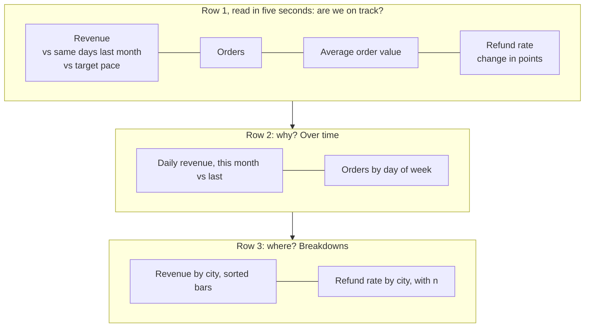
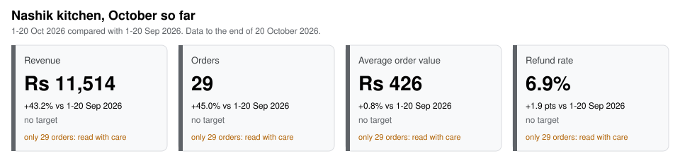

# Dashboard design and KPI cards

What should the CEO see in five seconds?

## Before you start

- **Level:** 1 (beginner). About 2 hours.
- **You need:** Python 3.9 or newer. Nothing to install.
- **Builds on:** [04 Draw a chart from scratch](../04-draw-a-chart-from-scratch/) (an SVG written by hand, and choosing a chart for a question) and [04 Automate the weekly report](../../05-python-for-analysts/04-automate-the-weekly-report/) (percent change for amounts, points for rates, and never comparing a part period with a whole one). [06 Percent, points and averages of ratios](../../03-metrics-and-product-analytics/06-percent-points-and-averages-of-ratios/) goes deeper on points.

## The problem

Tiffinbell, a fictional food delivery app with kitchens in Pune, Mumbai, Nagpur and Nashik, is building its first company dashboard. Meera, the CEO, opens it on her phone before the Wednesday leadership call and gives it about five seconds. Last week's draft had eleven charts, and its top number said "Revenue -29.7% vs September", which started a panic until someone noticed it compared 20 days of October with 30 days of September. It is Wednesday 21 October 2026, the order data runs to the end of Tuesday 20 October, and you have until the call to build the top row: the cards Meera reads first.

The files in `data/` are synthetic, built by `make_data.py` with a fixed seed: `orders.csv` (1,498 orders, 1 September to 20 October) and `targets.csv` (the monthly targets).

## In plain words

Think of a car's dashboard. You do not get a spreadsheet of engine readings while you drive. You get speed, fuel and a warning light, each in the same place every time, each readable in a glance, and each against something: the speed limit, an empty tank. A good business dashboard works the same way. A few numbers at the top, each one compared with the right thing, and a light only when something needs you.

- A **KPI** (key performance indicator) is one of the few numbers a business steers by, such as revenue.
- A **KPI card** is a box on a dashboard with one KPI: its value, what it is compared with, and how it stands against a target.
- **Month to date** (MTD) means from the 1st of this month to today, or here to the last day with data.
- A **period** is the date range a number covers. The **prior period** is the range you compare it with.
- **Percent change** is for amounts: (this - before) / before x 100. **Percentage points** (pts) are for rates: 3.2% to 2.6% is -0.6 pts.
- A **target** is the number the business planned for the month. Its **pace** is how much of it should be done by today, if it builds up evenly day by day.
- **Small n** means a number rests on few cases (n is the count), so a big swing can be luck.

## What you will build from scratch

- `period_bounds`: this month so far, and the same days of last month.
- `kpis`: revenue, orders, average order value and refund rate for any date range and city.
- `change` and `paced_target`: percent or points, and the target scaled to the days that have passed.
- `kpi_cards`: one card per KPI with its comparison, target status and a small-n flag.
- `render_svg`: the cards drawn as an SVG, with the status as a word and a colour.

## The idea

### What goes on the page

A five-second dashboard answers three questions in order: are we on track, why, and where. That order is the layout:



The design rules, each for a reason:

1. **Three to five cards, most important top left.** People read a page the way they read text, so the first card is the one that answers "are we on track". Eleven charts means the reader picks what matters, which is your job.
2. **Every number is compared with something.** "Rs 236,942" means nothing alone. Against the same days last month it says "growing", against the target pace it says "on plan".
3. **One period for the whole page, written on it.** "1-20 Oct 2026 compared with 1-20 Sep 2026" in the subtitle, and on each card. A reader should never have to guess which dates a number covers.
4. **The right unit for the change.** Percent for amounts, points for rates.
5. **Status as a word and a colour.** Some readers cannot tell red from green, and a printout may be black and white, so each card says "on track" or "behind" in words as well. Colour is for status only, not decoration.
6. **Flag small n on the card.** A city with 29 orders can move 45% on nine orders. The card says so.
7. **Definitions in one place.** Revenue here is the amount of orders not refunded. Write it once under the cards so nobody computes it a second way.

What the cards leave out on purpose: gauges, 3D, pies, sparklines with no axis, and any number the CEO cannot act on.

### The arithmetic behind a card

The comparison is only fair when both periods cover the same days:

```
as_of          = the last day with data (20 Oct)
current        = 1 Oct to 20 Oct
prior          = 1 Sep to 20 Sep            (same days, capped at the prior month's length)
                 whole previous month       (when as_of is the last day of its month)

change, amount = (current - prior) / prior x 100       None if prior is 0
change, rate   = current - prior, in points
paced target   = monthly target x as_of.day / days in the month
vs target      = value / paced target x 100            for amounts
               = value - limit, in points              for the refund rate, where lower is better
small n        = orders in the current period < 30
```

The cap matters at month ends. On 30 March, February has only 28 days, so the prior period is 1 to 28 February. On 30 April, April is complete, so it is compared with all 31 days of March.

The pace assumes the target builds up evenly across the days of the month. That is a simplification: weekends are busier for Tiffinbell. A business with a strong weekly pattern can pace by a daily plan instead. Thirty as the small-n line is a judgment call, written down so it can be argued with.

## Walk through

Run each block from this folder, in order, in one Python session (type `python3`, then paste). The block under each one is what it prints.

Step 1. Load the orders. `date.fromisoformat` turns `2026-10-20` into a date you can compare, and `r["refunded"] == "1"` turns the 0/1 column into True or False.

```python
import csv
from datetime import date

with open("data/orders.csv", newline="") as f:
    rows = [{"order_date": date.fromisoformat(r["order_date"]), "city": r["city"],
             "amount": float(r["amount"]), "refunded": r["refunded"] == "1"} for r in csv.DictReader(f)]
print(len(rows), "orders, from", min(r["order_date"] for r in rows), "to", max(r["order_date"] for r in rows))
```

```text
1498 orders, from 2026-09-01 to 2026-10-20
```

Step 2. Four KPIs for any range. `sel` is the orders in the range, `paid` the ones not refunded. A ratio with nothing to divide by is `None`, not 0.

```python
def kpis(rows, start, end, city=None):
    sel = [r for r in rows if start <= r["order_date"] <= end and (city is None or r["city"] == city)]
    paid = [r for r in sel if not r["refunded"]]
    revenue = round(sum(r["amount"] for r in paid), 2)
    return {"revenue": revenue, "orders": len(sel),
            "aov": round(revenue / len(paid), 2) if paid else None,
            "refund_rate": round(100 * (len(sel) - len(paid)) / len(sel), 2) if sel else None}

print("1-20 Oct:", kpis(rows, date(2026, 10, 1), date(2026, 10, 20)))
print("1-20 Sep:", kpis(rows, date(2026, 9, 1), date(2026, 9, 20)))
print("all Sep: ", kpis(rows, date(2026, 9, 1), date(2026, 9, 30)))
```

```text
1-20 Oct: {'revenue': 236941.55, 'orders': 608, 'aov': 400.24, 'refund_rate': 2.63}
1-20 Sep: {'revenue': 227975.01, 'orders': 602, 'aov': 391.04, 'refund_rate': 3.16}
all Sep:  {'revenue': 336999.18, 'orders': 890, 'aov': 389.14, 'refund_rate': 2.7}
```

October so far is ahead of the same 20 days of September, and far behind all of September, which had ten more days to collect orders. The second line is the fair comparison.

Step 3. The two periods. `calendar.monthrange(year, month)[1]` is the number of days in a month. January's prior month is December of the year before.

```python
import calendar

def period_bounds(as_of):
    start = as_of.replace(day=1)
    py, pm = (as_of.year - 1, 12) if as_of.month == 1 else (as_of.year, as_of.month - 1)
    prior_len = calendar.monthrange(py, pm)[1]
    month_done = as_of.day == calendar.monthrange(as_of.year, as_of.month)[1]
    last = prior_len if month_done else min(as_of.day, prior_len)
    return start, as_of, date(py, pm, 1), date(py, pm, last)

for d in (date(2026, 10, 20), date(2026, 3, 30), date(2026, 4, 30), date(2026, 1, 15)):
    print(d, "->", [str(x) for x in period_bounds(d)])
```

```text
2026-10-20 -> ['2026-10-01', '2026-10-20', '2026-09-01', '2026-09-20']
2026-03-30 -> ['2026-03-01', '2026-03-30', '2026-02-01', '2026-02-28']
2026-04-30 -> ['2026-04-01', '2026-04-30', '2026-03-01', '2026-03-31']
2026-01-15 -> ['2026-01-01', '2026-01-15', '2025-12-01', '2025-12-15']
```

Step 4. The change and the target pace. The `%+.1f` format always shows the sign.

```python
cur = kpis(rows, date(2026, 10, 1), date(2026, 10, 20))
pri = kpis(rows, date(2026, 9, 1), date(2026, 9, 20))
print("revenue change: %+.1f%%" % ((cur["revenue"] - pri["revenue"]) / pri["revenue"] * 100))
print("refund rate change: %+.2f pts" % (cur["refund_rate"] - pri["refund_rate"]))

target = 360000
pace = target * 20 / 31
print("pace by 20 Oct: %.0f  revenue is %.0f%% of pace, %.0f%% of the full month" % (
    pace, cur["revenue"] / pace * 100, cur["revenue"] / target * 100))
```

```text
revenue change: +3.9%
refund rate change: -0.53 pts
pace by 20 Oct: 232258  revenue is 102% of pace, 66% of the full month
```

Revenue is 66% of October's target, which sounds bad, and 102% of where it should be after 20 of 31 days, which is the true story.

Step 5. The cards. The worked answer's `kpi_cards` does steps 2 to 4 for every KPI and adds the status and the small-n flag. `fmt_value`, `change_text` and `target_text` turn a card into the words it shows.

```python
import sys
sys.path.insert(0, "solution")
import solution as s

targets = s.load_targets()
print(targets["2026-10"])
for card in s.kpi_cards(s.load_orders(), date(2026, 10, 20), targets):
    print("%-20s %-11s | %-24s | %s" % (card["label"], s.fmt_value(card), s.change_text(card), s.target_text(card)),
          card["status"])
```

```text
{'revenue': 360000.0, 'orders': 960.0, 'refund_rate': 4.0}
Revenue              Rs 236,942  | +3.9% vs 1-20 Sep 2026   | 102% of target pace on track
Orders               608         | +1.0% vs 1-20 Sep 2026   | 98% of target pace behind
Average order value  Rs 400      | +2.4% vs 1-20 Sep 2026   | no target None
Refund rate          2.6%        | -0.5 pts vs 1-20 Sep 2026 | 1.4 pts under the 4.0% limit on track
```

Revenue is on pace because each order is worth more (Rs 400, up 2.4%), while order count is slightly behind its pace. That is the sentence for Meera, and it fits in four cards.

Step 6. A small city. The same cards for Nashik alone. Targets are company-wide, so a city card has none.

```python
for card in s.kpi_cards(s.load_orders(), date(2026, 10, 20), targets, city="Nashik"):
    print("%-20s %-9s n=%d small_n=%s | %s" % (card["label"], s.fmt_value(card), card["n"], card["small_n"],
                                              s.change_text(card)))
print(kpis(rows, date(2026, 9, 1), date(2026, 9, 20), "Nashik"))
```

```text
Revenue              Rs 11,514 n=29 small_n=True | +43.2% vs 1-20 Sep 2026
Orders               29        n=29 small_n=True | +45.0% vs 1-20 Sep 2026
Average order value  Rs 426    n=29 small_n=True | +0.8% vs 1-20 Sep 2026
Refund rate          6.9%      n=29 small_n=True | +1.9 pts vs 1-20 Sep 2026
{'revenue': 8039.87, 'orders': 20, 'aov': 423.15, 'refund_rate': 5.0}
```

Nashik's "+45% orders" is 29 orders against 20, and its refund rate went from 1 refund in 20 orders to 2 in 29. Shown without a flag, those two numbers would lead the call. With the flag, they wait for more data.

Step 7. Draw the cards. `draw_dashboard.py` calls `kpi_cards` and `render_svg`. Once your exercise passes, run `python3 draw_dashboard.py` to draw your own (`my_chart_dashboard.svg`). The two images below were drawn from the worked answer with `CHECK_SOLUTION=1 python3 draw_dashboard.py`:




### The same cards in Power BI or Tableau (reference only, not run in this course)

```text
Power BI: a Card visual per KPI, each showing a measure such as
  Revenue MTD      = TOTALMTD([Revenue], 'Date'[Date])
  Revenue PM       = CALCULATE([Revenue MTD], DATEADD('Date'[Date], -1, MONTH))
  Change %         = DIVIDE([Revenue MTD] - [Revenue PM], [Revenue PM])
  If the page is filtered to all of October, DATEADD shifts all 31 days to all of September:
  the trap below. Filter the page to dates up to the last day with data.

Tableau: one sheet per KPI with a text mark, a date filter for this month to date, and a
  calculated field for the prior period that keeps last month's orders whose day of the
  month is not later than the last day with data.
```

Both tools compute month to date for you. Both will also compare it with a whole month if the prior period is set up as "last month", which is the next section's trap.

## Common mistakes

**1. Comparing a partial month with a full one (the trap).** Last week's draft did this:

```python
import sys
from datetime import date
sys.path.insert(0, "solution")
import solution as s

rows = s.load_orders()
oct_so_far = s.kpis(rows, date(2026, 10, 1), date(2026, 10, 20))
all_sep = s.kpis(rows, date(2026, 9, 1), date(2026, 9, 30))
for k in ("revenue", "orders"):
    print(k, "vs all of September: %+.1f%%" % s.change("amount", oct_so_far[k], all_sep[k]))
```

```text
revenue vs all of September: -29.7%
orders vs all of September: -31.7%
```

Revenue "down 29.7%" is 20 days against 30. On the same days it is up 3.9%. `period_bounds` makes the fair comparison the only one the cards can show, and the period is printed on every card so a reader can check it.

**2. Comparing month to date with the full monthly target.** Revenue is 66% of October's target on the 20th, which reads as "behind" while it is 102% of the pace. Scale the target to the days that have passed, and say on the card that it is a pace.

**3. Percent change on a rate.** The refund rate fell from 3.16% to 2.63%. That is -0.53 points. As a percent change it is (2.63 - 3.16) / 3.16 = -16.8%, which a reader takes for a far bigger improvement. Rates change in points.

**4. Ranking cities on small numbers.** Nashik's +45% orders would top any "fastest growing city" list, on nine extra orders. Show n next to every breakdown and flag cards under the line.

**5. Ignoring the day-of-week mix.** Tiffinbell sells more at weekends, so 1-20 October and 1-20 September are only comparable if they hold the same number of weekend days. Here both hold six. When they do not, compare the same weekdays (the last four Mondays, say) or say so on the card.

## Your turn

Open `exercise.py` and fill in `period_bounds`, `kpis`, `change`, `paced_target`, `kpi_cards` and the card loop inside `render_svg`. Loading, number formatting and the card's words (`fmt_value`, `change_text`, `target_text`) are done for you. Then run, from this folder:

```
python3 test_lesson.py
```

The test checks `period_bounds` on month ends, January and a leap year, `kpis` on no orders, a zero amount and an order book that is all refunds, `change` on a tie and a zero, then every card on the committed data and on a second dataset that `make_data.build(seed=2032, end=13 October)` makes in memory, for the whole company and for Nashik. It parses your SVG and checks the classes, the values, the escaping of a title with `&` and quotes, and that the small-n note appears only when it should.

Stretch: add a fifth card, new customers this month, and decide whether its change belongs in percent or in points. Then add a line under the cards with the definitions of all five.

## Check yourself

1. It is the 20th. Revenue is 66% of the monthly target. Is the month going badly?
2. Why compare 1-20 October with 1-20 September and not with all of September?
3. Why does each card say "on track" or "behind" in words when it already has a coloured bar?
4. A city's refund rate doubled this month. What do you check before putting it on the CEO's page?

<details>
<summary>Answers</summary>

1. Not necessarily. After 20 of 31 days, an evenly paced target expects about 65%. Here revenue is 102% of that pace, so the month is on plan. Compare to the paced target, and remember the pace itself assumes every day is alike.
2. The comparison must hold everything equal except time. All of September had ten more days to collect orders, so any month in progress looks like a fall. Same days on both sides is the fair test, and the period goes on the card.
3. Colour alone fails readers who cannot tell red from green, fails on a black and white printout, and has no meaning until someone learns the code. A word works for everyone.
4. How many orders the rate rests on, and how many refunds that is. 2 refunds in 29 orders against 1 in 20 is a doubling of a tiny count. Flag it as small n, and look at it again when there are more orders.

</details>

## What to tell the stakeholder

"Meera, October is on plan. Revenue for 1-20 October is Rs 236,942, up 3.9% on the same days of September and 102% of the target's pace, because orders are worth more on average (Rs 400, up 2.4%) while order count is just behind pace (608, 98%). The refund rate is 2.6%, 1.4 points under the 4.0% limit. The draft's -29.7% compared 20 days with 30 and is withdrawn. Nashik's jump in refunds is 2 refunds in 29 orders, too few to act on yet."

## In real job postings

In the Real Analyst Jobs data drop of 25 October 2026 ([data/job-market/2026-10](../../../data/job-market/2026-10/)), 740 of the 2,056 US analyst postings that list tools ask for Tableau (36.0%) and 492 for Power BI (23.9%), the tools these cards are usually built in. In India, Power BI leads, 350 to 309 of 900. See the [Power BI vs Tableau study](https://realanalystjobs.com/research/power-bi-vs-tableau-job-postings-2026) and check a card's change by hand with the [percentage change calculator](https://realanalystjobs.com/tools/percentage-change-calculator).

## Next

That is the last Level 1 lesson in this phase for now. Go back to the [phase 04 overview](../README.md) for the lessons planned next, or on to [05 Python for analysts](../../05-python-for-analysts/).
