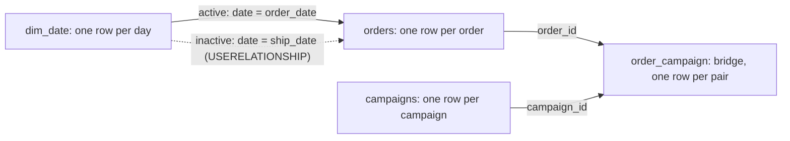

# Relationships, role-playing dates and many-to-many

Why does revenue by ship month differ from revenue by order month?

## Before you start

- **Level:** 2 (intermediate).
- **Time:** about 2 hours.
- **Builds on:** [Model the data a dashboard needs](../01-model-the-data-a-dashboard-needs/) (fact and dimension tables, the date table), [DAX measures from scratch](../02-dax-measures-from-scratch/) (filter context, CALCULATE) and [Joins without losing rows](../../01-sql/02-joins-without-losing-rows/) (LEFT JOIN, fan-out).
- **You need:** Python 3.9 or newer. No Power BI: every visual is rebuilt in sqlite3 SQL, and the DAX is shown next to it as a reference. An optional export check runs if you have Power BI.

## The problem

You are the analyst at Larkspur Home, the online homeware shop from lesson 01. Hana, the head of operations, reports revenue by ship month, because that is when the warehouse does the work. Ravi in finance reports revenue by order month. On Thursday's call their February numbers were 7,676.53 and 6,309.98, and each thinks the other's dashboard is broken. On the same call, Mei from marketing showed revenue by campaign: the four campaigns add up to 63,022.86, more than the shop's whole first-half revenue of 49,781.26. Hana wants one page by Monday that explains all three numbers.

## In plain words

Think of a pizza order. It has an order time (when you pressed Pay) and a delivery time (when it reached your door). Both are times on the same clock. If you count pizzas "per hour", you must say which time you mean: an order placed at 8:55 and delivered at 9:20 sits in the 8 o'clock hour by order time and the 9 o'clock hour by delivery time. Neither count is wrong. They answer different questions.

- A **relationship** in Power BI is a saved join between two tables. It lets a filter on one table (say, a month picked in a slicer) flow to another (the orders).
- A **role-playing dimension** is one dimension table used in more than one role. Here the date table plays "order date" and "ship date".
- Power BI allows only one **active** relationship between two tables. The other is **inactive** (a dashed line in the model view) and a measure switches it on with **USERELATIONSHIP**.
- A **many-to-many** link means one row on each side can match many rows on the other. One order can be touched by several campaigns, and one campaign touches many orders.
- A **bridge table** sits between the two and holds one row per pair, here one row per (order, campaign).
- A measure is **non-additive** when the rows of a visual do not add up to its total. That is expected across a many-to-many link, and it is the trap in this lesson.

## What you will build from scratch

- Revenue by order month, through the date table.
- Revenue by ship month through the same date table, keeping unshipped orders on a blank row so both views have the same total.
- Revenue by campaign through a bridge table that has repeated rows.
- A totals row that shows the double count: the sum of the campaign rows against each order counted once.
- An allocated version, where each order's amount is split across its campaigns so the rows add up.

The data in `data/` is synthetic. `make_data.py` builds it with a fixed random seed: 373 orders placed from January to June 2026, 4 campaigns, and a bridge of 485 rows that repeats 7 pairs.

## The idea

### One date table, two roles

The model has one `dim_date` table and two relationships from `orders` to it. Order date is active. Ship date is inactive, used only inside the measures that ask for it. The bridge sits between orders and campaigns.



In SQL, a relationship is just a join, and USERELATIONSHIP is a different ON clause:

| Power BI | SQL |
|---|---|
| active relationship `orders[order_date] -> dim_date[date]` | `JOIN dim_date d ON d.date = o.order_date` |
| `CALCULATE([Revenue], USERELATIONSHIP(orders[ship_date], dim_date[date]))` | `LEFT JOIN dim_date d ON d.date = o.ship_date` |
| the (Blank) row for orders whose ship date is blank | the `NULL` group from the LEFT JOIN |
| campaign filter flowing through the bridge to orders | `JOIN order_campaign` then `JOIN orders`, after `DISTINCT` pairs |

Microsoft's docs say what each piece does. There can be only one active filter path between two tables, other paths must be inactive, and USERELATIONSHIP activates one for a calculation ([Model relationships in Power BI Desktop](https://learn.microsoft.com/en-us/power-bi/transform-model/desktop-relationships-understand), Microsoft Learn, read 31 October 2026). The USERELATIONSHIP page uses this exact case, internet sales by ship date instead of order date, and notes it cannot be used when row-level security is defined on the table the measure is in ([USERELATIONSHIP function](https://learn.microsoft.com/en-us/dax/userelationship-function-dax), read 31 October 2026). When a fact row has no match on the one side, Power BI adds a blank virtual row to the dimension, so the fact still counts (the same relationships page, section Regular relationships). That is why the SQL for the ship month uses a LEFT JOIN.

### Why a many-to-many total is not the sum of its rows

Order 1007 was touched by Referral and Spring email. It belongs on both campaign rows, because both campaigns really touched it. So its amount appears twice in the rows, but once in the total. Microsoft's own example is joint bank accounts: two customers who share one account each show the account's balance, and the customer rows add up to more than the bank holds; the guidance calls these balances non-additive ([Many-to-many relationship guidance](https://learn.microsoft.com/en-us/power-bi/guidance/relationships-many-to-many), read 31 October 2026). Power BI computes the total row on its own, with no campaign filter at all, so every order counts once there, including orders no campaign touched. A spreadsheet or SQL query that adds up the rows counts order 1007 twice.

If someone needs rows that add up, you need a rule that splits each order, such as an equal split across its campaigns. That is a business decision (marketing calls it attribution), not a fix to the model.

## Walk through

Each query runs on the tables in `data/`. The block under each query is what sqlite3 returns.

Step 1. Revenue by order month. The join uses the active relationship.

```sql
SELECT d.year_month, COUNT(*) AS orders, ROUND(SUM(o.amount), 2) AS revenue
FROM orders o
JOIN dim_date d ON d.date = o.order_date
GROUP BY d.year_month
ORDER BY d.year_month
```

```text
year_month  orders  revenue
2026-01     65      8119.04
2026-02     58      7676.53
2026-03     59      8974.77
2026-04     66      8567.12
2026-05     58      7760.74
2026-06     67      8683.06
```

Step 2. Revenue by ship month, through the same date table. `LEFT JOIN` keeps the orders that have not shipped. They have no date to match, so they land on a `NULL` month, like the (Blank) row in Power BI. The `CASE` in `ORDER BY` puts that row last, because SQLite sorts NULL first.

```sql
SELECT d.year_month, COUNT(*) AS orders, ROUND(SUM(o.amount), 2) AS revenue
FROM orders o
LEFT JOIN dim_date d ON d.date = o.ship_date
GROUP BY d.year_month
ORDER BY CASE WHEN d.year_month IS NULL THEN 1 ELSE 0 END, d.year_month
```

```text
year_month  orders  revenue
2026-01     62      7696.02
2026-02     48      6309.98
2026-03     65      9625.47
2026-04     67      8854.62
2026-05     56      7849.44
2026-06     66      8236.61
2026-07     5       717.67
NULL        4       491.45
```

Both views have 373 orders and 49,781.26 in total. The ship view has a July row (late June orders that shipped in July) and a blank row (4 orders not shipped yet). Other databases sort NULL differently; PostgreSQL has `ORDER BY ... NULLS LAST`.

Step 3. Explain February. Orders move to a later month when they ship after the month ends.

```sql
SELECT
  SUM(substr(order_date, 1, 7) <> substr(ship_date, 1, 7)) AS ship_in_a_later_month,
  SUM(ship_date IS NULL) AS not_shipped,
  ROUND(SUM(CASE WHEN substr(order_date, 1, 7) = '2026-01' AND substr(ship_date, 1, 7) = '2026-02' THEN amount END), 2) AS jan_orders_shipped_feb,
  ROUND(SUM(CASE WHEN substr(order_date, 1, 7) = '2026-02' AND substr(ship_date, 1, 7) = '2026-03' THEN amount END), 2) AS feb_orders_shipped_mar
FROM orders
```

```text
ship_in_a_later_month  not_shipped  jan_orders_shipped_feb  feb_orders_shipped_mar
42                     4            423.02                  1789.57
```

February by ship month = February orders 7,676.53, minus the February orders that shipped in March 1,789.57, plus the January orders that shipped in February 423.02 = 6,309.98. In SQLite, a comparison is 1 or 0, so `SUM(a <> b)` counts the rows where it is true; with a NULL ship date the comparison is NULL and is not counted.

Step 4. Look at the bridge before you trust it.

```sql
SELECT COUNT(*) AS bridge_rows,
  (SELECT COUNT(*) FROM (SELECT DISTINCT order_id, campaign_id FROM order_campaign)) AS distinct_pairs,
  (SELECT COUNT(DISTINCT order_id) FROM order_campaign) AS orders_with_a_campaign,
  (SELECT COUNT(*) FROM orders) AS all_orders
FROM order_campaign
```

```text
bridge_rows  distinct_pairs  orders_with_a_campaign  all_orders
485          478             286                     373
```

Seven pairs are repeated, 286 orders have at least one campaign, and 87 have none.

Step 5. Revenue by campaign, on distinct pairs.

```sql
WITH pairs AS (SELECT DISTINCT order_id, campaign_id FROM order_campaign)
SELECT c.campaign_name, COUNT(*) AS orders, ROUND(SUM(o.amount), 2) AS revenue
FROM pairs p
JOIN campaigns c ON c.campaign_id = p.campaign_id
JOIN orders o ON o.order_id = p.order_id
GROUP BY c.campaign_name
ORDER BY c.campaign_name
```

```text
campaign_name  orders  revenue
Instagram      122     15627.45
Referral       110     14574.63
Search ads     113     14648.68
Spring email   133     18172.1
```

Each row is right: Spring email really touched 133 orders worth 18,172.10. The rows add up to 63,022.86, which is not a number anything earned.

Step 6. The totals row, each order once.

```sql
WITH pairs AS (SELECT DISTINCT order_id, campaign_id FROM order_campaign)
SELECT
  ROUND((SELECT SUM(o.amount) FROM pairs p JOIN orders o ON o.order_id = p.order_id), 2) AS sum_of_campaign_rows,
  ROUND(SUM(CASE WHEN order_id IN (SELECT order_id FROM pairs) THEN amount END), 2) AS revenue_with_a_campaign,
  ROUND(SUM(CASE WHEN order_id NOT IN (SELECT order_id FROM pairs) THEN amount END), 2) AS revenue_without_a_campaign,
  ROUND(SUM(amount), 2) AS total_revenue
FROM orders
```

```text
sum_of_campaign_rows  revenue_with_a_campaign  revenue_without_a_campaign  total_revenue
63022.86              38007.09                 11774.17                    49781.26
```

Campaign-touched revenue is 38,007.09. Add the 11,774.17 with no campaign and you get the shop's 49,781.26. The 63,022.86 counts many orders two or three times. In the exercise, make each column 0 when there is nothing to add, with `COALESCE`. `NOT IN` is safe here because `order_id` is never NULL; with a NULL in the subquery, `NOT IN` returns no rows at all.

Step 7. If marketing needs rows that add up, split each order equally across its campaigns.

```sql
WITH pairs AS (SELECT DISTINCT order_id, campaign_id FROM order_campaign),
weights AS (SELECT order_id, 1.0 / COUNT(*) AS weight FROM pairs GROUP BY order_id)
SELECT c.campaign_name, ROUND(SUM(o.amount * w.weight), 2) AS allocated_revenue
FROM pairs p
JOIN weights w ON w.order_id = p.order_id
JOIN campaigns c ON c.campaign_id = p.campaign_id
JOIN orders o ON o.order_id = p.order_id
GROUP BY c.campaign_name
ORDER BY c.campaign_name
```

```text
campaign_name  allocated_revenue
Instagram      9229.73
Referral       8781.24
Search ads     8807.93
Spring email   11188.18
```

These add up to 38,007.08, a cent off 38,007.09 because each row is rounded. `1.0 / COUNT(*)` uses `1.0` so SQLite does real division, not integer division.

### The same model in DAX (reference only, not run in this course)

Model: `dim_date[date]` to `orders[order_date]` active, `dim_date[date]` to `orders[ship_date]` inactive, `orders[order_id]` to `order_campaign[order_id]` and `campaigns[campaign_id]` to `order_campaign[campaign_id]`, with the orders to bridge relationship set to filter in both directions, so a campaign filter reaches the orders. Remove the repeated pairs in Power Query first (Remove Duplicates on both columns).

```dax
Revenue = SUM ( orders[amount] )

Revenue by Ship Date =
CALCULATE ( [Revenue], USERELATIONSHIP ( orders[ship_date], dim_date[date] ) )

-- a calculated column on orders: how many campaigns touched this order
campaign_count = COUNTROWS ( RELATEDTABLE ( order_campaign ) )

Allocated Revenue =
SUMX ( order_campaign, RELATED ( orders[amount] ) / RELATED ( orders[campaign_count] ) )
```

On a table of campaigns, `[Revenue]` gives the rows of step 5, and the total row shows 49,781.26: the total has no campaign filter, so it is every order, including the 87 with no campaign. It never shows 63,022.86. `[Allocated Revenue]` totals 38,007.09. Explain this in a tooltip or a text box, as Microsoft's guidance suggests.

## Common mistakes

**1. Adding up the campaign rows (the trap).** Someone exports the campaign table to Excel and sums the column, or writes the join straight through the raw bridge:

```sql
SELECT ROUND(SUM(o.amount), 2) AS naive_total, COUNT(*) AS rows_added
FROM order_campaign oc JOIN orders o ON o.order_id = oc.order_id
```

```text
naive_total  rows_added
64101.14     485
```

That is 64,101.14 against a true 38,007.09 for campaign-touched orders, and more than the shop's 49,781.26 in total. It is two errors at once: orders with several campaigns are counted several times, and the 7 repeated pairs add 1,078.28 more. The same raw join inflates each campaign row too: Instagram shows 124 orders and 16,060.09 instead of 122 and 15,627.45. Take distinct pairs, and never present the sum of many-to-many rows as a total.

**2. Joining both roles in one join.** Putting both keys in one ON clause asks for orders that were placed and shipped on the same day:

```sql
SELECT d.year_month, COUNT(*) AS orders, ROUND(SUM(o.amount), 2) AS revenue
FROM orders o
JOIN dim_date d ON d.date = o.order_date AND d.date = o.ship_date
GROUP BY d.year_month
ORDER BY d.year_month
```

```text
year_month  orders  revenue
2026-01     5       746.24
2026-02     1       122.11
2026-03     9       1521.07
2026-04     9       1522.2
2026-05     3       456.92
2026-06     6       769.14
```

33 orders instead of 373. Power BI gives the same answer if you build two date tables and set the same month on both slicers. One visual, one role. If a page needs both roles at once (orders placed in March and shipped in April), use two date tables, one per role.

**3. An inner join on ship date.** `JOIN dim_date d ON d.date = o.ship_date` drops the 4 unshipped orders, so the ship view totals 49,289.81 instead of 49,781.26, and the two dashboards disagree on the total as well as the months. Keep them on a blank row and label it "not shipped yet".

**4. Turning on both-direction filtering everywhere.** It makes campaign filters reach the orders, but on every relationship it creates more than one path between tables, which Power BI may reject as ambiguous or resolve in a way you did not expect. Set both directions on the one relationship that needs it, here orders to bridge.

## Your turn

Open `exercise.sql` and write `revenue_by_order_month`, `revenue_by_ship_month`, `revenue_by_campaign`, `campaign_totals` and `revenue_by_campaign_allocated`.

```
python3 test_lesson.py
```

Run it from this folder. The test recomputes every number with Python dictionaries over the raw rows. It runs on the committed data, on a second dataset from `make_data.build()` with another seed, on a four-order model with a repeated pair, an unshipped order, a zero amount and a tie, and on a model with no campaign rows at all (where the totals must be 0, not NULL). It also checks that the order view and the ship view add up to the same total.

Optional, in Power BI Desktop: load the four CSV files, build the model from the DAX block, put `dim_date[year_month]` and `[Revenue by Ship Date]` in a table, and export it (More options, Export data) to `export/revenue_by_ship_month.csv` with the columns renamed to `year_month` and `revenue`. The test then checks your export too.

Stretch: write a first-touch version, where each order goes to the campaign with the lowest `campaign_id`, and compare the ranking of campaigns with the equal split.

## Check yourself

1. What is a role-playing dimension, and how does Power BI let a measure use the second role?
2. Revenue by ship month is lower than revenue by order month in February. Name the two reasons that can happen.
3. Why do the rows of a revenue-by-campaign table add up to more than the total, and is the table wrong?
4. Marketing asks for campaign revenue that adds up to the total. What do you tell them?

<details>
<summary>Answers</summary>

1. One dimension used in several roles, such as a date table used for order date and ship date. Only one relationship between two tables can be active; the second is inactive and a measure activates it with `CALCULATE(..., USERELATIONSHIP(orders[ship_date], dim_date[date]))`. The other way is a second copy of the date table.
2. Orders placed late in February ship in March (they move out), and orders placed late in January ship in February (they move in). If more move out than in, February is lower. Orders not shipped yet also leave the ship view until they ship.
3. An order touched by several campaigns appears on each of their rows, but once in the total. Each row is correct (that campaign did touch that revenue). The rows are non-additive, so their sum means nothing. Only the column total, computed with all campaigns at once, is a real number.
4. That needs an allocation rule: an equal split, first touch, last touch or weights. Each gives a different answer and it is their choice, not a property of the data. Show the rule next to the numbers.

</details>

## What to tell the stakeholder

"Both February numbers are right: 7,676.53 is what customers ordered in February, and 6,309.98 is what the warehouse shipped in February, because 1,789.57 of February's orders shipped in March and 423.02 of January's shipped in February. Over the half year both views total 49,781.26; the ship view holds 491.45 on a 'not shipped yet' row. The campaign rows should not be added up: campaigns touched 38,007.09 of revenue, and the 63,022.86 counts orders with two or three campaigns more than once."

## In real job postings

In the Real Analyst Jobs data drop of 25 October 2026, 101 of the 413 UK analyst postings that list tools ask for Power BI (24.5%), and 92 for Tableau ([data/job-market/2026-10](../../../data/job-market/2026-10/)). See the [Power BI skills page](https://realanalystjobs.com/skills/power-bi).

## Next

[09 One metric, one definition: the semantic layer](../09-the-semantic-layer/)
