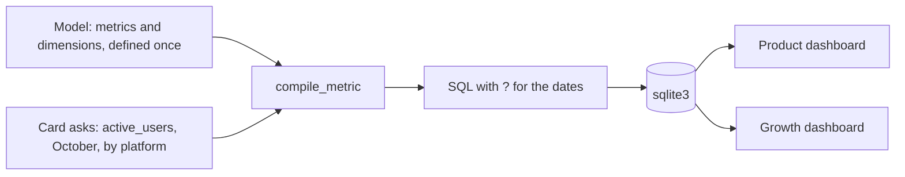

# One metric, one definition: the semantic layer

Why do two dashboards show different active users?

## Before you start

- **Level:** 2 (intermediate).
- **Time:** about 2 hours.
- **Builds on:** [Active users and stickiness](../../03-metrics-and-product-analytics/03-active-users-and-stickiness/) (what "active" means, and how the definition moves the number), [DAX measures from scratch](../02-dax-measures-from-scratch/) (a measure is a formula, the visual supplies the filters and the grouping) and [GROUP BY from raw rows](../../01-sql/01-group-by-from-raw-rows/).
- **You need:** Python 3.9 or newer. Nothing to install. No BI tool: you build the layer itself in about 60 lines of Python and sqlite3.

## The problem

Fitloop, the fictional workout tracking app from phase 03, now has two dashboards that both have a card called "Active users". For October 2026, the product dashboard says 195 and the growth dashboard says 108. Jo, the founder, has a board meeting on Tuesday and asks which one is right, and why there are two. You find that each dashboard has its own hand-written SQL: one counts everyone in the event log, the other drops push notifications but keeps staff accounts. Neither matches the definition the team agreed in September. Jo wants one number by Monday, and a way to make sure it never splits again.

## In plain words

Think of a recipe card in a restaurant kitchen. If every cook makes "house dal" from memory, every bowl is a bit different, and customers complain. So the head chef writes one card: these lentils, this much salt, this long. Every cook follows the card. When the recipe changes, the chef changes the card, and every bowl changes the same day.

- A **metric** is a business number with a name, such as active users or workouts logged.
- A **definition** is the exact rule behind it: what is counted (the **measure**, here `COUNT(DISTINCT user_id)`), and which rows are kept (the **filters**, such as "not a staff account").
- A **dimension** is a field you can split a metric by, such as platform, country or month.
- A **semantic layer** is the recipe card: one place where each metric is defined once, as data, and a small program that turns "active users, October, by platform" into SQL. Dashboards ask the layer instead of writing their own SQL. Tools such as LookML in Looker, dbt's semantic layer or a shared Power BI model do this job in real stacks; here you build the core so you know what they do.
- **Compiling** a metric means writing the SQL for it from the definition, the date window and the dimensions asked for.
- A **half-open window** `[start, end)` includes the start date and excludes the end date: October is `>= 2026-10-01` and `< 2026-11-01`. Windows like this never overlap and never leave a gap.

## What you will build from scratch

- A model: dimensions and metrics stored as a Python dictionary, with active users defined once.
- `compile_metric`: metric, window and dimensions in, SQL and parameters out, refusing any name that is not in the model.
- `filter_bridge`: a walk from the unfiltered count to the agreed number, one filter at a time, so you can explain the gap between two dashboards.
- `label_clashes`: a check that finds every label two sources define differently.

The data in `data/` is synthetic. `make_data.py` builds it with a fixed random seed: 240 users (8 of them staff or test accounts) and 1,278 events in September and October 2026. Event types are `app_open`, `workout_logged` and `push_received`, a notification the app sent; the user did nothing. 12 events come from devices that never signed in, so their `user_id` is blank.

## The idea

A dashboard card is a question: a metric, a window, maybe a split. Without a layer, the person who builds each card writes the answer in SQL, and the definition lives in many places. With a layer, the definition lives in one place, and the SQL is generated.



The compiled SQL always has the same shape:

```text
SELECT <dimension SQL> AS <name>, ..., <measure> AS value
FROM <the model's join>
WHERE <time> >= ? AND <time> < ?
  AND (<filter 1>) AND (<filter 2>) ...
GROUP BY 1, 2, ...      (only when there are dimensions)
ORDER BY 1, 2, ...
```

Three rules make it safe:

1. **Only model names reach the SQL.** The caller picks a metric and dimensions by name; the SQL text comes from the model. A name that is not in the model raises an error, so nobody can slip `platform; DROP TABLE users` into a query.
2. **Values are parameters.** The dates go in as `?` placeholders that sqlite3 fills in, never pasted into the SQL string.
3. **Distinct counts are recomputed, never added.** Active users in September plus active users in October is not active users across both months, because someone active in both is counted twice. The layer always runs the count on the window asked for.

When two dashboards disagree, a **filter bridge** explains the gap. Start with no filters, add the agreed filters one at a time, and record the number after each step. Each step's change is what that filter removes. Like a waterfall chart, the steps add up exactly from the first number to the last.

`GROUP BY 1` means "group by the first column of the SELECT". SQLite, PostgreSQL and MySQL accept it; SQL Server does not, and there you repeat the expression.

## Walk through

Run each block from this folder, in order, in one Python session (type `python3`, then paste). The block under each one is what it prints.

Step 1. Load the two tables into sqlite3 and look at October's events. `None if v == "" else v` turns the blank `user_id` into NULL.

```python
import csv
import sqlite3

con = sqlite3.connect(":memory:")
con.execute("CREATE TABLE users (user_id INTEGER, platform TEXT, country TEXT, is_internal INTEGER)")
con.execute("CREATE TABLE events (event_id INTEGER, user_id INTEGER, event_date TEXT, event_type TEXT)")
for table in ("users", "events"):
    with open("data/%s.csv" % table, newline="") as f:
        rows = [[None if v == "" else v for v in r.values()] for r in csv.DictReader(f)]
    con.executemany("INSERT INTO %s VALUES (?, ?, ?, ?)" % table, rows)

print(con.execute("SELECT event_type, COUNT(*) FROM events WHERE event_date >= '2026-10-01' "
                  "GROUP BY event_type ORDER BY event_type").fetchall())
```

```text
[('app_open', 242), ('push_received', 219), ('workout_logged', 137)]
```

More than a third of October's events are notifications the app sent. Whether they count is the whole argument.

Step 2. Write the three definitions as data: the two dashboards as they are today, and the agreed one. Each is a measure and a list of `[name, SQL condition]` filters.

```python
PRODUCT = {"label": "Active users", "measure": "COUNT(DISTINCT events.user_id)", "filters": []}
GROWTH = {"label": "Active users", "measure": "COUNT(DISTINCT events.user_id)",
          "filters": [["engaged_event", "events.event_type IN ('app_open', 'workout_logged')"]]}
AGREED = {"label": "Active users", "measure": "COUNT(DISTINCT events.user_id)",
          "filters": [["engaged_event", "events.event_type IN ('app_open', 'workout_logged')"],
                      ["not_internal", "users.is_internal = 0"]]}
```

This block prints nothing.

Step 3. A first compiler: build the WHERE clause from the filters, keep the dates as `?`, and run it for October.

```python
def compile_sql(definition, dims=()):
    select = ["users.%s AS %s" % (d, d) for d in dims] + [definition["measure"] + " AS value"]
    where = ["events.event_date >= ?", "events.event_date < ?"] + ["(%s)" % s for _, s in definition["filters"]]
    sql = ("SELECT " + ", ".join(select) + "\nFROM events JOIN users ON users.user_id = events.user_id"
           + "\nWHERE " + "\n  AND ".join(where))
    if dims:
        cols = ", ".join(str(i + 1) for i in range(len(dims)))
        sql += "\nGROUP BY %s\nORDER BY %s" % (cols, cols)
    return sql

october = ["2026-10-01", "2026-11-01"]
for name, d in (("product", PRODUCT), ("growth", GROWTH), ("agreed", AGREED)):
    print(name, con.execute(compile_sql(d), october).fetchone()[0])
print(compile_sql(AGREED, ["platform"]))
print(con.execute(compile_sql(AGREED, ["platform"]), october).fetchall())
```

```text
product 195
growth 108
agreed 100
SELECT users.platform AS platform, COUNT(DISTINCT events.user_id) AS value
FROM events JOIN users ON users.user_id = events.user_id
WHERE events.event_date >= ?
  AND events.event_date < ?
  AND (events.event_type IN ('app_open', 'workout_logged'))
  AND (users.is_internal = 0)
GROUP BY 1
ORDER BY 1
[('android', 73), ('ios', 27)]
```

The same function gives all three dashboard numbers. The only difference is the list of filters. The anonymous events never count: the JOIN drops a NULL `user_id`, and `COUNT(DISTINCT ...)` skips NULL anyway. The agreed definition gives 100 active users in October, 73 on Android and 27 on iOS. This first version trusts its input: `"users.%s" % d` pastes whatever dimension it is given into the SQL. Your `compile_metric` looks dimension names up in the model and refuses the rest.

Step 4. The filter bridge. Turn the filters on one at a time and record each change.

```python
steps, previous = [], None
for i in range(len(AGREED["filters"]) + 1):
    partial = dict(AGREED, filters=AGREED["filters"][:i])
    value = con.execute(compile_sql(partial), october).fetchone()[0]
    name = "no filters" if i == 0 else AGREED["filters"][i - 1][0]
    steps.append((name, value, None if previous is None else value - previous))
    previous = value
for step in steps:
    print(step)
```

```text
('no filters', 195, None)
('engaged_event', 108, -87)
('not_internal', 100, -8)
```

This is the answer for Jo. The product dashboard's 195 includes 87 users whose only October activity was a push notification they received. The growth dashboard's 108 still has 8 staff and test accounts in it. 195 - 87 - 8 = 100.

Step 5. Distinct counts do not add. Count active users for September, October, and the two months together.

```python
for start, end in (("2026-09-01", "2026-10-01"), ("2026-10-01", "2026-11-01"), ("2026-09-01", "2026-11-01")):
    print(start, "to", end, con.execute(compile_sql(AGREED), [start, end]).fetchone()[0])
```

```text
2026-09-01 to 2026-10-01 102
2026-10-01 to 2026-11-01 100
2026-09-01 to 2026-11-01 123
```

102 + 100 = 202, but only 123 different people were active across the two months. A dashboard that sums the monthly cards for a "last two months" number overstates it by 79.

The worked answer in `solution/solution.py` puts the dimensions and metrics in one `MODEL` dictionary, checks every name before it reaches the SQL, and adds `filter_bridge` and `label_clashes`. Run `python3 solution/solution.py` to see it.

## Common mistakes

**1. Fixing the number in the dashboard, not the definition (the trap).** The quick fix is to edit the product dashboard's SQL to add the push filter. Its card would then show 108, the same as the growth dashboard, and everyone relaxes, but both are still wrong: 8 staff accounts are in it. Two dashboards agreeing does not mean they are right. Fix the definition once in the layer, point both cards at it, and the number is 100.

**2. Adding distinct counts.** Monthly active users summed over two months gives 202 against a true 123 (step 5). The same trap hits a total row: active users by platform add up here (73 + 27 = 100) only because each user has one platform. Split by country of each event, or by month, and the rows can add to more than the total. The layer recomputes the count for every window and every total.

**3. Pasting names and values into the SQL.** `"... WHERE event_date >= '%s'" % start` works until someone passes `2026-10-01' OR '1'='1`. Bind values with `?`, and for names (metrics, dimensions, filters), which cannot be parameters, accept only names that are in the model.

**4. Calling two definitions different when they are the same.** Two sources that list the same filters in a different order, or give a filter a different name, compute the same number. A clash check must compare the measure and the set of filter conditions, not the text of the whole definition, or it raises false alarms and people stop reading it.

**5. A closed window with timestamps.** `event_date BETWEEN '2026-10-01' AND '2026-10-31'` works on dates, but if the column ever holds `2026-10-31 18:20:00`, that event is after `'2026-10-31'` as text and drops out. The half-open `>= start AND < end` is right for dates and timestamps alike.

## Your turn

Open `exercise.py`. Fill in the two filters of `active_users` in `MODEL` (the description says what they are), then write `compile_metric`, `filter_bridge` and `label_clashes`. `load_db`, `query_metric` and the two dashboard definitions are done for you.

```
python3 test_lesson.py
```

Run it from this folder. The test checks `compile_metric` with a model of its own against plain Python sets, for several windows and dimension lists, on the committed data and on a second dataset from `make_data.build()` with another seed. It checks your `MODEL` against the agreed definition, the bridge steps, that unknown names and reversed windows raise `ValueError`, that the dates are parameters, and small cases: an empty table, a NULL user, a staff account, a user who only received pushes.

Stretch: add a `country` filter argument to `compile_metric` (for example `where={"country": "IN"}`) that binds the value as a parameter and refuses a dimension name that is not in the model.

## Check yourself

1. What is a semantic layer, and what problem does it solve?
2. Two dashboards both say "Active users" and differ by 87. How do you find out why, quickly?
3. Why can a semantic layer not just add up last month's and this month's active users?
4. Why are metric and dimension names checked against the model, when the dates are bound as parameters?

<details>
<summary>Answers</summary>

1. One place where each metric is defined once (its measure, filters and allowed dimensions), plus a compiler that writes the SQL for any card. It stops the same label meaning different things on different dashboards, and a definition change reaches every dashboard at once.
2. A filter bridge: start from the version with fewer filters, add the other version's filters one at a time, and record the change at each step. Here the push filter removes 87 users and the staff filter 8 more.
3. Active users is a distinct count. A person active in both months is in both monthly numbers, so the sum double counts them: 202 against 123 here. The count must be run on the whole window.
4. Placeholders can carry values but not names: a column or table name cannot be a `?`. So names have to be pasted in, and the only safe way is to allow only names that already exist in the model.

</details>

## What to tell the stakeholder

"Fitloop had 100 active users in October 2026: real users who opened the app or logged a workout. The product dashboard's 195 also counts 87 people whose only activity was receiving a push notification, and the growth dashboard's 108 still includes 8 staff and test accounts. Both cards now read from one definition, so they will show the same number; note that September plus October is 123 different people, not 202."

## In real job postings

In the Real Analyst Jobs data drop of 25 October 2026, 232 of the 2,056 US analyst postings that list tools ask for Looker (11.3%) and 157 for dbt (7.6%), the two tools in that list built around a modelling layer ([data/job-market/2026-10](../../../data/job-market/2026-10/)). See the [analyst job market page](https://realanalystjobs.com/analyst-job-market).

## Next

[10 Slowly changing dimensions](../10-slowly-changing-dimensions/)
