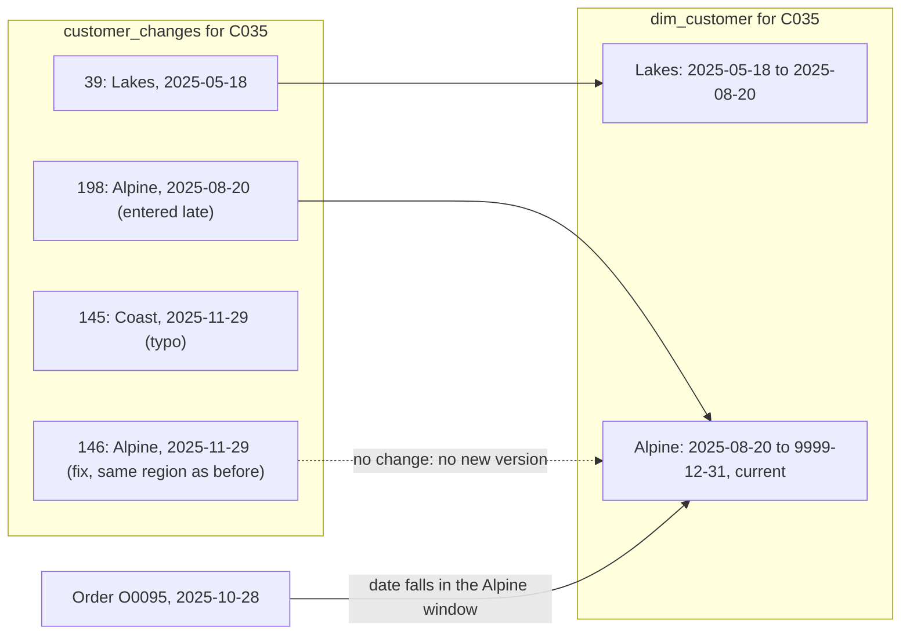

# Slowly changing dimensions

Which region was this customer in when they ordered?

## Before you start

- **Level:** 2 (intermediate).
- **Time:** about 2 hours.
- **Builds on:** [Model the data a dashboard needs](../01-model-the-data-a-dashboard-needs/) (fact and dimension tables), [Window functions](../../01-sql/03-window-functions/) (`ROW_NUMBER`, `LAG`, `LEAD`) and [Joins without losing rows](../../01-sql/02-joins-without-losing-rows/) (LEFT JOIN, fan-out).
- **You need:** Python 3.9 or newer. Nothing to install. Everything runs in sqlite3.

## The problem

You are the analyst at Kestrel Outdoor, the fictional hiking gear shop from lesson 03, which sells to customers in three regions: Alpine, Coast and Lakes. Each region has a manager whose bonus depends on the region's sales. Nadia, the Coast manager, says her sales for the last 21 months dropped by almost 900 overnight, without a single refund. The dashboard joins orders to the customer table, which holds only each customer's region today, so when a customer moves, all their past orders move with them. The finance team pays bonuses on Friday and wants sales by the region each customer was in when they ordered.

## In plain words

Think of a school register. A student who changes class in March was in class 7A for January and February and in 7B from March. If the school keeps only the student's class today, then January's attendance for 7A suddenly loses a student, and 7B gains one it never taught. To answer "how did 7A do in January", you need the register as it was in January.

- A **dimension** is a table that describes things, such as customers, with fields you group by, such as region. A **fact** table records events, such as orders.
- A **slowly changing dimension** (SCD) is a dimension whose fields change now and then, not every day: a customer moves, a product changes category.
- **Type 1** overwrites: one row per customer, always the latest value. History is lost.
- **Type 2** keeps history: a new row (a **version**) every time the value changes, each with a **valid_from** date (inclusive) and a **valid_to** date (exclusive, the day the next version starts). The current version has an open end, here `9999-12-31`, and `is_current = 1`.
- A **surrogate key** (`customer_key`) is a number that names one version. The **business key** (`customer_id`) names the customer across all versions.
- A **point-in-time join** joins each fact row to the version that was true on the fact's date: `valid_from <= order_date < valid_to`.

## What you will build from scratch

- A Type 1 customer table from a messy change log.
- A Type 2 customer table: same-day corrections resolved, saves that do not change the region dropped, windows that touch but never overlap.
- A point-in-time join that gives every order its region then and its region now.
- Revenue by region both ways, and the difference that moved Nadia's numbers.

The data in `data/` is synthetic. `make_data.py` builds it with a fixed random seed: `customer_changes.csv` (213 saves of 90 customers' records, from 1 March 2025) and `orders.csv` (427 orders, January 2025 to September 2026).

## The idea

The change log is what the CRM (the customer system) writes every time a record is saved. It is not a dimension yet. It has three kinds of noise:

1. **Saves that do not change the region.** A new street, same region. Not a new version.
2. **Same-day corrections.** A region typed wrong and fixed minutes later. Both rows have the same `changed_on`; the higher `change_id` is right.
3. **Late entries.** `change_id` is the order rows were loaded. A move entered weeks later has a high `change_id` and an earlier `changed_on`. History is ordered by `changed_on`, never by load order.

Customer C035, from this lesson's data, shows all three. The log becomes two versions, and each order finds the version whose window holds its date:



In SQL, the steps are three window functions:

| Step | SQL |
|---|---|
| one save per customer and day, the last loaded wins | `ROW_NUMBER() OVER (PARTITION BY customer_id, changed_on ORDER BY change_id DESC) = 1` |
| keep a save only if the region changed | `LAG(region) OVER (PARTITION BY customer_id ORDER BY changed_on)` is NULL or different |
| close each version when the next one starts | `LEAD(changed_on) OVER (PARTITION BY customer_id ORDER BY changed_on)`, else `'9999-12-31'` |

Why exclusive `valid_to`? With `valid_to` set to the next version's `valid_from`, the windows touch with no gap and no overlap, and `valid_from <= d < valid_to` matches exactly one version for every date. If `valid_to` were inclusive, an order on the day of a move would match both versions. A far-future date such as `9999-12-31` instead of NULL for the open end keeps the join condition simple.

Which type to use is a business choice. Type 1 answers "where are our customers now?" (a mailing list, today's account owner). Type 2 answers "where was the customer when it happened?" (sales by region, bonuses, anything reported by period). Many dimensions mix them: a typo fix in a name is Type 1, a move is Type 2.

## Walk through

Each query runs on the tables in `data/`. The block under each query is what sqlite3 returns.

Step 1. Read the raw log for two customers, in load order.

```sql
SELECT change_id, customer_id, region, changed_on
FROM customer_changes
WHERE customer_id IN ('C035', 'C036')
ORDER BY customer_id, change_id
```

```text
change_id  customer_id  region  changed_on
39         C035         Lakes   2025-05-18
145        C035         Coast   2025-11-29
146        C035         Alpine  2025-11-29
198        C035         Alpine  2025-08-20
5          C036         Coast   2025-03-01
77         C036         Coast   2025-07-15
151        C036         Coast   2025-12-05
199        C036         Alpine  2026-01-11
200        C036         Lakes   2026-01-11
```

C035's move to Alpine on 20 August was loaded last (change_id 198). On 29 November someone typed Coast and fixed it to Alpine. C036 saved three Coast records, then a typo and a fix on 11 January: C036 moved to Lakes that day.

Step 2. Type 1: the latest save wins, by date first, then by `change_id` for the same day.

```sql
SELECT customer_id, region
FROM (
  SELECT customer_id, region,
    ROW_NUMBER() OVER (PARTITION BY customer_id ORDER BY changed_on DESC, change_id DESC) AS rn
  FROM customer_changes
) ranked
WHERE rn = 1 AND customer_id IN ('C035', 'C036')
ORDER BY customer_id
```

```text
customer_id  region
C035         Alpine
C036         Lakes
```

Step 3. Type 2, one step at a time, for C036. `rn` picks the last save of each day, and `LAG` looks at the region of the save before.

```sql
WITH per_day AS (
  SELECT customer_id, region, changed_on,
    ROW_NUMBER() OVER (PARTITION BY customer_id, changed_on ORDER BY change_id DESC) AS rn
  FROM customer_changes
  WHERE customer_id = 'C036'
)
SELECT customer_id, region, changed_on,
  LAG(region) OVER (PARTITION BY customer_id ORDER BY changed_on) AS prev_region
FROM per_day
WHERE rn = 1
ORDER BY changed_on
```

```text
customer_id  region  changed_on  prev_region
C036         Coast   2025-03-01  NULL
C036         Coast   2025-07-15  Coast
C036         Coast   2025-12-05  Coast
C036         Lakes   2026-01-11  Coast
```

The Alpine typo is gone. Of the four saves left, only two start a version: the first (no previous region) and the move to Lakes. In SQLite the window runs after the `WHERE`, so `LAG` only sees the rows with `rn = 1`.

Step 4. Build the whole Type 2 table and save it as `dim_customer`. `LEAD` gives the next version's start, which closes the current one.

```sql
CREATE TABLE dim_customer AS
WITH per_day AS (
  SELECT customer_id, region, changed_on,
    ROW_NUMBER() OVER (PARTITION BY customer_id, changed_on ORDER BY change_id DESC) AS rn
  FROM customer_changes
),
saves AS (
  SELECT customer_id, region, changed_on,
    LAG(region) OVER (PARTITION BY customer_id ORDER BY changed_on) AS prev_region
  FROM per_day
  WHERE rn = 1
),
versions AS (
  SELECT customer_id, region, changed_on AS valid_from,
    LEAD(changed_on) OVER (PARTITION BY customer_id ORDER BY changed_on) AS next_from
  FROM saves
  WHERE prev_region IS NULL OR prev_region <> region
)
SELECT ROW_NUMBER() OVER (ORDER BY customer_id, valid_from) AS customer_key,
  customer_id, region, valid_from,
  COALESCE(next_from, '9999-12-31') AS valid_to,
  CASE WHEN next_from IS NULL THEN 1 ELSE 0 END AS is_current
FROM versions
```

This creates the table and prints nothing. Look at it:

```sql
SELECT COUNT(*) AS versions, COUNT(DISTINCT customer_id) AS customers,
  SUM(is_current) AS current_rows,
  (SELECT COUNT(DISTINCT customer_id) FROM dim_customer WHERE is_current = 0) AS customers_who_moved
FROM dim_customer
```

```text
versions  customers  current_rows  customers_who_moved
135       90         90            39
```

213 saves became 135 versions. Every customer has exactly one current row, and 39 customers moved at least once.

Step 5. The point-in-time join, for C036. Each order gets the version whose window holds its date, and, from a second join, the current version.

```sql
SELECT o.order_id, o.order_date, o.amount,
  COALESCE(at_order.region, 'Unknown') AS region_at_order,
  COALESCE(today.region, 'Unknown') AS region_now
FROM orders o
LEFT JOIN dim_customer at_order
  ON at_order.customer_id = o.customer_id
 AND o.order_date >= at_order.valid_from
 AND o.order_date < at_order.valid_to
LEFT JOIN dim_customer today
  ON today.customer_id = o.customer_id
 AND today.is_current = 1
WHERE o.customer_id = 'C036'
ORDER BY o.order_id
```

```text
order_id  order_date  amount  region_at_order  region_now
O0001     2025-01-15  214.87  Unknown          Lakes
O0042     2025-08-07  156.48  Coast            Lakes
O0051     2025-08-29  138.09  Coast            Lakes
O0316     2026-06-10  174.16  Lakes            Lakes
```

C036's two August orders were Coast orders. The dashboard shows them as Lakes. O0001 was placed in January 2025, before the change log started on 1 March 2025, so nobody knows the region then: it stays as `Unknown` instead of being dropped or guessed.

Step 6. Revenue by region, both ways.

```sql
SELECT region,
  SUM(CASE WHEN how = 'as ordered' THEN revenue END) AS as_ordered,
  SUM(CASE WHEN how = 'current' THEN revenue END) AS current_region
FROM (
  SELECT 'as ordered' AS how, COALESCE(d.region, 'Unknown') AS region, ROUND(SUM(o.amount), 2) AS revenue
  FROM orders o
  LEFT JOIN dim_customer d
    ON d.customer_id = o.customer_id AND o.order_date >= d.valid_from AND o.order_date < d.valid_to
  GROUP BY 2
  UNION ALL
  SELECT 'current', COALESCE(d.region, 'Unknown'), ROUND(SUM(o.amount), 2)
  FROM orders o
  LEFT JOIN dim_customer d ON d.customer_id = o.customer_id AND d.is_current = 1
  GROUP BY 2
)
GROUP BY region
ORDER BY region
```

```text
region   as_ordered  current_region
Alpine   15789.4     14891.91
Coast    18482.12    17595.36
Lakes    22059.71    24140.92
Unknown  296.96      NULL
```

Both columns add up to 56,628.19. By the region at the time of the order, Coast sold 18,482.12; the dashboard shows 17,595.36, because customers who moved away took 886.76 of Coast's past sales with them. Lakes gained 2,081.21 it never sold. The 296.96 on the Unknown row is two orders from before the log started; on the current view they count for the customer's region today, which is a guess.

## Common mistakes

**1. Reporting history with the current region (the trap).** The dashboard joined orders to a Type 1 table. Every number for a past period changes whenever a customer moves, so last quarter's report cannot be reproduced next quarter. Step 6 shows Coast losing 886.76 and Lakes gaining 2,081.21 for sales nobody moved. Use the Type 2 point-in-time join for anything reported by period.

**2. Joining on the business key alone.** `JOIN dim_customer d ON d.customer_id = o.customer_id` without the date condition matches every version of the customer:

```sql
SELECT COUNT(*) AS joined_rows, (SELECT COUNT(*) FROM orders) AS orders
FROM orders o
JOIN dim_customer d ON d.customer_id = o.customer_id
```

```text
joined_rows  orders
621          427
```

621 rows from 427 orders: a fan-out that inflates revenue. Join on the date window, or on `is_current = 1`, so each order matches one version.

**3. Ordering history by load order.** `ORDER BY change_id DESC` looks like "latest first", but C032's move back to Alpine on 30 October 2025 was entered before a late-loaded Lakes record dated 6 June. By `change_id`, C032 is in Lakes today; by date, Alpine. Sort by the date the change took effect, and use the load order only to break a tie on the same day.

**4. An inclusive `valid_to`.** `o.order_date BETWEEN d.valid_from AND d.valid_to` with `valid_to` set to the next version's start matches two versions for an order placed on the day of a move, and that order is counted twice. No order in this data falls on such a day, which is exactly why the bug survives until one does; the test's small case has one. Use `>= valid_from AND < valid_to`.

**5. An inner join that drops what it cannot match.** With `JOIN` instead of `LEFT JOIN`, the two orders from before the log started disappear and total sales fall by 296.96. Keep them on an `Unknown` row and say so.

## Your turn

Open `exercise.sql` and write `scd_type1`, `scd_type2`, `orders_with_region`, `revenue_by_region_as_ordered` and `revenue_by_region_current`. For the last three, the test loads a correct `dim_customer` first, so you can write them before `scd_type2` works.

```
python3 test_lesson.py
```

Run it from this folder. The test rebuilds both dimensions with Python dictionaries over the raw log, and checks your queries on the committed data, on a second dataset from `make_data.build()` with another seed, on a hand-made log (a same-day correction, a repeated region, a move entered late, an order on the day of a move, an order before the first record, a customer with no record at all, a zero amount) and on empty tables. It also checks that the versions touch without overlapping and that every customer has one current row.

Stretch: some dimensions mix types. Add an `email` column to the change log in your head: which type should a corrected email typo be, and how would you update it in every version without adding a new one?

## Check yourself

1. What is the difference between SCD Type 1 and Type 2, and when would you use each?
2. Why is `valid_to` exclusive, and why `9999-12-31` instead of NULL for the current row?
3. A sales report for last quarter gives a different number today than when it was first sent, and no orders changed. What would you check first?
4. Your change log has a row with a high load id and an old date. Which date decides the version, and why?

<details>
<summary>Answers</summary>

1. Type 1 overwrites the value and keeps one row per key, so it always shows the latest value and loses history. Type 2 adds a version with valid dates each time the value changes, so facts can be joined to the value that was true on their date. Use Type 1 for "now" questions and corrections; Type 2 for anything reported by period.
2. With an exclusive end equal to the next start, versions touch with no gap and no overlap, so `valid_from <= d < valid_to` matches exactly one version for any date. A far-future date keeps the same comparison working for the current row; with NULL every join needs an extra `OR valid_to IS NULL`.
3. Whether the report joins to a Type 1 dimension. If customers or products moved since, their past facts moved with them. Rebuild the report with a point-in-time join to a Type 2 dimension.
4. The date the change took effect (`changed_on`). The load id says when the row reached the system, not when the customer moved. Use the load id only to break a tie between two saves on the same day.

</details>

## What to tell the stakeholder

"Coast sold 18,482.12 from January 2025 to September 2026, counting each order in the region the customer was in when they ordered; the dashboard shows 17,595.36 because it uses each customer's region today, and customers who moved away took 886.76 of past Coast sales with them. Bonuses should use the first number. Two orders worth 296.96 were placed before our customer history starts on 1 March 2025, so their region is unknown."

## In real job postings

In the Real Analyst Jobs data drop of 25 October 2026, 1,477 of the 2,056 US analyst postings that list tools ask for SQL (71.8%), and 157 ask for dbt (7.6%) ([data/job-market/2026-10](../../../data/job-market/2026-10/)). See the [SQL data analyst jobs page](https://realanalystjobs.com/jobs/sql-data-analyst-jobs).

## Next

[11 Row-level security](../11-row-level-security/)
