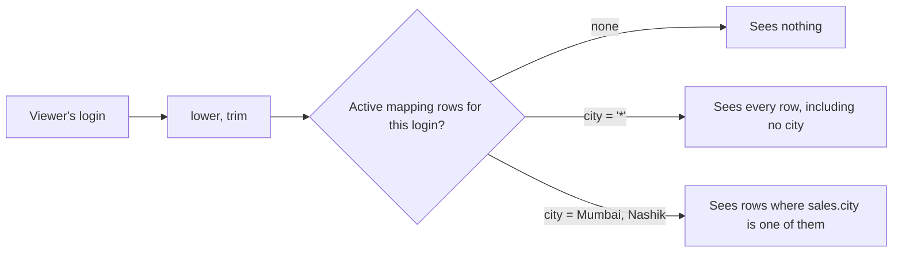

# Row-level security

Can each regional manager see only their own region?

## Before you start

- **Level:** 2 (intermediate).
- **Time:** about 2 hours.
- **Builds on:** [Anti-joins, self-joins and UNION](../../01-sql/06-anti-joins-self-joins-and-union/) (`EXISTS` and `NOT EXISTS`), [Joins without losing rows](../../01-sql/02-joins-without-losing-rows/) (fan-out from a duplicate key) and [Relationships, role-playing dates and many-to-many](../08-relationships-and-role-playing-dates/) (filters flowing through a model).
- **You need:** Python 3.9 or newer. Nothing to install. No Power BI or Tableau: the rule is rebuilt in sqlite3, so you can test it before any tool enforces it.

## The problem

Tiffinbell, the fictional food delivery app from phase 00, is giving its city managers their own sales dashboard on Monday. Each manager must see only their own city's orders; Bilal, the head of operations, sees everything. The access list is a small table that HR and operations keep by hand: who sees which city. Bilal asks you to write the rule and, before launch, prove three things: nobody sees a city they should not, nobody sees an order twice, and no order is visible only to head office by accident.

## In plain words

Think of a block of flats with one post room. Every resident has a key, and each key opens only that resident's letter box. The building manager has a master key. A visitor with no key opens nothing, and a resident who moved out hands their key back. The letters are all in one room; the keys decide who sees which.

- **Row-level security** (RLS) filters the rows of a table by who is looking. Everyone opens the same dashboard, and each person sees only their rows.
- A **mapping table** (also called a security or entitlement table) lists who may see what: here one row per (user, city). It is the list of keys.
- **Dynamic** RLS reads the mapping table at query time, using the viewer's login. Adding a manager means adding a row, not editing the dashboard.
- **Deny by default** means a person with no matching row sees nothing. The opposite, showing everything unless a rule says no, leaks the whole table to anyone the list forgot.
- A **wildcard** row, here city `*`, grants every city, including orders with no city yet. It is the master key.
- `EXISTS (subquery)` is true when the subquery returns at least one row. It checks for a key without multiplying anything.

## What you will build from scratch

- `visible_sales`: the rows one login may see, with deny by default, a wildcard and inactive rows ignored.
- `visible_revenue_by_city`: the dashboard visual on top of the same rule.
- `access_audit`: what every person in the mapping table can see, for Bilal to sign off.
- `uncovered_sales`: the orders that no active city manager covers.

The data in `data/` is synthetic. `make_data.py` builds it with a fixed random seed: `sales.csv` (476 orders in September and October 2026 across Mumbai, Nagpur, Nashik and Pune, 20 of them with no city yet) and `user_access.csv` (8 hand-typed rows). Emails use the reserved `example.com` domain.

## The idea

The rule for one row of sales is: show it if there is at least one row in the mapping table where the email is the viewer's login, the row is active, and the city is the sale's city or `*`.



In SQL that is a `WHERE EXISTS`:

```text
SELECT ... FROM sales s
WHERE EXISTS (
  SELECT 1 FROM user_access a
  WHERE lower(trim(a.user_email)) = lower(trim(:user))
    AND a.active = 1
    AND (a.city = '*' OR a.city = s.city)
)
```

Four details carry the weight:

1. **EXISTS, not JOIN.** A JOIN to the mapping table returns one sales row per matching key. If a pair is typed twice, or a manager has both `*` and a city, each of their orders appears twice. EXISTS only asks whether a key exists.
2. **Deny by default comes free.** With no matching row, EXISTS is false for every sale, so the result is empty. Nothing has to be written for the unknown user, and nothing can be forgotten.
3. **Clean both sides.** A login arrives as `esha@tiffinbell.example.com`; the list has `Esha@Tiffinbell.example.com` with a space at each end. `lower(trim(...))` on both sides makes them match. Treat the emails in an access list as case-insensitive; a plain `=` on text in SQLite is not.
4. **NULL never matches.** An order with no city has `s.city` NULL, and `a.city = NULL` is never true. So only the wildcard sees it, which is the safe default: unassigned orders go to head office until they are assigned.

The `:user` in the query is a **named parameter**: sqlite3 fills it in from `con.execute(sql, {"user": login})`, so a login can never change the SQL itself.

Power BI and Tableau both have built-in ways to enforce a rule like this; read the tool's own documentation for the details, and keep the audit in this lesson either way. One tool detail connects to lesson 08: Microsoft's USERELATIONSHIP page notes that the function cannot be used when row-level security is defined for the table in which the measure is included ([USERELATIONSHIP function](https://learn.microsoft.com/en-us/dax/userelationship-function-dax), Microsoft Learn, read 31 October 2026). Test a role-playing date measure as a secured user, not only as the model's author.

## Walk through

Each query runs on the tables in `data/`. The block under each query is what sqlite3 returns. In the exercise, the login is the parameter `:user`; here it is written in the query so you can run each block as it is.

Step 1. Read the mapping table. The brackets show the spaces.

```sql
SELECT '[' || user_email || ']' AS user_email_as_typed, city, active
FROM user_access
ORDER BY lower(trim(user_email)), city
```

```text
user_email_as_typed              city    active
[asha@tiffinbell.example.com]    Nagpur  0
[bilal@tiffinbell.example.com]   *       1
[dev@tiffinbell.example.com]     Pune    1
[ Esha@Tiffinbell.example.com ]  Pune    1
[farhan@tiffinbell.example.com]  Mumbai  1
[farhan@tiffinbell.example.com]  Nashik  1
[farhan@tiffinbell.example.com]  Nashik  1
[gauri@tiffinbell.example.com]   Mumbai  1
```

Bilal has the wildcard. Farhan covers Mumbai and Nashik, and his Nashik row was typed twice. Esha, an analyst for Pune, was typed with capitals and spaces. Asha managed Nagpur and has left.

Step 2. What Farhan sees.

```sql
SELECT COALESCE(s.city, 'Unassigned') AS city, COUNT(*) AS orders, ROUND(SUM(s.amount), 2) AS revenue
FROM sales s
WHERE EXISTS (
  SELECT 1 FROM user_access a
  WHERE lower(trim(a.user_email)) = lower(trim('farhan@tiffinbell.example.com'))
    AND a.active = 1
    AND (a.city = '*' OR a.city = s.city)
)
GROUP BY 1
ORDER BY 1
```

```text
city    orders  revenue
Mumbai  153     77899.35
Nashik  94      47229.63
```

Two cities, each order once, even though Nashik is in the list twice.

Step 3. Deny by default. A login that is not in the list, Asha who has left, and Esha typed exactly as she logs in:

```sql
SELECT login,
  (SELECT COUNT(*) FROM sales s WHERE EXISTS (
     SELECT 1 FROM user_access a
     WHERE lower(trim(a.user_email)) = lower(trim(login))
       AND a.active = 1 AND (a.city = '*' OR a.city = s.city))) AS orders_visible
FROM (SELECT 'stranger@example.com' AS login
      UNION ALL SELECT 'asha@tiffinbell.example.com'
      UNION ALL SELECT 'esha@tiffinbell.example.com')
```

```text
login                        orders_visible
stranger@example.com         0
asha@tiffinbell.example.com  0
esha@tiffinbell.example.com  137
```

The stranger and Asha see nothing, without a line of code written for them. Esha sees Pune's 137 orders because both sides were cleaned.

Step 4. The audit: one row per person, what they can see. This is what Bilal signs off before launch.

```sql
WITH people AS (SELECT DISTINCT lower(trim(user_email)) AS user_email FROM user_access)
SELECT p.user_email,
  COUNT(s.order_id) AS orders_visible,
  ROUND(COALESCE(SUM(s.amount), 0), 2) AS revenue_visible
FROM people p
LEFT JOIN sales s
  ON EXISTS (
    SELECT 1 FROM user_access a
    WHERE lower(trim(a.user_email)) = p.user_email
      AND a.active = 1
      AND (a.city = '*' OR a.city = s.city)
  )
GROUP BY p.user_email
ORDER BY p.user_email
```

```text
user_email                     orders_visible  revenue_visible
asha@tiffinbell.example.com    0               0.0
bilal@tiffinbell.example.com   476             245078.38
dev@tiffinbell.example.com     137             74488.47
esha@tiffinbell.example.com    137             74488.47
farhan@tiffinbell.example.com  247             125128.98
gauri@tiffinbell.example.com   153             77899.35
```

Bilal sees all 476 orders, which is the whole table. Nobody else sees more than their cities. `LEFT JOIN ... ON EXISTS` keeps Asha with 0 instead of dropping her row, so the audit lists everyone in the mapping table.

Step 5. Coverage: which orders does no active city-level row cover?

```sql
SELECT COALESCE(s.city, 'Unassigned') AS city, COUNT(*) AS orders, ROUND(SUM(s.amount), 2) AS revenue
FROM sales s
WHERE NOT EXISTS (
  SELECT 1 FROM user_access a WHERE a.active = 1 AND a.city = s.city
)
GROUP BY 1
ORDER BY 1
```

```text
city        orders  revenue
Nagpur      72      35796.86
Unassigned  20      9664.07
```

Nagpur's 72 orders have no manager since Asha left: only Bilal sees them. The 20 unassigned orders are expected to sit with head office. The Nagpur gap is the one to raise before Monday.

## Common mistakes

**1. Joining to the mapping table (the trap).** A JOIN returns one row per matching key:

```sql
SELECT COUNT(*) AS rows_shown, COUNT(DISTINCT s.order_id) AS distinct_orders, ROUND(SUM(s.amount), 2) AS revenue
FROM sales s
JOIN user_access a ON a.city = s.city
WHERE lower(trim(a.user_email)) = 'farhan@tiffinbell.example.com' AND a.active = 1
```

```text
rows_shown  distinct_orders  revenue
341         247              172358.61
```

Farhan's dashboard would show 172,358.61 instead of 125,128.98, because every Nashik order appears twice. Nobody notices until the city totals stop matching finance. Use `EXISTS` (or `IN`), which never multiplies rows.

**2. Comparing emails exactly.** `a.user_email = 'esha@tiffinbell.example.com'` finds no row for Esha, so she sees nothing and files a ticket. That one fails safe, but the same habit in an allow-all rule ("hide the rows of anyone in this exclusion list") fails open. Clean both sides.

**3. Allow by default.** A rule written as "if the user has a city, filter to it, otherwise show everything" shows all 476 orders to every stranger and to Asha after she left. Write the rule so that no row in the mapping means no rows in the result, and test it with a login that is not in the list.

**4. Forgetting the inactive flag and the rows nobody owns.** Ignoring `active` would leave Asha with Nagpur after she left. Checking only that each manager sees the right rows misses the opposite failure: Nagpur's 72 orders have no active manager at all. Run both the audit and the coverage check.

**5. Testing only as yourself.** The person who builds the dashboard usually has full access, so every visual looks right to them. Test as each role, with real logins, including one that should see nothing.

## Your turn

Open `exercise.sql` and write `visible_sales`, `visible_revenue_by_city`, `access_audit` and `uncovered_sales`. The first two use the parameter `:user`.

```
python3 test_lesson.py
```

Run it from this folder. The test runs your per-user queries once for every email in the mapping table as typed, again in capitals, and for logins that must see nothing (a stranger, an empty string, NULL, and the text `*`). It compares each result with a plain Python version of the rule, and fails with a clear message if a login sees rows it should not, or sees an order twice. It runs on the committed data, on a second dataset from `make_data.build()` with another seed, on a hand-made table, and on empty tables.

Stretch: Tiffinbell adds regions, each a group of cities. Add a `city_region` table and let a mapping row grant a whole region. What changes in the EXISTS?

## Check yourself

1. What is row-level security, and why use a mapping table instead of one role per city?
2. Why is `EXISTS` safer than a `JOIN` to the mapping table?
3. What should a user with no row in the mapping table see, and how do you test it?
4. How would you prove to an auditor that no order is visible to the wrong people?

<details>
<summary>Answers</summary>

1. A filter on the rows of a table based on who is looking, so one dashboard serves everyone. With a mapping table, access is data: adding a manager or a city is a new row, reviewed like any other change, and the rule itself never changes.
2. A JOIN returns one row per matching key, so a duplicate mapping row or two overlapping grants (a city and `*`) duplicate sales and inflate every total. EXISTS only asks whether a key exists, so each sale appears at most once.
3. Nothing. Write the rule so that no matching row means no rows (deny by default), and test with a login that is not in the list, an empty login and a NULL.
4. Run an audit of what each person can see, compare it with the intended access list, check that the wildcard users are the only ones who see everything, and run a coverage check for rows no active owner can see. Then test the dashboard while signed in as a few of those users.

</details>

## What to tell the stakeholder

"The rule is ready for Monday: each manager sees only their cities, and a login that is not on the list sees nothing. The audit shows Farhan sees Mumbai and Nashik (247 orders), Gauri Mumbai, Dev and Esha Pune, and only you see all 476 orders. Two things to fix in the access list: Nagpur has had no active manager since Asha left, so its 72 orders (35,796.86) are visible only to you, and Farhan's Nashik row is typed twice, which is harmless with this rule but should be cleaned up."

## In real job postings

In the Real Analyst Jobs data drop of 25 October 2026, Power BI was asked for in 350 of the 900 India analyst postings that list tools (38.9%), more than Tableau's 309 ([data/job-market/2026-10](../../../data/job-market/2026-10/)). See the [Power BI skills page](https://realanalystjobs.com/skills/power-bi).

## Next

[12 Tableau table calculations vs LOD](../12-tableau-table-calculations/)
