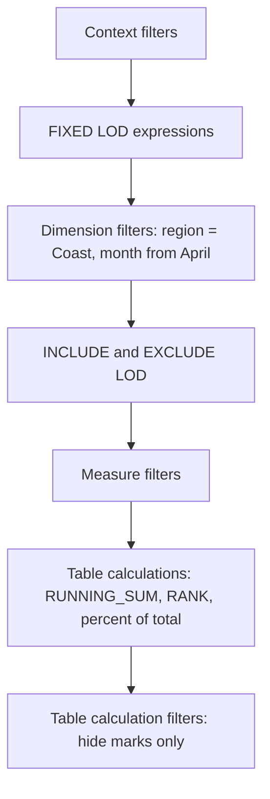

# Tableau table calculations vs LOD

Running total, rank or percent of total: which should be computed where?

## Before you start

- **Level:** 2 (intermediate).
- **Time:** about 2 hours.
- **Builds on:** [Tableau LOD expressions in SQL](../03-tableau-lod-expressions-in-sql/) (FIXED, INCLUDE, EXCLUDE and Tableau's order of operations), [Window functions](../../01-sql/03-window-functions/) (`SUM(...) OVER`, `RANK`) and [Rolling averages and percent of total](../../01-sql/09-rolling-averages-and-percent-of-total/).
- **You need:** Python 3.9 or newer. No Tableau: every view is rebuilt in sqlite3, and the Tableau calculation is shown next to it as a reference.

## The problem

You are the analyst at Kestrel Outdoor, the fictional hiking gear shop from lesson 03. Sofia, the marketing manager, is preparing the first-half review for Thursday. Her Coast page says Clothing is 15.2% of sales and Tents 52.1%; the CEO reads that as share of the whole company, which it is not. Her "year to date" chart for April to June starts again from zero in April, so the Coast year to date in June shows 15,172.44 instead of 25,239.03. Both come from the same thing: where each calculation sits relative to the filters. Sofia wants the page right by Wednesday, and a rule she can follow next time.

## In plain words

Think of a cricket scorecard. The runs each batter scored are facts from the match. The running total after each over, the batter's rank on the card and their share of the team's runs are worked out from the card as printed. If you tear off the first ten overs before you add them up, the running total starts at zero in over eleven. If you keep the whole card but fold the first ten overs out of sight, the running total still counts them.

- A **mark** in Tableau is one point, bar or cell in the view. A view by region and month has one mark per region and month.
- A **table calculation** is computed on the marks of the view after they are aggregated, like a window function over the result of a GROUP BY. Running total, rank and percent of total are the common ones.
- **Addressing** is the direction a table calculation moves along (the months, for a running total). **Partitioning** is what makes it restart (each region). In SQL these are `ORDER BY` and `PARTITION BY` inside `OVER (...)`.
- A **level of detail (LOD) expression** such as `{FIXED : SUM([Amount])}` is computed in the data source at a level you name, before most filters, and handed back to the view (lesson 03).
- A **dimension filter** removes rows by a field such as region or month. A **table calculation filter** only hides marks, after the table calculations have run.

## What you will build from scratch

- A running total by month that restarts for each region.
- A rank of categories within each region, with ties.
- Percent of total two ways in a view filtered to Coast: share of the view and share of all regions.
- A running total for April to June two ways: after a dimension filter and after a table calculation filter.

The data in `data/` is synthetic. `make_data.py` builds it with a fixed random seed: 463 sales lines from January to June 2026, in three regions and four categories.

## The idea

### Where each calculation runs

Tableau applies filters and calculations in a fixed order ([Tableau's Order of Operations](https://help.tableau.com/current/pro/desktop/en-us/order_of_operations.htm), Tableau help, read 31 October 2026). The parts that matter here:



Read it top to bottom as "runs before":

- A FIXED expression does not see a dimension filter. `{FIXED : SUM([Amount])}` in a view filtered to Coast is still every region's sales. To make FIXED respect a filter, add the filter to context.
- A table calculation sees only the marks left after the dimension and measure filters. Percent of total in a view filtered to Coast is a share of Coast.
- A table calculation filter runs after the table calculations, so it hides marks without changing the numbers on the marks that stay.

### The same thing in SQL

A view is a GROUP BY. A table calculation is a window over its result. A FIXED LOD is a separate aggregate that ignores the outer WHERE.

| Tableau | SQL |
|---|---|
| marks of a view by region and month | `SELECT region, month, SUM(amount) ... GROUP BY region, month` |
| `RUNNING_SUM(SUM([Amount]))`, along month, restarting per region | `SUM(sales) OVER (PARTITION BY region ORDER BY month ROWS BETWEEN UNBOUNDED PRECEDING AND CURRENT ROW)` |
| `RANK(SUM([Amount]))` within each region | `RANK() OVER (PARTITION BY region ORDER BY sales DESC)` |
| percent of total, table calculation | `sales / SUM(sales) OVER ()`, after the WHERE |
| `SUM([Amount]) / SUM({FIXED : SUM([Amount])})` | `sales / (SELECT SUM(amount) FROM sales)`, a subquery the WHERE does not reach |
| dimension filter on month | `WHERE month >= '2026-04'` before the window |
| table calculation filter on month | compute the window first, then `WHERE` in an outer query |

In SQL, window functions run after `WHERE`. That is the dimension filter case. To get the table calculation filter case, compute the window in a subquery or CTE and filter outside it.

Tableau's help describes the same two roles: when you pick Compute Using, Tableau decides which dimensions in the view are addressing and which are partitioning, and every dimension in the level of detail is one or the other ([Transform Values with Table Calculations](https://help.tableau.com/current/pro/desktop/en-us/calculations_tablecalculations.htm), read 31 October 2026). `RUNNING_SUM` returns the running sum from the first row in the partition to the current row, and Tableau has several rank functions, `RANK`, `RANK_DENSE`, `RANK_MODIFIED` and `RANK_UNIQUE`, which differ in how they treat ties ([Table Calculation Functions](https://help.tableau.com/current/pro/desktop/en-us/functions_functions_tablecalculation.htm), read 31 October 2026). This lesson uses the SQL `RANK()` rule: ties share a rank and the next rank is skipped (1, 1, 3). Check which Tableau function gives the same numbers before you publish a ranked view.

### So which goes where?

| Question | Compute it as | Why |
|---|---|---|
| Share of what the viewer is looking at | table calculation | it should follow the filters |
| Share of a fixed whole (the company, the year) | FIXED LOD, or SQL in the data source | it must not change when someone filters |
| Running total or year to date with a shorter date range shown | table calculation plus a table calculation filter, or SQL that filters after the window | the earlier months must still count |
| Rank among the items shown | table calculation | ranks follow the filter |
| Rank that must not move when someone filters (a league table) | FIXED, or SQL in the data source | a filter should hide rows, not re-rank them |

## Walk through

Each query runs on the `sales` table. The block under each query is what sqlite3 returns.

Step 1. The marks, then a running total. The inner query is the view (one row per region and month). The window is `RUNNING_SUM`, addressing month and partitioning region. Coast only, to keep it short:

```sql
SELECT region, year_month, ROUND(sales, 2) AS sales,
  ROUND(SUM(sales) OVER (PARTITION BY region ORDER BY year_month
                         ROWS BETWEEN UNBOUNDED PRECEDING AND CURRENT ROW), 2) AS running_sales
FROM (
  SELECT region, substr(order_date, 1, 7) AS year_month, SUM(amount) AS sales
  FROM sales
  GROUP BY region, year_month
) marks
WHERE region = 'Coast'
ORDER BY region, year_month
```

```text
region  year_month  sales    running_sales
Coast   2026-01     3610.85  3610.85
Coast   2026-02     2550.68  6161.53
Coast   2026-03     3905.06  10066.59
Coast   2026-04     5799.27  15865.86
Coast   2026-05     5671.14  21537.0
Coast   2026-06     3702.03  25239.03
```

Coast sold 25,239.03 in the first half. The `WHERE region = 'Coast'` here is harmless, because the running total restarts for each region anyway: removing other regions removes other partitions, not rows inside this one.

Step 2. Rank the categories within each region.

```sql
SELECT region, category, ROUND(sales, 2) AS sales,
  RANK() OVER (PARTITION BY region ORDER BY ROUND(sales, 2) DESC) AS sales_rank
FROM (
  SELECT region, category, SUM(amount) AS sales
  FROM sales
  GROUP BY region, category
) marks
ORDER BY region, sales_rank, category
```

```text
region  category  sales     sales_rank
Alpine  Tents     12354.39  1
Alpine  Packs     5910.95   2
Alpine  Boots     5662.82   3
Alpine  Clothing  2919.13   4
Coast   Tents     13140.16  1
Coast   Boots     4629.92   2
Coast   Clothing  3834.94   3
Coast   Packs     3634.01   4
Lakes   Tents     9121.04   1
Lakes   Packs     3736.04   2
Lakes   Boots     3721.02   3
Lakes   Clothing  1941.21   4
```

Tents lead everywhere. Lakes Packs and Boots are 15.02 apart, so a small filter could swap them. Ranking on the rounded value means two categories that print the same also rank the same.

Step 3. Percent of total in a view filtered to Coast, both ways.

```sql
SELECT category, ROUND(sales, 2) AS sales,
  ROUND(sales / SUM(sales) OVER (), 4) AS pct_of_view,
  ROUND(sales / (SELECT SUM(amount) FROM sales), 4) AS pct_of_all_regions
FROM (
  SELECT category, SUM(amount) AS sales
  FROM sales
  WHERE region = 'Coast'
  GROUP BY category
) marks
ORDER BY category
```

```text
category  sales     pct_of_view  pct_of_all_regions
Boots     4629.92   0.1834       0.0656
Clothing  3834.94   0.1519       0.0543
Packs     3634.01   0.144        0.0515
Tents     13140.16  0.5206       0.1861
```

Both columns are correct answers to different questions. Clothing is 15.2% of Coast's sales and 5.4% of the company's 70,605.63. `SUM(sales) OVER ()` runs after the `WHERE`, like a table calculation after a dimension filter. The subquery `(SELECT SUM(amount) FROM sales)` does not see the outer `WHERE`, like FIXED before a dimension filter.

Step 4. Year to date for April to June. First, filter the months away before the window:

```sql
SELECT region, year_month, ROUND(sales, 2) AS sales,
  ROUND(SUM(sales) OVER (PARTITION BY region ORDER BY year_month
                         ROWS BETWEEN UNBOUNDED PRECEDING AND CURRENT ROW), 2) AS running_sales
FROM (
  SELECT region, substr(order_date, 1, 7) AS year_month, SUM(amount) AS sales
  FROM sales
  WHERE substr(order_date, 1, 7) BETWEEN '2026-04' AND '2026-06'
  GROUP BY region, year_month
) marks
WHERE region = 'Coast'
ORDER BY year_month
```

```text
region  year_month  sales    running_sales
Coast   2026-04     5799.27  5799.27
Coast   2026-05     5671.14  11470.41
Coast   2026-06     3702.03  15172.44
```

That is Sofia's chart: a dimension filter on month removed January to March before `RUNNING_SUM` ran, so "year to date" starts in April. Now compute the window on all months and hide the early ones afterwards:

```sql
WITH marks AS (
  SELECT region, substr(order_date, 1, 7) AS year_month, SUM(amount) AS sales
  FROM sales
  GROUP BY region, year_month
),
with_running AS (
  SELECT region, year_month, sales,
    SUM(sales) OVER (PARTITION BY region ORDER BY year_month
                     ROWS BETWEEN UNBOUNDED PRECEDING AND CURRENT ROW) AS running_sales
  FROM marks
)
SELECT region, year_month, ROUND(sales, 2) AS sales, ROUND(running_sales, 2) AS running_sales
FROM with_running
WHERE region = 'Coast' AND year_month BETWEEN '2026-04' AND '2026-06'
ORDER BY year_month
```

```text
region  year_month  sales    running_sales
Coast   2026-04     5799.27  15865.86
Coast   2026-05     5671.14  21537.0
Coast   2026-06     3702.03  25239.03
```

The same three months, and June's year to date is 25,239.03, the figure from step 1. The `WHERE` outside the CTE plays the part of a table calculation filter.

### The same views in Tableau (reference only, not run in this course)

```tableau
// Step 1: Region on Rows, MONTH(Order Date) on Columns.
// Compute Using: Order Date (addressing month, partitioning region).
RUNNING_SUM(SUM([Amount]))

// Step 2: Region and Category on Rows. Compute Using: Category.
// Check that the rank function you pick treats ties the way you want.
RANK(SUM([Amount]))

// Step 3: Category on Rows, Region on Filters keeping Coast.
SUM([Amount]) / TOTAL(SUM([Amount]))          // share of the view
SUM([Amount]) / SUM({FIXED : SUM([Amount])})  // share of all regions

// Step 4: keep the months in the view and hide January to March with a filter on
// a table calculation, so it runs after RUNNING_SUM. A common pattern is a field
// such as this one on the Filters shelf, keeping April to June:
LOOKUP(MIN(DATETRUNC('month', [Order Date])), 0)
```

Check the step 4 filter in Tableau before you publish: the point is that the filter must be a table calculation, so it sits after `RUNNING_SUM` in the order of operations. Putting `MONTH([Order Date])` on Filters instead gives the 15,172.44 from the first query of step 4.

## Common mistakes

**1. Filtering a running total with a dimension filter (the trap).** Step 4's first query: Coast's year to date in June shows 15,172.44 instead of 25,239.03, because January to March were removed before the running sum. Nothing looks broken; the line just starts lower. If earlier periods must count, hide them after the calculation, or compute the running total in the data source.

**2. Reading a percent of view as a percent of the whole.** On a page filtered to Coast, "Tents 52.1%" is a share of Coast. The company share is 18.6%. Label the denominator on the chart ("% of Coast"), or use FIXED when the whole is what you mean.

**3. A rank that moves when someone filters.** Rank is a table calculation, so it ranks what is left. Filter Coast's categories to drop Tents and every other category moves up one:

```sql
SELECT category, ROUND(SUM(amount), 2) AS sales,
  RANK() OVER (ORDER BY ROUND(SUM(amount), 2) DESC) AS sales_rank
FROM sales
WHERE region = 'Coast' AND category <> 'Tents'
GROUP BY category
ORDER BY sales_rank
```

```text
category  sales    sales_rank
Boots     4629.92  1
Clothing  3834.94  2
Packs     3634.01  3
```

Boots is now "number 1" on Coast. That is right for "rank what I see" and wrong for a league table. Compute a stable rank in the data source if it must not move.

**4. The wrong Compute Using.** A running total computed along region instead of month adds Alpine, Coast and Lakes for each month. The numbers look plausible and are meaningless. Always say out loud which field the calculation moves along and which one makes it restart, then check one cell by hand.

**5. A FIXED total that should have respected a filter.** If Sofia adds a date filter for the first quarter and wants the share of the quarter's sales, `{FIXED : SUM([Amount])}` still divides by the half year, because FIXED runs before ordinary dimension filters. Add the date filter to context, or use a table calculation.

## Your turn

Open `exercise.sql` and write `running_total_by_month`, `category_rank_by_region`, `share_with_region_filter` and `running_total_q2`.

```
python3 test_lesson.py
```

Run it from this folder. The test recomputes each view with Python dictionaries over the raw sales lines. It runs on the committed data, on a second dataset from `make_data.build()` with another seed, on a seven-line table with a tie, a zero amount, a region with no sales before April and a month with no sales, and on an empty table.

Optional, in Tableau: connect to `data/sales.csv`, build the step 3 view with both percent calculations from the reference block, and check that Clothing shows 15.2% and 5.4%.

Stretch: add a third percent column for step 3 that respects the Coast filter but not a category filter. Which Tableau calculation is that, and what is its SQL?

## Check yourself

1. What is the difference between a table calculation and an LOD expression?
2. A running total by month restarts at zero when you filter the view to the last quarter. Why, and how do you fix it?
3. On a dashboard filtered to one region, a card says "Tents: 52%". What question do you ask before you repeat that number?
4. When should a rank be computed in the data source instead of as a table calculation?

<details>
<summary>Answers</summary>

1. A table calculation runs on the aggregated marks of the view, after the dimension and measure filters, along a direction (addressing) and restarting per partition. An LOD expression is computed in the data source at the level you name; FIXED runs before dimension filters, INCLUDE and EXCLUDE after them.
2. A dimension filter on month removes the earlier months before the running sum runs. Keep them in the view and hide them with a table calculation filter, which runs after table calculations, or compute the running total in SQL before filtering.
3. "52% of what?" A percent-of-total table calculation is a share of what is left after the filters, here one region. The share of the company needs a FIXED denominator.
4. When the rank must not change as people filter, such as a league table or a target list. A table calculation ranks only what is visible, so a filter re-ranks everything left.

</details>

## What to tell the stakeholder

"On the Coast page, Clothing is 15.2% of Coast's first-half sales and 5.4% of the company's, so the label should say '% of Coast'. Coast's year to date in June is 25,239.03; the chart showed 15,172.44 because the month filter removed January to March before the running total. I have changed it to hide those months instead of removing them. Ranks on the page are ranks of what is shown, so they change when a filter removes a category."

## In real job postings

In the Real Analyst Jobs data drop of 25 October 2026, 740 of the 2,056 US analyst postings that list tools ask for Tableau (36.0%), more than any other BI tool in the list ([data/job-market/2026-10](../../../data/job-market/2026-10/)). See the [Tableau skills page](https://realanalystjobs.com/skills/tableau) and the [Power BI vs Tableau study](https://realanalystjobs.com/research/power-bi-vs-tableau-job-postings-2026).

## Next

That is the last lesson in phase 04. Next: [05 Clean a messy CSV](../../05-python-for-analysts/01-clean-a-messy-csv/), the first lesson of phase 05, or back to the [phase 04 overview](../README.md).
