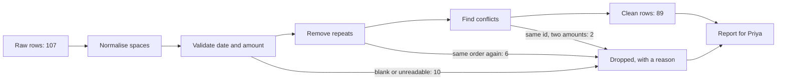

# Clean a messy CSV

Which rows of this export can we trust, and what did we change to get there?

## Before you start

- **Level:** 1 (beginner). About 2 hours.
- **You need:** Python 3.9 or later, nothing to install. If you have never run a Python file, do [Start here](../../00-start-here/) first.
- **Builds on:** nothing else in this phase. This is the first Python lesson.

## The problem

Kestrel Home, a fictional online furniture shop, sells in the US and India. Every month the ops team exports September orders from two systems and pastes them into one CSV. Priya, the head of finance, needs the September order table cleaned by Thursday so she can total revenue by currency. She has asked for a short note of what was fixed and what was dropped, because last month a duplicated order went into the board numbers.

The file `data/orders_raw.csv` (107 rows) is synthetic, built by `make_data.py` with a fixed random seed. The mess was added on purpose and is the same every time you rebuild it.

## In plain words

Imagine a shoebox of paper receipts from two shops, one in Austin and one in Pune. Some receipts are faded and have no date. Some are in dollars, some in rupees. A few were photocopied, so the same purchase is in the box twice. One purchase has two receipts with two different prices.

Before you add anything up you sort the box. You flatten the crumpled ones, you set aside the ones you cannot read, you throw away the photocopies, and you put the two receipts that disagree on one side and ask the shop which is right. Then you add up the dollars and the rupees in two separate piles. And you write a note saying what you set aside and why.

That is data cleaning. A few words used below:

- **CSV** (comma separated values): a text file where each line is a row and commas separate the cells.
- **Normalise**: rewrite a value in one standard form, so that `" Asha  Rao"` and `"Asha Rao"` become the same text.
- **Validate**: check that a value is what it claims to be, such as a real date or a real amount.
- **Duplicate**: a row that describes an order you already have.
- **Conflict**: two rows for the same order that disagree, so at least one of them is wrong.
- **Regular expression** (regex): a short pattern that describes what a piece of text must look like.

## What you will build from scratch

- `parse_date`: turns four different date formats into one, `YYYY-MM-DD`.
- `parse_amount`: turns `$1,200.50`, `USD 75`, `INR 45,000`, `INR 1,20,000` and `Rs 999` into a number plus a currency code, and rejects anything that is not a money string.
- `clean_rows`: normalises spaces, drops bad rows with a reason, removes duplicates, sets aside conflicts, and returns a report of everything it did.

## The idea

Cleaning is a list of small, explicit decisions. Write each one down as code so the next person can see it. The order of the steps matters:



Every arrow into "Dropped" carries a reason, and the report lists both piles. Nothing disappears without a note.

**Spaces.** `"  Asha  Rao "` and `"Asha Rao"` are the same customer. `" ".join(value.split())` strips both ends and collapses inner runs of spaces. Do this to every cell first, because every later check depends on it.

**Dates.** The export has `2026-09-14`, `14/09/2026`, `Sep 14, 2026` and `14-Sep-2026`. Try each format in a fixed order and keep the first one that parses. The order matters for slashes: `03/04/2026` is 3 April if the file is day first and 4 March if it is month first. No code can guess that. You have to know where the file came from. Here the slash dates come from the India office, so they are day first, and that rule is written in `DATE_FORMATS`, not hidden in your head.

**Money.** A money string is a currency marker, optional spaces, then a number. Here is the pattern, one piece per line:

```
^                  the start of the text: nothing may come before the marker
(                  open group 1, the currency marker
  \$|USD|INR|RS\.?   a $ sign, or USD, or INR, or RS with an optional full stop
)                  close group 1
\s*                zero or more spaces
(                  open group 2, the number
  \d+                one or more digits: the number must start with a digit
  (?:,\d+)*          zero or more blocks of "a comma, then digits"
  (?:\.\d+)?         an optional decimal part: a point, then digits
)                  close group 2
$                  the end of the text: nothing may come after the number
```

Written on one line, as Python needs it:

```
^(\$|USD|INR|RS\.?)\s*(\d+(?:,\d+)*(?:\.\d+)?)$
```

The symbols, once each:

- `\$` and `\.` have a backslash because `$` alone means "end of text" and `.` alone means "any character". The backslash says "the real character".
- `|` means "or".
- `?` means "the thing before me, zero or one time". So `RS\.?` matches `Rs` and `Rs.`.
- `*` means "zero or more times" and `+` means "one or more times".
- `\d` is any digit 0 to 9 and `\s` is any space character.
- `( )` is a group you can read back later with `m.group(1)`. `(?: )` groups without keeping a copy, so it does not change the group numbers.
- `re.IGNORECASE`, passed when the pattern is compiled, lets `Rs`, `RS` and `rs` all match.

Group 1 says the currency, group 2 is the number. Strip the commas from group 2 and convert. Removing commas instead of checking where they sit means `1,20,000` (Indian lakh grouping, where a lakh is 1,00,000) and `120,000` both become 120000. Because the number must start with a digit and every comma must be followed by digits, a broken cell such as `$,` does not match at all, so it is rejected instead of crashing the script. Keep the currency next to the amount. Adding rupees to dollars is the most expensive mistake in this file.

**Drop or fill.** A row with no date or no amount cannot be counted in monthly revenue, so it is dropped. A row with no city still has a valid order, so the city becomes `Unknown` and the row stays. Every drop gets a reason.

**Duplicates after cleaning.** Compare rows after cleaning, not before. Order 1024 appears once as `04/09/2026` and once as `2026-09-04`. As text the two rows differ. As data they are the same order. Dedupe on the raw text and you keep both.

**Conflicts last.** After exact repeats are gone, an order ID that still has two different rows is a conflict: the same order with two amounts, for example. Do not keep one and hope. Drop both, list the ID, and send it back to whoever owns the data.

## Walk through

Collapse spaces:

```python
print(repr(" ".join("  Asha  Rao ".split())))
```

This prints:

```
'Asha Rao'
```

`split()` with no argument breaks the text on any run of spaces and throws the empty pieces away. `" ".join(...)` glues the pieces back with exactly one space.

Try date formats in order:

```python
from datetime import datetime
FORMATS = ["%Y-%m-%d", "%d/%m/%Y", "%b %d, %Y", "%d-%b-%Y"]
for s in ["Sep 20, 2026", "04/09/2026", "TBD"]:
    out = None
    for fmt in FORMATS:
        try:
            out = datetime.strptime(s, fmt).strftime("%Y-%m-%d")
            break
        except ValueError:
            pass
    print(s, "->", out)
```

This prints:

```
Sep 20, 2026 -> 2026-09-20
04/09/2026 -> 2026-09-04
TBD -> None
```

Line by line: `strptime` (string parse time) reads text with a format, where `%Y` is a four digit year, `%m` a month number, `%d` a day and `%b` a short month name. If the text does not fit, it raises `ValueError`, so `except ValueError: pass` moves on to the next format. `break` stops at the first format that works. `strftime` (string format time) writes the date back out in one standard form. `04/09/2026` becomes 4 September because the day first format comes before any month first one. `TBD` fits no format, so it stays `None` and the row is dropped as `bad_date`.

Pull the currency and number out of a money string:

```python
import re
AMOUNT = re.compile(r"^(\$|USD|INR|RS\.?)\s*(\d+(?:,\d+)*(?:\.\d+)?)$", re.IGNORECASE)
for text in ["INR 1,20,000", "Rs.250", "$,"]:
    m = AMOUNT.match(text)
    print(text, "->", (m.group(1), float(m.group(2).replace(",", ""))) if m else None)
```

This prints:

```
INR 1,20,000 -> ('INR', 120000.0)
Rs.250 -> ('Rs.', 250.0)
$, -> None
```

The `r` before the pattern makes it a raw string, so Python leaves the backslashes alone for the regex to read. `match` returns `None` when the text does not fit. The marker comes back as written (`Rs.`), which is why the lesson maps it to a code with `CURRENCY[m.group(1).upper()]`.

Run the worked answer on the whole file:

```
python3 solution/solution.py
```

This prints:

```
rows in: 107  rows out: 89
cells with stray spaces fixed: 32
blank cities filled with Unknown: 3
dropped bad_amount 1
dropped bad_date 2
dropped blank_amount 4
dropped blank_date 3
dropped conflict 2
dropped duplicate 6
conflicts to send back: ['1047', '1047']
total INR 46 orders 3,478,100.00
total USD 43 orders 42,616.10
first clean row: {'order_id': '1001', 'order_date': '2026-09-21', 'customer': 'Farah Khan', 'city': 'Bengaluru', 'amount': 130700.0, 'currency': 'INR'}
```

107 rows go in and 89 come out. 32 cells had stray spaces, 3 blank cities became `Unknown`, and 18 rows were dropped: 3 with no date, 2 with the date `TBD`, 4 with no amount, 1 with the amount `$,`, 6 duplicates, and the 2 rows of order 1047, which says `Rs 132800` in one row and `INR 1,33,800` in the other.

## Common mistakes

**1. Removing duplicates before cleaning.** This is the trap in this file. Count repeats both ways:

```python
import sys
sys.path.insert(0, "solution")
import solution as s

rows = s.load_csv("orders_raw.csv")
print("repeats by raw text:", len(rows) - len({tuple(r.values()) for r in rows}))
clean, report = s.clean_rows(rows)
print("repeats after cleaning:", report["dropped"]["duplicate"])
missed = [r for r in clean if r["order_id"] in ("1024", "1055", "1086")]
print("counted twice if you dedupe first:", s.totals_by_currency(missed))
```

This prints:

```
repeats by raw text: 3
repeats after cleaning: 6
counted twice if you dedupe first: {'INR': (1, 38100.0), 'USD': (2, 1351.1)}
```

Only 3 of the 6 duplicates are exact copies of the text. Orders 1024, 1055 and 1086 differ only in a date format or in spaces. Dedupe the raw text and those three stay in, so Priya's totals come out INR 38,100 and USD 1,351.10 too high. That is exactly last month's board-number mistake.

**2. A money pattern that lets a number have no digits.** A first draft often writes the number as `[\d,]+`, "digits or commas". A comma alone fits that, so the cell `$,` matches, the commas are stripped, and `float("")` crashes the whole run:

```python
import re
OLD = re.compile(r"^(\$|USD|INR|RS\.?)\s*([\d,]+(?:\.\d+)?)$", re.IGNORECASE)
m = OLD.match("$,")
try:
    float(m.group(2).replace(",", ""))
except ValueError as e:
    print("ValueError:", e)
```

This prints:

```
ValueError: could not convert string to float: ''
```

Order 1059 in this file has exactly that amount. The fixed pattern says the number must start with a digit (`\d+`) and that every comma is followed by digits (`(?:,\d+)*`), so `$,` is simply not a money string and the row is dropped as `bad_amount`. One limit remains on purpose: the pattern does not check where commas sit, so `$1,2,3` reads as 123. That is the price of accepting both `1,20,000` and `120,000`.

**3. Adding the currencies together.** The clean amounts sum to 3,520,716.10, a number that means nothing: 46 rupee orders and 43 dollar orders added as if they were one currency. Keep `currency` as a column and total each one separately. Converting needs an exchange rate and a date for that rate, which is a business decision, not a cleaning step.

**4. Treating a minus sign as a sale.** `-$50.00` does not match the pattern, so it is rejected as `bad_amount`. That is safe for this file, which has no refunds. If a real export has refunds, they should arrive in their own column or with a status, and you should look at them before dropping anything.

**5. Trusting month names everywhere.** `%b` reads English short month names such as `Sep` only while Python runs in its default locale (the language settings it uses for dates). If a program switches the locale, for example with `locale.setlocale` to German, `Sep` may stop matching. Keep the default locale for files with English month names.

## Your turn

Open `exercise.py`. Write the `AMOUNT` pattern, then fill in `parse_date`, `parse_amount` and `clean_rows`. Check the reasons in this order: `blank_date`, `bad_date`, `blank_amount`, `bad_amount`, `duplicate`, then `conflict` as a second pass. Then run, from this folder:

```
python3 test_lesson.py
```

The test checks your cleaner on the committed file and on a second file that `make_data.build(seed=2027)` builds in memory, with different orders and different mess. A cleaner that only fits the committed file fails the second one.

Stretch: make `parse_amount` stricter, so that `$1,2,3` is rejected while `1,20,000` and `120,000` are still accepted. Hint: the comma rules for US grouping (blocks of three) and Indian grouping (blocks of two, then three) can be two alternatives joined with `|`.

## Check yourself

1. Why must duplicates be removed after the other cleaning steps, not before?
2. A date reads `03/04/2026`. What do you need to know before you parse it?
3. Why keep a currency column instead of converting everything to dollars during cleaning?
4. Two rows have the same order ID but different amounts. Is that a duplicate?

<details>
<summary>Answers</summary>

1. Two rows can be the same order written differently, for example one date as `04/09/2026` and one as `2026-09-04`. Only after both are normalised do they compare as equal. In this file, deduping first misses 3 of the 6 repeats.
2. Which system wrote it, and whether that system writes day first or month first. The string alone cannot tell you.
3. Conversion needs an exchange rate and a date for that rate, which is a business decision. Cleaning should keep the facts in the file and leave that choice visible to whoever totals the money.
4. No. It is a conflict. Do not silently keep one. `clean_rows` drops both rows with the reason `conflict` and lists the ID, so you can send it to the owner of the data, because one of the amounts is wrong and you do not know which.

</details>

## What to tell the stakeholder

> Priya, 89 of the 107 September rows are usable: 46 orders in INR totalling INR 3,478,100 and 43 orders in USD totalling $42,616.10. I dropped 10 rows with a missing or unreadable date or amount and 6 repeats of orders already counted. Order 1047 appears twice with two amounts (Rs 132800 and INR 1,33,800), so it is left out until sales confirms the right one. The totals are in two currencies on purpose; converting them needs an exchange rate you choose.

## In real job postings

Most of an analyst's Python is this kind of work. In the Real Analyst Jobs data drop of 25 October 2026 ([data/job-market/2026-10](../../../data/job-market/2026-10/)), 996 of the 2,056 US analyst postings that list tools ask for Python (48.4%), and 448 of the 900 such India postings do (49.8%). See [Python data analyst jobs](https://realanalystjobs.com/jobs/python-data-analyst-jobs), or try the free [CSV cleaner](https://realanalystjobs.com/tools/csv-cleaner) on a file of your own.

## Next

[02 Reshape wide and long](../02-reshape-wide-and-long/)
