# Reshape wide and long

The data has one row per region and month. The manager wants one row per region. How do you move between the two without losing anything?

## Before you start

- **Level:** 1 (beginner). About 2 hours.
- **You need:** Python 3.9 or later, nothing to install. New to Python? Start with [Start here](../../00-start-here/).
- **Builds on:** [01 Clean a messy CSV](../01-clean-a-messy-csv/) (reading a CSV into a list of dictionaries).

## The problem

Larkspur Coffee, a fictional chain with four regions, keeps its revenue as one row per region and month. Tom, the operations director, wants a table for Monday's review with regions down the side and months across the top, the way he reads it. The same afternoon, the BI team asks for the file back in the original shape so their dashboard can load it. You need both shapes, built from the same numbers, with nothing dropped, doubled or invented on the way.

The file `data/sales_long.csv` (23 rows) is synthetic, built by `make_data.py` with a fixed random seed. West has no March row on purpose: that store was closed for a refit.

## In plain words

Think of a cricket scorebook. One way to write it is a list, one line per ball or per over: "over 1, 4 runs", "over 2, 0 runs". Another way is a grid, one line per batter and one column per match. The list is easy to add to and easy to add up. The grid is easy to read across. Same runs, two shapes.

Analysts call the list **long** data and the grid **wide** data:

- **Long:** one row per observation, here `region, month, revenue`. 23 rows.
- **Wide:** one row per thing you compare (a region) and one column per value of something else (a month). 4 rows and 6 month columns.
- **Pivot** (or pivot wider): turn long into wide.
- **Unpivot** (or pivot longer, or melt): turn wide back into long.
- **Round trip:** pivot, then unpivot, and check you got back what you started with.

The one rule to keep in mind: if a match was not played, the grid cell is blank, not 0. A blank says "no data". A 0 says "played and scored nothing".

## What you will build from scratch

- `pivot_wider`: long to wide, with empty cells where a pair is missing, and an explicit choice for a pair that appears twice: raise an error (the default) or add the values up, never quietly keep one.
- `pivot_longer`: wide back to long, skipping empty cells, so the round trip gives back the same rows.
- `same_rows`: compares two tables as collections of rows, whatever their order.
- `total_by`: a group sum that shows why tools prefer long data.

## The idea

People want wide tables because the eye compares across a row. Tools want long data because every question is the same loop. Total by month, total by region, average by region: in long form each is "group by one column, sum another". In wide form the months are column names, so the code has to know them, and a new month means new code.

Here is West in both shapes. Five long rows become one wide row with six cells, and the month with no row becomes the empty cell:

```mermaid
flowchart LR
    subgraph LONG["Long: West is 5 rows"]
        direction TB
        a["West, Jan, 46000"]
        b["West, Feb, 47005"]
        c["West, Apr, 49459"]
        d["West, May, 49612"]
        e["West, Jun, 55105"]
    end
    subgraph WIDE["Wide: West is 1 row with 6 month cells"]
        direction TB
        j["Jan: 46000"]
        f["Feb: 47005"]
        m["Mar: EMPTY, no row was there"]
        p["Apr: 49459"]
        y["May: 49612"]
        u["Jun: 55105"]
    end
    LONG -->|"pivot_wider"| WIDE
    WIDE -->|"pivot_longer skips the empty cell"| LONG
    classDef gap fill:#fde68a,stroke:#b45309,stroke-width:2px,color:#000000
    class m gap
```



**Long to wide** is a dictionary keyed by pairs:

```
cells[(row_key, column_key)] = value
```

Read every row once, keep the row keys and column keys in the order they first appear, then build one output row per row key, looking up each column. A pair that is not in `cells` becomes an empty cell.

**A pair that arrives twice needs a decision.** If two rows claim to be North in January, either one is a mistake or they are two parts that should be added (two stores in one region, say). Overwriting, so the last row wins, is never right: it hides the problem and loses money. So `pivot_wider` makes you choose. The default, `duplicates="error"`, raises an error. `duplicates="sum"` adds the values, and you say so next to the table.

This is where a spreadsheet pivot table differs. Excel and Google Sheets pivot tables always summarise each cell, adding the values up by default, so a duplicated row is doubled without any warning. pandas has both behaviours: `pivot` raises an error on a repeated pair, and `pivot_table` aggregates (its default is the mean, not the sum). Know which one you are calling.

**Wide to long** is the reverse loop: for every row, for every column that is not the ID, emit `(id, column, value)`. Skip empty cells, so a missing value stays missing instead of turning into a row with no number. Skip only empty cells: a `0` is a real number and stays.

**Same rows, not same order.** The round trip gives back the same rows, but in the wide table's order: row keys first, then columns, in the order they were first seen. The committed file is already sorted by region and then month, so here it even comes back in the same order. A shuffled file would not. Compare the two as collections of rows, which is what `same_rows` does.

**Empty is not zero.** West's March cell is empty because the store was closed. If you fill it with 0, the wide table says West sold nothing in March, which is a different claim. Note what the gap does to totals: March is 165,792 across all regions, well below February's 206,914, because only three regions report. That is a missing store, not a bad month. Say so next to the number.

## Walk through

Store cells by pair, then read them back:

```python
rows = [
    {"region": "North", "month": "Jan", "revenue": "46000"},
    {"region": "North", "month": "Feb", "revenue": "46845"},
    {"region": "West", "month": "Jan", "revenue": "46000"},
]
cells = {(r["region"], r["month"]): r["revenue"] for r in rows}
print(repr(cells.get(("West", "Feb"), "")))
print(cells[("North", "Feb")])
```

This prints:

```
''
46845
```

The dictionary key is a pair, written `(region, month)`. `cells.get(key, "")` returns the value if the key is there and `""` if not, which is how a missing pair becomes an empty cell. West has no February in this small sample.

Unpivot one wide row:

```python
wide_row = {"region": "West", "Jan": "46000", "Feb": "47005", "Mar": ""}
print([(wide_row["region"], k, v) for k, v in wide_row.items() if k != "region" and v != ""])
```

This prints:

```
[('West', 'Jan', '46000'), ('West', 'Feb', '47005')]
```

`items()` walks every column name and value. The condition skips the ID column and the empty March cell, so the result has two tuples, not three.

Run the worked answer:

```
python3 solution/solution.py
```

This prints:

```
region,Jan,Feb,Mar,Apr,May,Jun
North,46000,46845,49580,49660,53980,56765
South,53000,55481,54694,60389,62260,59865
East,57000,57583,61518,62457,65896,63380
West,46000,47005,,49459,49612,55105
long rows in: 23  long rows back: 23  same rows: True  same order: True
total by month: {'Jan': 202000, 'Feb': 206914, 'Mar': 165792, 'Apr': 221965, 'May': 231748, 'Jun': 235115}
```

The wide table is 4 regions by 6 months, with West March empty (the `,,`). Unpivoting gives back 23 rows, the same rows as the input. One call to `total_by` totals revenue by month.

Now shuffle the input first and do the round trip again:

```python
import random, sys
sys.path.insert(0, "solution")
import solution as s

rows = s.load_csv("sales_long.csv")
random.Random(1).shuffle(rows)
header, wide = s.pivot_wider(rows, "region", "month", "revenue")
back = s.pivot_longer(wide, "region", "month", "revenue")
print(header)
print("same order:", back == rows)
print("same rows:", s.same_rows(back, rows))
```

This prints:

```
['region', 'Apr', 'Jun', 'May', 'Feb', 'Jan', 'Mar']
same order: False
same rows: True
```

Nothing was lost, but the order changed, and the months now appear in the order the shuffled file first mentioned them. If Tom wants calendar order, sort the columns on purpose. Never test a reshape with `==` on lists unless you control the order.

## Common mistakes

**1. Letting a pivot table add up a duplicate.** Suppose the BI team appends a corrected North January row instead of replacing the old one. See what each approach does:

```python
import sys
sys.path.insert(0, "solution")
import solution as s

rows = s.load_csv("sales_long.csv") + [{"region": "North", "month": "Jan", "revenue": "46000"}]
try:
    s.pivot_wider(rows, "region", "month", "revenue")
except ValueError as e:
    print("ValueError:", e)
_, wide = s.pivot_wider(rows, "region", "month", "revenue", duplicates="sum")
print("North Jan, summed like a pivot table:", wide[0]["Jan"])
```

This prints:

```
ValueError: two rows for region=North, month=Jan
North Jan, summed like a pivot table: 92000
```

A pivot table shows North January as 92,000, double the real 46,000, and nothing on the screen says why. The default here stops you instead. Use `duplicates="sum"` only when you know the rows are parts of one total.

**2. Filling the gap with 0.** Average revenue per region in March:

```python
import sys
sys.path.insert(0, "solution")
import solution as s

t = s.total_by(s.load_csv("sales_long.csv"), "month", "revenue")
print("March average, West filled with 0:", t["Mar"] / 4)
print("March average, regions that reported:", t["Mar"] / 3)
```

This prints:

```
March average, West filled with 0: 41448.0
March average, regions that reported: 55264.0
```

Filling West with 0 makes the average region look like it lost a quarter of its sales in March. The honest figure is 55,264 over the three regions that reported, with a note that West was closed.

**3. Checking a round trip with `==`.** As the walk through shows, a shuffled input comes back in a different order, so `==` says False for a perfect round trip. The opposite also happens: if you sort both lists by region only, rows with equal regions can still compare in a different order. Compare as collections of whole rows.

**4. Skipping zeros on the way back.** Writing `if v:` instead of `if v != "":` looks the same on this file, but a real `0` stored as a number would be dropped, and a month with genuinely no sales would vanish.

## Your turn

Open `exercise.py`. Fill in `pivot_wider`, `pivot_longer`, `same_rows` and `total_by`. Keep everything as strings except inside `total_by` and the `duplicates="sum"` branch, where you convert to `int` to add. Then run, from this folder:

```
python3 test_lesson.py
```

The test runs your code on the committed file and on a second, shuffled file that `make_data.build(seed=2027)` builds in memory, and compares both with a plain-Python reference.

Stretch: add a `fill` argument to `pivot_wider` so the caller can choose what an empty cell shows (`""` by default). Then write one sentence for the README of your own project saying when you would ever pass `fill="0"`.

## Check yourself

1. A dashboard tool asks for data. Do you send it wide or long, and why?
2. Your pivot has two input rows for North in January. What should happen?
3. Why does `pivot_longer` skip empty cells instead of writing a 0?
4. In SQL, which clause does the long-form `total_by` correspond to, and how does a spreadsheet pivot table differ from `pivot_wider`?

<details>
<summary>Answers</summary>

1. Long. Every chart and filter in the tool can then group by any column, and a new month is a new row, not a new column the tool has to be told about.
2. Stop and find out why. Either the data has a real duplicate or the key is missing a column, such as a store inside the region. Raise an error by default. Add the rows up only if you know they are parts of one total, and say so. Keeping the last row hides the problem.
3. Empty means not observed. Zero means observed and nothing happened. Writing 0 changes the meaning and drags down any average: here the March average falls from 55,264 to 41,448.
4. `GROUP BY` with `SUM`, for example `SELECT month, SUM(revenue) FROM sales GROUP BY month`. A pivot table always aggregates each cell (Sum by default for numbers), so duplicates are added without a warning. `pivot_wider` refuses them unless you ask for `duplicates="sum"`.

</details>

## What to tell the stakeholder

> Tom, here is revenue by region and month for January to June. West has no March figure because the store was closed for its refit; the cell is blank, not zero. March's total of 165,792 covers three regions, so it is not comparable with February's 206,914 across four.

## In real job postings

Reshaping is where Excel, SQL and Python meet. In the Real Analyst Jobs data drop of 25 October 2026 ([data/job-market/2026-10](../../../data/job-market/2026-10/)), 1,477 of the 2,056 US analyst postings that list tools ask for SQL (71.8%), 996 ask for Python (48.4%) and 860 ask for Excel (41.8%). See the [Excel skills page](https://realanalystjobs.com/skills/excel), or turn nested JSON into a flat table with the [JSON to CSV converter](https://realanalystjobs.com/tools/json-csv-converter).

## Next

[03 Dates, weeks and time zones](../03-dates-weeks-and-time-zones/)
