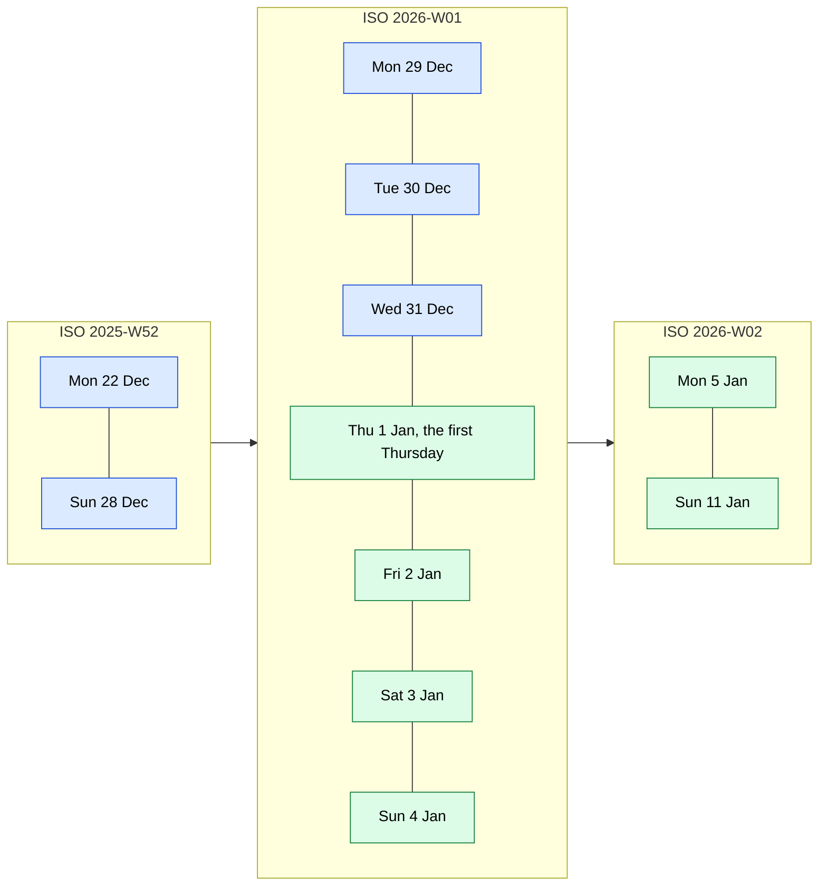

# Dates, weeks and time zones

How many people signed up each week over the new year, counted on the clock the team actually works on?

## Before you start

- **Level:** 2 (intermediate). About 2 hours.
- **You need:** Python 3.9 or later, nothing to install. The optional daylight saving check uses the time zone database that ships with macOS and Linux; on Windows it is skipped unless you have the `tzdata` package. New to Python? Start with [Start here](../../00-start-here/).
- **Builds on:** [01 Clean a messy CSV](../01-clean-a-messy-csv/) (parsing dates with `strptime`) and [02 Reshape wide and long](../02-reshape-wide-and-long/) (counting with a dictionary).

## The problem

Tidewell, a fictional budgeting app, logs every sign-up with a UTC timestamp. Meera, the growth lead in Bengaluru, wants weekly sign-ups with week-over-week change for her January review, counted in India time. Sam, who runs the US team, wants the same report in Pacific time. Last year the spreadsheet version broke in the first week of January and showed a week called W00. You need one piece of code that buckets any timestamp correctly in any of these zones, never breaks at a year end, and does not report a half-finished week as a collapse.

The file `data/signups.csv` (700 events, from Monday 8 December 2025 00:00 UTC up to Monday 19 January 2026 00:00 UTC) is synthetic, built by `make_data.py` with a fixed random seed.

## In plain words

When it is lunchtime in San Francisco on New Year's Eve, it is already the middle of the night of 1 January in Bengaluru. A cricket match that starts at 19:30 in Mumbai is shown live at 06:00 the same morning in California. The moment is the same; the date on the wall calendar is not.

So "how many sign-ups on 1 January?" has no answer until you say whose calendar. The same goes for weeks: a week is seven days, but which seven days, and which year does the week that contains New Year's Day belong to?

Words used below:

- **UTC** (Coordinated Universal Time): the world's reference clock. Logs store times in UTC so every event has one unambiguous label.
- **Time zone**: the rule a place uses to turn UTC into its wall clock. **IST** (India Standard Time) is UTC+5:30 all year. **PST** (Pacific Standard Time) is UTC-8.
- **Daylight saving time** (DST): moving the clocks forward one hour in summer. US Pacific clocks switch to **PDT** (Pacific Daylight Time, UTC-7) from the second Sunday in March to the first Sunday in November. India does not use DST.
- **Offset**: how far a wall clock is from UTC, such as +5:30.
- **ISO week**: an international standard week, Monday to Sunday, numbered within an ISO year.
- **Bucket**: put each event into a group (a day, a week, a month) so you can count the groups.

## What you will build from scratch

- `to_zone` and `to_pacific`: show a UTC instant on the IST, PST or Pacific clock, with the US daylight saving rule written out by hand.
- `iso_week_key`: labels any date with its ISO week, such as `2026-W01`.
- `count_by`: counts events by day, week or month in a chosen zone.
- `complete_weeks`: keeps only the weeks the data fully covers on the reader's clock.
- `previous_week` and `week_over_week`: a weekly table with the change from the week before, correct across the year end.

## The idea

**A timestamp is an instant. A day is a local idea.** `2025-12-31T20:00:00Z` (the `Z` means UTC) is 31 December in London, 1 January in India (UTC+5:30, so 01:30) and still 31 December in California (UTC-8, so 12:00). Which day an event belongs to depends on whose calendar you use. Pick the zone of the people reading the report, convert first, then bucket. Never bucket in UTC and then relabel.

Here are the three clocks side by side. Each column is one instant; time runs left to right (not to scale). The yellow box is the sign-up. The grey dashed box is the moment that clock's date turns to 1 January:

```mermaid
flowchart TB
    subgraph U["UTC clock"]
        direction LR
        u1["31 Dec 18:30"] --> u2["31 Dec 20:00"] --> u3["1 Jan 00:00"] --> u4["1 Jan 08:00"]
    end
    subgraph I["IST clock, UTC+5:30"]
        direction LR
        i1["1 Jan 00:00"] --> i2["1 Jan 01:30"] --> i3["1 Jan 05:30"] --> i4["1 Jan 13:30"]
    end
    subgraph P["PST clock, UTC-8"]
        direction LR
        p1["31 Dec 10:30"] --> p2["31 Dec 12:00"] --> p3["31 Dec 16:00"] --> p4["1 Jan 00:00"]
    end
    classDef signup fill:#fde68a,stroke:#b45309,stroke-width:2px,color:#000000
    classDef midnight fill:#e5e7eb,stroke:#374151,stroke-dasharray:4 3,color:#000000
    class u2,i2,p2 signup
    class u3,i1,p4 midnight
```



India's new year starts 5.5 hours before UTC's, and California's starts 8 hours after it. The sign-up lands after India's midnight and before the other two. In this data the choice changes the numbers: on 1 January there were 20 sign-ups by the UTC day, 19 by the IST day and 24 by the PST day.

**ISO weeks.** An ISO week runs Monday to Sunday. Week 1 is the week that contains the year's first Thursday. So a week can start in one calendar year and belong to the next ISO year. Blue days are calendar year 2025, green days are 2026:



Wednesday 31 December 2025 is in `2026-W01`. If you label it with the calendar year (2025) and the ISO week number (1), you get `2025-W01`, a week that happened twelve months earlier. Always take the year and the week from the same `isocalendar()` call.

The `%W` code in `strftime` is not ISO. It counts Mondays from 1 January and puts the days before the first Monday into week 00. It splits the new-year week in two:

| Day | Mon 29 Dec | Tue 30 Dec | Wed 31 Dec | Thu 1 Jan | Fri 2 Jan | Sat 3 Jan | Sun 4 Jan |
|---|---|---|---|---|---|---|---|
| ISO week | 2026-W01 | 2026-W01 | 2026-W01 | 2026-W01 | 2026-W01 | 2026-W01 | 2026-W01 |
| `%Y-W%W` | 2025-W52 | 2025-W52 | 2025-W52 | 2026-W00 | 2026-W00 | 2026-W00 | 2026-W00 |

**Previous week by dates, not by numbers.** Week 1 minus 1 is not week 0. Take the Monday of the week, subtract 7 days, and label that date. This also handles years with 53 ISO weeks, such as 2020.

**Week-over-week change** is

```
change % = (this week - last week) / last week * 100
```

It is undefined when last week is 0, so return nothing instead of dividing by zero. Weeks with no events must still appear, as 0, or the next week gets compared with the wrong week.

**Complete weeks only.** A week belongs in the report only if the data covers it from Monday 00:00 to the next Monday 00:00 on the reader's clock. The export runs from Monday 8 December 00:00 UTC to Monday 19 January 00:00 UTC. On the UTC clock that is exactly six weeks. On the IST clock it runs from 05:30 on Monday 8 December to 05:30 on Monday 19 January, so the first IST week is missing its first 5.5 hours and an extra week, `2026-W04`, holds only 5.5 hours. Both are partial. `complete_weeks` drops them.

**Daylight saving time.** A fixed offset is a constant: IST is always +5:30, and that is correct because India has no DST. Pacific time is not a constant. The US rule (in force since 2007) is:

```
clocks go forward: second Sunday of March,  02:00 PST -> 03:00 PDT  (10:00 UTC)
clocks go back:    first Sunday of November, 02:00 PDT -> 01:00 PST  (09:00 UTC)
between the two:   UTC-7 (PDT).  Otherwise: UTC-8 (PST)
```

So 8 March 2026 has 23 hours on Pacific clocks and 1 November 2026 has 25. Every date in this lesson's data is in winter, which is why a fixed UTC-8 gives the right answer here. In a report that covers summer, a fixed UTC-8 puts every event an hour early, and the events in the first hour after local midnight land on the previous day. `to_pacific` builds the rule by hand from the two switch instants, so it works on any computer. Python's `zoneinfo` module (standard since 3.9) reads the same rules from the system's time zone database, which also knows the rules for every other country and every past year. Use `zoneinfo` in real work when it is available, and test against it, which this lesson's test does.

## Walk through

See the `%W` trap:

```python
from datetime import date
for d in [date(2025, 12, 31), date(2026, 1, 1)]:
    print(d, d.strftime("%Y-W%W"), d.isocalendar()[:2])
```

This prints:

```
2025-12-31 2025-W52 (2026, 1)
2026-01-01 2026-W00 (2026, 1)
```

The `%W` labels are `2025-W52` and `2026-W00`, two weeks for days that are one day apart. `isocalendar()` returns (ISO year, ISO week, weekday), and `[:2]` keeps the first two: `(2026, 1)` for both.

Convert one instant to three clocks:

```python
from datetime import datetime, timedelta, timezone
ts = datetime(2025, 12, 31, 20, 0, tzinfo=timezone.utc)
for name, hours in [("UTC", 0), ("IST", 5.5), ("PST", -8)]:
    print(name, ts.astimezone(timezone(timedelta(hours=hours))).strftime("%Y-%m-%d %H:%M"))
```

This prints:

```
UTC 2025-12-31 20:00
IST 2026-01-01 01:30
PST 2025-12-31 12:00
```

`tzinfo=timezone.utc` makes the datetime aware: it knows it is a UTC instant. `timezone(timedelta(hours=5.5))` is a fixed offset of +5:30. `astimezone` keeps the instant and changes only the clock it is shown on.

Find the previous week with date arithmetic:

```python
from datetime import date, timedelta
monday = date.fromisocalendar(2026, 1, 1)
y, w, _ = (monday - timedelta(days=7)).isocalendar()
print("%d-W%02d" % (y, w))
```

This prints:

```
2025-W52
```

`date.fromisocalendar(2026, 1, 1)` is the Monday (day 1) of ISO week 1 of 2026, which is 29 December 2025. Seven days earlier is in `2025-W52`. `%02d` pads the week to two digits.

Watch the Pacific clock change in March, and see what a fixed UTC-8 does in summer:

```python
import sys
sys.path.insert(0, "solution")
import solution as s

for text in ["2026-03-08T09:59:59Z", "2026-03-08T10:00:00Z", "2026-07-01T07:30:00Z"]:
    ts = s.parse_utc(text)
    print(text, "PT", s.to_zone(ts, "PT").strftime("%d %b %H:%M %Z"), "| fixed PST", s.to_zone(ts, "PST").strftime("%d %b %H:%M %Z"))
```

This prints:

```
2026-03-08T09:59:59Z PT 08 Mar 01:59 PST | fixed PST 08 Mar 01:59 PST
2026-03-08T10:00:00Z PT 08 Mar 03:00 PDT | fixed PST 08 Mar 02:00 PST
2026-07-01T07:30:00Z PT 01 Jul 00:30 PDT | fixed PST 30 Jun 23:30 PST
```

One second after 01:59:59 the Pacific clock reads 03:00: the hour from 02:00 to 03:00 does not exist that day, yet the fixed offset shows 02:00. On 1 July, the fixed offset puts a sign-up from half past midnight on 30 June. `%Z` prints the zone's name.

Run the worked answer:

```
python3 solution/solution.py
```

This prints:

```
UTC 31 Dec: 21  1 Jan: 20  months: {'2025-12': 406, '2026-01': 294}
IST 31 Dec: 21  1 Jan: 19  months: {'2025-12': 404, '2026-01': 296}
PST 31 Dec: 18  1 Jan: 24  months: {'2025-12': 409, '2026-01': 291}

IST weeks left out as partial: ['2025-W50', '2026-W04']
{'week': '2025-W51', 'count': 122, 'prev_week': '2025-W50', 'prev_count': None, 'change_pct': None}
{'week': '2025-W52', 'count': 111, 'prev_week': '2025-W51', 'prev_count': 122, 'change_pct': -9.0}
{'week': '2026-W01', 'count': 125, 'prev_week': '2025-W52', 'prev_count': 111, 'change_pct': 12.6}
{'week': '2026-W02', 'count': 106, 'prev_week': '2026-W01', 'prev_count': 125, 'change_pct': -15.2}
{'week': '2026-W03', 'count': 111, 'prev_week': '2026-W02', 'prev_count': 106, 'change_pct': 4.7}
```

The same 700 events give three different December totals, because each clock moves a few late-night events across the month line. The IST weekly table covers the five complete IST weeks. `2025-W51` has no change because the week before it was partial and left out.

## Common mistakes

**1. Comparing a partial week with a full one.** This is the trap in this data. Keep every IST week and look at the last two rows:

```python
import sys
sys.path.insert(0, "solution")
import solution as s

stamps = [s.parse_utc(r["ts_utc"]) for r in s.load_csv("signups.csv")]
for row in s.week_over_week(s.count_by(stamps, s.iso_week_key, "IST"))[-2:]:
    print(row)
```

This prints:

```
{'week': '2026-W03', 'count': 111, 'prev_week': '2026-W02', 'prev_count': 106, 'change_pct': 4.7}
{'week': '2026-W04', 'count': 4, 'prev_week': '2026-W03', 'prev_count': 111, 'change_pct': -96.4}
```

A 96.4% drop in sign-ups, on the first line Meera reads. It is not real: `2026-W04` holds the 5.5 hours of data that are already Monday in India. `complete_weeks` drops it. The first IST week is partial in the same way, and the strict rule drops it too, at the cost of one comparison. A looser rule (allow a few missing hours) is a judgment call; if you make it, say so in the report.

**2. Using the calendar year with the ISO week.** `"%d-W%02d" % (d.year, d.isocalendar()[1])` labels 31 December 2025 as `2025-W01`. Take both numbers from `isocalendar()`.

**3. Bucketing in UTC and relabelling.** Counting UTC days and calling them India days puts every event from 00:00 to 05:30 IST on the previous day. On 1 January that is the difference between 20 and 19.

**4. Subtracting two local times in the same zone.** Python subtracts the wall clocks when both datetimes share one `tzinfo`, so it misses the DST hour. This block needs the time zone database:

```python
from datetime import datetime, timezone
from zoneinfo import ZoneInfo

la = ZoneInfo("America/Los_Angeles")
start, end = datetime(2026, 3, 8, tzinfo=la), datetime(2026, 3, 9, tzinfo=la)
print("subtracting local clocks:", end - start)
print("subtracting instants:", end.astimezone(timezone.utc) - start.astimezone(timezone.utc))
```

This prints:

```
subtracting local clocks: 1 day, 0:00:00
subtracting instants: 23:00:00
```

8 March 2026 was 23 hours long in Los Angeles. Convert to UTC before you measure a duration. If the block raises `ZoneInfoNotFoundError`, your computer has no time zone database (common on Windows); everything else in the lesson still works.

**5. A fixed UTC-8 for a whole year.** It is right from November to March and an hour off for the rest of the year, as the walk through shows. Use `zoneinfo`, or a rule like `to_pacific`, whenever a report crosses a DST switch.

## Your turn

Open `exercise.py`. Fill in `to_pacific`, `to_zone`, `iso_week_key`, `count_by`, `previous_week`, `complete_weeks` and `week_over_week`. Then run, from this folder:

```
python3 test_lesson.py
```

The test checks your code on the committed file, on a second file that `make_data.build(seed=2027)` builds in memory, and on hand-picked instants either side of both 2026 Pacific clock changes. If your computer has a time zone database, it also compares your `to_pacific` with `zoneinfo` for every hour of 2026; otherwise that one check is skipped.

Stretch: add `"PT"` to the loop in `main` and confirm it matches PST for this data. Then make `complete_weeks` accept `max_missing_hours`, and decide what value you would defend to Meera.

## Check yourself

1. Which ISO week is 31 December 2025 in, and why?
2. Your events are stored in UTC and the report is for a team in India. In what order do you convert and bucket?
3. Why must a week with zero events still appear in the weekly table?
4. This week shows a 96% drop. What is the first thing you check?
5. Why can a fixed UTC-8 offset be right for this lesson and wrong for a report on July?

<details>
<summary>Answers</summary>

1. `2026-W01`. ISO week 1 is the week containing the first Thursday of the year. 1 January 2026 is a Thursday, so the week from Monday 29 December 2025 is week 1 of 2026.
2. Convert each timestamp to IST first, then take the day, week or month. Bucketing in UTC puts events from 00:00 to 05:30 IST on the wrong day.
3. Otherwise the week after it is compared with the last week that had data, which might be two weeks back, and the change is wrong.
4. Whether the week is complete on the reader's clock. A week that has just started, or that the data cuts off part way, looks like a collapse. Here `2026-W04` held 5.5 hours of data.
5. Pacific clocks show UTC-8 only outside daylight saving time, roughly November to March. In July they show UTC-7, so a fixed UTC-8 puts every event an hour early and moves the events from just after midnight to the previous day.

</details>

## What to tell the stakeholder

> Meera, weekly sign-ups on India time, for the five complete weeks from 15 December 2025 to 18 January 2026: 122, 111, 125, 106 and 111. The new-year week (29 December to 4 January) was the highest at 125, up 12.6% on the week before. I left out the first and the last week because the export covers only part of them on India time; the last one would otherwise show a false 96.4% drop.

## In real job postings

Dates are where analyst Python and SQL both go wrong first. In the Real Analyst Jobs data drop of 25 October 2026 ([data/job-market/2026-10](../../../data/job-market/2026-10/)), 634 of the 900 India analyst postings that list tools ask for SQL (70.4%) and 448 ask for Python (49.8%). See the [Python skills page](https://realanalystjobs.com/skills/python) and the [analyst job market report](https://realanalystjobs.com/analyst-job-market).

## Next

[04 Automate the weekly report](../04-automate-the-weekly-report/)
