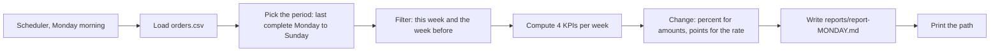

# Automate the weekly report

Can the Monday KPI report write itself, with the same numbers every time it runs?

## Before you start

- **Level:** 2 (intermediate). About 2 hours.
- **You need:** Python 3.9 or later, nothing to install. New to Python? Start with [Start here](../../00-start-here/).
- **Builds on:** [01 Clean a messy CSV](../01-clean-a-messy-csv/) (reading a CSV) and [03 Dates, weeks and time zones](../03-dates-weeks-and-time-zones/) (Monday to Sunday weeks and partial weeks).

## The problem

Brightloom, a fictional online stationery shop, sends a KPI note to its founders every Monday. Leila, the analyst, spends an hour each week copying numbers from an export into a document, and twice this quarter a number was pasted into the wrong row. The founders want the note to look the same every week, cover the last full Monday to Sunday, and compare each number with the week before. Your job is a script that reads the order export, computes four KPIs and writes the note as a Markdown file, so Monday becomes one command.

The file `data/orders.csv` (485 orders, Monday 5 to Sunday 25 October 2026) is synthetic, built by `make_data.py` with a fixed random seed.

## In plain words

Think of a bank statement. It arrives on the same day each month, covers one full month, uses the same layout every time, and shows each total next to last month's. Nobody types it by hand. A program picks the period, finds the transactions, adds them up and prints the page.

A weekly KPI report should work the same way. Words used below:

- **KPI** (key performance indicator): one of the few numbers a business watches every week, such as revenue.
- **Average order value** (AOV): revenue divided by the number of paid orders.
- **Refund rate**: refunded orders as a share of all orders.
- **Percentage point** (pt): the unit for the difference between two percentages. 4.0% to 5.0% is +1.0 pts.
- **Markdown**: a plain-text format where `|` makes tables and `#` makes headings. GitHub, Slack and many editors display it.
- **Idempotent**: running the same command twice gives the same result as running it once.
- **Scheduler**: a program that starts another program at set times, such as cron on macOS and Linux or Task Scheduler on Windows.
- **CLI** (command line interface): options you pass when you run the script, such as `--week 2026-10-12`.

## What you will build from scratch

- `latest_complete_week`: finds the Monday of the last full week in the data.
- `rows_in_week` and `compute_kpis`: revenue, paid orders, average order value and refund rate for one week.
- `pct_change` and `format_change`: week-over-week change that never divides by zero and reports a rate in points.
- `build_report`: the Markdown note, the same layout every week.

## The idea

A report script is a short pipeline, each step a function you can test on its own:



The scheduler box is the only part this lesson does not run. Everything to its right is the script.

**Pick the period.** The default is the last complete week, not "the last 7 days". Find the last Sunday on or before the latest date in the data, then go back 6 days to its Monday. If the export stops on a Thursday, the report covers the week before, instead of comparing four days with seven.

**Define each KPI once, in code.**

```
revenue             = sum of amount over paid orders
paid orders         = count of paid orders
average order value = revenue / paid orders
refund rate         = refunded orders / all orders * 100
```

Write the definitions under the table too. A number that people read every week needs its definition next to it.

**Change.** For amounts and counts, use percent change: `(this - last) / last * 100`. It is undefined when last week is 0, so the cell says `n/a`. For a rate, use the difference in **percentage points**. A refund rate going from 4.0% to 5.0% is +1.0 pts. Calling it +25% is correct arithmetic but is easy to misread as the rate itself going up by 25 points.

**Refund lag.** The refund rate counts orders placed in the week. A customer who orders on Sunday may ask for a refund on Wednesday, after the report has gone out. So the latest week's refund rate is a floor: it can only rise when the report is run again later. The report says so in a footnote. Older weeks have had time to settle.

**Write a file, not a screen.** The script writes `reports/report-<monday>.md`. The file name carries the week, not the day it ran, so running it twice for the same week overwrites the same file (the script is idempotent) and running it next week adds a new one. The script prints only the path, so a scheduler's log stays short.

## Walk through

Find the last complete week:

```python
from datetime import date, timedelta
last = date(2026, 10, 22)  # a Thursday
sunday = last - timedelta(days=(last.weekday() + 1) % 7)
print(sunday, sunday - timedelta(days=6))
```

This prints:

```
2026-10-18 2026-10-12
```

`weekday()` is 0 for Monday up to 6 for Sunday, so `(weekday() + 1) % 7` is how many days ago the last Sunday was: 4 for a Thursday, and 0 if the last day is itself a Sunday. The data stops on a Thursday, so the report covers the week of 12 October.

Percent change and points change:

```python
this_rate, last_rate = 5.0, 4.0
print("%+.1f pts" % (this_rate - last_rate))
print("%+.1f%%" % ((this_rate - last_rate) / last_rate * 100))
```

This prints:

```
+1.0 pts
+25.0%
```

`%+.1f` always shows the sign and one decimal. `%%` prints a literal percent sign. The first line is what the report shows. The second is the version to avoid.

Run the worked answer, from this folder:

```
python3 solution/solution.py
```

This prints:

```
wrote reports/report-2026-10-19.md
```

and the file it writes is:

```
# Weekly report: week of 2026-10-19

Orders from Monday 2026-10-19 to Sunday 2026-10-25, compared with the week before.

| KPI | This week | Last week | Change |
|---|---|---|---|
| Revenue | $19,629.98 | $19,565.07 | +0.3% |
| Paid orders | 143 | 145 | -1.4% |
| Average order value | $137.27 | $134.93 | +1.7% |
| Refund rate | 5.9% | 7.6% | -1.7 pts |

Revenue and average order value count paid orders only. Refund rate is refunded orders as a share of all orders placed in the week.
Refunds can arrive days after the order, so the latest week's refund rate can still rise when the report is run again.
```

Revenue is up a little on fewer paid orders, because each order was worth more. Pass `--week 2026-10-12` to rebuild an older week, and `--out` to write somewhere else. The `reports/` folder is ignored by git, so your reports never end up in a commit.

**Put it on a schedule.** The block below is a reference only. It is not run by this lesson or its test; copy it when you set up a real machine.

```
# Reference only, not run. cron (macOS, Linux): edit with `crontab -e`.
# Fields: minute hour day-of-month month day-of-week (1 = Monday), then the command.
0 7 * * 1  cd /path/to/04-automate-the-weekly-report && python3 solution/solution.py >> reports/cron.log 2>&1

# Reference only, not run. Windows Task Scheduler, from a Command Prompt:
schtasks /Create /SC WEEKLY /D MON /ST 07:00 /TN "Weekly KPI report" /TR "python C:\path\to\04-automate-the-weekly-report\solution\solution.py"
```

`0 7 * * 1` means minute 0, hour 7, any day of the month, any month, on Mondays. `>> reports/cron.log 2>&1` appends the printed path and any error to a log file, because nobody is watching the screen at 07:00. Both schedulers use the machine's own clock and time zone, which is lesson 03 again: a cloud server on UTC runs "07:00" at 12:30 in India. Hosted schedulers such as GitHub Actions also take a cron line and run it in UTC.

## Common mistakes

**1. Reporting the last 7 days, or a week that has not finished.** Suppose the export had stopped on Thursday 22 October and the script simply took "this week so far":

```python
import sys
from datetime import date
sys.path.insert(0, "solution")
import solution as s

rows = s.load_orders()
so_far = [r for r in rows if date(2026, 10, 19) <= r["order_date"] <= date(2026, 10, 22)]
cur = s.compute_kpis(so_far)
prev = s.compute_kpis(s.rows_in_week(rows, date(2026, 10, 12)))
print("revenue, Monday to Thursday vs a full week:", s.format_change("revenue", cur["revenue"], prev["revenue"]))
```

This prints:

```
revenue, Monday to Thursday vs a full week: -42.4%
```

Four days compared with seven looks like revenue fell by 42.4%. The full week, once it ended, was up 0.3%. `latest_complete_week` prevents this by never picking a week the data has not finished.

**2. Percent change on a rate.** On this week's data:

```python
import sys
from datetime import date
sys.path.insert(0, "solution")
import solution as s

rows = s.load_orders()
cur = s.compute_kpis(s.rows_in_week(rows, date(2026, 10, 19)))
prev = s.compute_kpis(s.rows_in_week(rows, date(2026, 10, 12)))
print("in points: %+.1f pts" % (cur["refund_rate"] - prev["refund_rate"]))
print("in percent: %+.1f%%" % s.pct_change(cur["refund_rate"], prev["refund_rate"]))
```

This prints:

```
in points: -1.7 pts
in percent: -22.5%
```

"Refunds down 22.5%" reads like a big win. The rate moved from 7.6% to 5.9%, which is 1.7 points. Report the points.

**3. Reading the latest refund rate as final.** Because of refund lag, part of that -1.7 pts may simply be refunds for late-week orders that have not been asked for yet. This week had 152 orders, so each extra refund adds about 0.7 points (1 in 152). Re-run the report next Monday and see whether the number holds before anyone celebrates.

**4. Naming the file by the day it ran.** `report-2026-10-26.md` for the week of 19 October means a re-run on Tuesday creates a second file for the same week, and two versions start to circulate. Name the file by the week it covers.

## Your turn

Open `exercise.py`. Fill in `latest_complete_week`, `rows_in_week`, `compute_kpis`, `pct_change`, `format_change` and `build_report`. The tests read the file your script writes, so match the report above line for line, footnotes included. Then run, from this folder:

```
python3 test_lesson.py
```

The test runs your script on the committed export and on a second export that `make_data.build(seed=2027, days=19)` builds in memory, which ends on a Friday. It also checks a week with no orders, where most cells must say `n/a`.

Stretch: add a fifth KPI, new customers (customer IDs never seen in any earlier week of the file), and decide whether its change belongs in percent or in points.

## Check yourself

1. Why default to the last complete week instead of the last 7 days?
2. Refund rate went from 4.0% to 5.0%. How do you report the change?
3. Last week had 0 paid orders. What goes in the change column, and why not 0%?
4. Why test the function that computes the KPIs separately from the function that writes the file?
5. This week's refund rate fell. Why should you be careful before calling it an improvement?

<details>
<summary>Answers</summary>

1. Weeks are what people compare. A rolling 7 days starting on a Thursday mixes two weeks, and a partial week compared with a full week looks like a drop: here -42.4% for a week that ended up +0.3%.
2. +1.0 percentage points. Percent change on a rate (+25%) is easy to misread as the rate going up by 25 points.
3. `n/a`. Any change from 0 is undefined. Writing 0% claims there was no change, which is false.
4. When a number is wrong you want to know whether the maths or the formatting broke. Small functions with their own tests point straight at the broken step.
5. Refund lag. Refunds arrive after orders, so the most recent week always looks better than it will once its refunds come in. Compare it again a week later.

</details>

## What to tell the stakeholder

> Week of 19 October: revenue $19,629.98, up 0.3% on the week before, on 143 paid orders (down 1.4%), because the average order was worth more ($137.27, up 1.7%). The refund rate is 5.9%, down 1.7 points, but refunds for late-week orders can still arrive, so I will confirm that figure in next Monday's report.

## In real job postings

Automating recurring reports is one of the first places an analyst's Python pays off. In the Real Analyst Jobs data drop of 25 October 2026 ([data/job-market/2026-10](../../../data/job-market/2026-10/)), 996 of the 2,056 US analyst postings that list tools ask for Python (48.4%), and 222 of the 413 such UK postings do (53.8%). See [Python data analyst jobs](https://realanalystjobs.com/jobs/python-data-analyst-jobs), or check a change by hand with the [percentage change calculator](https://realanalystjobs.com/tools/percentage-change-calculator).

## Next

That ends the live lessons in phase 05. Go on to [06 AI for analysts](../../06-ai-for-analysts/), or back to the [phase 05 overview](../) to see the lessons planned next.
