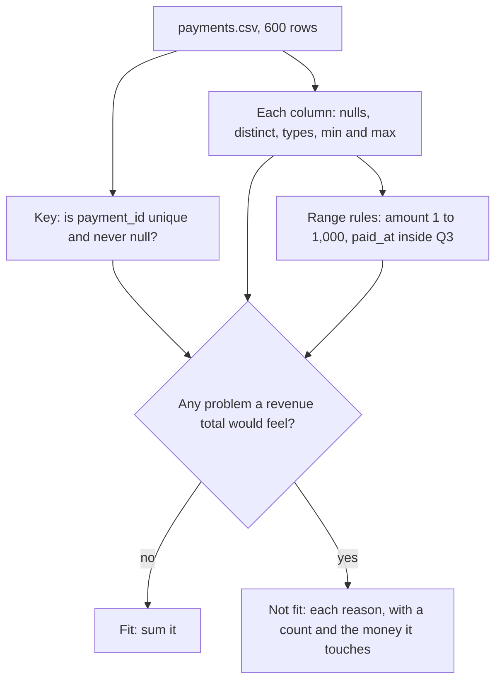

# Profile a table before you trust it

Is this table fit for the board number?

## Before you start

- **Level:** 1 (beginner). About 2 hours.
- **You need:** Python 3.9 or later, nothing to install. New to Python? Start with [Start here](../../00-start-here/).
- **Builds on:** [01 Clean a messy CSV](../01-clean-a-messy-csv/) (reading a CSV, duplicates, conflicts), [03 Tables, rows and grain](../../00-start-here/03-tables-rows-and-grain/) (one row per what?) and [05 NULLs, CASE and COALESCE](../../00-start-here/05-nulls-case-and-coalesce/) (what "no value" means).

## The problem

Lanternway Courses, a fictional online course platform, reports quarterly revenue to its board. Ines, the CFO, needs the Q3 2026 number (July to September) for the board pack that goes out on Thursday 5 November. The data team has handed over `payments.csv`, an export of the payments table, and the quick total of the amount column is 36,829.00. Before that number goes to a board, Ines wants a yes or no: is the table fit to be summed, and if not, what is wrong with it and how much money does each problem touch? You have one afternoon.

The file `data/payments.csv` (600 rows) is synthetic, built by `make_data.py` with a fixed seed. Its problems were put there on purpose.

## In plain words

Before a doctor treats you, a nurse takes your temperature, pulse and blood pressure. None of these is a diagnosis. Each one is a quick, standard check that says "normal" or "look closer", and together they decide whether the treatment can go ahead. Profiling a table is the same: a few standard checks on every column, done before any analysis, that tell you whether the numbers you are about to compute can be trusted.

- A **profile** is a short summary of every column: how many cells are missing, how many different values there are, the smallest and largest value, and what kinds of value it holds.
- A **null** is a missing value. In a CSV it hides in several forms: an empty cell, a cell of spaces, or text such as `NULL` or `N/A` that someone wrote in place of a value.
- A **primary key** is the column that should identify each row once, here `payment_id`. A **duplicate key** is a key that appears on more than one row.
- **Distinct** values are the different values in a column. `Pro`, `pro` and `PRO` are three distinct values for one plan.
- A **type** is the kind of a value: a number, a date or text. A column with a **type mix** holds more than one kind, such as numbers and the text `49,00`.
- A **range rule** says which values make sense, for example "an amount between 1 and 1,000" or "a date inside Q3".
- **Fit for purpose** means good enough for one specific use. A table can be fine for counting customers by country and unfit for a revenue total.

## What you will build from scratch

- `classify`: one cell is empty, null text, an integer, a decimal, a date or text.
- `profile_column`: nulls (split into empty and null text), distinct values, type counts, main type, min and max.
- `profile_table`: every column, plus the key checks: null keys, duplicate keys, exact duplicate rows.
- `out_of_range`: values that break a range rule.
- `check_fitness`: the verdict, fit or not fit, with a list of reasons and counts.
- `naive_revenue` and `duplicate_inflation`: the quick total, and how much of it sits on repeated keys.

## The idea

A profile is a fixed list of questions, asked of every column, that ends in a verdict for one use:



What each check catches, and why it matters for a sum:

| Check | Formula | What goes wrong if you skip it |
|---|---|---|
| Rows vs distinct keys | `rows - distinct keys` | A payment loaded twice is counted twice |
| Nulls | empty cells + null text | Missing amounts quietly count as 0 |
| Distinct values | count of different values | `Pro`, `pro` and `PRO` become three plans in a breakdown |
| Type mix | cells not of the main type | `49,00` is text, so a sum skips it or crashes |
| Min and max | smallest and largest of the main type | A 4,900.00 typo or a negative refund hides inside a total |
| Range rules | values outside the allowed range | Payments from October land in Q3 |

**Two kinds of null.** Python's `csv` module never gives you `None` for an empty cell. It gives the empty string `""`. So `value is None` finds nothing in a CSV, and `value == ""` misses a cell of spaces and every `NULL` or `N/A` someone typed. The profile counts all of them and reports them separately, because they come from different places: an empty cell usually means the source had no value, while `NULL` written as text means a program exported its missing value as a word.

**Null text is a list you choose per column.** This export writes missing values as `NULL`, `None`, `N/A` or `\N`. It does not use `NA`, because in the country column `NA` is Namibia. Adding `NA` to the list would turn real customers into missing ones.

**The verdict is for one use.** Every reason in the verdict is something that changes a revenue total. The same table might be fit for "how many customers do we have in Canada", because none of these problems touches the country column.

## Walk through

Run each block from this folder, in order, in one Python session (type `python3`, then paste). The block under each one is what it prints.

Step 1. Read the file. `csv.DictReader` gives one dictionary per row, and every cell is text.

```python
import csv

with open("data/payments.csv", newline="") as f:
    rows = list(csv.DictReader(f))
print(len(rows), "rows")
print(rows[0])
```

```text
600 rows
{'payment_id': 'PAY-10001', 'customer_id': 'C0144', 'paid_at': '2026-08-08', 'plan': 'Pro', 'amount': '49.00', 'country': 'DE', 'status': 'paid'}
```

Step 2. Count missing amounts three ways. `Counter` counts how often each value appears. The last line keeps every amount that is not a plain number: `replace(".", "", 1)` removes one decimal point and `lstrip("-")` a leading minus, so what is left must be all digits.

```python
from collections import Counter

amounts = [r["amount"] for r in rows]
print("is None:      ", sum(1 for v in amounts if v is None))
print("== '':        ", sum(1 for v in amounts if v == ""))
print("not numbers:  ", Counter(v for v in amounts if not v.replace(".", "", 1).lstrip("-").isdigit()))
```

```text
is None:       0
== '':         3
not numbers:   Counter({'NULL': 3, '': 3, '49,00': 1, 'N/A': 1})
```

`is None` finds no missing amounts. `== ""` finds 3. In fact 7 amounts are missing (3 empty, 3 `NULL`, 1 `N/A`), and one more, `49,00`, is a real amount written with a decimal comma, which Python cannot read as a number.

Step 3. Is the key unique? `set(ids)` keeps one copy of each id, so its length is the number of distinct ids. A tuple of a row's values is the whole row, so counting those finds exact copies.

```python
ids = [r["payment_id"] for r in rows]
print(len(ids), "rows,", len(set(ids)), "distinct payment ids")
twice = [k for k, n in Counter(ids).items() if n > 1]
whole_rows = Counter(tuple(r.values()) for r in rows)
print(len(twice), "ids appear more than once;", sum(n - 1 for n in whole_rows.values()), "rows are exact copies")
for k in twice:
    versions = {tuple(r.values()) for r in rows if r["payment_id"] == k}
    if len(versions) > 1:
        print("same id, different payments:")
        for v in sorted(versions):
            print("   ", v)
```

```text
600 rows, 579 distinct payment ids
21 ids appear more than once; 20 rows are exact copies
same id, different payments:
    ('PAY-10227', 'C0297', '2026-07-27', 'Team', '149.00', 'DE', 'paid')
    ('PAY-10227', 'C0315', '2026-09-09', 'Pro', '49.00', 'US', 'paid')
```

21 rows repeat a key. 20 are exact copies: all of them are payments from 23 to 25 August, the sign of a load that ran twice for those days. The 21st is worse: two different customers' payments share the id PAY-10227. Removing exact copies would not fix that one.

Step 4. Distinct values in two text columns.

```python
print(Counter(r["plan"] for r in rows))
print(Counter(r["country"] for r in rows))
```

```text
Counter({'Pro': 301, 'Basic': 185, 'Team': 108, 'PRO': 2, 'pro': 2, '  ': 2})
Counter({'US': 226, 'IN': 139, 'GB': 82, 'DE': 80, 'CA': 64, 'NA': 9})
```

The plan column holds six different values for three plans: the three names, `PRO` and `pro` (two rows each), and a cell of spaces (two rows). The profile counts the spaces as missing, so it reports 5 distinct values. The country column is clean, and its 9 `NA` rows are Namibian customers.

Step 5. Min, max and range rules. ISO dates (`YYYY-MM-DD`) sort correctly as text, so `"2026-07-01" <= d <= "2026-09-30"` is a valid date check.

```python
nums = [float(v) for v in amounts if v.replace(".", "", 1).lstrip("-").isdigit()]
print("amount min", min(nums), "max", max(nums), " below 1:", sum(1 for x in nums if x < 1),
      " above 1000:", sum(1 for x in nums if x > 1000))
dates = sorted(r["paid_at"] for r in rows)
print("paid_at from", dates[0], "to", dates[-1], " outside Q3:",
      [d for d in dates if not "2026-07-01" <= d <= "2026-09-30"])
```

```text
amount min -49.0 max 4900.0  below 1: 3  above 1000: 1
paid_at from 2026-07-01 to 2026-10-02  outside Q3: ['2026-10-01', '2026-10-02']
```

The plans cost 19, 49 and 149, so 4,900.00 is almost certainly 49.00 typed with two extra zeros. The three amounts of -49.00 are refunds written as negative payments on rows whose status still says `paid`. Two payments are from October.

Step 6. The whole profile and the verdict. The worked answer's `check_fitness` runs every check above on every column, with the rules in `REQUIRED` (columns that must never be missing) and `RULES` (ranges), and returns the verdict with its reasons.

```python
import sys
sys.path.insert(0, "solution")
import solution as s

fit, reasons, profile = s.check_fitness(rows)
for col, p in profile["columns"].items():
    print("%-12s nulls %d (empty %d, text %d)  distinct %3d  %s  %s .. %s" % (
        col, p["nulls"], p["empty"], p["null_text"], p["distinct"], p["types"], p["min"], p["max"]))
print("fit:", fit)
for reason in reasons:
    print("   ", reason)
```

```text
payment_id   nulls 0 (empty 0, text 0)  distinct 579  {'text': 600}  PAY-10001 .. PAY-10579
customer_id  nulls 0 (empty 0, text 0)  distinct 334  {'text': 600}  C0001 .. C0449
paid_at      nulls 0 (empty 0, text 0)  distinct  94  {'date': 600}  2026-07-01 .. 2026-10-02
plan         nulls 2 (empty 2, text 0)  distinct   5  {'text': 598}  Basic .. pro
amount       nulls 7 (empty 3, text 4)  distinct   6  {'number': 592, 'text': 1}  -49.0 .. 4900.0
country      nulls 0 (empty 0, text 0)  distinct   6  {'text': 600}  CA .. US
status       nulls 0 (empty 0, text 0)  distinct   2  {'text': 600}  paid .. refunded
fit: False
    ('duplicate_keys', 'payment_id', 21)
    ('out_of_range', 'paid_at', 2)
    ('missing', 'plan', 2)
    ('missing', 'amount', 7)
    ('mixed_types', 'amount', 1)
    ('out_of_range', 'amount', 4)
```

Six reasons, each with a count. Text min and max are by alphabet (`Basic .. pro`), which is still useful: a lowercase value sorting last is a hint of case variants.

Step 7. What the problems do to the board number.

```python
print("quick SUM of paid amounts:", s.naive_revenue(rows))
print("from rows that repeat a payment id:", s.duplicate_inflation(rows))
```

```text
quick SUM of paid amounts: 36829.0
from rows that repeat a payment id: 1051.0
```

1,051.00 of the quick total sits on rows that repeat a payment id: 902.00 from the 20 copied rows and 149.00 from the second payment filed under PAY-10227. The 4,900.00 row adds about 4,851.00 more than a Pro payment would, the October rows do not belong to Q3, and 7 amounts are missing entirely.

## Common mistakes

**1. Summing a table whose key is not unique (the trap).** The quick total counts every copied row again:

```python
import sys
sys.path.insert(0, "solution")
import solution as s

rows = s.load_csv()
p = s.profile_table(rows, "payment_id")
print("rows", p["rows"], " distinct keys", p["distinct_keys"], " extra rows", p["duplicate_key_rows"])
print("quick total", s.naive_revenue(rows), " of which repeated keys", s.duplicate_inflation(rows),
      "= %.1f%%" % (100 * s.duplicate_inflation(rows) / s.naive_revenue(rows)))
```

```text
rows 600  distinct keys 579  extra rows 21
quick total 36829.0  of which repeated keys 1051.0 = 2.9%
```

2.9% of the board number sits on repeated keys, most of it plain double counting, and no single row looks wrong. `len(rows) == len(set(keys))` is a one-line check that should run before every sum.

**2. Counting nulls with `is None` or `== ""` alone.** Step 2 showed it: `is None` finds 0 missing amounts and `== ""` finds 3, when 7 are missing. Count empty cells, cells of spaces and null text together, and report them apart.

**3. Putting `NA` in the null list for every column.** It would mark Lanternway's 9 Namibian payments as missing countries. Null text depends on the column and on the system that wrote it.

**4. Trusting the type a column "should" have.** The amount column is meant to be numbers, but one cell is `49,00`. `float("49,00")` raises an error, and code that skips errors silently drops that payment. The type counts in the profile show it at once.

**5. Fixing while profiling.** A profile describes the table. Deciding that 4,900.00 means 49.00, or which of the two PAY-10227 payments is real, is a business decision for the owner of the data. Profile first, report, then fix with the owner's answers.

## Your turn

Open `exercise.py` and fill in `classify`, `profile_column`, `profile_table`, `out_of_range`, `check_fitness`, `naive_revenue` and `duplicate_inflation`. The rules for this table (`KEY`, `REQUIRED`, `RULES`, `NULL_TOKENS`) are already there. Then run, from this folder:

```
python3 test_lesson.py
```

The test checks `classify` on every kind of null and value (including `NA`, an invalid date and `49,00`), each profile function on an empty column, an all-null column, a tie between types and a zero, the verdict on a clean row and on no rows, and then the whole profile, the reasons and both revenue numbers on the committed file and on a second file that `make_data.build(seed=2033)` makes in memory, with a different number of every problem.

Stretch: add a `top_values` entry to `profile_column` with the three most common values and their counts, and a check that flags a column where one value fills more than 95% of the rows.

## Check yourself

1. A table has 600 rows and 579 distinct primary keys. What do you check next?
2. Why does `value is None` find no missing values in a CSV read with `csv.DictReader`?
3. Why is "fit for purpose" a better verdict than "clean"?
4. The amount column's max is 4,900.00 and every plan costs 149 or less. What do you do?

<details>
<summary>Answers</summary>

1. Whether the repeated keys are exact copies (a load that ran twice: drop the copies) or different rows sharing a key (a real conflict: ask the owner). Then how much of the number you care about sits on the repeated rows.
2. The csv module writes an empty cell as the empty string `""`, never `None`. You get `None` only for a cell missing from a short row. Missing values can also be spaces or words like `NULL`, so check all of them.
3. No real table is perfectly clean, and different uses care about different columns. A table can be fit for counting customers by country and unfit for a revenue total. The verdict should name the use and the problems that affect it.
4. Report it, do not fix it alone. It is probably 49.00 with two extra zeros, but the person who owns the payments system should confirm it before the board number changes by 4,851.00.

</details>

## What to tell the stakeholder

> Ines, the payments table is not fit for the Q3 board number yet. The quick total is 36,829.00, but 1,051.00 of it sits on repeated payment ids: 902.00 is double counting, because 23 to 25 August were loaded twice, and 149.00 is a second payment filed under an id that was already used (PAY-10227), which may be real but cannot be checked until it has its own id. One payment of 4,900.00 is very likely a 49.00 typo, 3 refunds are recorded as negative payments marked paid, 2 payments are dated October, and 7 payments have no amount at all. I have listed each row for the data team. Once they confirm the fixes, I will rerun the same checks and send you a number I can stand behind.

## In real job postings

Checking data before using it is everyday analyst work, and most of it is done in SQL or Python. In the Real Analyst Jobs data drop of 25 October 2026 ([data/job-market/2026-10](../../../data/job-market/2026-10/)), 1,477 of the 2,056 US analyst postings that list tools ask for SQL (71.8%) and 996 ask for Python (48.4%). See [Python data analyst jobs](https://realanalystjobs.com/jobs/python-data-analyst-jobs), or try the free [CSV cleaner](https://realanalystjobs.com/tools/csv-cleaner) on a file of your own.

## Next

[06 Join two files and prove nothing was lost](../06-join-files-and-prove-nothing-was-lost/)
