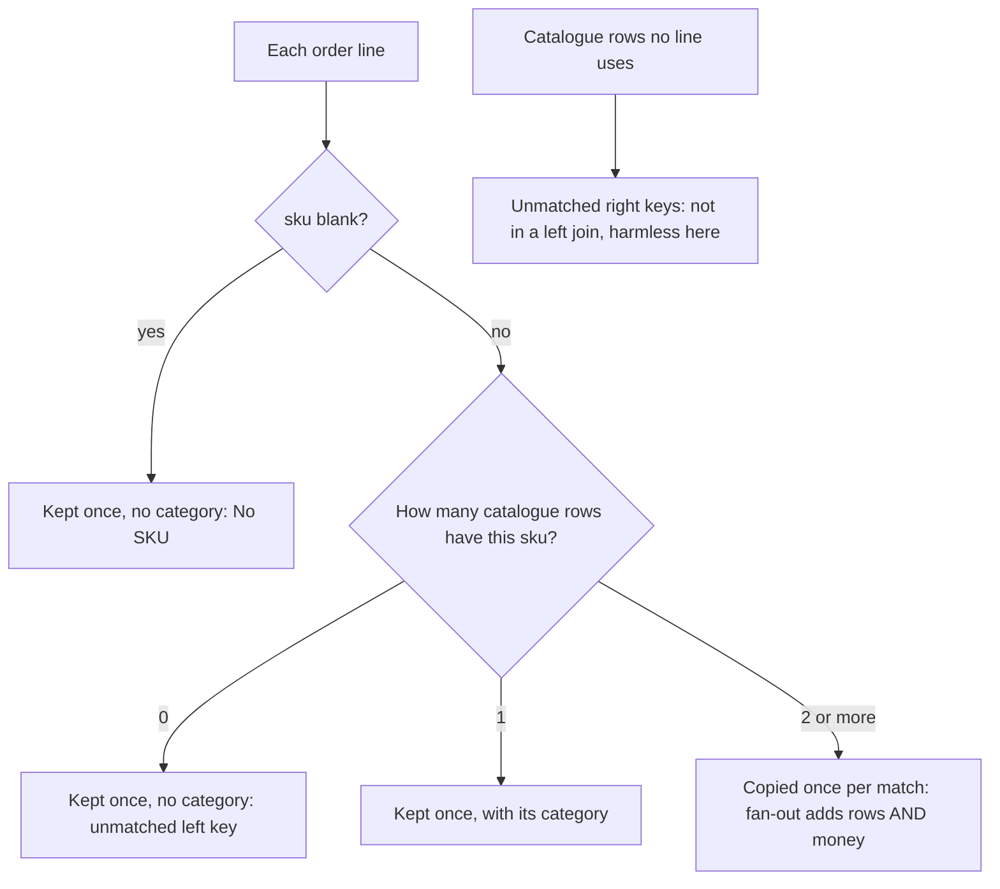

# Join two files and prove nothing was lost

After the merge, are the totals still the totals?

## Before you start

- **Level:** 1 (beginner). About 2 hours.
- **You need:** Python 3.9 or later, nothing to install. pandas is optional: one section and one test use it if you have it.
- **Builds on:** [05 Profile a table before you trust it](../05-profile-a-table/) (duplicate keys, blank cells that mean "no value") and [02 Joins without losing rows](../../01-sql/02-joins-without-losing-rows/) (left and inner joins, and fan-out, in SQL).

## The problem

Kestrel Home, a fictional online furniture shop, wants October revenue by product category for its US store. Priya, the head of finance, has the order lines (391 lines, 262,620.04 in total) and the product catalogue, which says which category each product belongs to. A colleague joined the two in a notebook and sent a category table that adds up to 276,019.78, more than the shop actually sold. Priya will not take a joined number again unless it comes with proof that the join neither lost nor invented any money. She needs the category table and the proof by Friday.

The files in `data/` are synthetic, built by `make_data.py` with a fixed seed: `order_lines.csv` (391 rows) and `products.csv` (43 rows).

## In plain words

Imagine a teacher marking homework against a class list. For each sheet, she finds the student's name on the list and writes down their house colour. If a name is on the list twice, she writes the sheet down twice, and now that student's marks count double. If a sheet has a name that is not on the list, she can drop the sheet or put it on an "unknown" pile. If a sheet has no name at all, it can never be matched. And students on the list with no sheet simply do not appear.

Before she reports the class average, she counts: sheets in, lines written down. If the counts differ, something above happened, and she knows exactly where to look.

- A **join** combines two tables by matching a **key**, here `sku` (stock keeping unit, the product code).
- A **left join** keeps every row of the left table, matched or not. An **inner join** keeps only the rows that match.
- **Fan-out** is what happens when one left row matches several right rows: it is copied once per match, and its amount is counted once per copy.
- An **unmatched key** is a key on one side with no partner on the other. On the left it means lost or unlabelled money. On the right it is usually harmless (a product nobody bought).
- A **blank key** (an empty sku) is like NULL in SQL: it matches nothing, not even another blank.
- To **reconcile** is to compare the joined result with its input until every difference is explained.

## What you will build from scratch

- `left_join` and `inner_join` in plain Python, with fan-out and blank keys handled the way SQL does.
- `reconcile`: row counts, amounts before and after, unmatched keys on both sides, duplicate keys and the money the fan-out added, ending in a list of problems.
- `assert_reconciled`: a guard that stops a script when a join breaks the totals.
- `clean_catalogue` and `revenue_by_category`: the fixed join, where every order line lands in exactly one bucket and the buckets add up to the order lines.

## The idea

A left join keeps every order line. What happens to each line depends on how many catalogue rows share its sku:



So the reconciliation checks are short, and each one has a meaning:

```
joined rows   - left rows    = fan-out rows               must be 0 for a lookup join
joined amount - left amount  = fan-out money              must be 0.00
left rows with blank or unmatched keys                     must be reported, with their amount
right keys listed more than once                           the cause of any fan-out
right keys no left row uses                                usually fine, worth a glance
```

A lookup join (adding a product's category to each line) should be **many to one**: many lines per product, one catalogue row per product. If the right side is not unique on the key, the join is many to many, and totals stop being totals.

**Inner joins hide two errors at once.** An inner join drops unmatched lines (money lost) and still copies fanned-out lines (money added). The two can cancel out, so a total that looks close can still be wrong in both directions. Always compare rows and amounts, not just one of them.

**Fix the right side, not the result.** Deleting the extra rows after the join means knowing which copy to keep. Making the catalogue one row per sku before the join means the join cannot fan out at all. Where the catalogue disagrees with itself (one sku, two categories), say so in a "Needs review" bucket instead of picking one.

## Walk through

Run each block from this folder, in order, in one Python session (type `python3`, then paste). The block under each one is what it prints.

Step 1. Count both files and the money before anything else. This is the number every later step must still add up to.

```python
import csv

def load(path):
    with open(path, newline="") as f:
        return list(csv.DictReader(f))

lines, products = load("data/order_lines.csv"), load("data/products.csv")
before = round(sum(float(l["amount"]) for l in lines), 2)
print(len(lines), "order lines, total", before)
print(len(products), "catalogue rows")
```

```text
391 order lines, total 262620.04
43 catalogue rows
```

Step 2. Is the catalogue unique on sku? `Counter` counts rows per sku. Any count above 1 will fan out.

```python
from collections import Counter

per_sku = Counter(p["sku"] for p in products)
print(len(per_sku), "distinct skus in", len(products), "rows")
for sku, n in per_sku.items():
    if n > 1:
        print(sku, [(p["product_name"], p["category"]) for p in products if p["sku"] == sku])
```

```text
41 distinct skus in 43 rows
KH-1028 [('Knoll Storage', 'Storage'), ('Knoll Storage', 'Tables')]
KH-1245 [('Fable Table', 'Tables'), ('Fable Table', 'Tables')]
```

Two skus are listed twice. KH-1245 is an exact copy. KH-1028 is worse: the catalogue cannot decide whether it is Storage or Tables.

Step 3. A left join, written out. `index` maps each sku to its catalogue rows. For each line, `matches or [None]` loops once per match, or once with `None` when there is no match, so an unmatched line is kept with empty columns.

```python
def left_join(left, right, key):
    index = {}
    for r in right:
        if r[key].strip():
            index.setdefault(r[key], []).append(r)
    out = []
    for row in left:
        matches = index.get(row[key], []) if row[key].strip() else []
        for m in matches or [None]:
            merged = dict(row)
            for col in ("product_name", "category"):
                merged[col] = m[col] if m else None
            out.append(merged)
    return out

joined = left_join(lines, products, "sku")
after = round(sum(float(r["amount"]) for r in joined), 2)
print("rows:", len(lines), "->", len(joined), "   amount:", before, "->", after, "  difference:", round(after - before, 2))
```

```text
rows: 391 -> 407    amount: 262620.04 -> 276019.78   difference: 13399.74
```

16 more rows and 13,399.74 more money than the shop sold. That is the colleague's number.

Step 4. Explain the difference. Set difference (`used - listed`) finds keys on one side only.

```python
used = {l["sku"] for l in lines}
listed = set(per_sku)
print("ordered but not in the catalogue:", sorted(k for k in used - listed if k))
print("lines with no sku:", sum(1 for l in lines if not l["sku"]))
print("in the catalogue, not ordered:   ", sorted(listed - used))
fan = sum((per_sku[l["sku"]] - 1) * float(l["amount"]) for l in lines if per_sku.get(l["sku"], 0) > 1)
print("money added by the fan-out:", round(fan, 2))
```

```text
ordered but not in the catalogue: ['KH-1287', 'KH-1294', 'KH-1301']
lines with no sku: 7
in the catalogue, not ordered:    ['KH-1000', 'KH-1077', 'KH-1119', 'KH-1217', 'KH-1238', 'KH-1273']
money added by the fan-out: 13399.74
```

The fan-out explains the whole difference to the cent. Three new products are not in the catalogue yet, and seven lines (delivery fees) have no sku: a left join keeps them but cannot give them a category. Six catalogue products sold nothing in October, which is fine.

Step 5. All of it in one report, and a guard. The worked answer's `reconcile` returns every count above plus a list of problems. `assert_reconciled` raises an error when a problem is not explicitly allowed, so a script that writes a report stops instead of publishing a wrong number.

```python
import sys
sys.path.insert(0, "solution")
import solution as s

rep = s.reconcile(lines, products, s.left_join(lines, products, "sku"), "sku", "amount")
for k in ("row_diff", "amount_diff", "fanout_rows", "fanout_amount", "duplicate_right_keys",
          "unmatched_left_rows", "unmatched_left_amount", "problems"):
    print("%-22s %s" % (k, rep[k]))
try:
    s.assert_reconciled(rep)
except ValueError as e:
    print("stopped:", e)
```

```text
row_diff               16
amount_diff            13399.74
fanout_rows            16
fanout_amount          13399.74
duplicate_right_keys   ['KH-1028', 'KH-1245']
unmatched_left_rows    40
unmatched_left_amount  9084.33
problems               ['rows_added', 'amount_changed', 'unmatched_left']
stopped: join failed reconciliation: rows_added, amount_changed, unmatched_left (rows 391 -> 407, amount 262620.04 -> 276019.78)
```

40 lines worth 9,084.33 have no category: 33 lines of the three new products and the 7 delivery fees.

Step 6. The fix, and the proof. `clean_catalogue` makes one row per sku: the exact copy collapses, and the sku with two categories becomes "Needs review". The join can no longer fan out. The only problem left is the unmatched lines, which are allowed because they are reported in their own buckets.

```python
catalogue = s.clean_catalogue(products)
print(len(catalogue), "catalogue rows, one per sku;", [c for c in catalogue if c["category"] == s.NEEDS_REVIEW])
fixed = s.left_join(lines, catalogue, "sku")
rep = s.reconcile(lines, catalogue, fixed, "sku", "amount")
s.assert_reconciled(rep, allow=("unmatched_left",))
print("rows:", rep["left_rows"], "->", rep["joined_rows"], "  amount:", rep["left_amount"], "->", rep["joined_amount"])
totals = s.revenue_by_category(fixed)
for k, v in totals.items():
    print("   %-13s %10.2f" % (k, v))
print("   %-13s %10.2f" % ("total", sum(totals.values())))
```

```text
41 catalogue rows, one per sku; [{'sku': 'KH-1028', 'category': 'Needs review'}]
rows: 391 -> 391   amount: 262620.04 -> 262620.04
   Decor            6975.04
   Lighting        18231.97
   Needs review      727.96
   No SKU            343.00
   Rugs            34538.79
   Sofas          108040.90
   Storage         33977.02
   Tables          51044.03
   Unmatched        8741.33
   total          262620.04
```

391 rows in, 391 rows out, and the buckets add up to 262,620.04, the order lines' own total. That is the proof Priya asked for.

Step 7 (optional, needs pandas). pandas has both checks built in. `indicator=True` adds a `_merge` column saying whether each row matched (`both`) or came from one side only (`left_only`, `right_only`). `validate="many_to_one"` checks that the right side is unique on the key and raises an error if not ([pandas DataFrame.merge](https://pandas.pydata.org/docs/reference/api/pandas.DataFrame.merge.html), read 31 October 2026). Skip this step if you do not have pandas.

```python
import pandas as pd

left = pd.DataFrame(lines)
left["amount"] = left["amount"].astype(float)
left.loc[left["sku"] == "", "sku"] = None
right = pd.DataFrame(products)

m = left.merge(right, on="sku", how="left", indicator=True)
print(len(left), "->", len(m), "rows;", m["_merge"].value_counts().to_dict())
try:
    left.merge(right, on="sku", how="left", validate="many_to_one")
except pd.errors.MergeError as e:
    print("MergeError:", e)
ok = left.merge(pd.DataFrame(s.clean_catalogue(products)), on="sku", how="left", validate="many_to_one")
print(len(ok), "rows, amount", round(ok["amount"].sum(), 2))
```

```text
391 -> 407 rows; {'both': 367, 'left_only': 40, 'right_only': 0}
MergeError: Merge keys are not unique in right dataset; not a many-to-one merge
391 rows, amount 262620.04
```

The same 407 rows and the same 40 unmatched lines as our report. A left join never has `right_only` rows; an outer join (`how="outer"`) would show the six unsold products there. One difference from SQL to know: the pandas documentation warns that null keys on both sides are matched against each other, so the blank skus are set to `None` above and the catalogue has no blank sku. Our `left_join` never matches a blank key, like SQL.

## Common mistakes

**1. Trusting a join because the total looks close (the trap).** An inner join on the raw catalogue:

```python
import sys
sys.path.insert(0, "solution")
import solution as s

lines, products = s.load_csv("order_lines.csv"), s.load_csv("products.csv")
inner = s.inner_join(lines, products, "sku")
rep = s.reconcile(lines, products, inner, "sku", "amount")
print("rows", rep["left_rows"], "->", rep["joined_rows"], "  amount", rep["left_amount"], "->", rep["joined_amount"])
print("lost:", rep["unmatched_left_amount"], " added by fan-out:", rep["fanout_amount"])
print("Tables:", s.revenue_by_category(inner)["Tables"], " true Tables:", s.revenue_by_category(
    s.left_join(lines, s.clean_catalogue(products), "sku"))["Tables"])
```

```text
rows 391 -> 367   amount 262620.04 -> 266935.45
lost: 9084.33  added by fan-out: 13399.74
Tables: 64443.77  true Tables: 51044.03
```

The total is only 1.6% high, so it might pass a glance. Underneath, 9,084.33 was dropped and 13,399.74 was invented, and the Tables category is overstated by 26%. Check rows and amount together, and look at the parts of the difference, not only its size.

**2. Fixing the fan-out by removing duplicate rows after the join.** "Drop duplicates" on the joined table removes the KH-1245 copies, because the two catalogue rows are identical, but keeps both KH-1028 rows, because their categories differ. It only spares real order lines because each has its own `line_id`; on a file without one, two identical genuine lines would be merged too. Fix the lookup table before the join.

**3. Using an inner join to "clean" unmatched rows.** It makes the 40 unmatched lines disappear, along with 9,084.33 of real sales. Keep them with a left join and give them their own bucket, so the owner of the catalogue can add the three new products.

**4. Assuming blank keys behave like in SQL everywhere.** In SQL and in our `left_join`, a blank key matches nothing. pandas matches null keys with each other. If both files had blank skus, a pandas merge would pair every delivery fee with every blank catalogue row.

## Your turn

Open `exercise.py` and fill in `left_join`, `inner_join`, `reconcile`, `assert_reconciled`, `clean_catalogue` and `revenue_by_category`. `index_by`, `blank` and the right-column naming helper are done for you. Then run, from this folder:

```
python3 test_lesson.py
```

The test checks the joins on small tables (an empty side, a blank key on both sides, a key listed twice, a column name on both sides, a zero amount), every field of the reconciliation report, the guard, and the fix. Then it checks the report and the category totals on the committed files and on a second pair that `make_data.build(seed=2034)` makes in memory. If pandas is installed, it also compares your numbers with `merge(indicator=True)` and checks `validate="many_to_one"`; without pandas that test is skipped.

Stretch: add `outer_join`, which also keeps catalogue rows that no line uses, and extend `reconcile` so the outer join's extra rows are counted as `right_only` and do not count as money added.

## Check yourself

1. A join turned 391 rows into 407. Where do you look first?
2. Why can an inner join give a total that is close to right and still be wrong?
3. What does `validate="many_to_one"` check in pandas, and when would you use it?
4. The catalogue lists one sku under two categories. What do you do with its revenue?

<details>
<summary>Answers</summary>

1. At the right-hand table: count rows per key. Every extra row is a left row matched more than once, so the keys listed more than once on the right are the cause, and their extra copies times each line's amount is the money added.
2. It loses unmatched rows (money down) and still copies fanned-out rows (money up). The two errors can nearly cancel. Here the total was 1.6% high while one category was 26% high.
3. That every key appears at most once in the right-hand table, so each left row can match at most one row. Use it on every lookup join: adding a category, a region or a price to transaction lines.
4. Keep it out of both categories and report it as "Needs review" with its amount, so the totals still add up and someone who owns the catalogue decides. Picking one quietly moves money between categories.

</details>

## What to tell the stakeholder

> Priya, October US revenue is 262,620.04 on 391 order lines, and the category table now adds up to exactly that, with the same 391 lines before and after the join. The earlier 276,019.78 counted one product twice because the catalogue lists it twice (KH-1245, 13,399.74 too much in Tables). Three items to resolve, each shown separately: 8,741.33 from three new products not yet in the catalogue, 727.96 from KH-1028, which the catalogue lists as both Storage and Tables, and 343.00 of delivery fees with no product code.

## In real job postings

Joining files and checking that the totals survive is daily work in SQL and in Python. In the Real Analyst Jobs data drop of 25 October 2026 ([data/job-market/2026-10](../../../data/job-market/2026-10/)), 1,477 of the 2,056 US analyst postings that list tools ask for SQL (71.8%) and 996 for Python (48.4%). In the UK, 286 of 413 ask for SQL (69.2%) and 222 for Python (53.8%). See [SQL data analyst jobs](https://realanalystjobs.com/jobs/sql-data-analyst-jobs) and [Python data analyst jobs](https://realanalystjobs.com/jobs/python-data-analyst-jobs).

## Next

That is the last lesson in this phase written so far. Go back to the [phase 05 overview](../README.md) for the lessons planned next.
