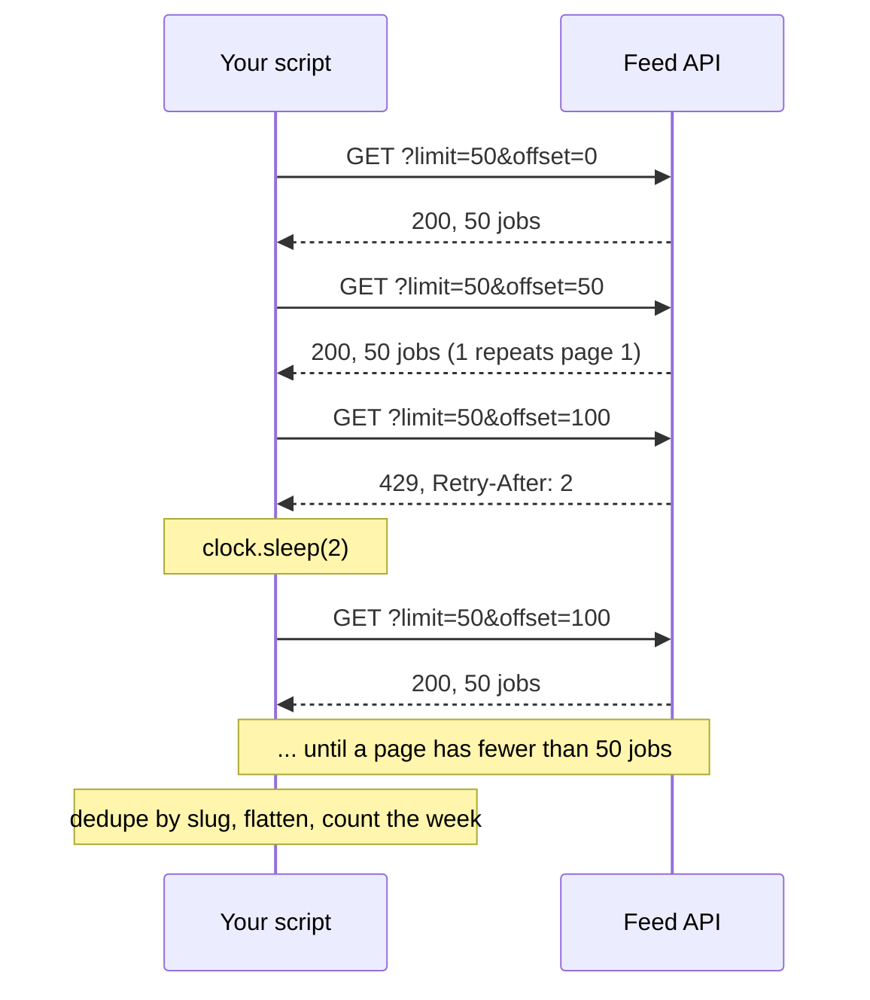

# APIs and JSON

How many analyst roles did the feed return this week?

## Before you start

- **Level:** 2 (intermediate). About 2 hours.
- **You need:** Python 3.9 or later, nothing to install, and no internet: the lesson plays back a recorded feed.
- **Builds on:** [01 Clean a messy CSV](../01-clean-a-messy-csv/) (turning messy values into clean ones), [04 Automate the weekly report](../04-automate-the-weekly-report/) (Monday to Sunday weeks) and [06 Join two files and prove nothing was lost](../06-join-files-and-prove-nothing-was-lost/) (counting rows in and rows out).

## The problem

Jobnest, a fictional job marketplace, sends a newsletter every Monday that opens with "This week: N new analyst roles". The roles come from a partner's job feed, an API that returns JSON 50 roles at a time. Last Monday the newsletter said 50, and a reader replied that the partner's own site showed far more. Sana, the editor, wants the real number for the week of Monday 19 to Sunday 25 October 2026, split by country, before this Monday's issue goes out at 10:00.

The feed was recorded on Monday 26 October at 07:00 UTC into `data/pages/` (six pages) and `data/failures.json` (two requests that failed the first time). It is synthetic, built by `make_data.py` with a fixed seed: no real API was called and every company is invented. `data/fixture.json` says so.

## In plain words

Think of a long shopping receipt that the shop will only print 50 lines at a time. You ask for lines 1 to 50, then 51 to 100, and so on, until a printout comes back with fewer than 50 lines. If you stop after the first printout you have counted 50 items, whatever you bought. And if the cashier adds items to the top of the receipt while you are asking, line 51 of the new printout is the old line 50, so one item appears on two printouts.

That is paging through an API. Words used below:

- **API** (application programming interface): a web address that a program, not a person, asks for data. It answers in a fixed format.
- **JSON** (JavaScript Object Notation): the text format most APIs answer in. `{...}` is an object (Python reads it as a `dict`), `[...]` is a list, and `null` is JSON's empty value (Python reads it as `None`).
- **Nested field**: a value inside a value, such as `job["location"]["country"]`.
- **Pagination**: the API returns a big result in pages. Here each request says `limit` (how many per page, 50) and `offset` (how many to skip: 0, 50, 100 and so on).
- **Status code**: the number every web response starts with. 200 means OK. 404 means not found. 429 means "too many requests, slow down". 500 to 599 mean the server had a problem.
- **Rate limit**: the most requests an API accepts in a period. Go over it and you get 429, often with a **Retry-After** header that says how many seconds to wait. A **header** is a named value sent alongside the response body.
- **Retry with backoff**: when a request fails for a reason that may pass (429, 5xx), wait and try again, waiting longer each time: 1, then 2, then 4 seconds.
- **Fake clock**: an object with a `sleep` method that only writes down how long it was asked to wait. Tests use it so that retries take no real time.
- **Slug**: a short unique text id for a record, such as `data-analyst-retail-co-07-0042`. Here it is the key that tells you two records are the same role.

## What you will build from scratch

- `fetch_with_retry`: one request, retried on 429 and 5xx with Retry-After or backoff, failing at once on anything else.
- `fetch_all`: every page, stopping on a short page.
- `dedupe`: one record per slug, because pages overlap when the feed shifts.
- `flatten`: one flat row per role, where a `null` anywhere becomes `None` instead of a crash.
- `count_week`: roles posted Monday to Sunday, by country.

## The idea

A paged feed is a loop. Each turn asks for one page, retries if the server says "not now", and stops when a page comes back short:



**When to stop.** Ask for the next offset while the last page was full. A page with fewer than `limit` jobs (or none) is the last one. The `total` field is useful as a check, but on a live feed it changes while you page: here it says 255 on the first page and 262 on the last.

**Why pages overlap.** The feed is sorted newest first. When a new role arrives between two requests, every older role moves down one place, so the next page starts one role earlier and repeats the last role of the page before. You never miss an older role this way (it only moves later), but you will see some twice. The new role itself sits on page 1, which you already have, so it waits for next week's run. Counting is therefore: collect every record, then keep the first record for each slug.

**Which failures to retry.**

| Status | Meaning | What `fetch_with_retry` does |
|---|---|---|
| 200 | OK | return the body |
| 429 | rate limited | wait Retry-After seconds if given, else 1, 2, 4, then retry |
| 500 to 599 (here 500, 502, 503, 504) | server trouble, may pass | same as 429 |
| anything else, such as 404 | your request is wrong | raise at once: waiting will not fix it |

With `max_attempts=4` there are at most 4 calls and so at most 3 waits. Header names are case-insensitive in HTTP, so `Retry-After` and `retry-after` are the same header.

**Nulls in nested JSON.** A remote role here has `"location": null`, and some roles have a location whose `country` is `null`. `job["location"]["country"]` crashes on the first. The safe pattern is `(job.get("location") or {}).get("country")`: `.get` returns `None` for a missing key, and `or {}` turns a `None` object into an empty one you can ask again.

## Walk through

Run these from the lesson folder: type `python3`, then paste each block.

Step 1. Look at one recorded page.

```python
import json
with open("data/pages/offset_0000.json") as f:
    body = json.load(f)
print(sorted(body))
print(body["total"], body["limit"], body["offset"], len(body["jobs"]))
```

`json.load` reads the file into Python dicts and lists. The page has four keys: the jobs, and three numbers about the paging. It prints:

```
['jobs', 'limit', 'offset', 'total']
255 50 0 50
```

Step 2. Play the feed back with a fake fetch. `FakeFeed` (done for you) answers `fetch(offset, limit)` with `(status, headers, body)`, just like a real HTTP call, from the recording.

```python
import sys
sys.path.insert(0, "solution")
import solution as s

feed, clock = s.FakeFeed(s.load_recorded()), s.FakeClock()
for offset in (0, 50, 100):
    print(offset, feed.fetch(offset, 50)[0])
```

`sys.path.insert(0, "solution")` lets Python find the worked answer. The first request for offset 100 was rate limited. It prints:

```
0 200
50 200
100 429
```

Step 3. Retry it properly.

```python
import sys
sys.path.insert(0, "solution")
import solution as s

feed, clock = s.FakeFeed(s.load_recorded()), s.FakeClock()
body = s.fetch_with_retry(feed.fetch, 100, 50, clock)
print(len(body["jobs"]), feed.calls, clock.sleeps)
```

`feed.calls` lists every offset requested and `clock.sleeps` every wait. It prints:

```
50 [100, 100] [2.0]
```

Two calls to offset 100, one wait of 2 seconds, the Retry-After value from `data/failures.json`. With a real clock the script would have paused for 2 seconds. With the fake one the test runs instantly and can check the wait.

Step 4. Flatten one role.

```python
import sys
sys.path.insert(0, "solution")
import solution as s

feed = s.FakeFeed(s.load_recorded())
job = feed.fetch(0, 50)[2]["jobs"][0]
print(s.flatten(job))
```

It prints:

```
{'slug': 'product-analyst-travel-co-31-0147', 'title': 'Product Analyst', 'company': 'Travel Co 31', 'country': 'CA', 'posted_date': datetime.date(2026, 10, 25), 'salary_min': 71000, 'tools': []}
```

The nested `company`, `location` and `salary` objects became plain columns, and the `postedAt` text `2026-10-25T05:19:00Z` became a date. The `Z` means UTC, so the week is counted on UTC dates.

Step 5. The whole run.

```
python3 solution/solution.py
```

It prints:

```
requests: 9, waited [2.0, 1.0, 2.0] seconds
records received: 262, unique roles: 255
posted 2026-10-19 to 2026-10-25: 64 roles
  US       22
  IN       12
  GB       10
  UNKNOWN  10
  CA       7
  DE       3
no posted date: 14
```

Six pages took nine requests: one retry after the 429 (2 seconds, as the server asked) and two after the 503s on offset 200 (1 then 2 seconds, backoff, because no Retry-After was sent). The six pages held 262 records for 255 roles: 7 were repeats. 64 roles were posted in the week. 10 of them have no country, mostly remote roles. 14 roles have no posted date at all, so no week can claim them; they are reported, not dropped silently.

**Optional, with internet.** Real Analyst Jobs publishes a live feed at `https://realanalystjobs.com/api/job-feed?limit=100&offset=0`. It is not used by this lesson or its test, and the numbers will differ every day. If you try it, write your own `fetch` with `urllib.request`, send a `User-Agent` header, pause between pages, and note that its records are flatter than this recording (for example `company` is a plain string). The course's own [snapshot script](../../../tools/build_job_market_snapshot.py) pages through it the same way and also drops repeated slugs.

## Common mistakes

**1. Counting page 1.** This is last Monday's newsletter:

```python
import sys
from datetime import date
sys.path.insert(0, "solution")
import solution as s

feed, clock = s.FakeFeed(s.load_recorded()), s.FakeClock()
first = s.fetch_with_retry(feed.fetch, 0, 50, clock)
rows = [s.flatten(j) for j in first["jobs"]]
print("page 1 only:", s.count_week(rows, date(2026, 10, 19))["total"])
```

It prints:

```
page 1 only: 50
```

Exactly the page size. Any count that equals `limit` should make you suspicious: it is the size of a page, not of the answer. The real number is 64.

**2. Counting overlapping pages twice.**

```python
import sys
from datetime import date
sys.path.insert(0, "solution")
import solution as s

feed, clock = s.FakeFeed(s.load_recorded()), s.FakeClock()
raw = s.fetch_all(feed.fetch, clock)
everything = [s.flatten(j) for j in raw]
once = [s.flatten(j) for j in s.dedupe(raw)]
print("every record:", s.count_week(everything, date(2026, 10, 19))["total"])
print("one per slug:", s.count_week(once, date(2026, 10, 19))["total"])
```

It prints:

```
every record: 65
one per slug: 64
```

Only one of this week's roles sat on a page boundary this time, so the error is one role. Across the whole feed it is 7 records, and on a busy morning with more new roles arriving it grows. The error is silent: nothing crashes, the number is just a bit too high. Dedupe on a key that is unique per role, and print records received next to unique roles, as `main` does, so a reader can see the overlap was handled.

**3. Indexing straight into nested JSON.**

```python
import sys
sys.path.insert(0, "solution")
import solution as s

feed, clock = s.FakeFeed(s.load_recorded()), s.FakeClock()
jobs = s.fetch_all(feed.fetch, clock)
try:
    countries = [job["location"]["country"] for job in jobs]
except TypeError as e:
    print("TypeError:", e)
```

It prints:

```
TypeError: 'NoneType' object is not subscriptable
```

`job["location"]` is `None` for remote roles. The worse version is a `try` around each row that skips it: the script runs and the remote roles quietly vanish from the count. Use `.get` with `or {}`, and keep the row with country `UNKNOWN`.

**4. Retrying the wrong things, or not waiting.** Retrying a 404 four times wastes four requests and still fails. Retrying a 429 at once, without waiting, is how a script gets its key blocked. Wait what the server asks, back off when it does not say, and give up after a fixed number of attempts with an error that names the offset.

**5. Trusting `total` as the stopping rule.** It is the server's count at the moment of that request. On this recording it grows from 255 to 262 while you page. Stop on a short page, and use `total` only as a sanity check.

## Your turn

Open `exercise.py`. `load_recorded`, `FakeFeed`, `FakeClock`, `header` and `main` are done. Write `fetch_with_retry`, `fetch_all`, `dedupe`, `flatten` and `count_week`. Then run, from this folder:

```
python3 test_lesson.py
```

The test plays back the committed recording and a second one that `make_data.build(seed=2031)` makes in memory, with different roles, overlaps and Retry-After values. It checks every wait on the fake clock, and small cases: an empty feed, exactly one full page (you must still ask for the next one), every nested field `null`, a salary of 0, Monday 00:00 and Sunday 23:59, a lowercase `retry-after: 0`, a 404 that must not be retried, and four 500s in a row. To see the reference solution pass: `CHECK_SOLUTION=1 python3 test_lesson.py`.

Stretch: some APIs page with a cursor instead of an offset: each response includes `"next": "<token>"` and you send that token to get the next page, until `next` is `null`. Rewrite `fetch_all` for that shape. Why can a cursor not repeat or skip a role when the feed shifts?

## Check yourself

1. Your count comes out at exactly 100 and the API's page size is 100. What do you check first?
2. Why do pages overlap when the feed is sorted newest first, and why does that not lose older roles?
3. Which responses should a script retry, and which should it not?
4. A teammate wraps each row in `try/except: continue`. What goes wrong?

<details>
<summary>Answers</summary>

1. Whether the script fetched more than one page. A count equal to the page size is the classic sign of reading page 1 only.
2. A new role at the top pushes every role down one place, so the next offset starts one role earlier and repeats one. Older roles only move later, so a later page still catches them. The new role is on page 1, which was already read, so it is counted on the next run. Dedupe on a unique key.
3. Retry 429 (rate limited) and 5xx (server trouble), with a wait: the Retry-After value if given, else a growing backoff, and a cap on attempts. Do not retry 4xx errors such as 400 or 404: the request itself is wrong and will fail the same way.
4. Rows with a `null` in a nested field are skipped silently, so the count is too low and nobody is told. Read nested fields with `.get` and a default, keep the row, and label the missing value (country `UNKNOWN`).

</details>

## What to tell the stakeholder

> The partner feed shows 64 analyst roles posted Monday 19 to Sunday 25 October (UTC dates): 22 in the US, 12 in India, 10 in the UK, 10 with no country (mostly remote), 7 in Canada and 3 in Germany. Last week's 50 was the first page of the feed only. 14 roles in the feed have no posted date and are not in any week's count, and roles added after 07:00 UTC today will be in next week's number.

## In real job postings

Pulling data from an API is a Python task, and Python is in about half of analyst postings: in the Real Analyst Jobs data drop of 25 October 2026 ([data/job-market/2026-10](../../../data/job-market/2026-10/)), 996 of the 2,056 US analyst postings that list tools ask for Python (48.4%), and 448 of the 900 such postings in India do (49.8%). That data drop was itself built by paging through a JSON feed. See [Python data analyst jobs](https://realanalystjobs.com/jobs/python-data-analyst-jobs), or turn a JSON response into a table by hand with the [JSON to CSV converter](https://realanalystjobs.com/tools/json-csv-converter).

## Next

[08 More charts from scratch](../08-more-charts-from-scratch/): histogram, scatter or line, and how bins and scales mislead.
