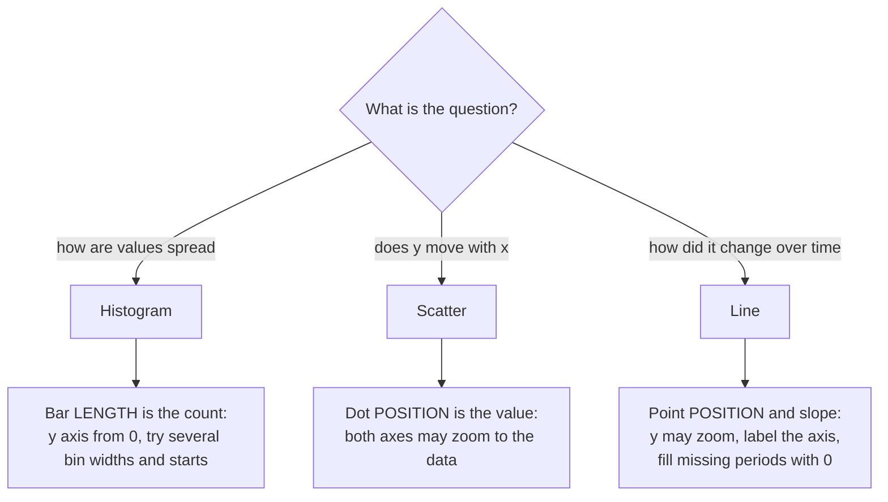
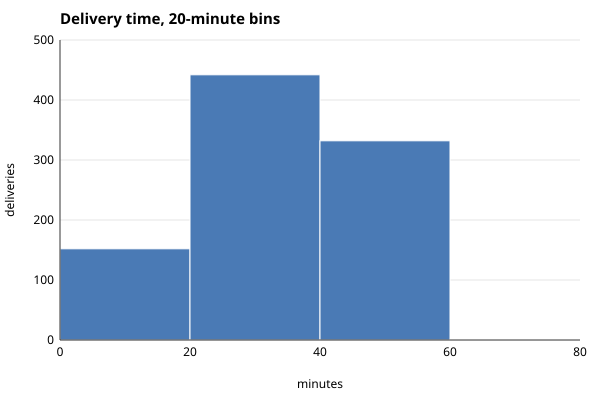
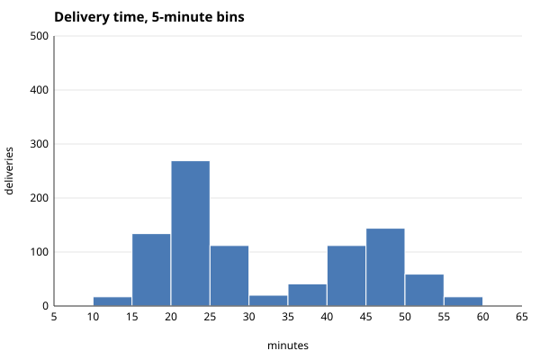
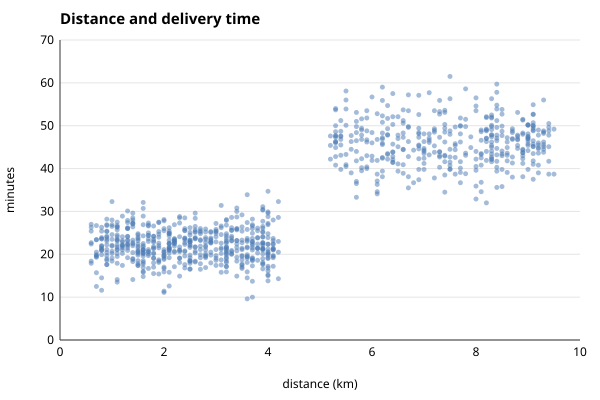
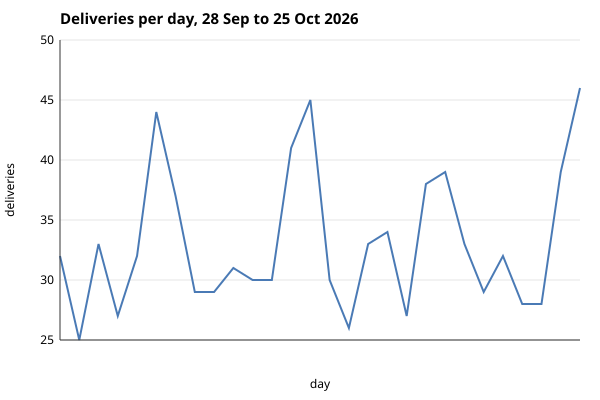

# More charts from scratch

Histogram, scatter or line: which shows the answer, and how do bins and scales mislead?

## Before you start

- **Level:** 2 (intermediate). About 2 hours.
- **You need:** Python 3.9 or later, nothing to install. A browser to look at the SVG files.
- **Builds on:** [04-04 Draw a chart from scratch](../../04-dashboards/04-draw-a-chart-from-scratch/) (SVG, `nice_max`, why bars start at zero), [02-01 Mean, median and skew](../../02-statistics-and-experiments/01-mean-median-and-skew/) (an average can describe nobody) and [05 Profile a table before you trust it](../05-profile-a-table/).

## The problem

Tiffinbell, a fictional food delivery app with a kitchen in Pune, wants to print one promise on the app: "delivered in 35 minutes". Meera, the head of operations, got the number from a teammate's chart: a histogram of four weeks of delivery times with 20-minute bins, one big hump in the middle, and an average of 31.9 minutes. Before the promise goes live next Monday, Meera wants to know if the chart tells the truth, and what promise the shop can actually keep.

The file `data/deliveries.csv` is synthetic, built by `make_data.py` with a fixed seed: 927 deliveries from 28 September to 25 October 2026, with the date, the city, the distance in kilometres and the minutes from order to door.

## In plain words

Think of sorting a class's exam marks into boxes. With three boxes (0 to 40, 40 to 80, 80 to 100) almost everyone lands in the middle box and the class looks "average". With ten boxes you may see two groups: the students who revised and the ones who did not. The marks did not change. Only the box size did. A chart's job is to show the groups that are really there, and the box size decides whether you can see them.

- A **histogram** counts how many values fall in each range and draws one bar per range. It answers "how are the values spread?"
- A **bin** is one of those ranges, such as 20 to 25 minutes. The **bin width** is its size (5 minutes). The **bin edges** are the numbers where one bin stops and the next starts.
- A **peak** (or mode) is a hump in the histogram: a bin, or a run of equal bins, higher than its neighbours. Data with two humps is called **bimodal**, and it usually means two kinds of thing are mixed together.
- A **scatter plot** draws one dot per row, with one number across and another up. It answers "does y move with x?"
- A **line chart** joins one value per period in time order. It answers "how did this change over time?"
- A **scale** turns a data value into a pixel position. The **domain** is the range of data values the axis covers (0 to 500 deliveries). The **range** is the pixels it maps to (340 down to 40).
- A **truncated axis** is one that does not start at zero. It is fine for position (dots, lines) and misleading for length (bars).

## What you will build from scratch

- `bin_edges` and `histogram`: bins that never lose a value, with a clear rule for a value on an edge.
- `count_peaks`: how many humps a histogram has, plateaus included.
- `linear_scale` and `value_domain`: data to pixels, with zero forced for bars and zoom allowed for lines and dots.
- `histogram_svg`, `scatter_svg` and `line_svg`: three charts as SVG, on the frame the lesson gives you.
- `daily_counts`: one value per day, with 0 for a day with no rows, so the line does not skip it.

## The idea

Pick the chart from the question, then pick the scale from what the chart's marks encode:



**Bins.** With width `w`, the edges are `start, start + w, start + 2w, ...`. `start` is `floor(min / w) * w`, the largest multiple of `w` at or below the smallest value, and edges are added until the last one is above the largest value. A value `v` goes in bin `i` when `edges[i] <= v < edges[i+1]`, so a value exactly on an edge goes to the bin on its right, and no value is ever counted twice or dropped. The bin number is `floor((v - start) / w)`.

**How many bins.** There is no single right width. Too wide and different groups merge into one hump. Too narrow and every bin is noise. Draw two or three widths, and two starts, before you believe a shape. A shape that only appears for one width is probably noise. A shape that appears for most of them is probably real.

**Scales.** A linear scale is a straight line from the domain to the pixels:

```
pixel = r0 + (value - d0) * (r1 - r0) / (d1 - d0)
```

SVG's y grows downward, so a y scale maps the bottom of the domain to `BASELINE` (340) and the top to `TOP` (40). The domain is the decision that can mislead:

| Chart | What the mark encodes | Domain |
|---|---|---|
| Histogram, bar | length | `0` to `nice_max(largest count)` |
| Scatter, line | position | `min` rounded down to `max` rounded up, in steps of `tick_step` |

A histogram bar's height is `count / y_hi * 300` pixels. If the axis started at 100 instead of 0, a bin of 269 would be drawn 14 times as tall as a bin of 112, for a real ratio of 2.4.

## Walk through

Run each block from this folder, in order, in one Python session (type `python3`, then paste). The block under each one is what it prints.

Step 1. Load the deliveries and look at the number on the teammate's chart. `load_deliveries` (done for you) turns the date into a `date` and the distance and minutes into floats.

```python
import sys, statistics
sys.path.insert(0, "solution")
import solution as s

rows = s.load_deliveries()
minutes = [r["minutes"] for r in rows]
print(len(rows), "deliveries, mean", round(statistics.mean(minutes), 1), "median", statistics.median(minutes))
print("between 30 and 35 minutes:", sum(1 for m in minutes if 30 <= m < 35))
print("over 35 minutes:", sum(1 for m in minutes if m > 35))
```

```text
927 deliveries, mean 31.9 median 26.1
between 30 and 35 minutes: 20
over 35 minutes: 374
```

The mean is 31.9, but only 20 of 927 deliveries took between 30 and 35 minutes. The median, 26.1, is far from the mean. Something about the shape is hiding.

Step 2. The same data in three bin widths. `histogram` returns the edges and the counts, and `count_peaks` counts the humps.

```python
for width in (20, 10, 5):
    edges, counts = s.histogram(minutes, width)
    print("width %2d: edges %s" % (width, edges))
    print("          counts %s, %d peak(s)" % (counts, s.count_peaks(counts)))
```

```text
width 20: edges [0, 20, 40, 60, 80]
          counts [152, 442, 332, 1], 1 peak(s)
width 10: edges [0, 10, 20, 30, 40, 50, 60, 70]
          counts [1, 151, 381, 61, 256, 76, 1], 2 peak(s)
width  5: edges [5, 10, 15, 20, 25, 30, 35, 40, 45, 50, 55, 60, 65]
          counts [1, 17, 134, 269, 112, 20, 41, 112, 144, 59, 17, 1], 2 peak(s)
```

With 20-minute bins there is one hump, 20 to 40 minutes, which is where the teammate's "about 30" came from. With 10 and 5 there are two: one around 20 to 25 minutes and one around 45 to 50, with a valley at 30 to 35, exactly where the mean sits.

Step 3. The edge rule. A value on an edge goes in the bin to its right, and every value lands somewhere.

```python
print(s.histogram([20.0, 24.9, 25.0], 5))
edges, counts = s.histogram(minutes, 5)
print(sum(counts) == len(minutes))
```

```text
([20, 25, 30], [2, 1])
True
```

Step 4. Who are the two groups? A scatter plot of distance against minutes answers it, and the numbers behind it are two lines of Python.

```python
near = [r["minutes"] for r in rows if r["distance_km"] < 5]
far = [r["minutes"] for r in rows if r["distance_km"] >= 5]
print("under 5 km:", len(near), "deliveries, slowest", max(near), "| within 30 min:", sum(1 for m in near if m <= 30))
print("5 km or more:", len(far), "deliveries, fastest", min(far), "| within 55 min:", sum(1 for m in far if m <= 55))
```

```text
under 5 km: 546 deliveries, slowest 34.7 | within 30 min: 534
5 km or more: 381 deliveries, fastest 32.0 | within 55 min: 363
```

Two kinds of trip: short ones from the nearby kitchen, and long ones across town, every one at 5 km or more. The histogram showed that there are two groups; the scatter shows what separates them.

Step 5. Scales. `value_domain` chooses the axis, `linear_scale` turns values into pixels.

```python
edges, counts = s.histogram(minutes, 5)
print("histogram y axis:", s.value_domain(counts, "histogram"))
y = s.linear_scale(0, 500, s.BASELINE, s.TOP)
print("bar for 269: top at y =", y(269), "height", s.BASELINE - y(269))
daily = s.daily_counts(rows)
print("deliveries per day: min", min(daily), "max", max(daily), "-> line y axis:", s.value_domain(daily, "line"))
print("scatter axes:", s.value_domain([r["distance_km"] for r in rows], "scatter"), s.value_domain(minutes, "scatter"))
```

```text
histogram y axis: (0, 500.0)
bar for 269: top at y = 178.6 height 161.4
deliveries per day: min 25 max 46 -> line y axis: (25.0, 50.0)
scatter axes: (0.0, 10.0) (0.0, 70.0)
```

The histogram's axis runs from 0 to 500, so the 269 bar is 161.4 pixels tall. The line chart is allowed to zoom to 25 to 50 deliveries a day, because a line encodes position, not length.

Step 6. Draw the four charts. `draw_charts.py` calls the functions above and writes SVG files. The images below were drawn from the worked answer with `CHECK_SOLUTION=1 python3 draw_charts.py`. Once your exercise passes, `python3 draw_charts.py` draws yours as `my_chart_*.svg`.

| 20-minute bins: one hump | 5-minute bins: two groups |
|---|---|
|  |  |

| Distance and minutes | Deliveries per day |
|---|---|
|  |  |

The scatter plot shows the answer at a glance: two clouds, split at 5 km. The line chart answers a different question (when are we busy?) and shows a peak every weekend.

## Common mistakes

**1. Trusting one bin width (the trap).** The 20-minute histogram is not wrong: every count on it is correct. It just puts 442 deliveries from two different groups into one bar, so the chart says "about 30 minutes", the mean agrees, and a promise of 35 minutes looks safe. Step 1 showed what that promise would mean on this data: 374 of the 927 deliveries, 40%, took longer than 35 minutes. Draw at least two widths before you describe a shape.

**2. A histogram on a truncated axis.** Bars on an axis that starts at 100:

```python
true_ratio = 269 / 112
drawn_ratio = (269 - 100) / (112 - 100)
print("20-25 vs 25-30 minutes: real", round(true_ratio, 1), "times, drawn", round(drawn_ratio, 1), "times")
```

```text
20-25 vs 25-30 minutes: real 2.4 times, drawn 14.1 times
```

A histogram's bars are lengths, so `value_domain` refuses to zoom them. Lines and dots may zoom, but say so: on the line chart above, a weekend day (41.1 deliveries on average) looks about three times as high as a weekday (29.9), because the axis starts at 25. If the question is "how much busier are weekends?", show 41.1 against 29.9 as bars from zero.

**3. Believing one bin start.** The same 10-minute width, started at 5 instead of 0:

```python
for start in (0, 5):
    edges, counts = s.histogram(minutes, 10, start=start)
    print("start", start, "edges", edges, "counts", counts)
```

```text
start 0 edges [0, 10, 20, 30, 40, 50, 60, 70] counts [1, 151, 381, 61, 256, 76, 1]
start 5 edges [5, 15, 25, 35, 45, 55, 65] counts [18, 403, 132, 153, 203, 18]
```

Started at 5, the valley at 30 to 35 is split across two bins, the 25 to 35 bin holds 132 deliveries, and the gap almost disappears. Same data, same width. Moving the start by half a width is a cheap check that a shape is real.

**4. Letting a missing day vanish from a line.** Counting only the dates that appear in the file gives one point per date with orders. If the kitchen had been closed for a day, the line would join the day before to the day after and the closure would be invisible. `daily_counts` walks every day from the first to the last and writes 0 for a day with no rows.

**5. A scatter plot drawn as a blob.** 927 dots on top of each other hide where most of them are. The worked answer draws small dots at 50% opacity, so dense areas look darker. With tens of thousands of rows, a 2D histogram (count per grid cell) is the next step.

## Your turn

Open `exercise.py`. `load_deliveries`, `nice_max`, `tick_step`, `fmt` and `frame` are done. Write `bin_edges`, `histogram`, `count_peaks`, `linear_scale`, `value_domain`, `histogram_svg`, `scatter_svg`, `line_svg` and `daily_counts`. The docstrings give the exact rules and class names. Then run, from this folder:

```
python3 test_lesson.py
```

The test computes the bins, peaks, axis ranges and pixel positions on its own, parses your SVG as XML, and checks every bar, a sample of dots and every point of the line, on the committed file and on a second dataset from `make_data.build(seed=2038)`. Small cases cover no values, one value, a value on an edge, a value below the start, plateaus in `count_peaks`, all-zero bins, an `&` in a title and a day with no deliveries. When it passes, run `python3 draw_charts.py` and open your `my_chart_*.svg` files in a browser.

Stretch: colour the scatter dots by distance group (under 5 km, 5 km or more) and add a legend, then write `histogram_svg` for two groups side by side so the two humps are drawn as two colours.

## Check yourself

1. A histogram with wide bins shows one hump. What two checks do you run before you call the data "normal-looking"?
2. Why may a line chart's y axis start at 25 when a histogram's must start at 0?
3. The mean delivery time is 31.9 minutes, yet almost no delivery takes 30 to 35 minutes. How?
4. You need to show that long trips take longer. Which chart, and why not a histogram?

<details>
<summary>Answers</summary>

1. Draw it with narrower bins (here 10 and 5 minutes), and shift the bin start by half a width. If two humps appear in most versions, the data is a mix of two groups, and a single average describes neither.
2. A bar's length is its value, so cutting the bottom off changes the ratios the reader sees (2.4 times becomes 14.1 times here). A line or a dot encodes position; the reader compares heights against the labelled axis, not lengths from zero. Still label the axis, and use bars from zero when the question is "how much bigger?".
3. The data has two groups, short trips around 22 minutes and long trips around 46. The mean lands in the empty space between them. That is the sign of a bimodal distribution: report each group, not one average.
4. A scatter of distance against minutes, because the question is whether one number moves with another. A histogram of minutes shows that there are two groups, but not what separates them.

</details>

## What to tell the stakeholder

> Meera, delivery times are two groups, not one, so a single "35 minutes" promise would have been broken on 374 of 927 deliveries (40%) in the last four weeks. Under 5 km, 534 of 546 deliveries (98%) arrived within 30 minutes; at 5 km or more, 363 of 381 (95%) arrived within 55. I suggest promising by distance. Caveat: this is four weeks of October data, and 18 long trips already took more than 55 minutes, so I would check the long-trip promise again every month.

## In real job postings

Charts are usually made in a BI tool or a Python library, and knowing what the tool does with bins and axes is the transferable part. In the Real Analyst Jobs data drop of 25 October 2026 ([data/job-market/2026-10](../../../data/job-market/2026-10/)), 996 of the 2,056 US analyst postings that list tools ask for Python (48.4%) and 740 for Tableau (36.0%). In India, 448 of 900 ask for Python (49.8%). See [Python data analyst jobs](https://realanalystjobs.com/jobs/python-data-analyst-jobs).

## Next

[09 Data quality tests as code](../09-data-quality-tests-as-code/): would we have caught last week's broken load?
