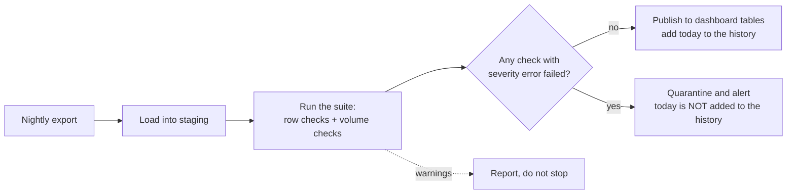

# Data quality tests as code

Would we have caught last week's broken load?

## Before you start

- **Level:** 2 (intermediate). About 2 hours.
- **You need:** Python 3.9 or later, nothing to install.
- **Builds on:** [05 Profile a table before you trust it](../05-profile-a-table/) (nulls, duplicate keys, ranges, looked at by hand), [06 Join two files and prove nothing was lost](../06-join-files-and-prove-nothing-was-lost/) (a guard that stops a script) and [04 Automate the weekly report](../04-automate-the-weekly-report/) (a job that runs without you).

## The problem

Kestrel Home, the fictional online furniture shop from lesson 06, loads the previous day's orders into its reporting database every night. On Tuesday 20 October the revenue dashboard showed Sunday 18 October at 0.00, and the team spent the morning asking whether the website had been down. It had not. The Monday night load had gone in without a single error message, and it was broken in three ways at once. Priya, the head of finance, asks one question before she signs off the October numbers on Friday: if we had had proper checks, would they have caught it, and would they have cried wolf on the good nights?

The files in `data/` are synthetic, built by `make_data.py` with a fixed seed: `orders.csv` holds every row the job loaded from 12 to 25 October 2026 (788 rows, 14 loads), and `customers.csv` is the customer list as of 11 October (162 customers).

## In plain words

A restaurant kitchen checks each delivery before it goes into the fridge: is the box sealed, is the fish cold, is it the amount on the invoice, is it about the size of last week's order? None of these checks proves the fish is good. Each one is cheap, and together they catch most bad deliveries at the door, before a customer eats them. A delivery that fails a serious check is refused. One that fails a minor check is accepted with a note.

Data quality tests are the same idea for a table that arrives every night.

- A **load** is one run of the job that copies new rows into the reporting database. Here, one load per night.
- A **data quality test** (or **check**) is a rule about the data, written as code, that returns the rows or values that break it. An empty result means it passed.
- **Not null**: a column must always have a value. **Unique**: no value appears twice. **Accepted values**: only values from a fixed list. **Range**: numbers between a low and a high. **Relationships**: every value must exist in another table, like a foreign key.
- A **volume check** compares today's row count or total with recent loads. The **median** (the middle value when sorted) of the last seven good loads is the baseline, and a **tolerance** (here 50%) sets how far from it is still normal.
- **Severity**: an **error** stops the load; a **warning** lets it through and is reported.
- A **gate** is the step that looks at the results and refuses the load if any error check failed. The refused rows stay out of the dashboard tables until someone fixes them. That holding area is called **quarantine**.

## What you will build from scratch

- Five row checks: `check_not_null`, `check_unique`, `check_accepted_values`, `check_range`, `check_relationships`.
- `check_vs_history`: a volume check against the median of recent good loads.
- `run_suite` and `gate`: run every check, label each pass, warn or fail, and stop the load on an error.
- `replay`: run the checks on two weeks of loads in order, as the nightly job would have, to answer Priya's question.

## The idea

The checks sit between the load and the tables people read:



The suite for Kestrel Home's orders, in `default_suite`:

| Check | Severity | Catches |
|---|---|---|
| `order_id` not null | error | rows with no key |
| `order_id` unique | error | rows loaded twice |
| `currency` not null | error | a column the export stopped filling |
| `status` in paid, refunded, cancelled | error | a new spelling or a new status nobody defined |
| `amount` between 0 and 5,000 | error | cents instead of dollars, negative amounts, text |
| `customer_id` in the customer list | warn | new customers the list does not have yet |
| row count within 50% of the median of the last 7 good loads | error | half a file, or a file loaded twice |
| revenue within 50% of the same median | error | a unit change, a lost region |

Four rules hold the design together:

1. **A blank is only not null's business.** Unique, accepted values, range and relationships skip blanks, so one missing value fails one check, not five. The same convention as dbt's tests, which [08-02 dbt from scratch](../../08-modern-data-stack/02-dbt-from-scratch/) rebuilds.
2. **Checks never clean.** `PAID` is not `paid`, and `"paid "` with a space is not either. The check reports; a person decides whether to fix the export or widen the rule.
3. **Volume is judged against recent good loads.** The baseline is the median of the last 7 loads that passed: `low = median * (1 - 0.5)` and `high = median * (1 + 0.5)`, both allowed. With fewer than 3 good loads there is nothing to compare with, so the check passes and says nothing.
4. **A rejected load never becomes the baseline.** Otherwise a broken source that stays broken slowly teaches the check that broken is normal.

## Walk through

Run each block from this folder, in order, in one Python session (type `python3`, then paste). The block under each one is what it prints.

Step 1. Load the files and look at each night the way the dashboard does: rows loaded, and revenue from paid orders.

```python
import sys
sys.path.insert(0, "solution")
import solution as s

rows, customers = s.load_csv("orders.csv"), s.load_csv("customers.csv")
loads = s.split_loads(rows)
for day, load in loads.items():
    paid = sum(float(r["amount"]) for r in load if r["status"] == "paid")
    print(day, "%4d rows" % len(load), "paid revenue %10.2f" % paid)
```

```text
2026-10-12   56 rows paid revenue   11462.28
2026-10-13   46 rows paid revenue    9488.19
2026-10-14   44 rows paid revenue    7939.96
2026-10-15   53 rows paid revenue   11923.40
2026-10-16   48 rows paid revenue   10218.56
2026-10-17   45 rows paid revenue    7943.97
2026-10-18   57 rows paid revenue    9155.52
2026-10-19  128 rows paid revenue       0.00
2026-10-20   50 rows paid revenue    9505.91
2026-10-21   47 rows paid revenue    9736.18
2026-10-22   49 rows paid revenue   10095.24
2026-10-23   51 rows paid revenue   10906.26
2026-10-24   52 rows paid revenue   10941.99
2026-10-25   62 rows paid revenue   13028.35
```

The load of 19 October (Sunday's orders) has more than twice the usual rows and no paid revenue at all.

Step 2. Look at that load.

```python
bad = loads["2026-10-19"]
print(bad[0])
print(bad[64])
```

```text
{'load_date': '2026-10-19', 'order_id': 'KO-50350', 'order_date': '2026-10-18', 'customer_id': 'C0035', 'status': 'CANCELLED', 'currency': '', 'amount': '32554'}
{'load_date': '2026-10-19', 'order_id': 'KO-50350', 'order_date': '2026-10-18', 'customer_id': 'C0035', 'status': 'CANCELLED', 'currency': '', 'amount': '32554'}
```

The same order twice, the status in capitals, no currency, and an amount of 32554 with no decimal point: cents, not dollars. The export had moved to a new version and the job had been retried, appending the file a second time.

Step 3. The row checks on that load. Each returns what broke the rule: row numbers, or the repeated values for unique.

```python
ids = {c["customer_id"] for c in customers}
print("not null currency:", len(s.check_not_null(bad, "currency")))
print("unique order_id:  ", len(s.check_unique(bad, "order_id")), s.check_unique(bad, "order_id")[:3])
print("accepted status:  ", len(s.check_accepted_values(bad, "status", s.STATUSES)))
print("amount 0 to 5000: ", len(s.check_range(bad, "amount", 0, 5000)))
print("customer in list: ", s.check_relationships(bad, "customer_id", ids))
```

```text
not null currency: 128
unique order_id:   64 ['KO-50350', 'KO-50351', 'KO-50352']
accepted status:   128
amount 0 to 5000:  128
customer in list:  [31, 38, 95, 102]
```

128 rows with no currency, 64 order ids that appear twice, 128 statuses outside the list, and all 128 amounts above 5,000. An order under 50 dollars, written in cents, would still slip under 5,000, which is one reason the volume checks matter too. Four rows (two orders, each loaded twice) belong to customers who signed up after the list was taken: a warning, not a reason to refuse.

Step 4. The volume checks. The baseline is the median of the 7 good loads before it.

```python
import statistics
history_rows = [len(loads[d]) for d in list(loads)[:7]]
history_rev = [s.revenue(loads[d]) for d in list(loads)[:7]]
print("rows:", history_rows, "median", statistics.median(history_rows), "->", s.check_vs_history(len(bad), history_rows))
print("revenue median", statistics.median(history_rev), "->", s.check_vs_history(s.revenue(bad), history_rev))
```

```text
rows: [56, 46, 44, 53, 48, 45, 57] median 48 -> [(128, 24.0, 72.0)]
revenue median 11431.01 -> [(2932168.0, 5715.51, 17146.51)]
```

128 rows against a normal band of 24 to 72, and 2,932,168 of revenue against 5,715.51 to 17,146.51.

Step 5. All checks at once, and the gate.

```python
results = s.run_suite(bad, s.default_suite(ids, {"rows": history_rows, "revenue": history_rev}))
for r in results:
    print("%-30s %-5s %4d" % (r["name"], r["status"], r["failures"]))
try:
    s.gate(results)
except s.LoadRejected as e:
    print(e)
```

```text
order_id not null              pass     0
order_id unique                fail    64
currency not null              fail   128
status accepted values         fail   128
amount between 0 and 5000      fail   128
customer_id in customers       warn     4
row count near recent median   fail     1
revenue near recent median     fail     1
load rejected: order_id unique, currency not null, status accepted values, amount between 0 and 5000, row count near recent median, revenue near recent median
```

Step 6. Priya's question: replay all 14 nights in order, as if the checks had existed. `replay` adds a night to the history only if it passed the gate.

```
python3 solution/solution.py
```

```text
2026-10-12 ok     warn: customer_id in customers
2026-10-13 ok     
2026-10-14 ok     warn: customer_id in customers
2026-10-15 ok     warn: customer_id in customers
2026-10-16 ok     
2026-10-17 ok     warn: customer_id in customers
2026-10-18 ok     
2026-10-19 REJECT order_id unique; currency not null; status accepted values; amount between 0 and 5000; row count near recent median; revenue near recent median; warn: customer_id in customers
2026-10-20 ok     
2026-10-21 ok     
2026-10-22 ok     warn: customer_id in customers
2026-10-23 ok     warn: customer_id in customers
2026-10-24 ok     
2026-10-25 ok     warn: customer_id in customers
```

Yes: six error checks would have refused the 19 October load before the dashboard read it, and no good night was refused. The customer warning fires on 7 of the 13 good nights. That is expected (new customers sign up every day), and it is why it is a warning: if it were an error, the job would stop on half the nights and people would learn to ignore it.

## Common mistakes

**1. Testing that the job ran instead of testing the data (the trap).** Kestrel Home's only check was that the job finished and the table was not empty:

```python
print("nights with rows > 0:", sum(1 for load in loads.values() if len(load) > 0), "of", len(loads))
```

```text
nights with rows > 0: 14 of 14
```

It passed every night, including the broken one. A load can succeed perfectly and still put wrong data in the table. Test the data: keys, values, units and volume.

**2. Letting the broken night into the baseline.** Suppose the job had used the mean of the last 7 nights, broken one included, instead of the median of the last 7 good ones. The revenue band for the nights after it:

```python
days = list(loads)
for i in range(8, 11):
    last7 = [s.revenue(loads[d]) for d in days[i - 7:i]]
    mean = sum(last7) / 7
    print(days[i], "band %.2f to %.2f" % (mean * 0.5, mean * 1.5), "actual", s.revenue(loads[days[i]]))
```

```text
2026-10-20 band 214175.47 to 642526.41 actual 11462.08
2026-10-21 band 214257.43 to 642772.28 actual 10858.43
2026-10-22 band 214384.34 to 643153.03 actual 10543.92
```

One broken night drags the mean up about 37 times, and every normal night for the next week is rejected as "too low". The team learns to ignore the alert in its first week. The median of the last 7 nights barely moves with one odd value, and excluding rejected loads keeps a broken source rejected until it is fixed.

**3. Thresholds tighter than the data.** "No order over 1,000 dollars" sounds safe:

```python
too_tight = [d for d, load in loads.items() if d != "2026-10-19" and s.check_range(load, "amount", 0, 1000)]
print(len(too_tight), "of 13 good nights would fail")
```

```text
3 of 13 good nights would fail
```

Sofas cost more than that. Set a range from what the business allows (the shop sells nothing above 5,000), check it against the history of good loads, and expect zero failures on good nights before you switch a check to error.

**4. Cleaning before testing.** Dropping duplicate rows, lowercasing the status and filling a blank currency with USD before running the checks makes every check pass and hides the fact that the export changed. The retry bug would have happened again next week. Run the checks on the data as it arrived; clean afterwards, on purpose, in a step someone can read.

**5. Checking only the total.** A file loaded twice and a file with half a region missing can add up to a normal-looking total. Row checks and volume checks catch different things; you need both.

## Your turn

Open `exercise.py`. `load_csv`, `blank`, `split_loads`, `revenue`, `default_suite` and `LoadRejected` are done. Write the five row checks, `check_vs_history`, `run_suite`, `gate` and `replay`. Then run, from this folder:

```
python3 test_lesson.py
```

The test checks every function on small rows (a blank, a cell of spaces, a missing column, the text `0`, repeated values, both ends of the range, a non-number, both ends of the tolerance band, too little history, a zero median), then replays the committed loads and a second dataset from `make_data.build(seed=2039)`, whose broken night falls on a different date, against a reference written in the test. It also checks that a source which stays broken for five nights stays rejected for all five.

Stretch: add a freshness check (every `order_date` must be the day before its `load_date`) and a check that `customers.csv` itself has unique ids. Then make the volume check compare each night with the same weekday in earlier weeks: why would that be fairer to Sunday's orders?

## Check yourself

1. Your nightly job finished with no errors, and the dashboard shows a drop to zero. What do you check first?
2. Why should unique, accepted values and range skip blanks?
3. Why use the median of recent good loads as the baseline, and not the mean of all recent loads?
4. When should a failing check be a warning instead of an error?

<details>
<summary>Answers</summary>

1. The data the job loaded, not the job: row count against recent nights, duplicate keys, the values in the columns the dashboard filters on (here `status = 'paid'` matched nothing because the export wrote `PAID`), and the units of the amounts.
2. So that one missing value fails exactly one check, not_null, and the report points at one cause. Checks that also failed on blanks would repeat the same problem under five names.
3. The median ignores one extreme value, and leaving rejected loads out of the history stops a broken night from becoming the new normal. With the mean of all loads, one night in cents pushed the band up about 37 times and would have rejected every good night that followed.
4. When the failure is expected and harmless on good data, or when someone needs to know but the numbers are still right, such as a new customer the list does not have yet. A check that stops the job on good nights trains people to ignore it.

</details>

## What to tell the stakeholder

> Priya, yes: eight checks on each nightly load would have refused the 19 October load before the dashboard read it, on six counts (every row loaded twice, amounts in cents, statuses in capitals, no currency, and row count and revenue far outside the last week's range). Replayed over the 14 loads from 12 to 25 October, they refuse that night and no other. One caveat: two weeks is a short history, so I would run the checks in report-only mode for a month before letting them stop the job.

## In real job postings

Data quality checks are usually written in SQL or Python, and both are near the top of analyst job ads. In the Real Analyst Jobs data drop of 25 October 2026 ([data/job-market/2026-10](../../../data/job-market/2026-10/)), 1,477 of the 2,056 US analyst postings that list tools ask for SQL (71.8%) and 996 for Python (48.4%); 157 (7.6%) name dbt, a tool that runs tests like these inside a warehouse. See [SQL data analyst jobs](https://realanalystjobs.com/jobs/sql-data-analyst-jobs) and [Python data analyst jobs](https://realanalystjobs.com/jobs/python-data-analyst-jobs).

## Next

[10 From standard library to pandas](../10-from-stdlib-to-pandas/): which pandas call does each function you wrote correspond to?
