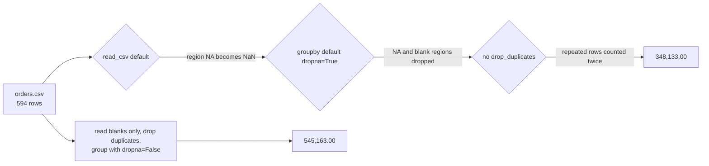

# From standard library to pandas

Which pandas call does each function you wrote correspond to?

## Before you start

- **Level:** 2 (intermediate). About 2 hours.
- **You need:** Python 3.9 or later. pandas is optional: the lesson and the test run without it, and the pandas steps and one test class run if you have it (`pip install pandas`, outside this course's standard library rule).
- **Builds on:** [01 Clean a messy CSV](../01-clean-a-messy-csv/) (blank cells), [02 Reshape wide and long](../02-reshape-wide-and-long/), [06 Join two files and prove nothing was lost](../06-join-files-and-prove-nothing-was-lost/) (where pandas' `merge` already appeared) and [09 Data quality tests as code](../09-data-quality-tests-as-code/).

## The problem

Juniper Bikes, the fictional bike shop from lesson [04-04](../../04-dashboards/04-draw-a-chart-from-scratch/), now sells online in four regions: EU, UK, NA (North America) and APAC. Its monthly revenue-by-region report is a standard library script that has said 545,163.00 for October. Omar, a new analyst, rewrote it in pandas because the rest of the team works in pandas, and his version says 348,133.00. Leo, the owner, has two numbers for one month and a bank meeting on Wednesday. Your job: map each function in the old script to the pandas call that does the same thing, with the arguments that make it do exactly the same thing, and prove the two agree.

The file `data/orders.csv` is synthetic, built by `make_data.py` with a fixed seed: 594 rows of October 2026 orders.

## In plain words

Moving from your own scripts to pandas is like moving from your own kitchen to a restaurant kitchen. The knives are better and faster, but they were set up by someone else. The salt is in a different jar, and the oven runs 20 degrees hot unless you change the dial. Same recipe, different result, until you learn the defaults.

- **pandas** is a Python library for tables. A **DataFrame** (`df`) is a table, a **Series** is one column.
- **NaN** ("not a number") is how pandas marks a missing value, where our scripts use `None` and SQL uses NULL.
- A **default** is the value an argument takes when you do not pass it. `pd.read_csv(path)` uses dozens of them.
- `na_values` are the texts that `read_csv` turns into NaN. `keep_default_na` says whether pandas' own list of such texts is used too.
- **groupby** splits rows into groups by a column and aggregates each one, like SQL's GROUP BY.
- `dropna` in `groupby` and `value_counts` says what happens to rows whose group value is missing.
- A **stable sort** keeps rows with equal values in their original order.

## What you will build from scratch

- Six functions in the standard library, each with exactly the rules of one pandas call: `read_typed`, `filter_rows`, `group_agg`, `sort_rows`, `drop_duplicates` and `value_counts`.
- `PANDAS_EQUIVALENT`: the map from each function to the pandas call and the arguments that make the two agree.
- If you have pandas, a test that runs both on the same data and compares every answer.

## The idea

Every function you write in plain Python has a pandas call. The work is in the defaults:

| Our function | pandas call | Default to know |
|---|---|---|
| `read_typed(path)` | `pd.read_csv(path, keep_default_na=False, na_values=[""])` | By default `read_csv` turns 19 texts into NaN (pandas 3.0.5), including `NA`, `N/A`, `NULL`, `null` and `None`. The region code for North America is one of them |
| `filter_rows(rows, col, ">", v)` | `df[df[col] > v]` | NaN is False for `==`, `>`, `<` and the rest, and **True** for `!=`. So `df[df.region != "EU"]` keeps rows with no region. SQL drops them |
| `group_agg(rows, by, col, "sum")` | `df.groupby(by)[col].sum()` | `dropna=True`: rows whose group value is NaN are left out of every group. Group keys come back sorted |
| `group_agg(..., "sum")` on a group with no values | `.sum()` | 0, not NaN (pandas' `min_count=0`). SQL's SUM gives NULL |
| `group_agg(..., "count")` and `"size"` | `.count()` and `.size()` | `count` skips NaN values, `size` counts rows |
| `sort_rows(rows, col)` | `df.sort_values(col, kind="stable")` | NaN goes last both ways (`na_position="last"`). The default `kind` is not guaranteed to keep ties in order |
| `drop_duplicates(rows)` | `df.drop_duplicates()` | All columns, keep the first copy. NaN counts as equal to NaN here, unlike in comparisons |
| `value_counts(rows, col)` | `df[col].value_counts()` | `dropna=True`: missing values are not counted at all |

These behaviours were checked with pandas 3.0.5 on 31 October 2026, and the test checks them again on whatever version you have. The pandas reference pages are [read_csv](https://pandas.pydata.org/docs/reference/api/pandas.read_csv.html), [DataFrame.groupby](https://pandas.pydata.org/docs/reference/api/pandas.DataFrame.groupby.html) and [DataFrame.sort_values](https://pandas.pydata.org/docs/reference/api/pandas.DataFrame.sort_values.html).

A difference between two reports is rarely one bug. Here three defaults stack up:



## Walk through

Run each block from this folder, in order, in one Python session (type `python3`, then paste). The block under each one is what it prints. Steps 1 to 4 need nothing installed; steps 5 and 6 need pandas.

Step 1. Read the file with our own reader. Only a blank cell is missing; `NA` stays the text `NA`.

```python
import sys
sys.path.insert(0, "solution")
import solution as s

rows = s.read_typed("data/orders.csv")
print(len(rows), "rows")
print(rows[0])
print(s.value_counts(rows, "region", dropna=False))
```

```text
594 rows
{'order_id': 'J-30001', 'order_date': '2026-10-05', 'region': 'EU', 'channel': 'web', 'qty': 1, 'amount': 2300.0}
{'NA': 202, 'EU': 166, 'UK': 125, 'APAC': 87, None: 14}
```

Step 2. Duplicates. Two exports overlapped, so some rows are in the file twice, word for word.

```python
clean = s.drop_duplicates(rows)
print(len(rows) - len(clean), "repeated rows dropped,", len(clean), "left")
```

```text
4 repeated rows dropped, 590 left
```

Step 3. Revenue by region, keeping the orders with no region in their own group. `dropna=False` is the choice that makes the regions add up to the total.

```python
by_region = s.group_agg(clean, "region", "amount", "sum", dropna=False)
for region, amount in by_region.items():
    print("%-8s %12.2f" % ("(blank)" if region is None else region, amount))
print("%-8s %12.2f" % ("total", sum(by_region.values())))
print("count of amounts:", s.group_agg(clean, "region", "amount", "count", dropna=False))
print("rows:            ", s.group_agg(clean, "region", "amount", "size", dropna=False))
```

```text
APAC         79852.00
EU          158581.00
NA          188999.00
UK          103746.00
(blank)      13985.00
total       545163.00
count of amounts: {'APAC': 85, 'EU': 160, 'NA': 201, 'UK': 119, None: 14}
rows:             {'APAC': 87, 'EU': 163, 'NA': 202, 'UK': 124, None: 14}
```

Count and size differ wherever an order has no amount yet: those orders are rows, but they have no amount to add.

Step 4. Filters and sorting with pandas' rules. `!=` keeps a row with no region, because a missing value is not equal to anything.

```python
print(len(s.filter_rows(clean, "region", "!=", "EU")), "rows are not EU")
print(len(s.filter_rows(clean, "region", "==", "EU")), "rows are EU")
print(sum(1 for r in clean if r["region"] is None), "rows have no region")
top = s.sort_rows(clean, "amount", ascending=False)
print([(r["order_id"], r["amount"]) for r in top[:3]], "...", [(r["order_id"], r["amount"]) for r in top[-2:]])
```

```text
427 rows are not EU
163 rows are EU
14 rows have no region
[('J-30050', 6900.0), ('J-30158', 6900.0), ('J-30274', 6900.0)] ... [('J-30547', None), ('J-30579', None)]
```

Not-EU plus EU is every row, so the blank regions are in the "not EU" rows. In SQL, `WHERE region <> 'EU'` would leave them out. The orders with no amount come last, even in a descending sort.

Step 5 (optional, needs pandas). Omar's version, with every default left as it is.

```python
import pandas as pd

df = pd.read_csv("data/orders.csv")
print(df["region"].value_counts(dropna=False).to_dict())
naive = df.groupby("region")["amount"].sum()
print(naive.to_dict(), "total", round(naive.sum(), 2))
```

```text
{nan: 216, 'EU': 166, 'UK': 125, 'APAC': 87}
{'APAC': 79852.0, 'EU': 164490.0, 'UK': 103791.0} total 348133.0
```

North America is gone from the regions: `read_csv` read the text `NA` as missing, and `groupby` then dropped every missing region, together with the genuinely blank ones. And EU and UK are higher than in step 3, because the repeated rows were never removed.

Step 6 (optional, needs pandas). The same report, with the arguments from the map.

```python
df = pd.read_csv("data/orders.csv", keep_default_na=False, na_values=[""])
unique = df.drop_duplicates()
fixed = unique.groupby("region", dropna=False)["amount"].sum()
print({("(blank)" if pd.isna(k) else k): round(v, 2) for k, v in fixed.items()}, "total", round(fixed.sum(), 2))
print((unique["region"] != "EU").sum(), "rows are not EU, as in step 4")
```

```text
{'APAC': 79852.0, 'EU': 158581.0, 'NA': 188999.0, 'UK': 103746.0, '(blank)': 13985.0} total 545163.0
427 rows are not EU, as in step 4
```

The same five numbers as step 3, and the same 545,163.00. Each of our functions now has a pandas call that agrees with it, and the test proves it on two datasets.

## Common mistakes

**1. Trusting `read_csv`'s missing-value list (the trap).** The default list exists to help, and it turned a whole region into missing data without a warning. On this file that hid 188,999.00 of North American revenue, 35% of the month. Whenever a column holds codes (country, region, product), read it with `keep_default_na=False, na_values=[""]`, or pass `dtype=str` and decide about blanks yourself, then run `value_counts(dropna=False)` before anything else.

**2. Forgetting that `groupby` drops missing keys.** Even with `NA` read correctly, the default `dropna=True` leaves the orders with a blank region out of the table, so the regions add up to less than the total:

```python
print(round(sum(s.group_agg(clean, "region", "amount", "sum").values()), 2), "with dropna=True")
print(round(sum(s.group_agg(clean, "region", "amount", "sum", dropna=False).values()), 2), "with dropna=False")
```

```text
531178.0 with dropna=True
545163.0 with dropna=False
```

A region table should either add up to the total or say clearly what it leaves out.

**3. Expecting pandas to treat missing values like SQL.** `!=` keeps NaN rows, `sum` of nothing is 0, and `drop_duplicates` treats two NaN as equal, while `==` says they are not. None of these is wrong, but each differs from SQL, and code ported from SQL to pandas (or back) changes numbers quietly. When you port, compare the two on the same data, as the test does.

**4. Relying on the order of ties.** `sort_values` without `kind="stable"` is not documented to keep equal values in their original order. If a report takes "the first row per customer" after a sort, ask for a stable sort or add a tie-breaker column.

## Your turn

Open `exercise.py`. Write `read_typed`, `filter_rows`, `group_agg`, `sort_rows`, `drop_duplicates` and `value_counts`, each with the rules in its docstring, and fill in `PANDAS_EQUIVALENT` with the pandas call for each. Then run, from this folder:

```
python3 test_lesson.py
```

Without pandas, the test checks every function on small rows (None as a group, as a value and as a filter target, a group with no values, ties, an empty table, the three `keep` options) and on the committed file and a second one from `make_data.build(seed=2040)`, against a reference written in the test. It also checks that your map names the right pandas calls. With pandas installed, one more class runs the real pandas calls on both datasets and checks that every answer matches yours; without pandas it is skipped.

Stretch: add `pivot_sum(rows, index, columns, values)` and match it to `df.pivot_table(index=..., columns=..., values=..., aggfunc="sum", fill_value=0)`. What does `pivot_table` do with a row whose index value is missing?

## Check yourself

1. A pandas report and a SQL report on the same table disagree on a regional total. Name three defaults you would check first.
2. Why might `df[df.region != "EU"]` and `WHERE region <> 'EU'` return different row counts?
3. What is the difference between `count()` and `size()` after a `groupby`?
4. You read a file of country codes with `pd.read_csv` and Namibia has no rows. Why?

<details>
<summary>Answers</summary>

1. `read_csv`'s missing-value texts (`NA`, `NULL`, `None` and others become NaN), `groupby`'s `dropna=True` (rows with a missing key are left out), and whether duplicates were removed. After that: how NaN is compared (`!=` is True) and what an empty sum gives (0 in pandas, NULL in SQL).
2. pandas treats NaN as not equal to anything, so rows with no region pass `!= "EU"`. SQL's comparison with NULL is unknown, and WHERE drops unknown rows.
3. `count()` counts the non-missing values of the column in each group; `size()` counts rows, missing values included. They differ exactly where the column has missing values.
4. Namibia's ISO code is `NA`, one of the texts `read_csv` turns into NaN by default. Read the column with `keep_default_na=False, na_values=[""]` or as text and check `value_counts(dropna=False)`.

</details>

## What to tell the stakeholder

> Leo, October revenue is 545,163.00, the number the old report gave. The pandas version said 348,133.00 because of three default settings: it read the region code NA (North America) as "missing" and then left those orders out, which dropped 188,999.00; it also left out 13,985.00 of orders whose address had no region; and it counted a few orders twice where two exports overlapped. With those three settings changed, pandas gives exactly the same five regional numbers as the old script, and a test now checks that the two keep agreeing.

## In real job postings

Python is in about half of the analyst postings that list tools, and tables in Python usually means pandas or a library built like it. In the Real Analyst Jobs data drop of 25 October 2026 ([data/job-market/2026-10](../../../data/job-market/2026-10/)), 996 of the 2,056 such US postings ask for Python (48.4%), 222 of 413 in the UK (53.8%) and 448 of 900 in India (49.8%). See [Python data analyst jobs](https://realanalystjobs.com/jobs/python-data-analyst-jobs).

## Next

That is the last lesson in phase 05 (see the [phase 05 overview](../README.md)). Next phase: [06-01 Grade an LLM classifier](../../06-ai-for-analysts/01-grade-an-llm-classifier/).
