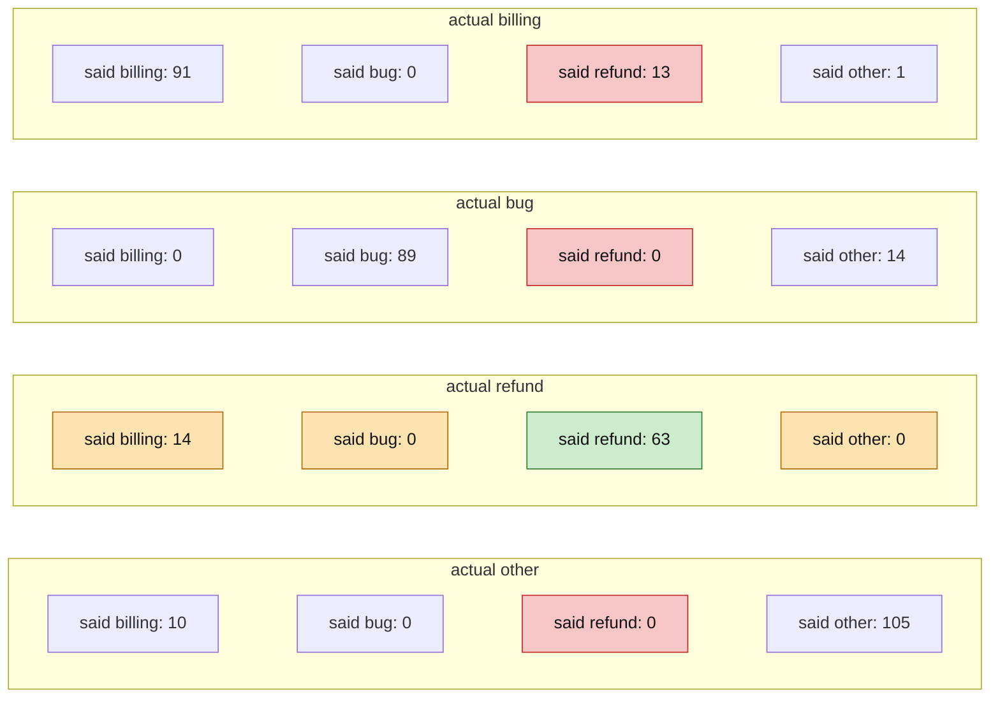
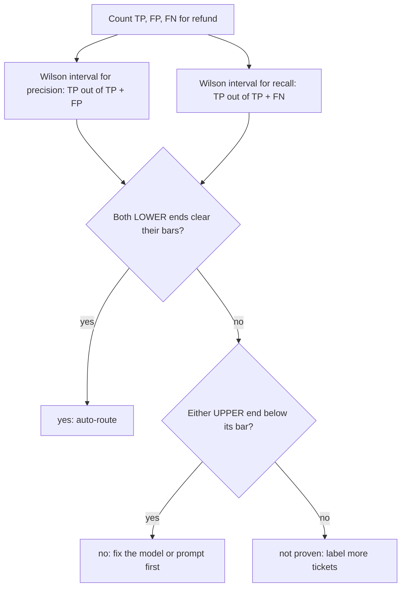

# Grade an LLM classifier

Is the LLM good enough at spotting refund tickets that we can route them automatically?

## Before you start

- **Level:** 2 (you can read and run a short Python file).
- **Time:** about 2 hours.
- **Builds on:** [Python for spreadsheet people](../../00-start-here/06-python-for-spreadsheet-people/) for loops and dictionaries, and [Confidence interval by hand](../../02-statistics-and-experiments/02-confidence-interval-by-hand/) for the idea of a margin of error.

## The problem

Northwind Desk, a fictional software company, tried an LLM to label incoming support tickets as billing, bug, refund or other. Priya, the support lead, wants refund tickets to skip the queue and go straight to the refunds team, but only if the LLM rarely sends the wrong ticket there and rarely misses a real refund. Her rule: precision for refund at least 0.90 and recall at least 0.80. A person already labelled 400 recent tickets, and the LLM's labels for the same tickets are saved next to them. She needs a yes or no by Friday's ops review.

The dataset in `data/tickets.csv` is synthetic, built by `make_data.py` with a fixed random seed. **No model was called.** The `llm_label` column is simulated, and `data/fixture.json` says so. The simulation behaves like a real model run at temperature 0 (the setting that makes a model's answer to the same input as repeatable as it can be): each label depends on the ticket's text, the same text always gets the same label, and most mistakes happen on genuinely ambiguous wording.

## In plain words

Picture a new colleague sorting the morning post into four trays: billing, bug, refund and other. Before you let them sort alone, you sort 400 letters yourself and compare.

Two questions matter for the refund tray:

- Of the letters they put in the refund tray, how many really belong there? That is **precision**. Low precision means the refunds team wastes time on letters that are not theirs.
- Of all the real refund letters, how many ended up in the refund tray? That is **recall**. Low recall means refund requests sit in the wrong pile.

A third idea: 400 letters is a sample. A batter who scores 60 in 5 innings might average 35 over a season. The fewer letters behind a number, the wider its **margin of error**. You only say yes when even the cautious end of that margin clears the bar.

Terms used below:

- **LLM** (large language model): a program that reads text and writes text. Here it reads a ticket and writes one label.
- **Classifier**: anything that puts each item into one of a fixed set of labels.
- **Fixture**: saved outputs that a test runs on, so nothing calls a model and the answer never changes.
- **Confusion matrix**: a table that counts every pair of (true label, predicted label).
- **Wilson interval**: a 95% range for a rate measured on a sample, explained below.

## What you will build from scratch

- A confusion matrix from two label columns, as a dict of dicts.
- Accuracy, and precision, recall and F1 for any one label.
- A Wilson 95% interval, by hand, for precision and recall.
- A decision, `yes`, `no` or `not proven`, that uses the interval and not just the point value.

## The idea

Treat the human label as the truth (see Common mistakes for why that is an assumption). For each ticket you know the actual label and the predicted label. Count every pair: `cm[actual][predicted]`. The diagonal is where the LLM agreed with the person.

Here is the matrix for this data. Each row is what the tickets really are, and each box says what the LLM called them. The green box is refund tickets labelled refund. The red boxes are the refund column's mistakes (false positives) and the amber boxes are the refund row's mistakes (false negatives).



For one label, say refund:

- True positives (TP): actual refund, predicted refund. That is `cm["refund"]["refund"]`, 63.
- False positives (FP): predicted refund, actually something else. Sum down the refund column, minus the diagonal: 13.
- False negatives (FN): actual refund, predicted something else. Sum across the refund row, minus the diagonal: 14.

Then:

```
precision = TP / (TP + FP)    of the tickets we would route to refunds, how many belong there
recall    = TP / (TP + FN)    of the real refund tickets, how many we would catch
F1        = 2 * precision * recall / (precision + recall)
accuracy  = sum of the diagonal / all tickets
```

If a denominator is zero, return 0.0 instead of crashing.

Accuracy alone can hide the problem. A model can score well overall because it is great at the big classes, while the one class the business cares about is weak. Precision answers "how often is the automatic action wrong", recall answers "how much do we still miss". The business rule says which one matters more.

**The margin of error.** Precision is 63 out of 76 predicted refunds, and recall is 63 out of 77 actual refunds. Those are small samples. The Wilson score interval gives a 95% range for a rate of k successes out of n, with p = k / n and z = 1.96:

```
centre   = (p + z^2 / (2n)) / (1 + z^2 / n)
half     = z * sqrt( p(1 - p) / n + z^2 / (4n^2) ) / (1 + z^2 / n)
interval = centre - half  to  centre + half
```

It is a better choice here than the simpler `p +/- z * sqrt(p(1 - p) / n)` (the Wald interval from phase 02), because it never leaves 0 to 1 and it stays honest for small n and for rates near 0 or 1, which is exactly where classifier metrics live.

**The decision.** Use the interval, not the point value:



## Walk through

Load the rows and count pairs:

```python
import csv
rows = list(csv.DictReader(open("data/tickets.csv")))
labels = ["billing", "bug", "refund", "other"]
cm = {a: {p: 0 for p in labels} for a in labels}
for r in rows:
    cm[r["human_label"]][r["llm_label"]] += 1
print(cm["refund"])
```

```
{'billing': 14, 'bug': 0, 'refund': 63, 'other': 0}
```

`cm` starts with every pair at 0, so a pair that never happens still shows up as 0. The loop adds 1 to one cell per ticket. The refund row says 63 refund tickets were labelled refund and 14 were labelled billing.

Precision and recall for refund:

```python
tp = cm["refund"]["refund"]
fp = sum(cm[a]["refund"] for a in labels if a != "refund")
fn = sum(cm["refund"][p] for p in labels if p != "refund")
print(tp, fp, fn)
print(round(tp / (tp + fp), 3), round(tp / (tp + fn), 3))
```

```
63 13 14
0.829 0.818
```

`fp` walks down the refund column, skipping the diagonal. `fn` walks across the refund row. Precision is 0.829, already below the 0.90 bar. Recall is 0.818, above 0.80 on the point value.

Now the margin of error, by hand:

```python
import math

def wilson_interval(k, n, z=1.96):
    if n == 0:
        return 0.0, 1.0
    p = k / n
    denom = 1 + z * z / n
    centre = (p + z * z / (2 * n)) / denom
    half = z * math.sqrt(p * (1 - p) / n + z * z / (4 * n * n)) / denom
    return centre - half, centre + half

print([round(x, 3) for x in wilson_interval(tp, tp + fp)])
print([round(x, 3) for x in wilson_interval(tp, tp + fn)])
```

```
[0.729, 0.897]
[0.718, 0.888]
```

With n = 0 there is no evidence, so the function returns the whole range. Precision could plausibly be anywhere from 0.729 to 0.897. Even the hopeful end is below 0.90, so the precision answer is a firm no. Recall runs from 0.718 to 0.888: the point value passes, but the sample cannot show that recall really is at least 0.80.

Read the mistakes, not just the counts. Which billing tickets did the LLM send to refunds?

```python
wrong = [r for r in rows if r["human_label"] == "billing" and r["llm_label"] == "refund"]
for r in wrong[:3]:
    print(r["ticket_id"], r["text"])
print(len(wrong), sum("charged twice" in r["text"] for r in wrong), sum("instead of" in r["text"] for r in wrong))
```

```
T0054 Hi, you charged me $199 instead of $169 for the team plan?
T0094 Hello, I was charged twice in October, please reverse one of them. Thanks
T0096 I was charged twice in January, please reverse one of them?
13 8 5
```

All 13 come from two wordings: 8 ask to reverse a double charge and 5 point out a wrong amount. Both are billing corrections that sound like a request for money back. That tells you what to fix: give the prompt a rule and an example for "reverse a charge" versus "refund a purchase".

Run the full worked answer to see the whole report:

```
python3 solution/solution.py
```

```
actual \ predicted    billing      bug   refund    other
billing                    91        0       13        1
bug                         0       89        0       14
refund                     14        0       63        0
other                      10        0        0      105
accuracy 0.870
billing  precision 0.791 recall 0.867 f1 0.827
bug      precision 1.000 recall 0.864 f1 0.927
refund   precision 0.829 recall 0.818 f1 0.824
other    precision 0.875 recall 0.913 f1 0.894
refund precision 63/76, 95% interval 0.729 to 0.897 (bar 0.90)
refund recall    63/77, 95% interval 0.718 to 0.888 (bar 0.80)
auto-route refunds: no
```

Accuracy is 0.870, which sounds fine. The answer for Priya is still no.

### Honest limits

- The labels are simulated, so the numbers teach the method, not how good any real model is. Run the same check on real saved outputs, and record the model name, prompt version, date and temperature next to them, as `data/fixture.json` does for this simulation.
- The refund precision interval is 0.168 wide. Narrowing it means labelling more tickets that the model calls refund, not just more tickets.
- The check grades a past sample of tickets. If the mix of tickets changes, the numbers can change too.

## Common mistakes

1. **Trusting accuracy.** Accuracy is 0.870 here, while refund precision is 0.829. Accuracy averages over all four labels, and billing, bug and other are 323 of the 400 tickets. The rule is about refund only, so grade refund only.
2. **Reading the point value as a pass.** Recall is 0.818, so it is tempting to tell Priya "recall is fine". The lower end of its interval is 0.718. Small samples make this worse:

    ```python
    print(tp / (tp + fn) >= 0.80, wilson_interval(tp, tp + fn)[0] >= 0.80)
    print([round(x, 3) for x in wilson_interval(19, 20)])
    ```

    ```
    True False
    [0.764, 0.991]
    ```

    19 right out of 20 is 0.95, but the interval reaches down to 0.764. A pilot on 20 tickets proves very little.
3. **Treating the human label as perfect.** One person labelled each ticket. People disagree too, most of all on the same ambiguous wording that trips the model: is "charged twice, please reverse one" billing or refund? Have a second person label a sample of the tickets and measure how often the two agree (Cohen's kappa, in a later lesson). If two people agree on only 85% of tickets, grading a model to 0.90 against one of them means little.
4. **Grading on the tickets you used to fix the prompt.** If you change the prompt until these 400 tickets look good, the score flatters the model. Keep a set of tickets aside that nobody looks at while changing the prompt, and grade on that.

## Your turn

Open `exercise.py` and fill in `confusion_matrix`, `accuracy`, `counts`, `precision_recall_f1`, `wilson_interval`, `meets_rule` and `decide`. Then run, from this folder:

```
python3 test_lesson.py
```

The test checks your functions on tiny hand-made matrices (empty, zero denominators, 19 out of 20), on the committed data, and on a second dataset built with another seed, where the right answer is computed independently.

Stretch: keep recall at 63/77 (0.818) and work out how many actual refund tickets you would need before the lower end of its interval clears 0.80. That is how a bigger sample turns "not proven" into a clear answer.

## Check yourself

1. Why is accuracy a poor single number for this decision?
2. The refunds team says a wrong ticket costs them far more than a missed one. Which metric do you push up, and what usually happens to the other?
3. Where in the confusion matrix do you look to find out what the LLM confuses refunds with?
4. Recall is 0.818 against a bar of 0.80. Why is the recall answer "not proven" and not "yes"?

<details>
<summary>Answers</summary>

1. It averages over all classes. Strong results on billing, bug and other can cover a weak refund class, and the rule is about refund only.
2. Precision. Making the model stricter about saying refund usually lowers recall, so you trade misses for fewer wrong routings.
3. The refund column (false positives come from other rows) and the refund row (false negatives go to other columns). Here the billing row, refund column box holds all 13 false positives, and the refund row, billing column box holds all 14 misses.
4. 63 out of 77 is a sample. The 95% Wilson interval runs from 0.718 to 0.888, so the true recall could well be below 0.80. Only the lower end clearing the bar would prove it.

</details>

## What to tell the stakeholder

"Not yet. On 400 labelled tickets, 63 of the 76 tickets the LLM would send to refunds belong there (83%), and the 95% range is 72.9% to 89.7%, so even the hopeful end is below your 90% bar. All 13 wrong routings are billing corrections such as double charges, so the next step is a prompt fix for that case, checked on a fresh set of labelled tickets."

## In real job postings

This lesson is evaluation work in Python: checking a model's output against a trusted answer. In the Real Analyst Jobs data drop of 25 October 2026, 996 of the 2,056 US analyst postings that list a tool ask for Python (48.4%). See [Python data analyst jobs](https://realanalystjobs.com/jobs/python-data-analyst-jobs) and [how to become an AI analyst](https://realanalystjobs.com/tools/how-to-become-an-ai-analyst).

## Next

[Check LLM-written SQL](../02-check-llm-written-sql/)
