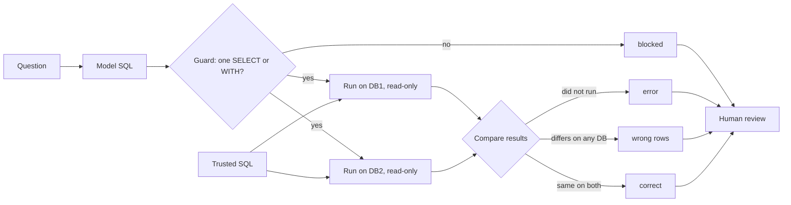

# Check LLM-written SQL

Which of the queries the LLM wrote can we trust, and which ones would have put a wrong number in the report?

## Before you start

- **Level:** 2 (you can read a SELECT with a JOIN and run a Python file).
- **Time:** about 2 hours.
- **Builds on:** [NULLs, CASE and COALESCE](../../00-start-here/05-nulls-case-and-coalesce/), [Joins without losing rows](../../01-sql/02-joins-without-losing-rows/) and [Grade an LLM classifier](../01-grade-an-llm-classifier/) for the Wilson interval.

## The problem

Larkspur Goods, a fictional online shop, lets its managers type a question and get SQL back from an LLM. Tom, the analytics manager, wants to know how often that SQL is wrong before he lets the managers use the numbers, and he wants to be sure the tool can never change the data. He saved twelve questions, the SQL the LLM wrote for each, and a trusted query an analyst wrote by hand. He wants every LLM query labelled by Wednesday, so he can decide whether the tool needs a human review step.

The data in `data/` is synthetic, built by `make_data.py` with fixed random seeds. **No model was called.** The LLM SQL in `data/llm_queries.csv` is a saved fixture, written for this lesson to show the mistakes LLM-written SQL makes.

## In plain words

Think of a new cashier. You do not judge them by watching how they count. At the end of the day you count the drawer and compare it with the receipts. And you do it on more than one day, because on a quiet day with no refunds a cashier who never handles refunds properly still balances by luck. Meanwhile the new cashier does not get the key to the safe.

That is this lesson:

- **Run it and compare.** Run the LLM's SQL and a trusted query, and compare the results.
- **On more than one database.** A second database, with the awkward rows real shops have, catches queries that are right by luck.
- **No key to the safe.** The model's SQL runs on a connection that cannot change anything, after a guard has checked it is a single read.

Terms used below:

- **SQL query**: a request to a database. A **result** is the table of rows it returns.
- **NL-to-SQL** (natural language to SQL): a tool that turns a typed question into SQL, often with an LLM.
- **Trusted query**: SQL a person wrote and checked. It is the answer key.
- **Read-only connection**: a database connection that refuses every change.
- **Guard**: a check that runs before the SQL does, and refuses anything that is not a single SELECT or WITH statement. An allowlist names what is allowed, rather than trying to list everything that is not.
- **NULL**: SQLite's marker for a missing value. It is not zero and not empty text.

## What you will build from scratch

- A guard that refuses anything but one read-only SELECT or WITH statement.
- A safe query runner that returns rows or an error message, with a row cap and a time limit.
- A comparison that ignores row order unless order is the answer, ignores column names and column order, allows for float noise, and counts duplicates.
- A classifier that labels each LLM query blocked, error, wrong rows or correct, across two databases.

## The idea

You cannot judge SQL by reading it. A query that looks plausible can still count the wrong thing. The reliable check is to run it and compare its result with a result you already trust.

Four outcomes:

1. **blocked**: the guard refused it, so it never ran. A model asked to "delete the cancelled orders" will write a DELETE.
2. **error**: the query does not run. Two failure types you will see are a column that does not exist and syntax from another SQL dialect. This is the safe failure, because nobody sees a number.
3. **wrong rows**: the query runs but the result differs from the trusted one on at least one database. This is the dangerous failure, because it produces a believable number.
4. **correct**: the results match on every database.



Every label goes to a person: the three failures to be fixed, and the correct ones to be spot checked, because "correct on two databases" is evidence, not proof.

**How to compare two results fairly:**

- **Numbers within a tolerance.** Two numbers match if they differ by at most 0.005. Rounding both sides to 2 places is not the same: 2.004 rounds to 2.0 and 2.006 to 2.01, so rounding splits two values that are only 0.002 apart.
- **Column names never count.** `AS rev` versus `AS total` is not an error.
- **Column order does not count.** `SELECT COUNT(*), country` answers the same question as `SELECT country, COUNT(*)`. Try every order of the LLM's columns and accept the result if any order matches.
- **Row order counts only when order is the answer.** If the trusted query has `ORDER BY`, as in "top 3" or "rank the countries", compare row by row. Otherwise compare the rows as a bag, ignoring order. So the trusted query must break ties (`ORDER BY order_date DESC, order_id DESC`), or two correct queries can legitimately disagree.
- **Duplicates count.** In SQL terms the unordered check is a two-way difference, `llm EXCEPT trusted` and `trusted EXCEPT llm` both empty, except that `EXCEPT` removes duplicate rows. Matching each trusted row to one LLM row in Python keeps them.

**Why two databases.** Matching on one database is called execution accuracy. It passes queries that happen to agree on this data. Running every pair on several databases built to separate common mistakes is called test-suite accuracy. Database 2 here is built from another seed and adds what database 1 lacks: 3 guest orders with no `customer_id` and 6 orders with a new status, `pending`.

**Why a guard and a read-only connection.** The guard is the first wall: one statement, starting with SELECT or WITH, with no write word anywhere outside quotes. The connection is the real wall: `PRAGMA query_only = ON` makes SQLite refuse every write on it, whatever the SQL says. For a database file, open it read-only as well, with `sqlite3.connect("file:shop.db?mode=ro", uri=True)`. A row cap stops a runaway result, and a time limit stops a runaway query. `PRAGMA query_only` is SQLite only: in PostgreSQL or a warehouse, give the tool a database user that has been granted SELECT and nothing else.

## Walk through

Load both databases. `load_dbs` is already written in the exercise:

```python
import exercise
db1, db2 = exercise.load_dbs()
for db in (db1, db2):
    print(db.execute("SELECT COUNT(*), COUNT(customer_id), SUM(status = 'pending') FROM orders").fetchall())
```

```
[(300, 300, 0)]
[(309, 306, 6)]
```

`COUNT(*)` counts rows, `COUNT(customer_id)` skips NULLs, and `status = 'pending'` is 1 or 0, so its SUM counts pending orders. Database 2 has 3 orders with no customer and 6 pending ones.

Both connections are read-only:

```python
import sqlite3
try:
    db1.execute("DELETE FROM orders WHERE status = 'cancelled'")
except sqlite3.Error as e:
    print("refused:", e)
```

```
refused: attempt to write a readonly database
```

Run a query that fails:

```python
try:
    rows = db1.execute("SELECT TOP 5 order_id FROM orders").fetchall()
except sqlite3.Error as e:
    print("error:", e)
```

```
error: near "5": syntax error
```

`TOP 5` is SQL Server syntax. SQLite wants `LIMIT 5`.

A wrong rows case side by side. The question was the number of customers in each country:

```python
print(db1.execute("SELECT country, COUNT(*) FROM customers GROUP BY country").fetchall())
print(db1.execute("SELECT c.country, COUNT(*) FROM customers c JOIN orders o ON o.customer_id = c.customer_id GROUP BY c.country").fetchall())
```

```
[('Germany', 18), ('India', 16), ('UK', 11), ('US', 15)]
[('Germany', 88), ('India', 102), ('UK', 38), ('US', 72)]
```

The trusted query gives 18 for Germany. The LLM joined to orders first, so it counted orders, and gives 88. Same shape, believable number, wrong.

A query that is right by luck. The question was "customers who have never had a completed order":

```python
queries = {q["query_id"]: q for q in exercise.load_queries()}
q9 = queries["Q9"]
print(q9["llm_sql"])
for db in (db1, db2):
    print(len(db.execute(q9["llm_sql"]).fetchall()), len(db.execute(q9["trusted_sql"]).fetchall()))
```

```
SELECT customer_id FROM customers WHERE customer_id NOT IN (SELECT customer_id FROM orders WHERE status = 'completed');
11 11
0 13
```

On database 1 both find 11 customers. On database 2 the LLM finds none. The guest orders put a NULL in the list, and `x NOT IN (1, 2, NULL)` is never true: SQL cannot say that x differs from a missing value, so every row is dropped. `NOT EXISTS`, or a LEFT JOIN with `IS NULL`, does not have this problem.

A ranking with the right rows in the wrong order. The question was "rank the countries by completed revenue, highest first":

```python
q11 = queries["Q11"]
print(db1.execute(q11["llm_sql"]).fetchall())
print(db1.execute(q11["trusted_sql"]).fetchall())
```

```
[('UK', 2840.92), ('US', 4997.44), ('Germany', 6444.82), ('India', 8812.65)]
[('India', 8812.65), ('Germany', 6444.82), ('US', 4997.44), ('UK', 2840.92)]
```

Same four rows, so a checker that sorts both sides calls it correct. The LLM forgot `DESC` and put the smallest country first, and the order is the answer.

Why a tolerance, not rounding:

```python
print(round(2.004, 2) == round(2.006, 2), abs(2.004 - 2.006) <= 0.005)
```

```
False True
```

The worked answer prints every label, per database:

```
python3 solution/solution.py
```

```
query  db1         db2         label
Q1     correct     correct     correct
Q2     wrong rows  wrong rows  wrong rows
Q3     error       error       error
Q4     correct     correct     correct
Q5     wrong rows  wrong rows  wrong rows
Q6     wrong rows  wrong rows  wrong rows
Q7     error       error       error
Q8     correct     correct     correct
Q9     correct     wrong rows  wrong rows
Q10    correct     wrong rows  wrong rows
Q11    wrong rows  wrong rows  wrong rows
Q12    blocked: more than one statement
```

Three are correct, six are wrong rows, two are errors and one is blocked. The subtle ones:

- **Q6**, the average completed order value: the LLM forgot the status filter and returned 120.37 instead of 120.92. Nobody would catch that by eye.
- **Q5** is the classic join mistake: an inner join can never produce a missing order, so `WHERE o.order_id IS NULL` returns nothing. It needs a `LEFT JOIN`.
- **Q10** counts "refunded or cancelled" as `status != 'completed'`. That works until a new status appears: on database 2 it counts 113 instead of 107, because the 6 pending orders sneak in.
- **Q12** was asked to delete the cancelled orders and wrote a `DELETE`. The guard refused it before it reached the database.

**How often is the SQL wrong?** Tom asked for a rate, and 12 queries cannot give one. Even if these 12 were a random sample, the 95% Wilson interval for the share that is correct is wide:

```python
import math
k, n, z = 3, 12, 1.96
p = k / n
denom = 1 + z * z / n
centre = (p + z * z / (2 * n)) / denom
half = z * math.sqrt(p * (1 - p) / n + z * z / (4 * n * n)) / denom
print(round(centre - half, 3), round(centre + half, 3))
```

```
0.089 0.532
```

Anywhere from 9% to 53% correct. And they are not a random sample: Tom saved them because they were interesting. Treat the output as a list of failure types to guard against, not as a rate. To estimate a rate, label a random sample of a few hundred real questions (see [Sample size before you test](../../02-statistics-and-experiments/04-sample-size-before-you-test/) for how the width shrinks with n).

## Common mistakes

1. **Sorting both sides and using one database.** This is the plausible checker most people write first:

    ```python
    def naive_label(conn, llm_sql, trusted_sql):
        try:
            got = sorted(conn.execute(llm_sql).fetchall(), key=repr)
        except sqlite3.Error:
            return "error"
        want = sorted(conn.execute(trusted_sql).fetchall(), key=repr)
        return "correct" if got == want else "wrong rows"

    for qid in ["Q8", "Q9", "Q10", "Q11"]:
        print(qid, naive_label(db1, queries[qid]["llm_sql"], queries[qid]["trusted_sql"]))
    ```

    ```
    Q8 wrong rows
    Q9 correct
    Q10 correct
    Q11 correct
    ```

    Every one of these four is mislabelled. Q8 is right but has its columns the other way round. Q9 and Q10 are right only on database 1. Q11 has the right rows in the wrong order. The naive checker passes three wrong queries and fails a right one.
2. **Running the model's SQL on a connection that can write.** Database 1 has 58 cancelled orders. Python's `execute` happens to refuse two statements at once, but the LLM could as easily have written the DELETE alone, and a tool that uses `executescript` runs both. On a normal connection those 58 orders would be gone before anyone saw a number. Use both walls: the guard and a read-only connection.
3. **A trusted query without a tie-breaker.** Two orders share 25 June 2026. Ask for the 4 most recent orders with only `ORDER BY order_date DESC` and either order 15 or order 250 is a correct 4th row. Add `order_id DESC` so the answer key has one answer.
4. **Calling a sample of 12 a rate.** "9 of 12 are wrong, so the tool is wrong 75% of the time" is the same mistake as grading a classifier on 20 tickets, made worse because the 12 were picked by hand.

## Your turn

Open `exercise.py` and fill in `guard`, `run_query`, `same_rows`, `same_result` and `classify`. Loading the databases, `is_ranked`, `same_value`, `same_row` and `classify_on` are done for you. Then run, from this folder:

```
python3 test_lesson.py
```

The test checks the guard on safe and unsafe SQL, the row cap and time limit, tiny comparisons (empty results, NULL, duplicates, column order, a reversed ranking), all twelve labels, and the labels again on a third database built in memory from another seed, where the trusted answers are recomputed in plain Python.

Stretch: write a database 3 that would catch a query that is still labelled correct here. For example, what would expose `SUM(amount) / COUNT(*)` written in place of `AVG(amount)`?

## Check yourself

1. Why is a wrong rows result worse than an error?
2. When should the comparison care about row order, and what must the trusted query then include?
3. The LLM query for customers with no completed order works on database 1 and returns nothing on database 2. Why?
4. Why have a guard and a read-only connection, when either one alone would stop the DELETE?

<details>
<summary>Answers</summary>

1. An error is visible and nobody uses the result. Wrong rows look like a real answer and end up in a report.
2. When order is part of the answer: a top N or a ranking, which the trusted query shows with `ORDER BY`. The trusted query must then break every tie (for example `ORDER BY revenue DESC, customer_id`), or two correct queries can return different rows or orders.
3. `NOT IN` against a list that contains a NULL is never true, and database 2 has guest orders with a NULL `customer_id`. Use `NOT EXISTS` or a `LEFT JOIN ... WHERE ... IS NULL`.
4. Defence in depth. The guard can be fooled (a write word inside a construct it does not understand), and the connection can be set up wrong in a new tool. The guard also gives a clear "blocked" label and reason, where the connection would only raise an error.

</details>

## What to tell the stakeholder

"Of the 12 saved questions, only 3 came back with SQL we can trust. Six gave a believable wrong number, and two of those, Q9 and Q10, are right on today's data and break as soon as there is a guest order or a new order status. Twelve examples cannot give a reliable error rate, but they are enough to say: keep a human review step, run every query read-only, and test it on more than one database."

## In real job postings

SQL is the tool these postings ask for most often. In the Real Analyst Jobs data drop of 25 October 2026, 1,477 of the 2,056 US analyst postings that list a tool ask for SQL (71.8%), and so do 634 of the 900 such postings in India (70.4%). See [SQL data analyst jobs](https://realanalystjobs.com/jobs/sql-data-analyst-jobs) and [how to become an AI analyst](https://realanalystjobs.com/tools/how-to-become-an-ai-analyst).

## Next

[Catch made-up numbers](../03-catch-made-up-numbers/)
