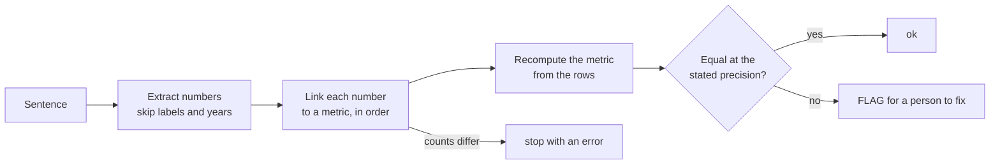

# Catch made-up numbers

Every number in the AI-written summary: is it actually in the data?

## Before you start

- **Level:** 2 (you can read and run a short Python file).
- **Time:** about 2 hours.
- **Builds on:** [Clean a messy CSV](../../05-python-for-analysts/01-clean-a-messy-csv/) for regular expressions, and [Check LLM-written SQL](../02-check-llm-written-sql/) for the habit of recomputing instead of reading.

## The problem

Fernhollow Supply, a fictional wholesaler, asked an LLM to write the half-year sales summary for the board pack. Dana, the finance director, likes the prose but does not trust the numbers, because LLMs can state a figure that sounds right and is not in the data. She wants every number in the summary checked against the order table before the pack goes out on Monday, with the wrong ones listed so they can be fixed.

The data in `data/orders.csv` (240 orders) and the summary in `data/ai_summary.csv` are synthetic, built by `make_data.py` with a fixed random seed. **No model was called.** The summary is a saved fixture written the way LLM prose usually is, with labels like H1 and Q2, a year, amounts like $77.9k and changes like -0.5%. Three of its numbers were made wrong on purpose.

## In plain words

Think of checking a restaurant bill. You do not reread the menu prose. You find every number on the bill, work out what it should be from what you ordered, and circle the ones that do not match. A bill that says "about 1,200 rupees" is not wrong if the true total is 1,180: it was only stated to the nearest hundred. A bill that says exactly 1,200 is wrong.

The same three steps check an AI summary:

- **Extract** every number from the text, and only the numbers. "Q2" and "2026" are labels, not amounts.
- **Link** each number to the metric it claims to be, then **recompute** that metric from the raw rows.
- **Compare at the stated precision**, and **flag** what does not match.

Terms used below:

- **Regular expression** (regex): a pattern that finds text, such as "digits, then optional decimals".
- **Metric**: a number defined from the data, such as total revenue or the share of revenue from one region.
- **Precision as stated**: how exactly a number was written. 650.59 is stated to the cent, 52,000 to the unit, $77.9k to the nearest hundred.
- **Fixture**: saved text that the test runs on, so nothing calls a model.

## What you will build from scratch

- A regex that pulls every number out of LLM prose: `156,142`, `650.59`, `-0.5%`, `$77.9k`, `$1.5M`, while skipping `H1`, `Q2`, `FY26`, `3rd` and the year `2026`.
- A record of how precisely each number was stated, including suffixes: `$77.9k` is stated to the nearest hundred.
- A checker that recomputes each claimed metric from the raw rows and flags every number that does not match.

## The idea



**1. Extract.** A number in prose has parts. In order:

```
(?<![\w.,])[-+\u2212]          optional sign, not inside a word or a range like 3-5
[$\u00a3\u20ac\u20b9]          optional currency: $, pound, euro, rupee
\d{1,3}(?:,\d{3})+(?:\.\d+)?   digits in groups of three with commas, optional decimals
|\d+(?:\.\d+)?                 or plain digits, optional decimals
\s?(?:thousand|million|billion)\b|(?:k|K|m|M|mn|bn|B)\b   optional size suffix
\s?%                           optional percent sign
```

`\u2212` is the Unicode minus sign, which LLMs often write instead of a hyphen. In the digits part the comma branch comes first, so `156,142` is read as one number, not as `156` and `142`. A full stop at the end of a sentence is not swallowed, because `\.\d+` needs a digit after the point.

Before all of that, the pattern tries one more branch: labels that contain digits but are not amounts, `Q1` to `Q4`, `H1` and `H2`, `FY26`, and ordinals like `3rd`. A match on that branch is thrown away. Years are thrown away after matching: four plain digits from 1900 to 2100, with no sign, currency, suffix, comma or percent.

**2. Link each number to a metric.** A regex cannot tell what a number means. In `ai_summary.csv` each sentence has a `metrics` column, written by the reviewer, that lists which metric each number claims, in order. If the counts differ, stop with an error rather than guess.

**3. Compare at the stated precision.** A summary that says 30.6% is not wrong because the true value is 30.5859. The rule: a number stated to `d` decimal places matches if

```
|actual - claimed| <= 0.5 * 10^(-d)
```

So `650.59` must be within 0.005, `41.1` within 0.05, and `52,000` within 0.5. A suffix moves the last stated digit to the left, so `d` goes negative: `$77.9k` has 1 decimal on a thousand, so `d = 1 - 3 = -2` and it must be within 50. `$50k` has `d = -3` and must be within 500.

That is why `$52,000` matters: rounding 51,319 up to a tidy 52,000 is a change of 681, and with no decimals and no suffix the reader takes it as exact. Even written as `$52k` it would be out by more than 500.

## Walk through

Pull the numbers out of one sentence with the digits part alone:

```python
import re
DIGITS = r"\d{1,3}(?:,\d{3})+(?:\.\d+)?|\d+(?:\.\d+)?"
s = "North was the largest region at $54,809, or 41.1% of revenue."
print(re.findall(DIGITS, s))
```

```
['54,809', '41.1']
```

That works on plain sentences. Now a sentence the way LLMs write them:

```python
s6 = "Q2 revenue was $77.9k, a change of -0.5% on Q1."
print(re.findall(DIGITS, s6))
```

```
['2', '77.9', '0.5', '1']
```

Four numbers for two metrics. The `2` and `1` come from the quarter labels, `77.9` has lost its thousands, and `0.5` has lost its minus sign. The full pattern in the exercise reads the same sentence correctly:

```python
import exercise
print(exercise.SIGN, exercise.SUFFIX)
```

```
(?<![\w.,])[-+\u2212] \s?(?:thousand|million|billion)\b|(?:k|K|m|M|mn|bn|B)\b
```

`SIGN`, `CURRENCY`, `SUFFIX` and `LABEL` are written for you. You write `DIGITS` and the code that turns each match into a value and a precision. Once you have, `extract_numbers(s6)` returns `[(77900.0, -2), (-0.5, 1)]`: 77,900 stated to the nearest hundred, and minus 0.5 stated to one decimal.

Recompute the truth from the rows:

```python
import csv
rows = list(csv.DictReader(open("data/orders.csv")))
total = sum(int(r["revenue"]) for r in rows)
north = sum(int(r["revenue"]) for r in rows if r["region"] == "North")
print(total, north, round(north / total * 100, 1))
```

```
156142 54809 35.1
```

North revenue is right at 54,809, but the share is 35.1%, not 41.1%.

Run the worked answer to check all 15 numbers:

```
python3 solution/solution.py
```

```
ok   S1 total_revenue    claimed 156142.0 actual 156142
ok   S1 order_count      claimed 240.0 actual 240
ok   S2 avg_order_value  claimed 650.59 actual 650.59
ok   S3 north_revenue    claimed 54809.0 actual 54809
FLAG S3 north_share_pct  claimed 41.1 actual 35.1
ok   S4 south_revenue    claimed 50000.0 actual 50014
FLAG S4 west_revenue     claimed 52000.0 actual 51319
ok   S5 jan_revenue      claimed 21215.0 actual 21215
ok   S5 jun_revenue      claimed 27704.0 actual 27704
FLAG S5 growth_pct       claimed 25.0 actual 30.59
ok   S6 q2_revenue       claimed 77900.0 actual 77862
ok   S6 q2_vs_q1_pct     claimed -0.5 actual -0.53
ok   S7 apr_revenue      claimed 25700.0 actual 25720
ok   S7 apr_vs_mar_pct   claimed -17.5 actual -17.51
ok   S8 region_count     claimed 3.0 actual 3
```

Twelve numbers match. Three are flagged: North's share (41.1% stated, 35.1% true), West revenue (52,000 stated, 51,319 true) and the January to June growth (25.0% stated, 30.59% true). Notice that the growth sentence gets both monthly figures right and still states the wrong percentage. Correct inputs do not prove a correct result. And notice that South's `$50k` passes although the true value is 50,014: it was stated to the nearest thousand.

### Honest limits

This check catches made-up figures, not made-up claims. Sentence S8 says all 3 regions grew. The 3 is right, so it passes. But North fell from Q1 to Q2:

```python
q1 = sum(int(r["revenue"]) for r in rows if r["region"] == "North" and r["month"] in ("Jan", "Feb", "Mar"))
q2 = sum(int(r["revenue"]) for r in rows if r["region"] == "North" and r["month"] in ("Apr", "May", "Jun"))
print(q1, q2, round((q2 - q1) / q1 * 100, 1))
```

```
29110 25699 -11.7
```

"Grew over the period" could mean January to June, when North did grow, or Q1 to Q2, when it fell 11.7%. A person has to read the words. Other things the extractor cannot do:

- **Direction words.** "Revenue fell 3.2%" is extracted as 3.2. If the metric is a change, the reviewer must link it to a decline metric, or the sign is lost.
- **Numbers as words and dates.** "three regions" is not found, and "25 October" gives a 25.
- **A count that looks like a year.** "2026 orders" written without a comma is skipped as a year.
- **The link is only as good as the reviewer.** A right number tagged to the wrong metric gives a false flag or a false pass.

The sturdier approach, where you control the prompt, is to ask the model for its claims as structured data (each claim with a metric name and a value) and check those, with the prose written from them. That is a later lesson in this phase.

## Common mistakes

1. **Using a number regex that does not know LLM prose.** With the digits part alone, the first sentence gives four numbers for two metrics:

    ```python
    print(re.findall(DIGITS, "In H1 2026 the team booked $156,142 of revenue from 240 orders."))
    print(re.findall(DIGITS, "April revenue was $25.7k, -17.5% on March."))
    ```

    ```
    ['1', '2026', '156,142', '240']
    ['25.7', '17.5']
    ```

    The first stops the checker with a count error. The second is worse: the counts match, so it compares 25.7 with April revenue of 25,720 and 17.5 with a change of -17.51, and flags two numbers that are right. Labels, years, suffixes and signs must be handled before comparing.
2. **Rounding to a fixed number of places.** Comparing everything to 2 decimals calls `$50k` wrong (it is 14 away from 50,014). The precision as written is the reader's precision.
3. **Pairing numbers with metrics by guesswork when counts differ.** Pairing by position after a mismatch compares a number with the wrong metric. A loud error is safer than a silent guess.
4. **Treating "every number is right" as "the summary is right".** S8 passes and is misleading. Read the claims too.

## Your turn

Open `exercise.py`. Write the `DIGITS` pattern, then fill in `read_number`, `extract_numbers` and `check_summary`. `LABEL`, `SIGN`, `CURRENCY`, `SUFFIX`, `compute_metrics` and `matches` are already written. Then run, from this folder:

```
python3 test_lesson.py
```

The test checks tiny sentences (empty, years, quarter labels, negatives, the Unicode minus, ranges, k and M suffixes, a comma number that looks like a year), the committed summary, and a second summary built from another seed, where it must flag exactly the numbers that were made wrong.

Stretch: handle direction words. When "fell", "down" or "declined" comes just before a number linked to a change metric, make the number negative, and add a test for "Revenue fell 0.5% on Q1".

## Check yourself

1. Why is the comma branch of the digits pattern listed before the plain digits branch?
2. The true value is 30.5859 and the summary says 30.6%. Is that a match? What about 31%?
3. The summary says West made $52k and the truth is 51,319. Does it pass? What if it said $51k?
4. Name one kind of wrong statement this checker will never flag.

<details>
<summary>Answers</summary>

1. Regex alternation tries branches left to right. With plain digits first, `156,142` would match as `156`, then `142`, two wrong numbers.
2. 30.6 with one decimal allows 0.05, and 30.5859 is 0.0141 away, so yes. 31 with no decimals allows 0.5, and 30.5859 is 0.4141 away, so it also matches. Precision as written sets the tolerance.
3. $52k is stated to the nearest thousand, so it allows 500 either way. 51,319 is 681 away, so it is flagged. $51k is 319 away, so it passes.
4. A claim with no number, such as "all regions grew", or a right number attached to the wrong label, if the reviewer tagged the metric wrong.

</details>

## What to tell the stakeholder

"I checked all 15 numbers in the summary against the order table. Twelve are right. Three need fixing before Monday: North's share of revenue is 35.1%, not 41.1%; West revenue is $51,319, not $52,000; and growth from January to June is 30.6%, not 25.0%. One sentence also needs rewording: it says all three regions grew, but North fell 11.7% from Q1 to Q2."

## In real job postings

Checking AI output against the data is a Python and SQL job. In the Real Analyst Jobs data drop of 25 October 2026, 448 of the 900 India analyst postings that list a tool ask for Python (49.8%), and so do 996 of the 2,056 such US postings (48.4%). See [Python data analyst jobs](https://realanalystjobs.com/jobs/python-data-analyst-jobs) and [how to become an AI analyst](https://realanalystjobs.com/tools/how-to-become-an-ai-analyst).

## Next

[04: How LLMs work, for analysts](../04-how-llms-work-for-analysts/): what a token is, what a run costs, and why the same prompt gives different answers.
