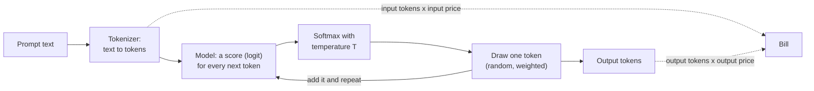

# How LLMs work, for analysts

What is a token, what does a run cost, and why does the same prompt give different answers?

## Before you start

- Level 1 (beginner). About 2 hours.
- You can run a Python file and read a short function: [00-06 Python for spreadsheet people](../../00-start-here/06-python-for-spreadsheet-people/).
- Random draws with a seed are explained from zero below. [02-05 Probability by simulation](../../02-statistics-and-experiments/05-probability-by-simulation/) goes deeper if you want more.

## The problem

Ritu runs customer experience at Tiffinbell, a fictional food delivery app with kitchens in four cities of Maharashtra. She wants an LLM to write a one-sentence summary of every customer review, about 60,000 reviews a month, so her team reads summaries instead of raw text. Finance has given her a budget of $25 a month and wants to know by Friday which model fits. A colleague already said "the big model fits easily". Ritu also noticed that when she pasted the same review into a chat tool twice, she got two different summaries, and she wants to know whether that is a bug.

The files in `data/` are synthetic, built by `make_data.py` with a fixed seed. `reviews.csv` holds one week of 300 made-up reviews. **No model was called.** The `summary` column is simulated, and `data/fixture.json` says so. The prices in `rate_card.csv` are a **fictional example rate card** for two made-up models, `example-small` and `example-large`. They are not any real provider's prices. Before you budget a real project, read the provider's own pricing page on the day you budget.

## In plain words

Think of a courier that charges by weight, not by parcel. A letter costs little, a box of books costs a lot, and the price list has one rate for what you send and a higher rate for what comes back. To estimate a month of parcels you weigh a sample, find the average weight each way, and multiply by how many parcels you will send.

An LLM bills the same way. It does not read letters or words. It reads **tokens**, small pieces of text, and the bill is a price per token, with one price for the tokens you send and a higher price for the tokens it writes back.

The second puzzle is like asking a friend to finish the sentence "Your order was ...". Most of the time they say "delivered", sometimes "late", now and then "cold". The model works the same way: for the next piece of text it has a score for every option, and it **draws** one of them at random, weighted by those scores. Draw twice and you can get two different answers. That is how it was built, not a bug.

Words used in this lesson:

- **LLM** (large language model): a program that reads text and writes text, one token at a time.
- **Token**: the unit an LLM reads, writes and bills. Often a whole common word, sometimes a piece of a rare word, a digit or a punctuation mark.
- **Tokenizer**: the rule that cuts text into tokens. Every model family has its own.
- **Prompt**: everything you send in one request. Here: the fixed instructions plus one review.
- **Input tokens and output tokens**: tokens you send, and tokens the model writes back. They have different prices.
- **Rate card**: the price list, usually in dollars per million tokens.
- **Logit**: the model's raw score for one possible next token. Higher means more likely.
- **Softmax**: the formula that turns scores into chances that add up to 1.
- **Temperature**: a setting that makes the chances sharper (low) or flatter (high).
- **Seed**: the starting number of a random number generator. The same seed gives the same draws.

## What you will build from scratch

- `toy_tokenize`: a **toy** tokenizer. Common words are one token, other words are cut into 4-letter pieces, and each digit and punctuation mark is a token. Real tokenizers are learned from data and cut text differently, so use this to understand the idea and the provider's own token counter for real numbers.
- `batch_tokens`, `cost` and `monthly_estimate`: input and output tokens for a batch, priced from the fictional rate card, scaled to a month.
- `softmax`, `sample_next` and `run_many`: temperature as weighted random draws from a tiny made-up table of next-token scores, so you can watch the answer change between runs.

## The idea

A model writes its answer one token at a time. Each step turns the text so far into a score for every possible next token, turns the scores into chances, draws one token, adds it to the text, and goes again until the answer is finished.



**Cost.** With prices per million tokens:

```
cost = (input tokens x input price + output tokens x output price) / 1,000,000
```

Every request sends the instructions again, so for a batch of n reviews:

```
input tokens  = sum over reviews of (instruction tokens + review tokens)
output tokens = sum over reviews of summary tokens
```

To estimate a month, price the sample, divide by the number of reviews in it to get the average cost per request, and multiply by the requests you expect.

**Temperature.** With scores z for each candidate token and temperature T above 0:

```
chance(token) = exp(z / T) / sum over all candidates of exp(z / T)
```

`exp` is the exponential function. Dividing by a small T stretches the gaps between scores, so the top token takes almost all the chance. A large T shrinks the gaps, so the chances get closer to equal. At T = 0 the formula would divide by zero, so T = 0 is defined as "always take the highest score". Before taking `exp`, subtract the largest score from every score: the chances are unchanged and the numbers never overflow.

A draw works like a lucky dip. Line the tokens up in a fixed order, give each a slice of the line from 0 to 1 as long as its chance, pick a random number r between 0 and 1, and take the token whose slice r lands in.

## Walk through

Run these from the lesson folder.

Step 1. Tokens. `sys.path.insert(0, "solution")` lets Python find the worked answer, and `import solution as s` loads it, so you can watch each function before you write your own.

```python
import sys
sys.path.insert(0, "solution")
import solution as s

vocab = s.load_vocab()
for text in ["the food was cold", "khana thanda tha", "Tiffinbell", "Rs 2,499"]:
    tokens = s.toy_tokenize(text, vocab)
    print(len(tokens), tokens)
```

```
4 ['the', 'food', 'was', 'cold']
5 ['khan', 'a', 'than', 'da', 'tha']
3 ['Tiff', 'inbe', 'll']
6 ['Rs', '2', ',', '4', '9', '9']
```

`load_vocab` reads the toy word list in `data/vocab.csv`. Four common English words are four tokens. The same complaint in Hinglish ("the food was cold") is five, because none of its words is in the toy vocabulary. A brand name is three. A price is six, because every digit and the comma cost a token. The lesson: token counts depend on the words, not on how long the text looks, so you count them on your own text.

Step 2. One request.

```python
import sys
sys.path.insert(0, "solution")
import solution as s

vocab = s.load_vocab()
row = s.load_csv("reviews.csv")[3]
print(row["text"])
print(s.count_tokens(s.INSTRUCTIONS, vocab), s.count_tokens(row["text"], vocab), s.count_tokens(row["summary"], vocab))
```

```
The paneer tikka arrived cold and 50 minutes late. Not happy at all.
27 18 18
```

The instructions are 27 tokens, the review 18 and the simulated summary 18. So this request sends 45 input tokens and gets 18 output tokens back. The instructions are more than half of what is sent, and they are sent again with every review.

Step 3. The whole week, and a month.

```python
import sys
sys.path.insert(0, "solution")
import solution as s

vocab = s.load_vocab()
rows = s.load_csv("reviews.csv")
rates = s.load_rates()
inp, out = s.batch_tokens(rows, s.INSTRUCTIONS, vocab)
print(len(rows), inp, out, round(inp / len(rows), 1), round(out / len(rows), 1))
for model, rate in rates.items():
    print(model, rate, round(s.monthly_estimate(rows, s.INSTRUCTIONS, vocab, rate, 60000), 2))
```

```
300 14306 6388 47.7 21.3
example-small {'input_per_million': 0.5, 'output_per_million': 2.0} 3.99
example-large {'input_per_million': 5.0, 'output_per_million': 20.0} 39.86
```

The 300 reviews send 14,306 input tokens and get 6,388 output tokens back: 47.7 in and 21.3 out per review on average. At 60,000 reviews a month, the fictional small model costs $3.99 and the fictional large one $39.86. With a $25 budget, the large model does not fit.

Step 4. Where the money goes.

```python
import sys
sys.path.insert(0, "solution")
import solution as s

vocab = s.load_vocab()
rows = s.load_csv("reviews.csv")
large = s.load_rates()["example-large"]
inp, out = s.batch_tokens(rows, s.INSTRUCTIONS, vocab)
input_only = s.cost(inp, 0, large) / len(rows) * 60000
full = s.cost(inp, out, large) / len(rows) * 60000
print(round(input_only, 2), round(full, 2), round(s.cost(0, out, large) / s.cost(inp, out, large), 3))
```

```
14.31 39.86 0.641
```

There are fewer output tokens than input tokens, but each one costs four times as much on this rate card, so the output is 64.1% of the bill. Pricing the input alone says $14.31 a month, inside the budget. That is the colleague's "fits easily", and it is wrong by $25.55.

Step 5. Temperature turns scores into chances. `data/next_token.csv` holds made-up scores for the word after "Your order was".

```python
import sys
sys.path.insert(0, "solution")
import solution as s

logits = s.load_logits("Your order was")
for t in (0, 0.5, 1.0, 2.0):
    probs = s.softmax(logits, t)
    print("T=%.1f" % t, {k: round(v, 2) for k, v in probs.items()})
```

```
T=0.0 {'cancelled': 0.0, 'cold': 0.0, 'delivered': 1.0, 'late': 0.0, 'wonderful': 0.0}
T=0.5 {'cancelled': 0.02, 'cold': 0.05, 'delivered': 0.78, 'late': 0.16, 'wonderful': 0.0}
T=1.0 {'cancelled': 0.08, 'cold': 0.13, 'delivered': 0.53, 'late': 0.24, 'wonderful': 0.02}
T=2.0 {'cancelled': 0.14, 'cold': 0.18, 'delivered': 0.36, 'late': 0.24, 'wonderful': 0.07}
```

At T = 0 "delivered" always wins. As T rises, its chance falls from 0.78 to 0.36, and even "wonderful", a strange word here, gets a 7% chance at T = 2.

Step 6. Ask the same question 20 times at each temperature.

```python
import sys
sys.path.insert(0, "solution")
import solution as s

logits = s.load_logits("Your order was")
for t in (0, 0.5, 1.0, 2.0):
    print("T=%.1f" % t, s.run_many(logits, t, 20, seed=1))
```

```
T=0.0 {'cancelled': 0, 'cold': 0, 'delivered': 20, 'late': 0, 'wonderful': 0}
T=0.5 {'cancelled': 1, 'cold': 2, 'delivered': 14, 'late': 3, 'wonderful': 0}
T=1.0 {'cancelled': 3, 'cold': 2, 'delivered': 8, 'late': 7, 'wonderful': 0}
T=2.0 {'cancelled': 5, 'cold': 2, 'delivered': 5, 'late': 7, 'wonderful': 1}
```

Same prompt, same scores, 20 runs. At T = 0 the answer never changes. At T = 1 it is "delivered" only 8 times out of 20. The fixed seed makes this table repeat every time you run it, which a test needs. A chat tool does not let you fix its seed, which is why Ritu saw two summaries.

Step 7. Why this matters for an analyst. When two options score almost the same, the label itself flips between runs.

```python
import random
import sys
sys.path.insert(0, "solution")
import solution as s

logits = s.load_logits("Overall the customer is")
probs = s.softmax(logits, 0.7)
print({k: round(v, 2) for k, v in probs.items()})
print([s.sample_next(probs, random.Random(seed)) for seed in range(1, 11)])
print([s.sample_next(s.softmax(logits, 0), random.Random(seed)) for seed in range(1, 11)])
```

```
{'angry': 0.15, 'confused': 0.1, 'happy': 0.4, 'unhappy': 0.35}
['angry', 'unhappy', 'confused', 'confused', 'happy', 'unhappy', 'happy', 'confused', 'happy', 'happy']
['happy', 'happy', 'happy', 'happy', 'happy', 'happy', 'happy', 'happy', 'happy', 'happy']
```

Ten runs at T = 0.7 give four different labels for the same review. At T = 0 every run says "happy". For labels you will count, grade or put in a dashboard, use temperature 0 and save the outputs with the model name, prompt version, date and temperature, as `data/fixture.json` does here. Even then, some services do not promise exactly the same output on every call, so a saved output, not a rerun, is the record.

### Honest limits

- The tokenizer is a toy. Real ones are learned from large amounts of text and give different counts. The habits carry over: count on your own text, and expect names, numbers and other languages to cost more than you guess.
- The prices are fictional. Real rate cards change, and many have more lines than input and output, such as cheaper repeated input or a separate price for batch jobs. Some models also write hidden reasoning tokens that are billed as output. Read the provider's pricing page on the day you budget, and write the date next to your estimate.
- The summaries are simulated. A real model's summaries can be longer or shorter, and output length is the biggest part of this bill, so measure it on a real sample and set a maximum output length.
- The next-token scores are made up for two prompts. A real model scores tens of thousands of tokens at every step.

## Common mistakes

1. **Pricing the input tokens only.** The prompt is the part you write, so it is the part you count. On this data that gives $14.31 a month for the large model, and the real figure is $39.86, because output tokens cost four times as much and make up 64.1% of the bill. The budget answer flips from yes to no.
2. **Counting the instructions once per batch instead of once per request.** Each review is its own request and carries the instructions again.

    ```python
    import sys
    sys.path.insert(0, "solution")
    import solution as s

    vocab = s.load_vocab()
    rows = s.load_csv("reviews.csv")
    large = s.load_rates()["example-large"]
    inp, out = s.batch_tokens(rows, s.INSTRUCTIONS, vocab)
    once = s.count_tokens(s.INSTRUCTIONS, vocab) + sum(s.count_tokens(r["text"], vocab) for r in rows)
    print(inp, once, round(s.cost(once, out, large) / len(rows) * 60000, 2))
    ```

    ```
    14306 6233 31.79
    ```

    Counting the 27 instruction tokens once leaves out 8,073 of the 14,306 input tokens, and the month comes out at $31.79 instead of $39.86.
3. **Mixing units.** Rate cards quote per million tokens, some older ones per thousand. Write the unit in the variable name, as `input_per_million` does, and check one request by hand.
4. **Treating a different answer as a bug, or one answer as the answer.** At a temperature above 0 the model is drawing at random. Use T = 0 for anything you will count, and grade on saved outputs, not on whatever the model says today.

## Your turn

Open `exercise.py` and fill in `toy_tokenize`, `count_tokens`, `batch_tokens`, `cost`, `monthly_estimate`, `softmax`, `sample_next` and `run_many`. Then run, from this folder:

```
python3 test_lesson.py
```

The test checks your tokenizer on tiny hand-made texts (empty, a known word in capitals, a brand name, a price), your costs on zero tokens and on output priced apart from input, your softmax on a tie at T = 0 and on scores big enough to overflow, and everything again on a second week of reviews built with another seed, where the right answer is computed a different way.

Stretch: Ritu asks what happens if the summaries are capped at 12 tokens. Work out the new monthly cost for both models, and say what the cap might cut from a summary.

## Check yourself

1. Why does the same review cost more tokens in Hinglish than in English with the toy tokenizer, and why should you not assume the exact gap holds for a real model?
2. Output tokens are fewer than input tokens here. Why are they still most of the bill?
3. You will label 5,000 tickets and report the share that are refunds. What temperature do you use, and what do you save next to the labels?
4. A colleague prices one request and multiplies by 60,000. When is that close to right, and when is it far off?

<details>
<summary>Answers</summary>

1. The toy vocabulary holds common English words, so Hinglish words are cut into pieces. Real tokenizers are learned from data, so the size of the gap depends on that model's training text. Count tokens with the provider's own counter on a sample of your text.
2. Because each output token costs more. On this fictional card output is four times the input price, so 6,388 output tokens cost more than 14,306 input tokens.
3. Temperature 0, so the same ticket gets the same label. Save the model name, the prompt version, the date and the temperature next to the labels, and grade from that saved file.
4. It is close when requests are all about the same length, as here (one review gave $39.30 against $39.86). It is far off when lengths vary a lot, for example when a few reviews are very long, so use the average over a sample of a few hundred requests.

</details>

## What to tell the stakeholder

"On a sample of 300 reviews, each summary sends about 48 tokens and gets about 21 back. At 60,000 reviews a month the small model costs about $4 and the large one about $40 on the example rate card, so only the small model fits the $25 budget; most of the cost is the summaries the model writes, not the reviews we send. Different summaries for the same review are expected when the temperature is above zero, so we will run at temperature 0, save every output with the model and prompt version, and recheck the price against the provider's live rate card before we start."

## In real job postings

LLM work for analysts is done in Python. In the Real Analyst Jobs data drop of 25 October 2026, 448 of the 900 India analyst postings that list a tool ask for Python (49.8%), and 996 of the 2,056 such US postings do (48.4%). See [how to become an AI analyst](https://realanalystjobs.com/tools/how-to-become-an-ai-analyst) and [Python data analyst jobs](https://realanalystjobs.com/jobs/python-data-analyst-jobs).

## Next

[Prompt versions as experiments](../05-prompt-versions-as-experiments/)
