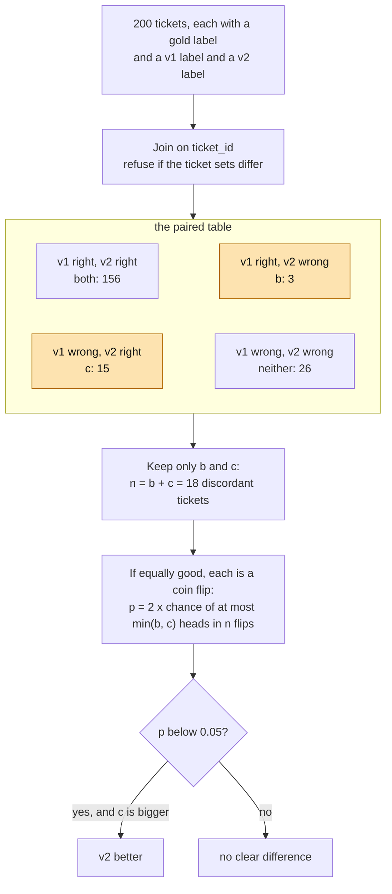

# Prompt versions as experiments

Is prompt v2 better than v1 on the same 200 tickets?

## Before you start

- Level 1 (beginner). About 2 hours.
- You can run a Python file and read a short function: [00-06 Python for spreadsheet people](../../00-start-here/06-python-for-spreadsheet-people/).
- [06-01 Grade an LLM classifier](../01-grade-an-llm-classifier/) introduced these tickets and found that the LLM sends double charges to refunds. This lesson tests the prompt fix it suggested.
- [02-03 A/B test from scratch](../../02-statistics-and-experiments/03-ab-test-from-scratch/) explains the null hypothesis and the p-value. The plain-words section below repeats the idea, so you can start here.

## The problem

Northwind Desk, a fictional software company, uses an LLM to label support tickets as billing, bug, refund or other. Priya, the support lead, saw in her last review that the model calls "I was charged twice, please reverse one" a refund. Sam, who looks after the prompt, wrote prompt v2 with a rule and an example for charges, and posted in the team chat: "v2 gets 10 out of 10 on my examples, and 93.5% on this week's tickets, against 79.5% for v1." Priya wants to switch only if v2 is really better, and she wants the answer before Monday's planning meeting. A person already labelled 200 tickets from last week, and both prompts were run on those same 200.

The data in `data/` is synthetic, built by `make_data.py` with a fixed seed. **No model was called.** The labels in `run_v1.csv`, `run_v2.csv`, `other_week_v2.csv` and `dev_examples.csv` are simulated, and `data/fixture.json` says so and records both prompt texts. The simulation behaves like a real model at temperature 0: the same text always gets the same label, and the two versions only disagree on wordings that the prompt change touches.

## In plain words

Two cooks each make the same 200 dishes from the same 200 orders, and a taster marks every plate right or wrong. To decide who is better, you do not need the plates both got right, or the plates both got wrong. They tell you nothing about who is better. Only the plates where one cook was right and the other was wrong count.

Suppose there are 18 such plates. If the two cooks were equally good, each of those 18 would be a coin flip: as likely to favour one as the other. So the question becomes: if you flip a fair coin 18 times, how often do you get 15 or more heads (or 15 or more tails)? If almost never, the cooks are not equally good.

Now imagine Sam's claim instead. One cook made this week's dishes and the other made last week's, and last week had more of the hard orders. Comparing their scores tells you about the weeks, not the cooks. And a cook who chooses the 10 plates to be tasted will choose their best ones.

Words used in this lesson:

- **Prompt version**: one exact text of the instructions sent to the model. A changed word is a new version.
- **Gold label**: the answer a trusted person gave, treated as the truth.
- **Paired comparison**: both versions run on the same items, so each item gives one result for each version, side by side.
- **Discordant pair**: an item where one version is right and the other is wrong. Concordant pairs are where they agree.
- **Null hypothesis**: the assumption that the two versions are equally good.
- **p-value**: the chance of a result at least this lopsided if the null hypothesis were true.
- **Exact binomial test**: a p-value worked out by counting coin-flip outcomes, with no approximation.
- **McNemar's test**: the name for this test on the discordant pairs of a paired comparison. Here we use its exact form.

## What you will build from scratch

- `pair_runs`: join the gold labels and two runs on `ticket_id`, and refuse when they are not on exactly the same tickets.
- `accuracy` and `paired_table`: the 2 by 2 table of right and wrong for v1 against v2.
- `exact_two_sided_p`: the exact binomial p-value with `math.comb`.
- `compare`: the verdict, `v2 better`, `v1 better` or `no clear difference`.

## The idea

Run both versions on the same tickets and put each ticket in one of four boxes:



The difference in accuracy is (c - b) / 200: the concordant boxes cancel out. So the evidence is in b and c alone.

If the versions were equally good, each of the n = b + c discordant tickets would favour v2 with chance one half. The number that favour v2 would follow a **binomial distribution**: the count of heads in n fair coin flips. The chance of exactly i heads is

```
P(X = i) = comb(n, i) / 2^n
```

where `comb(n, i)` is the number of ways to choose which i of the n flips are heads (in Python, `math.comb(n, i)`). The two-sided p-value adds up the chance of a split at least as lopsided as the one we saw, in either direction:

```
p = 2 x sum of comb(n, i) / 2^n for i = 0 .. min(b, c)      capped at 1
```

The 2 is there because a split of 3 to 15 in v1's favour would be just as surprising, and we did not decide in advance which version would win. With n = 0 there are no discordant tickets and no evidence, so p = 1. With b = c the formula goes above 1, so it is capped.

Why not compare 79.5% with 85.5% as two separate groups, as in the A/B test of lesson 02-03? Because these are not two groups of different tickets. The same tickets are hard for both versions, and the two-group test treats that shared difficulty as noise. It ends up much less sure than the data allows. You will see this in the walk through.

## Walk through

Run these from the lesson folder.

Step 1. Join the runs and count. `sys.path.insert(0, "solution")` lets Python find the worked answer, and `import solution as s` loads it.

```python
import sys
sys.path.insert(0, "solution")
import solution as s

tickets = s.load_csv("tickets.csv")
v1, v2 = s.load_csv("run_v1.csv"), s.load_csv("run_v2.csv")
pairs = s.pair_runs(tickets, v1, v2)
print(len(pairs), pairs[0])
print(round(s.accuracy(pairs, "a"), 3), round(s.accuracy(pairs, "b"), 3))
print(s.paired_table(pairs))
```

```
200 {'ticket_id': 'T0001', 'gold': 'bug', 'a': 'other', 'b': 'other'}
0.795 0.855
(156, 3, 15, 26)
```

Each pair holds one ticket's gold label, v1's label (`a`) and v2's label (`b`). The runs are joined on `ticket_id`, not on row number, because a saved run can come back in any order. v1 is right on 159 tickets (79.5%) and v2 on 171 (85.5%). The table says 156 tickets are right under both, 26 are wrong under both, v2 fixed 15 and broke 3.

Step 2. The exact p-value by hand, for 3 against 15.

```python
import math
print(sum(math.comb(18, i) for i in range(4)), 2 ** 18)
print(round(2 * sum(math.comb(18, i) for i in range(4)) / 2 ** 18, 4))
```

```
988 262144
0.0075
```

Of the 262,144 ways 18 coin flips can land, 988 give 3 or fewer heads. Double that for the other direction and divide: p = 0.0075. A fair coin rarely splits 18 flips as unevenly as 3 to 15.

Step 3. The verdict, and the tickets behind it.

```python
import sys
sys.path.insert(0, "solution")
import solution as s

pairs = s.pair_runs(s.load_csv("tickets.csv"), s.load_csv("run_v1.csv"), s.load_csv("run_v2.csv"))
print(s.compare(pairs))
fixed = [p for p in pairs if p["a"] != p["gold"] and p["b"] == p["gold"]]
broke = [p for p in pairs if p["a"] == p["gold"] and p["b"] != p["gold"]]
text = {r["ticket_id"]: r["text"] for r in s.load_csv("tickets.csv")}
for p in fixed[:3] + broke:
    print(p["gold"], p["a"], p["b"], text[p["ticket_id"]])
```

```
{'n': 200, 'acc_a': 0.795, 'acc_b': 0.855, 'a_only': 3, 'b_only': 15, 'p_value': 0.007537841796875, 'verdict': 'v2 better'}
billing refund billing Hello, you charged me $49 instead of $39 for the starter plan
billing refund billing Hi, you charged me $49 instead of $39 for the annual plan. Thanks
billing refund billing Hi, you charged me $29 instead of $9 for the annual plan. Thanks
refund refund billing Hello, I cancelled in September but you still charged me $249, I want it back
refund refund billing Hello, I cancelled in August but you still charged me $29, I want it back. Thanks
other other billing Hi, do you have a student discount on the starter plan?
```

Each line reads gold, v1, v2, text. v2 is better: p = 0.0075, below 0.05, and the 15 discordant tickets that favour it are v2's. Reading the tickets tells you more than the p-value. The three fixes shown are wrong-amount tickets, exactly what the new rule is for. All three breaks come from the same rule applied too widely: two customers who cancelled and want their money back, and one question about a discount, are now called billing. That is the next prompt fix, and it will be tested the same way.

Step 4. The same data treated as two separate groups, with the two-proportion z-test from lesson 02-03.

```python
import math
import sys
sys.path.insert(0, "solution")
import solution as s

pairs = s.pair_runs(s.load_csv("tickets.csv"), s.load_csv("run_v1.csv"), s.load_csv("run_v2.csv"))
x1 = sum(p["a"] == p["gold"] for p in pairs)
x2 = sum(p["b"] == p["gold"] for p in pairs)
n = len(pairs)
pool = (x1 + x2) / (2 * n)
z = (x2 / n - x1 / n) / math.sqrt(pool * (1 - pool) * (2 / n))
print(x1, x2, round(z, 2), round(math.erfc(abs(z) / math.sqrt(2)), 3))
```

```
159 171 1.58 0.114
```

`math.erfc(abs(z) / math.sqrt(2))` is the two-sided p-value of a z score. Treated as two unrelated groups of 200, the same counts give p = 0.114, "no clear difference". The test does not know that 182 of the 200 tickets got the same verdict from both versions, so it treats every ticket's difficulty as chance. The paired test uses that information and gives 0.0075.

### Honest limits

- The labels are simulated, so the numbers teach the method, not how good any real prompt or model is.
- Significant is not the same as big enough. v2 is better by 6.0 points on these tickets. Whether 6 points is worth a change, and whether the 3 new mistakes are acceptable, is Priya's call, not the test's.
- The gold labels come from one person. If people disagree on the ambiguous tickets, a version can "win" by agreeing with that one person's habits.
- The answer is about tickets like last week's. A new product launch can bring wordings that neither version has seen.

## Common mistakes

1. **Comparing on different ticket sets.** Sam's 93.5% for v2 is real, but it was measured on a different week:

    ```python
    import sys
    sys.path.insert(0, "solution")
    import solution as s

    other = s.load_csv("other_week_v2.csv")
    print(len(other), round(sum(r["label"] == r["gold_label"] for r in other) / len(other), 3))
    try:
        s.pair_runs(s.load_csv("tickets.csv"), s.load_csv("run_v1.csv"), other)
    except ValueError as e:
        print("refused:", e)
    ```

    ```
    200 0.935
    refused: run b is not on the same tickets: missing ['T0001', 'T0002', 'T0003'], extra ['W0001', 'W0002', 'W0003']
    ```

    That week had far fewer of the ambiguous wordings that trip both versions, so 93.5% against 79.5% looks like a 14-point gain. On the same tickets the gain is 6.0 points. Most of Sam's gap is the week, not the prompt. `pair_runs` refuses to compare the two.
2. **Judging on 10 hand-picked tickets.** Sam's 10 examples are the tickets he looked at while writing v2:

    ```python
    import sys
    sys.path.insert(0, "solution")
    import solution as s

    dev = s.load_csv("dev_examples.csv")
    print(sum(r["v1_label"] == r["gold_label"] for r in dev), sum(r["v2_label"] == r["gold_label"] for r in dev))
    pairs = [{"ticket_id": r["ticket_id"], "gold": r["gold_label"], "a": r["v1_label"], "b": r["v2_label"]} for r in dev]
    print(s.compare(pairs))
    ```

    ```
    5 10
    {'n': 10, 'acc_a': 0.5, 'acc_b': 1.0, 'a_only': 0, 'b_only': 5, 'p_value': 0.0625, 'verdict': 'no clear difference'}
    ```

    v2 goes from 5 to 10 out of 10, a 50-point gain, because the prompt was written to fix exactly these tickets. They say nothing about the rest. Even taken at face value, 5 discordant tickets cannot pass the test: 5 heads out of 5 flips has p = 0.0625. Grade on tickets nobody looked at while writing the prompt.
3. **Using a two-group test on paired data.** Step 4 shows it: p = 0.114 instead of 0.0075 on the same counts. On paired data, use the paired test.
4. **Rerunning until the answer looks good.** Running v2 several times at a temperature above 0 and keeping the best run is choosing the result. Run at temperature 0, save the outputs with the prompt version and date, and grade the saved file once.

## Your turn

Open `exercise.py` and fill in `pair_runs`, `accuracy`, `paired_table`, `exact_two_sided_p` and `compare`. Then run, from this folder:

```
python3 test_lesson.py
```

The test checks your join on runs saved in a different order, on a run with a missing or an extra ticket, and on a repeated ticket id. It checks your p-value against a second method (adding up a row of Pascal's triangle) on small cases: no discordant tickets, an even split, 5 out of 5 and 6 out of 6. Then it runs everything on the committed data and on a second set of tickets built with another seed.

Stretch: the 6.0-point gain is (c - b) / 200. Put a rough 95% range on it with the standard error `sqrt(b + c - (c - b)^2 / n) / n`, and say whether a gain of 1 point is still plausible.

## Check yourself

1. Why do the 156 tickets that both versions got right not change the p-value?
2. v2 fixes 4 tickets and breaks 4. What is the p-value, and what do you tell Sam?
3. Sam re-ran v2 on this week's tickets and got 93.5%. Why can you not compare that with v1's 79.5%?
4. The two-group z-test says p = 0.114 on the same counts. Which test is right here, and why?

<details>
<summary>Answers</summary>

1. They are the same under both versions, so they cancel when you subtract one accuracy from the other. Only the tickets where the versions disagree say which is better.
2. p = 1.0. An even split is exactly what equally good versions would give. Tell Sam the change made no difference overall, and read the 8 tickets to see whether the fixes or the breaks matter more to the business.
3. The ticket sets differ, so the gap mixes the effect of the prompt with the effect of the week. Run both versions on the same tickets and compare them pair by pair.
4. The paired test. Every ticket was labelled by both versions, so the two results are linked. The two-group test assumes 400 unrelated tickets, counts the shared difficulty as noise, and is far too unsure.

</details>

## What to tell the stakeholder

"Yes, switch to v2. On the same 200 labelled tickets, v2 is right on 171 and v1 on 159, a gain of 6 points. v2 fixed 15 tickets and broke 3, and a split that uneven would happen by chance less than 1% of the time (p = 0.0075). Sam's 93.5% came from a different, easier week, so expect about 85% on a week like last week. The 3 new mistakes are cancellation refunds and a discount question now called billing, which is the next fix to test."

## In real job postings

Testing a change on the same items and reading the result is evaluation work in Python. In the Real Analyst Jobs data drop of 25 October 2026, 222 of the 413 UK analyst postings that list a tool ask for Python (53.8%). See [how to become an AI analyst](https://realanalystjobs.com/tools/how-to-become-an-ai-analyst) and the [A/B test calculator](https://realanalystjobs.com/tools/ab-test-calculator).

## Next

[Structured output you can load](../06-structured-output-you-can-load/)
