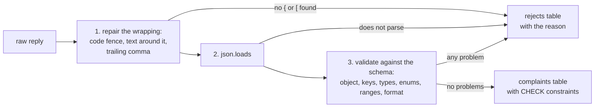

# Structured output you can load

Can we put the model's JSON straight into a table?

## Before you start

- **Level:** 2 (you can write a Python function with a loop and a dict, and read a CREATE TABLE).
- **Time:** about 2 hours.
- **Builds on:** [Python for spreadsheet people](../../00-start-here/06-python-for-spreadsheet-people/), [NULLs, CASE and COALESCE](../../00-start-here/05-nulls-case-and-coalesce/), [Clean a messy CSV](../../05-python-for-analysts/01-clean-a-messy-csv/) for the idea of rejecting a value instead of guessing, and [Check LLM-written SQL](../02-check-llm-written-sql/) for treating model output as untrusted.

## The problem

Tiffinbell, a fictional food delivery app, gets a few hundred complaint messages a week. Meera, who runs customer care, had an LLM read each message and reply with a small JSON object: the order id, the kind of issue, whether the customer wants a refund, the amount and a severity from 1 to 5. Her plan is to load those replies into a table on Monday and count complaints by issue for the kitchen review on Tuesday. A developer wrote a loader that keeps every reply `json.loads` accepts. Meera wants to know if those counts can be trusted, and what to do with the replies that do not fit.

The data in `data/outputs.csv` is synthetic, built by `make_data.py` with a fixed seed. **No model was called.** Each reply was written from known true fields and then damaged in the ways real model replies are damaged. `data/fixture.json` says so and records the prompt the replies stand in for.

## In plain words

Think of a form at a bank counter. The clerk does not just check that the form is filled in. They check the account number has the right number of digits, that the amount is a number and not "two thousand-ish", that the date is a real date, and that you did not write in a box that does not exist. A form that fails goes back to the customer with a note, and only good forms reach the ledger.

A model's JSON is that form. "It parses" only means the handwriting is readable. It does not mean the boxes hold the right things.

Terms used below:

- **JSON**: a text format for data: objects in `{ }` with `"key": value` pairs, lists in `[ ]`, strings in double quotes, numbers, `true`, `false` and `null`.
- **Parse**: turn the text into Python values. `json.loads` does it, or raises an error.
- **Schema**: the contract for each record: which keys must be there, what type each value has, and which values are allowed. Real projects often write it in the JSON Schema standard. Here it is a small Python dict, checked by hand.
- **Enum**: a fixed list of allowed values, such as the five issue names.
- **Repair**: a fix to the wrapping around the JSON that cannot change any value, such as removing a code fence.
- **Reject**: refuse a record, keep it in a separate table with the reason, and do not load it.
- **Type affinity**: SQLite's habit of converting a value to the column's declared type if it can do so without loss, and storing it as it is if it cannot. It never refuses a value because of its type.

## What you will build from scratch

- `repair`: remove a code fence, cut surrounding sentences, and drop a trailing comma, without touching any value.
- `type_ok` and `validate`: a strict schema check with required keys, no unexpected keys, types, enums, ranges and a format pattern.
- `parse` and `process`: split every reply into a loaded record or a reject with a reason.
- `load_into_sqlite` and `issue_counts`: two tables with CHECK constraints as a second wall, and the count Meera asked for.

## The idea

Every reply goes through three gates. Only the first one is allowed to change the text, and only in ways that cannot change a value.



**What repair may and may not do.** Wrapping is not data. A reply that says "Here is the JSON you asked for:" before a perfect object is a perfect object. So repair removes fences, cuts everything before the first `{` or `[` and after the last `}` or `]`, and removes a comma that sits right before a closing bracket. It does not turn `"3"` into `3` or `"yes"` into `true`. Those are guesses about what the model meant, and guessing is the schema's job to refuse.

The trailing comma rule uses a regular expression, `,\s*([}\]])`, which would also change a string value that happens to contain a comma before a bracket. It is safe here because no value in this schema can hold one. With free text values, use a parser that understands strings.

**The schema** for this lesson:

| Key | Type | Rule |
|---|---|---|
| order_id | string | matches `TB-` and five digits |
| issue | string | one of late, missing_item, wrong_item, cold_food, other |
| refund_requested | boolean | `true` or `false` only |
| amount_rs | number | 0 to 5000, or `null` when the message gives no amount |
| severity | integer | 1 to 5 |

Every key is required, and no other key is allowed. Note the difference between a missing `amount_rs` and `"amount_rs": null`. Null is a real answer: "the message gave no amount". A missing key means the model did not answer.

**Two Python facts that break naive checks.** `isinstance(True, int)` is `True` in Python, because a bool is a kind of int. So a check for "integer" must rule out bools by hand, or `"severity": true` passes as severity 1. And `json.loads` accepts `NaN`, which is not valid JSON, and gives a float that fails every comparison. A number check must ask `math.isfinite`.

**Why CHECK constraints too, and why they are not enough.** `validate` is the first wall. The CHECK constraints on the table are the second: if a later change to the code lets `"yes"` or `"Late delivery"` through, the insert fails loudly instead of storing it. But SQLite applies type affinity before it runs a CHECK. The text `'3'` going into an INTEGER column becomes the integer 3 first, so no CHECK can tell that the model wrote text. Only the Python check, before the insert, sees the reply as the model wrote it. (PostgreSQL refuses `'yes'` for a boolean column on its own, but it also accepts the text `'3'` for an integer column, so the same advice holds there.)

## Walk through

Run these from the lesson folder. `sys.path.insert(0, "solution")` lets Python find the worked answer, and `import solution as s` loads it.

Step 1. Look at the replies, and at what parses as it is.

```python
import sys, json
sys.path.insert(0, "solution")
import solution as s

rows = s.load_outputs()
print(len(rows))
print(repr(rows[1]["raw_output"]))
ok = 0
for r in rows:
    try:
        json.loads(r["raw_output"])
        ok += 1
    except ValueError:
        pass
print(ok, "of", len(rows), "parse as they are")
```

```
300
'```json\n{"order_id": "TB-12475", "issue": "wrong_item", "refund_requested": false, "amount_rs": null, "severity": 2}\n```'
171 of 300 parse as they are
```

The second reply is a good object inside a code fence, which `json.loads` refuses. So the developer's loader loses good replies as well as letting bad ones in.

Step 2. Repair the wrapping, then parse.

```python
import sys, json
sys.path.insert(0, "solution")
import solution as s

rows = s.load_outputs()
text, repairs = s.repair(rows[1]["raw_output"])
print(repairs)
print(json.loads(text))
parsed = 0
for r in rows:
    text, _ = s.repair(r["raw_output"])
    if text is None:
        continue
    try:
        json.loads(text)
        parsed += 1
    except ValueError:
        pass
print(parsed, "parse after repair")
```

```
['removed code fence']
{'order_id': 'TB-12475', 'issue': 'wrong_item', 'refund_requested': False, 'amount_rs': None, 'severity': 2}
285 parse after repair
```

`repair` returns the cleaned text and a list of what it did, so a reviewer can see how often each fix was needed. After repair, every reply that was not cut off part way parses. That is the number the developer's loader would load. The next step shows why it is the wrong number.

Step 3. Validate. Each problem comes back as a sentence.

```python
import sys
sys.path.insert(0, "solution")
import solution as s

good = {"order_id": "TB-12345", "issue": "late", "refund_requested": True, "amount_rs": None, "severity": 3}
print(s.validate(good))
print(s.validate(dict(good, severity="3")))
print(s.validate(dict(good, severity=True)))
print(s.validate(dict(good, issue="Late delivery", confidence=0.9)))
print(s.validate({"order_id": "TB-12345"}))
print(isinstance(True, int))
```

```
[]
["severity should be integer, got '3'"]
['severity should be integer, got True']
['unexpected key confidence', "issue 'Late delivery' is not one of the allowed values"]
['missing key issue', 'missing key refund_requested', 'missing key amount_rs', 'missing key severity']
True
```

An empty list means valid. A null amount is fine. A severity of `"3"` or `true` is not, and an issue outside the list plus an extra key gives two problems. `isinstance(True, int)` shows why the bool rule is needed.

Step 4. Run the whole pipeline and load the table.

```python
import sys, sqlite3
sys.path.insert(0, "solution")
import solution as s

valid, rejects = s.process(s.load_outputs())
conn = sqlite3.connect(":memory:")
s.load_into_sqlite(conn, valid, rejects)
print(len(valid), "loaded,", len(rejects), "rejected")
print(s.issue_counts(conn))
print(rejects[:4])
```

```
177 loaded, 123 rejected
[('wrong_item', 42), ('late', 38), ('missing_item', 33), ('cold_food', 32), ('other', 32)]
[('M0005', 'issue is null'), ('M0008', "amount_rs should be number, got 'Rs 560'"), ('M0010', 'severity 7 is above 5'), ('M0013', "severity should be integer, got '2'")]
```

Of 300 replies, 177 are fit to load. The 123 rejects each carry a reason that tells you what to fix in the prompt. Meera's table now has exactly five issue names, and every severity is an integer from 1 to 5.

Step 5. Test the second wall. Insert bad rows directly, skipping `validate`.

```python
import sys, sqlite3
sys.path.insert(0, "solution")
import solution as s

conn = sqlite3.connect(":memory:")
s.load_into_sqlite(conn, [], [])
try:
    conn.execute("INSERT INTO complaints VALUES ('M9998', 'TB-11111', 'late', 'yes', NULL, 3)")
except sqlite3.IntegrityError as e:
    print("refused:", type(e).__name__)
conn.execute("INSERT INTO complaints VALUES ('M9999', 'TB-11112', 'late', 1, NULL, '3')")
print(conn.execute("SELECT severity, typeof(severity) FROM complaints").fetchall())
```

```
refused: IntegrityError
[(3, 'integer')]
```

The text `'yes'` is refused, because it is not 0 or 1. The text `'3'` is accepted: type affinity turned it into the integer 3 before the CHECK ran. That is why the type check has to happen in Python, on the parsed reply. The `typeof` CHECK still catches a value such as 3.5, which stays a real number.

## Common mistakes

1. **Treating "json.loads succeeded" as "valid".** This is the developer's loader, after the repair step, writing whatever it gets into a table with no CHECKs:

    ```python
    import sys, json, sqlite3
    sys.path.insert(0, "solution")
    import solution as s

    conn = sqlite3.connect(":memory:")
    conn.execute("CREATE TABLE complaints (message_id TEXT, order_id TEXT, issue TEXT, refund_requested INTEGER, amount_rs REAL, severity INTEGER)")
    for r in s.load_outputs():
        text, _ = s.repair(r["raw_output"])
        try:
            o = json.loads(text) if text else None
        except ValueError:
            continue
        if isinstance(o, dict):
            conn.execute("INSERT INTO complaints VALUES (?, ?, ?, ?, ?, ?)", (r["message_id"], o.get("order_id"), o.get("issue"), o.get("refund_requested"), o.get("amount_rs"), o.get("severity")))
    print(conn.execute("SELECT COUNT(*) FROM complaints").fetchone()[0])
    print(conn.execute("SELECT issue, COUNT(*) FROM complaints GROUP BY issue ORDER BY 2 DESC, 1").fetchall())
    print(conn.execute("SELECT typeof(refund_requested), COUNT(*) FROM complaints GROUP BY 1").fetchall())
    ```

    ```
    278
    [('wrong_item', 65), ('cold_food', 52), ('other', 52), ('late', 46), ('missing_item', 46), ('late ', 4), (None, 3), ('LATE', 3), ('Cold food', 2), ('Late delivery', 2), ('missing item', 2), ('food quality', 1)]
    [('integer', 267), ('null', 1), ('text', 10)]
    ```

    278 rows load instead of 177. The issue count has twelve groups, including `late `, `LATE` and `Late delivery` as separate issues and NULL as an issue. Ten refund flags are the text `yes` or `no`, which SUM treats as 0, so a refund total from this table is wrong. And the 19 severities written as text were silently turned into integers, so nobody can even see that they were wrong. Every one of these rows parsed.
2. **Coercing instead of rejecting.** It is tempting to turn `"yes"` into `true` and `"Late delivery"` into `late`. Each rule is a guess, and the guesses pile up: is `"food quality"` cold_food or other? Reject, count the reasons, and fix the prompt. If one coercion is truly safe and agreed with the stakeholder, write it down as a rule and test it.
3. **Forgetting that bool is an int.** `isinstance(True, int)` is `True`. A check written as `isinstance(value, int)` accepts `"severity": true`, and the 10 replies that did this would load as severity 1.
4. **Mixing up missing and null.** `obj.get("amount_rs")` returns `None` both when the key is missing and when it is `null`. Check `key in obj` first. A missing key is a reject; a null is an answer.

## Your turn

Open `exercise.py` and fill in `repair`, `type_ok`, `validate`, `parse`, `process`, `load_into_sqlite` and `issue_counts`. The schema is given. Then run, from this folder:

```
python3 test_lesson.py
```

The test checks repair on fences, surrounding text, trailing commas and text with no JSON at all. It checks validate on every kind of problem one at a time (text for numbers, `true` for an integer, `3.0` for an integer, NaN, a missing key, an extra key, a null issue, a bad order id). Then it runs the pipeline on the committed replies and on a second set built with another seed, and compares each loaded or rejected reply with the answer key that `make_data.py` recorded.

Stretch: some teams drop unexpected keys instead of rejecting the record. Add a `strict` flag to `validate` that does this, and count how many more rows Meera would load. Then decide whether a model that adds `"customer_mood"` is following the contract.

## Check yourself

1. A reply parses with `json.loads`. Name three ways it can still be unfit for the table.
2. Why is removing a code fence a fair repair, but turning `"3"` into `3` is not?
3. What does SQLite do when you insert the text `'3'` into an INTEGER column, and how do you stop it?
4. Why keep a rejects table instead of just skipping bad replies?

<details>
<summary>Answers</summary>

1. Any of: a value of the wrong type (`"3"`, `"yes"`), a value outside the enum or the range, a missing key, an unexpected key, a null where a value is required, a list instead of an object, or NaN.
2. The fence is wrapping around the data, so removing it cannot change a value. Turning `"3"` into `3` assumes what the model meant. The model was asked for an integer and gave text, which is a sign it did not follow the contract on that reply.
3. Type affinity converts it to the integer 3 and stores it with no error. It does this before any CHECK runs, so even `CHECK (typeof(severity) = 'integer')` passes. The only place to catch it is before the insert, in Python, where the parsed value is still the string `'3'`.
4. The reasons are the feedback for the prompt: the biggest groups here are severity problems (33) and issue or extra-key problems (17 each), which says where the instructions are weak. And the reject count is part of the result: "177 of 300 complaints" is honest, a table with 177 rows and no note is not.

</details>

## What to tell the stakeholder

"Not straight in. Of the 300 replies, 177 match the format and are loaded; 123 were rejected and are listed with the reason. The biggest groups are a bad severity (33, mostly written as text) and an issue name that is missing or outside our five (17). The counts by issue cover those 177 only. The quick loader would have shown 278 rows with twelve issue groups and a wrong refund total. The next step is a prompt fix for severity and issue names, checked on next week's replies."

## In real job postings

Loading semi-structured data into tables is everyday Python and SQL work. In the Real Analyst Jobs data drop of 25 October 2026, 1,477 of the 2,056 US analyst postings that list a tool ask for SQL (71.8%) and 996 ask for Python (48.4%). See [Python data analyst jobs](https://realanalystjobs.com/jobs/python-data-analyst-jobs) and the [JSON to CSV converter](https://realanalystjobs.com/tools/json-csv-converter).

## Next

[How big must an eval set be?](../07-how-big-an-eval-set/)
