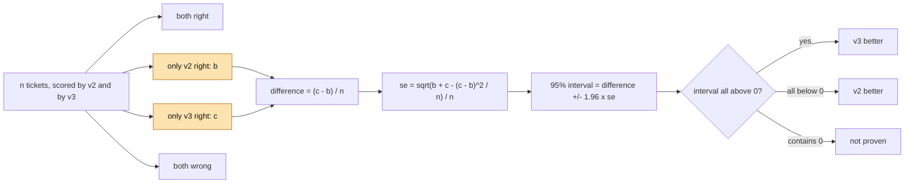

# How big must an eval set be?

How many labelled examples do we need before we trust the score?

## Before you start

- **Level:** 2 (you can read and run a short Python file).
- **Time:** about 2 hours.
- **Builds on:** [Grade an LLM classifier](../01-grade-an-llm-classifier/) for the Wilson interval, [Prompt versions as experiments](../05-prompt-versions-as-experiments/) for paired comparisons and discordant tickets, and [Sample size before you test](../../02-statistics-and-experiments/04-sample-size-before-you-test/) for the idea of power. The plain-words section below repeats what you need.

## The problem

Northwind Desk, a fictional software company, labels support tickets with an LLM. Last month prompt v2 replaced v1. Sam has now written prompt v3, scored it on the first 50 labelled tickets, and posted: "v3 is 88% accurate, v2 only 86%. Let's switch." Priya, the support lead, has a labeller who can mark about 400 tickets a week, and the team has 1,600 labelled tickets so far. Before she approves anything she wants two numbers by Thursday: how many labelled tickets it takes to quote v3's accuracy to within 2 points, and how many it takes to know whether v3 really beats v2 by 2 points.

The data in `data/labelled_tickets.csv` is synthetic, built by `make_data.py` with a fixed seed. **No model was called.** The `v2_label` and `v3_label` columns are simulated, and `data/fixture.json` says so. Because the simulation is built from known chances, we know the true answer that a real project never knows: v2 is right on 86% of tickets like these and v3 on 88%. That lets you see how often a small eval set gets it wrong.

## In plain words

A cricket fan says a new batter is better than the old one because he scored 88 in his first innings and the old one scored 86. Nobody would accept that: one innings is mostly luck. After a season you start to believe it. The question in this lesson is "how long is a season?".

Two different questions need two different counts:

- **How good is v3?** You want a number with a small margin of error, such as "87%, plus or minus 2 points".
- **Is v3 better than v2?** You want to know the sign of a small difference. That usually needs far more tickets, because the difference is small and the noise is not.

Terms used below:

- **Eval set**: a set of examples with a trusted answer (a **gold label**), used to score a model or a prompt.
- **Margin of error**: half the width of a 95% interval. "87% plus or minus 2" has a margin of 0.02.
- **Wilson interval**: the 95% range for a rate from lesson 06-01.
- **Paired comparison**: both versions are scored on the same tickets, so each ticket gives one result for each.
- **Discordant ticket**: a ticket where exactly one version is right. The **discordant share** is the fraction of tickets like that.
- **Power**: the chance that the test notices a real difference of a given size. 80% power means that, if v3 truly is 2 points better, 8 eval sets in 10 of this size would show it.
- **Sample size calculation**: working out, before you label, how many examples give the margin or the power you want.

## What you will build from scratch

- `wilson_interval` and `margin`, then `n_for_margin`: the smallest eval set for a chosen plus or minus.
- `paired_table` and `paired_difference_interval`: the 95% interval for v3 minus v2 on the same tickets.
- `verdict`: `v3 better`, `v2 better` or `not proven`.
- `n_for_paired_difference` and `n_for_unpaired_difference`: tickets needed for 80% power, with and without pairing.

## The idea

**One score.** For k right out of n, with p = k / n and z = 1.96, the Wilson interval from lesson 06-01 is

```
centre   = (p + z^2 / (2n)) / (1 + z^2 / n)
half     = z * sqrt( p(1 - p) / n + z^2 / (4n^2) ) / (1 + z^2 / n)
```

For anything but tiny n, `half` is close to `z * sqrt(p(1 - p) / n)`. The n sits under a square root. So to halve the margin you need four times the tickets, and to go from plus or minus 9 points to plus or minus 2 you need about twenty times as many. To find the n for a target margin, guess an expected accuracy p (use the pilot, or 0.5 if you know nothing, which gives the largest n) and find the smallest n whose half-width is at or below the target. The half-width only shrinks as n grows, so a simple search finds it.

**A difference, on the same tickets.** Put every ticket in one of four boxes, as in lesson 06-05:



The tickets both versions get right, or both get wrong, add nothing to the difference. All the noise comes from the discordant tickets. That is where the `se` formula comes from: for each ticket, the difference d is +1 (only v3 right), -1 (only v2 right) or 0, and `se` is the standard deviation of d divided by the square root of n.

**How many tickets for a comparison.** To have 80% power to see a true gain of `delta` when a share `psi` of tickets is discordant, both versions on the same tickets:

```
n = ( z_alpha * sqrt(psi) + z_beta * sqrt(psi - delta^2) )^2 / delta^2
```

with z_alpha = 1.96 (a 5% two-sided test) and z_beta = 0.8416 (the z score with 80% of the normal curve below it). If instead each version is graded on its own separate tickets, as two groups, the usual two-proportion formula gives the count **per version**:

```
n = (z_alpha + z_beta)^2 * ( p1(1 - p1) + p2(1 - p2) ) / (p1 - p2)^2
```

Pairing wins because the same tickets are hard for both versions. In the two-group formula that shared difficulty is noise; in the paired formula it cancels out.

## Walk through

Run these from the lesson folder. `sys.path.insert(0, "solution")` lets Python find the worked answer, and `import solution as s` loads it.

Step 1. How the margin shrinks with n, at an accuracy of 0.87.

```python
import sys
sys.path.insert(0, "solution")
import solution as s

for n in [50, 100, 200, 400, 800, 1600]:
    print(n, round(s.margin(0.87 * n, n), 3))
```

```
50 0.094
100 0.066
200 0.047
400 0.033
800 0.023
1600 0.016
```

`margin(k, n)` is half the Wilson width, and k does not have to be a whole number when you are planning. Each doubling of n shrinks the margin by about 30% (the square root of 2), and each quadrupling halves it. Sam's 50 tickets give plus or minus 9 points.

Step 2. Sam's pilot, read honestly.

```python
import sys
sys.path.insert(0, "solution")
import solution as s

pilot = s.load_rows()[:50]
k2 = sum(s.right(r, "v2") for r in pilot)
k3 = sum(s.right(r, "v3") for r in pilot)
print(k2, k3, [round(x, 3) for x in s.wilson_interval(k3, 50)])
both, only_v2, only_v3, neither = s.paired_table(pilot)
print(both, only_v2, only_v3, neither)
print([round(x, 3) for x in s.paired_difference_interval(only_v2, only_v3, 50)])
```

```
43 44 [0.762, 0.944]
41 2 3 4
[-0.067, 0.107]
```

v2 got 43 of 50 and v3 got 44 of 50. The 95% range for v3 runs from 76% to 94%. The whole "v3 is better" claim rests on 5 discordant tickets, 3 for v3 and 2 for v2, and the interval for the gain runs from minus 7 points to plus 11. The pilot says almost nothing.

Step 3. Score more and more of the 1,600 labelled tickets.

```
python3 solution/solution.py
```

```
first n   v2 acc  v3 acc   v3 margin   paired 95% interval for v3 - v2
     50   0.860   0.880    +/- 0.091   -0.067 to +0.107  not proven
    100   0.890   0.890    +/- 0.062   -0.062 to +0.062  not proven
    200   0.880   0.880    +/- 0.045   -0.046 to +0.046  not proven
    400   0.855   0.875    +/- 0.032   -0.012 to +0.052  not proven
    800   0.859   0.871    +/- 0.023   -0.011 to +0.036  not proven
   1600   0.864   0.875    +/- 0.016   -0.006 to +0.029  not proven
n for +/- 0.02 at 0.87: 1088
n for a 2-point gain, paired, 12% discordant: 2353
n per version for 0.86 vs 0.88, unpaired: 4435
```

Read it top down. v3's accuracy settles at about 87.5% with a margin of 1.6 points at 1,600 tickets, so the first question is answered. The gain jumps around (2 points, 0, 0, 2, 1.2, 1.1) and its interval narrows, but even at 1,600 it still includes 0. On these numbers you cannot say v3 is better, even though, in this simulation, it truly is.

Step 4. Plan instead of hoping.

```python
import sys
sys.path.insert(0, "solution")
import solution as s

print(s.n_for_margin(0.87, 0.02), s.n_for_margin(0.5, 0.02))
print(s.n_for_paired_difference(0.02, 0.12))
print(s.n_for_unpaired_difference(0.86, 0.88))
print(s.n_for_paired_difference(0.05, 0.12))
```

```
1088 2398
2353
4435
375
```

Line by line:

- Plus or minus 2 points at an expected 87% takes 1,088 tickets. If you knew nothing and planned at 50%, you would ask for 2,398, more than twice as many. A pilot is worth having for this number, even though its own score means little.
- Seeing a true 2-point gain with 80% power, both versions on the same tickets, with 12% of tickets discordant (the share in the 1,600), takes 2,353 tickets: about 6 weeks of labelling from zero at 400 a week, or 2 more weeks on top of the 1,600 already labelled.
- Grading each version on its own tickets would take 4,435 per version, 8,870 in all. Pairing costs about a quarter as much labelling.
- A 5-point gain takes only 375. The size of the difference you care about drives everything, so agree on it with the stakeholder first.

### Honest limits

- The labels are simulated, so the numbers teach the method, not how good any real prompt is.
- The sample size formulas use a normal approximation. They are a planning tool, accurate to a few percent, not an exact count.
- `psi`, the discordant share, has to be guessed before you label. Take it from the data you already have, as here, and round up if unsure: more discordance means more tickets.
- All of this assumes the eval set looks like the tickets the model will see. 2,353 tickets from a quiet month will not tell you how v3 handles a launch week.

## Common mistakes

1. **Trusting the order a small pilot gives.** In this simulation v3 is truly 2 points better. Build a thousand 50-ticket pilots and count how often each version comes out ahead:

    ```python
    import make_data

    v3_ahead = tie = v2_ahead = 0
    for seed in range(1000):
        rows = make_data.build(seed=seed, n=50)["tickets"]
        a = sum(r["v2_label"] == r["gold_label"] for r in rows)
        b = sum(r["v3_label"] == r["gold_label"] for r in rows)
        if b > a:
            v3_ahead += 1
        elif b == a:
            tie += 1
        else:
            v2_ahead += 1
    print(v3_ahead, tie, v2_ahead)
    ```

    ```
    579 156 265
    ```

    The better prompt comes out ahead in only 579 pilots of 1,000. In 265 the worse one wins. A 50-ticket pilot is barely better than a coin at ranking two prompts this close.
2. **Comparing two separate intervals.** "v2 is 86.4% (84.6% to 88.0%), v3 is 87.5% (85.8% to 89.0%), the ranges overlap, so no difference" treats paired data as two groups:

    ```python
    import math
    import sys
    sys.path.insert(0, "solution")
    import solution as s

    rows = s.load_rows()
    n = len(rows)
    p2 = sum(s.right(r, "v2") for r in rows) / n
    p3 = sum(s.right(r, "v3") for r in rows) / n
    se = math.sqrt(p2 * (1 - p2) / n + p3 * (1 - p3) / n)
    print("as two groups:", round(p3 - p2 - 1.96 * se, 3), "to", round(p3 - p2 + 1.96 * se, 3))
    _, only_v2, only_v3, _ = s.paired_table(rows)
    low, high = s.paired_difference_interval(only_v2, only_v3, n)
    print("paired:       ", round(low, 3), "to", round(high, 3))
    ```

    ```
    as two groups: -0.012 to 0.035
    paired:        -0.006 to 0.029
    ```

    The paired interval is a quarter narrower on the same tickets. Overlapping separate intervals can hide a real difference; compare the difference itself, paired.
3. **Peeking and stopping.** Checking the interval after every batch of 100 and stopping the first time it clears 0 gives you many chances to be fooled by luck, so the real false alarm rate is well above 5%. Decide the size first, from Step 4, then look once. If you must look early, say so and use a stricter bar.
4. **Planning for the wrong difference.** "Is v3 better?" has no sample size until someone says by how much. A 2-point gain needs 2,353 paired tickets and a 5-point gain needs 375. Ask Priya what gain is worth a prompt change before anyone labels anything.

## Your turn

Open `exercise.py` and fill in `wilson_interval`, `margin`, `n_for_margin`, `paired_table`, `paired_difference_interval`, `verdict`, `n_for_paired_difference` and `n_for_unpaired_difference`. Then run, from this folder:

```
python3 test_lesson.py
```

The test checks your Wilson interval against a second way of writing it, your paired interval against the mean and spread of per-ticket differences, and each sample size by computing the power (or the margin) at your n and at n - 1: your n must be enough and n - 1 must not be. Then it checks the verdict on growing slices of the committed tickets and of a second dataset built with another seed, and the edge cases: no tickets, no discordant tickets, an impossible target.

Stretch: write a simulation that builds 500 eval sets of 2,353 tickets with `make_data.build(seed, n=2353)` and counts how often `verdict` says `v3 better`. It should come out close to 80%. That is what power means.

## Check yourself

1. Your margin is plus or minus 6 points on 100 tickets. Roughly how many tickets for plus or minus 3?
2. Why can 1,600 tickets pin down v3's accuracy but not settle whether v3 beats v2?
3. Why does grading both versions on the same tickets need fewer labels?
4. Sam says: "it is significant at 400 tickets if we stop there." What is wrong with choosing the stopping point that way?

<details>
<summary>Answers</summary>

1. About 400. The margin shrinks with the square root of n, so halving it takes four times the tickets.
2. The margin on one score is about 1.6 points at 1,600 tickets, which is small next to 87%. But the gain is only about 1 to 2 points, and its interval (minus 0.6 to plus 2.9) is wider than the gain itself. A small difference needs far more data than a single level.
3. Most of the noise in each score comes from which tickets happen to be hard. On the same tickets that difficulty hits both versions equally and cancels. Only the discordant tickets carry information, and the paired formula uses exactly those.
4. If you check after every batch and stop at the first good-looking result, luck gets many chances to produce one, so the real chance of a false win is much higher than 5%. Fix n in advance from a sample size calculation and look once.

</details>

## What to tell the stakeholder

"On all 1,600 labelled tickets, v3 is right 87.5% of the time, plus or minus 1.6 points, so we can quote that. Whether v3 beats v2 is not settled: the gain is about 1 point and could be anywhere from slightly negative to 3 points. Sam's 50-ticket test cannot tell them apart. To detect a 2-point gain reliably we need about 2,350 tickets scored by both prompts, roughly 2 more weeks of labelling, or we can agree that only a 5-point gain is worth a change and check that with what we already have."

## In real job postings

Sizing a test before you run it is the same skill as sizing an A/B test, and it is done in Python. In the Real Analyst Jobs data drop of 25 October 2026, 996 of the 2,056 US analyst postings that list a tool ask for Python (48.4%). See the [sample size calculator](https://realanalystjobs.com/tools/sample-size-calculator) and [how to become an AI analyst](https://realanalystjobs.com/tools/how-to-become-an-ai-analyst).

## Next

[Human in the loop: confidence thresholds](../08-human-in-the-loop-thresholds/)
