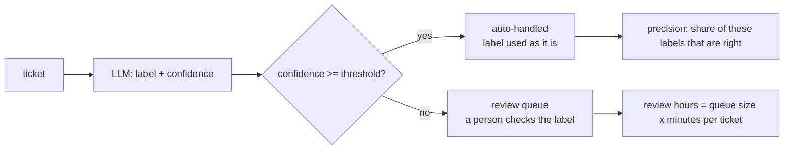
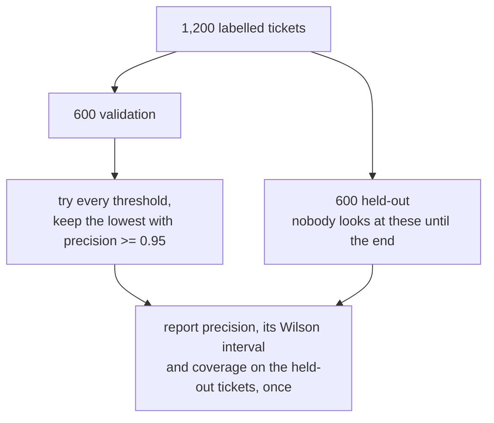

# Human in the loop: confidence thresholds

How many tickets can we auto-route at 95% precision, and who reviews the rest?

## Before you start

- **Level:** 2 (you can read and run a short Python file).
- **Time:** about 2 hours.
- **Builds on:** [Grade an LLM classifier](../01-grade-an-llm-classifier/) for precision and the Wilson interval, and [How big must an eval set be?](../07-how-big-an-eval-set/) for why a few hundred tickets still leave a margin of error.

## The problem

Northwind Desk, a fictional software company, gets about 2,500 support tickets a week (a made-up figure for this lesson). An LLM labels each one as billing, bug, refund or other, and now also reports a confidence from 0.50 to 1.00. Priya, the support lead, wants to let the model's label stand on its own whenever it is confident enough, as long as at least 95% of those automatic labels are right. Everything else goes to a person. She needs two numbers for next month's staffing plan: what share of tickets can go automatic, and how many hours of human review the rest will take. A person has labelled 1,200 recent tickets that the model also scored.

The data in `data/tickets.csv` is synthetic, built by `make_data.py` with a fixed seed. **No model was called.** The `llm_label` and `confidence` columns are simulated, and `data/fixture.json` says so. The simulation is overconfident on purpose, as real models often are: when it reports 0.90, it is right less than 90% of the time.

## In plain words

A new cashier counts the till at the end of each shift and writes down how sure they are that the count is right. You decide: "if they say 95% sure or more, we accept the count; otherwise a supervisor counts it again." Where you draw that line decides two things at once. A high line means few recounts are skipped and few mistakes slip through. A low line means many skipped recounts and more mistakes.

You cannot pick the line by asking the cashier. "95% sure" is their feeling, not a measured fact. You pick it by checking their past counts. And you must check the line on shifts you did not use to pick it, or you will fool yourself.

Terms used below:

- **Confidence**: the score the model reports with its label. It is the model's own claim, not a measurement.
- **Threshold**: the line. A ticket with confidence at or above it is **auto-handled**; the rest go to the **review queue**.
- **Precision** (here): of the auto-handled tickets, the share whose label is right.
- **Coverage**: the share of all tickets that are auto-handled.
- **Calibration**: whether the reported confidence matches how often the model is right. A calibrated model that says 0.90 is right 90% of the time.
- **Validation split**: tickets used to choose the threshold.
- **Held-out split**: tickets kept aside and used once, at the end, to report how the chosen threshold performs.
- **Human in the loop**: a design where a person checks the cases the model is unsure about.

## What you will build from scratch

- `at_threshold`: auto-handled count, right count, precision and coverage at one threshold.
- `calibration`: reported confidence against the share actually right, by bin.
- `choose_threshold`: the lowest threshold that keeps precision at 95% on validation tickets.
- `report`: the result on held-out tickets, with a Wilson interval.
- `review_queue` and `review_hours`: who gets the rest, and how long it takes.

## The idea

Every ticket takes one of two paths:



Lowering the threshold raises coverage and usually lowers precision. Because the model is not perfectly calibrated, you cannot read the right threshold off its confidence. You measure precision at every possible threshold on labelled tickets and pick the lowest one whose precision is still at least 0.95. Lowest, because that auto-handles the most tickets. Two guards:

- Require at least 50 auto-handled tickets. A threshold so high that only 6 tickets clear it can show 100% by luck.
- Check every threshold. Precision does not always fall smoothly as the threshold drops: adding a batch of easy tickets can raise it again.

**Choose on one set, report on another.** If you try a hundred thresholds and keep the one that looks best, the one you keep is partly the one that was luckiest on those tickets. Its precision on those same tickets is too flattering. That bias is called the **winner's curse**. The fix is the split:



The held-out number is the one you give the stakeholder.

## Walk through

Run these from the lesson folder. `sys.path.insert(0, "solution")` lets Python find the worked answer, and `import solution as s` loads it.

Step 1. Is the confidence honest? Compare what the model reports with how often it is right.

```python
import sys
sys.path.insert(0, "solution")
import solution as s

val = s.load_rows("validation")
print(len(val))
for row in s.calibration(val, [0.5, 0.7, 0.8, 0.85, 0.9, 0.95, 1.0]):
    print(row)
```

```
600
(0.5, 0.7, 10, 0.654, 0.4)
(0.7, 0.8, 49, 0.755, 0.673)
(0.8, 0.85, 61, 0.823, 0.738)
(0.85, 0.9, 96, 0.87, 0.854)
(0.9, 0.95, 146, 0.923, 0.897)
(0.95, 1.0, 238, 0.975, 0.979)
```

Each row is a bin: its edges, the number of tickets, the average reported confidence, and the share actually right. In the middle bins the model claims more than it delivers: tickets where it reports about 0.92 are right 89.7% of the time, and at about 0.82 only 73.8%. Only the top bin is honest. So "the model says 95%" is not a precision you can promise.

Step 2. Precision and coverage at a few thresholds, on validation tickets.

```python
import sys
sys.path.insert(0, "solution")
import solution as s

val = s.load_rows("validation")
for t in [0.85, 0.89, 0.90, 0.91, 0.93, 0.95]:
    auto, right, precision, coverage = s.at_threshold(val, t)
    print(t, auto, right, round(precision, 3), round(coverage, 3))
```

```
0.85 480 446 0.929 0.8
0.89 401 378 0.943 0.668
0.9 384 364 0.948 0.64
0.91 363 346 0.953 0.605
0.93 309 298 0.964 0.515
0.95 238 233 0.979 0.397
```

`at_threshold` keeps tickets with confidence at or above `t` (a ticket at exactly 0.91 counts as auto at 0.91). The trade is plain: from 0.85 to 0.95, precision climbs from 92.9% to 97.9% while coverage falls from 80% to 40%. The precision at a threshold is not the threshold itself: at 0.91 it is 95.3%, because the tickets above the line average a higher confidence than 0.91.

Step 3. Choose on validation, report on held-out.

```
python3 solution/solution.py
```

```
chosen on validation: 0.91
validation: {'threshold': 0.91, 'auto': 363, 'right': 346, 'precision': 0.953, 'low': 0.926, 'high': 0.971, 'coverage': 0.605, 'to_review': 237}
held-out:   {'threshold': 0.91, 'auto': 356, 'right': 336, 'precision': 0.944, 'low': 0.915, 'high': 0.963, 'coverage': 0.593, 'to_review': 244}
review queue on held-out by LLM label: {'bug': 68, 'billing': 65, 'other': 62, 'refund': 49}
review hours a week: 50.9
```

The lowest threshold with at least 95% precision on validation is 0.91. On validation that looks like 95.3%. On the 600 held-out tickets, which played no part in the choice, it is 94.4%, with a 95% Wilson range of 91.5% to 96.3%. That drop is the winner's curse in action. In this simulation we can check the truth from the recipe in `data/fixture.json`: at 0.91 the long-run precision is about 94.4%, so the held-out number is the honest one.

Coverage is 59.3%, so about 41% of tickets still need a person. At 2,500 tickets a week and 3 minutes per check (both fictional planning figures in `solution.py`), that is 2,500 x 0.407 x 3 / 60 = 50.9 hours a week. The queue split by the model's label tells each team lead roughly how much of it is theirs.

### Honest limits

- The labels and confidences are simulated, so the numbers teach the method, not how good any real model is.
- The held-out interval (91.5% to 96.3%) still includes values below 95%. 600 held-out tickets cannot prove 95%; [How big must an eval set be?](../07-how-big-an-eval-set/) shows how many would.
- The threshold is only good while the tickets look like these. A product launch, a new prompt or a new model version changes the confidences, so re-check on fresh labelled tickets each month.
- "Right" here means it agrees with one person's label. Reviewers make mistakes too.

## Common mistakes

1. **Choosing and reporting on the same tickets.** It is tempting to use all 1,200 labelled tickets to pick the threshold, "for more data":

    ```python
    import sys
    sys.path.insert(0, "solution")
    import solution as s

    val = s.load_rows("validation")
    held = s.load_rows("heldout")
    both = val + held
    t = s.choose_threshold(both)
    print(t, s.report(both, t)["precision"])
    print(s.report(held, t)["precision"])
    ```

    ```
    0.92 0.952
    0.945
    ```

    The threshold chosen on all 1,200 reports 95.2% on the same tickets, and there is nothing left that was not used in the choice. Choosing on validation and reporting on held-out costs nothing but discipline, and it is the only number you can defend.
2. **Treating the confidence as the precision.** "We want 95%, so auto-handle anything the model is 95% sure of" sounds natural:

    ```python
    import sys
    sys.path.insert(0, "solution")
    import solution as s

    held = s.load_rows("heldout")
    for t in [0.91, 0.95]:
        rep = s.report(held, t)
        print(t, rep["precision"], rep["coverage"], s.review_hours(rep["coverage"]))
    ```

    ```
    0.91 0.944 0.593 50.9
    0.95 0.957 0.392 76.0
    ```

    A threshold of 0.95 buys 1.3 points of precision but auto-handles only 39% of tickets, and the review team needs 76 hours a week instead of 51. Whether 1.3 points is worth 25 more hours a week is Priya's call, made from measured numbers, not from the confidence label. The threshold is a setting you measure, not a promise the model makes.
3. **One overall precision hiding a weak label.** 94.4% is the average over four labels. The refunds team cares about refund only:

    ```python
    import sys
    sys.path.insert(0, "solution")
    import solution as s

    held = s.load_rows("heldout")
    auto = [r for r in held if r["confidence"] >= 0.91]
    for label in ["billing", "bug", "refund", "other"]:
        mine = [r for r in auto if r["llm_label"] == label]
        right = sum(r["gold_label"] == label for r in mine)
        print(label, right, len(mine), round(right / len(mine), 3))
    ```

    ```
    billing 93 97 0.959
    bug 88 90 0.978
    refund 70 79 0.886
    other 85 90 0.944
    ```

    Only 70 of the 79 tickets auto-routed to refunds are refunds: 88.6%. If a wrong refund routing is costly, choose a separate threshold for that label, on validation tickets, and report it on held-out ones.
4. **Never re-checking.** A threshold chosen in October is a guess in December. Keep a small stream of auto-handled tickets going to a person every week (a random sample, say 2%), so you always have fresh labels to re-measure precision.

## Your turn

Open `exercise.py` and fill in `at_threshold`, `choose_threshold`, `report`, `calibration`, `review_queue` and `review_hours`. Then run, from this folder:

```
python3 test_lesson.py
```

The test checks small hand-made cases (a ticket exactly on the threshold, no tickets, a threshold with too few tickets, precision that rises as the threshold drops, an empty calibration bin), then the committed data and a second dataset built with another seed. The expected precision at every threshold is computed independently from running totals.

Stretch: give refund its own threshold. Write `choose_threshold_for(rows, label)` that only looks at tickets the model labelled `label`, choose it on validation, and report refund precision and the extra review hours on held-out.

## Check yourself

1. Why choose the lowest threshold that meets the target, not the highest?
2. Validation says 95.3% and held-out says 94.4%. Which do you report, and why is the validation number higher?
3. The model reports 0.92 on a ticket. Does that mean a 92% chance it is right? How would you find out?
4. Why require at least 50 auto-handled tickets before trusting a threshold?

<details>
<summary>Answers</summary>

1. Every threshold that meets the target is acceptable on precision, and the lowest one auto-handles the most tickets, so it saves the most review time.
2. The held-out number. The threshold was picked because it looked good on the validation tickets, so part of its validation score is luck. The held-out tickets played no part in the choice, so their score is not inflated.
3. No. Confidence is the model's own claim. Look at a calibration table on labelled tickets: here tickets reported between 0.90 and 0.95 were right 89.7% of the time.
4. With very few tickets, precision jumps around: 6 out of 6 is 100% by luck. A minimum count stops the search from picking a threshold that only looks good because almost nothing passed it.

</details>

## What to tell the stakeholder

"If we auto-handle tickets where the model reports 0.91 or more, about 59% of tickets go automatic, and on 600 tickets we kept aside, 94.4% of those labels were right (likely range 91.5% to 96.3%), so expect about 94 to 95%, not a guaranteed 95%. The other 41% is about 51 review hours a week at 2,500 tickets. One caution: auto-routed refunds are only about 89% right, so I suggest refunds always go to a person until we test a stricter refund threshold."

## In real job postings

Choosing a threshold and staffing the review queue is analysis done in Python and SQL. In the Real Analyst Jobs data drop of 25 October 2026, 222 of the 413 UK analyst postings that list a tool ask for Python (53.8%), and 286 ask for SQL (69.2%). See [how to become an AI analyst](https://realanalystjobs.com/tools/how-to-become-an-ai-analyst) and [Python data analyst jobs](https://realanalystjobs.com/jobs/python-data-analyst-jobs).

## Next

[LLM as judge, and judging the judge](../09-llm-as-judge/)
