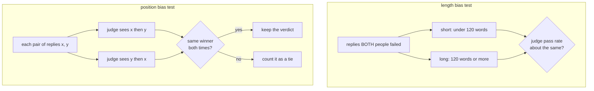

# LLM as judge, and judging the judge

Can a model grade answers, and does its grading agree with people?

## Before you start

- **Level:** 2 (you can read and run a short Python file).
- **Time:** about 2 hours.
- **Builds on:** [Grade an LLM classifier](../01-grade-an-llm-classifier/) for the confusion matrix and the idea of a trusted label, and [Prompt versions as experiments](../05-prompt-versions-as-experiments/) for comparing two versions on the same items.

## The problem

Tiffinbell, a fictional food delivery app, has a support assistant that drafts replies to customers. Today two people in Meera's customer care team read a sample of drafts every week and mark each one pass or fail. It takes them most of a day. A vendor suggests an LLM judge instead: a second model that reads each draft and says pass or fail, and that can also say which of two drafts is better when the team tests a new reply style. Meera wants to know, before the quarterly review on the 20th, whether the judge grades like her people do. Both people and the judge have already graded the same 300 drafts, and the judge has compared 150 pairs of drafts that a person also compared.

The data in `data/` is synthetic, built by `make_data.py` with a fixed seed. **No model was called and no person graded anything.** The grades in `answers.csv` and `pairs.csv` are simulated, and `data/fixture.json` says so, records the judge prompts the simulation stands in for, and lists the two biases that were planted on purpose.

## In plain words

Two cricket umpires watch the same 300 appeals. They agree on 266 of them. Is that good? It depends on how often they would agree by luck. If almost every appeal is plainly not out, two umpires who never look at the pitch and always say "not out" will agree nearly every time. Agreement only means something once you take away the agreement that luck alone would give.

Now a third umpire, a machine, joins. It agrees with each human umpire about 78% of the time. Before you trust it, you want to know two things: is its agreement, after removing luck, as high as the agreement between the two people? And does it have habits that people do not, such as giving more batters out when the appeal is loud?

Terms used below:

- **LLM judge**: a language model asked to grade another model's output, here pass or fail, or "which of these two is better".
- **Rater**: anyone who grades: a person or the judge.
- **Observed agreement**: the share of items where two raters gave the same grade.
- **Chance agreement**: the agreement you would expect if each rater gave their grades at random, at their own pass rate.
- **Cohen's kappa**: agreement after removing chance. 1 is perfect, 0 is no better than luck, below 0 is worse than luck.
- **Length bias**: a judge that rewards long answers whether or not they are good.
- **Position bias**: a judge that, given two answers, favours the one it reads first (or second) whatever they say.

## What you will build from scratch

- `cohen_kappa`: observed agreement, chance agreement and kappa for any two lists of grades.
- `kappas`: kappa for rater A against rater B, and the judge against each of them.
- `false_pass_by_length`: how often the judge passes replies both people failed, short against long.
- `position_stats`, `swap_verdicts` and `agreement_with_human`: does the winner change when the order changes, and what is left when you only count verdicts that survive the swap.

## The idea

**Kappa.** For two raters on n items:

```
observed = items with the same grade / n
chance   = sum over grades g of (share rater 1 gave g) x (share rater 2 gave g)
kappa    = (observed - chance) / (1 - chance)
```

`chance` is what two raters would agree on if each simply graded at their usual pass rate without reading anything. If rater 1 passes 65% and rater 2 passes 62%, they agree by luck on 0.65 x 0.62 of the items (both pass) plus 0.35 x 0.38 (both fail), about 54%. Kappa asks what fraction of the possible improvement over luck the raters actually achieved. When both raters only ever use one grade, chance is 1 and kappa is undefined.

**The bar is the people, not 1.0.** Two careful people do not agree perfectly either. So the question is not "is the judge's kappa high?" but "is the judge's kappa with each person close to the kappa between the two people?" If people agree with each other at 0.76 and the judge agrees with them at 0.55, the judge is not yet a substitute for a person.

**Agreement is not enough: look for habits.** A judge can agree reasonably well on average while being wrong in a pattern that matters. Two patterns are common enough to test for every time:



For length bias, look only at replies both people failed, so "the judge passed it" is clearly a mistake, and compare the judge's false pass rate for short and long replies. For position bias, ask for every comparison twice with the order swapped. A judge with no position bias names the same winner both times, and the reply shown first wins half of all verdicts. A verdict that flips with the order is not a verdict about the replies.

## Walk through

Run these from the lesson folder. `sys.path.insert(0, "solution")` lets Python find the worked answer, and `import solution as s` loads it.

Step 1. Agreement and kappa for every pair of raters.

```python
import sys
sys.path.insert(0, "solution")
import solution as s

rows = s.load_csv("answers.csv")
a = [r["rater_a"] for r in rows]
b = [r["rater_b"] for r in rows]
judge = [r["judge"] for r in rows]
print(len(rows), a.count("pass"), b.count("pass"), judge.count("pass"))
for name, x, y in [("A vs B", a, b), ("judge vs A", judge, a), ("judge vs B", judge, b)]:
    po, pe, k = s.cohen_kappa(x, y)
    print(name, round(po, 3), round(pe, 3), round(k, 3))
```

```
300 185 179 196
A vs B 0.887 0.523 0.763
judge vs A 0.797 0.536 0.562
judge vs B 0.77 0.53 0.511
```

The first line gives the pass counts: rater A passed 185 of 300 drafts, rater B 179, the judge 196. Then each line is observed agreement, chance agreement and kappa. The two people agree on 88.7% of drafts, where luck alone would give 52.3%, so kappa is 0.763. The judge agrees with A on 79.7% and with B on 77.0%, which sounds decent, but after removing luck its kappas are 0.562 and 0.511. The judge is clearly worse than a second person. It also passes more drafts than either person: 65.3% against about 61%.

Step 2. Where does the judge go wrong? Look at drafts both people failed.

```python
import sys
sys.path.insert(0, "solution")
import solution as s

rows = s.load_csv("answers.csv")
fp = s.false_pass_by_length(rows)
print(fp)
for key in ["short", "long"]:
    k, n = fp[key]
    print(key, round(k / n, 3))
```

```
{'short': (3, 49), 'long': (23, 52)}
short 0.061
long 0.442
```

Of the 49 short drafts both people failed, the judge passed 3 (6.1%). Of the 52 long ones, it passed 23 (44.2%). A bad draft is seven times as likely to get through if it is long. That is the planted length bias, and it would show up in a real judge the same way: a team that "optimises for the judge" would learn to write longer replies, not better ones.

Step 3. Position bias, and the swap test.

```
python3 solution/solution.py
```

```
kappa a_vs_b     0.763
kappa judge_vs_a 0.562
kappa judge_vs_b 0.511
judge passes replies both people failed: {'short': (3, 49), 'long': (23, 52)}
position: {'pairs': 150, 'consistent': 94, 'first_wins': 192}
x-first verdict agrees with the person: (113, 150)
both-orders verdict agrees with the person: (82, 94)
```

The judge saw 150 pairs in both orders: 300 verdicts. The reply shown first won 192 of them, 64%, where no bias would give about 50%. Only 94 of the 150 pairs (63%) got the same winner in both orders; in the other 56, the winner was simply whichever came first or whichever came second. If you ask once, in one order, the judge matches the person on 113 of 150 pairs (75%). If you ask in both orders and keep only verdicts that survive the swap, it matches on 82 of 94 (87%), and honestly reports the other 56 as ties.

### Honest limits

- The grades are simulated, with the biases planted, so the numbers teach the method, not how good any real judge is. The point is the tests: a real judge must pass the same three checks on your own data.
- Two people are a small panel. The people's kappa of 0.763 has its own margin of error. With more raters, compare the judge with the average person-to-person agreement.
- "Long" is cut at 120 words. A real check should look at the false pass rate across several length bands to see the trend, not just one cut.
- A judge that agrees with people on these drafts may not on next quarter's, after the assistant or the judge prompt changes. Keep grading a small sample by hand.

## Common mistakes

1. **Reporting raw agreement.** A judge that passes every draft without reading it:

    ```python
    import sys
    sys.path.insert(0, "solution")
    import solution as s

    rows = s.load_csv("answers.csv")
    a = [r["rater_a"] for r in rows]
    lazy = ["pass"] * len(rows)
    po, pe, k = s.cohen_kappa(lazy, a)
    print(round(po, 3), round(pe, 3), round(k, 3))
    ```

    ```
    0.617 0.617 0.0
    ```

    It "agrees with rater A 61.7% of the time", because A passes 61.7% of drafts. Its kappa is exactly 0. Raw agreement rewards a judge for matching the pass rate, not for reading. Always report kappa next to it.
2. **Comparing the judge with 1.0 instead of with people.** A kappa of 0.56 is called "moderate" in many tables, and a vendor may present it that way. Here the honest comparison is with the 0.763 two people reach on the same drafts, and the judge falls well short.
3. **Asking for a comparison in one order only.** One order gives 75% agreement with the person and hides that 56 of 150 verdicts flip when the order flips. Ask both ways and treat a flip as a tie. Randomising the order per pair also removes the bias from an average, but it does not stop any single verdict being decided by position.
4. **Letting the judge grade its own family.** A judge from the same model family as the assistant may share its blind spots and its style, and rate that style highly. When you can, use a different model as the judge, and keep people in the loop on a sample.

## Your turn

Open `exercise.py` and fill in `cohen_kappa`, `kappas`, `false_pass_by_length`, `position_stats`, `swap_verdicts` and `agreement_with_human`. Then run, from this folder:

```
python3 test_lesson.py
```

The test checks kappa on small hand-made lists (perfect agreement, perfect disagreement, a judge that always says pass, three labels, one label only, empty lists), against a second formula built from the 2 by 2 table, on the committed data and on a second dataset built with another seed. The bias counts are recomputed independently.

Stretch: split the 300 drafts by `topic` and compute the judge's kappa with rater A for each topic. Which topic is the judge worst at, and how many drafts is that kappa based on?

## Check yourself

1. Two raters agree on 90% of items. Why might their kappa still be close to 0?
2. The judge's kappa with a person is 0.56. What do you compare it with before deciding?
3. How would you test a judge for position bias, and what would an unbiased judge show?
4. Why test length bias only on drafts that both people failed?

<details>
<summary>Answers</summary>

1. If both pass about 95% of items, they would agree about 90% of the time by luck alone (0.95 x 0.95 + 0.05 x 0.05). Kappa removes that, so it can be near 0 even when raw agreement is high.
2. With the kappa between two people on the same items. Here people reach 0.763, so a judge at 0.56 is clearly worse than adding a second person.
3. Ask for every comparison twice, with the order swapped. An unbiased judge names the same winner both times, and the first-shown reply wins about half of all verdicts. Here it won 64%, and 56 of 150 pairs flipped.
4. Because on those drafts a pass is clearly a judge mistake. On drafts people disagree about, you cannot tell whether the judge is biased or just siding with one person.

</details>

## What to tell the stakeholder

"Not yet. On 300 drafts, the judge agrees with your two graders much less than they agree with each other (kappa about 0.54 against 0.76), and it passes more drafts than they do, 65% against about 61%. It lets long bad replies through seven times as often as short ones, and when comparing two replies it favours whichever it reads first, so one-order comparisons are unreliable. It can help with a first pass if every comparison is run in both orders, but your team should keep grading a weekly sample by hand."

## In real job postings

Evaluating AI output against people is evaluation work in Python. In the Real Analyst Jobs data drop of 25 October 2026, 448 of the 900 India analyst postings that list a tool ask for Python (49.8%), and 996 of the 2,056 such US postings do (48.4%). See [how to become an AI analyst](https://realanalystjobs.com/tools/how-to-become-an-ai-analyst) and [Python data analyst jobs](https://realanalystjobs.com/jobs/python-data-analyst-jobs).

## Next

[Natural language to SQL, safely](../10-safe-nl-to-sql/)
