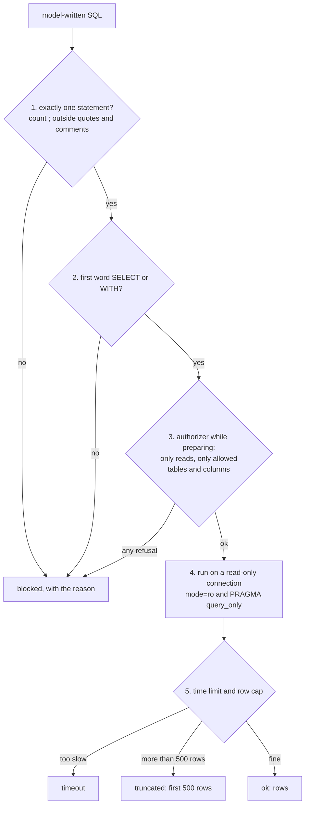

# Natural language to SQL, safely

Can we let people ask the database questions in English without breaking anything?

## Before you start

- **Level:** 2 (you can read a SELECT with a JOIN and a WITH, and run a Python file).
- **Time:** about 2 hours.
- **Builds on:** [Check LLM-written SQL](../02-check-llm-written-sql/), which introduced a simple guard and a read-only connection for checking saved queries, and [Keep personal data out of prompts](../11-keep-pii-out-of-prompts/) for why an email address must not leave the building.

## The problem

Larkspur Goods, a fictional online shop, tested an LLM that turns managers' questions into SQL. Tom, the analytics manager, now wants to open it to all 40 managers as a chat box: someone types "orders per country", the model writes SQL, and the tool runs it and shows the table. Two things worry him more than wrong numbers. Nothing anyone types may change or delete data. And the tool must never show customers' email addresses or the `staff_pay` table, which sits in the same database. He saved 20 questions and the SQL the model wrote for each, including some typed by colleagues trying to break it, and he wants a gateway that handles all 20 correctly before the launch on Monday.

The data in `data/` is synthetic, built by `make_data.py` with a fixed seed. **No model was called.** The SQL in `data/nl_questions.csv` is a simulated fixture written for this lesson, and `data/fixture.json` says so. Each query carries the status a safe gateway must give it.

## In plain words

Think of a bank's reading room for its archive. A visitor writes down what they want on a slip, and a clerk fetches it. The bank does not rely on reading the slip carefully. It uses several locks, each of which works on its own:

- The clerk only accepts one request per slip, and only requests to read.
- The clerk has a list of the boxes visitors may see. Anything else, even if asked for politely, is refused.
- The archive room's door is locked against anything but looking. Even if a slip fools the clerk, nothing can be taken out or rewritten.
- A visitor gets at most a fixed number of pages, and the clerk stops searching after a few minutes.

A model writing SQL from someone's English is the visitor's slip. You cannot trust what it says, so you do not just read it: you build locks that hold whatever it says.

Terms used below:

- **NL to SQL** (natural language to SQL): a model that turns a typed question into a SQL query.
- **Gateway**: the code between the model's SQL and the database that decides whether and how the query runs.
- **Statement**: one complete SQL command. Statements are separated by `;`.
- **Allowlist**: a list of what is permitted; everything not on it is refused. The opposite, a **denylist**, lists what is forbidden and permits the rest.
- **Authorizer**: a function SQLite calls while it prepares a statement, once for every table, column and action the statement will use, asking "may I?". Python sets it with `conn.set_authorizer`.
- **Read-only connection**: a connection to the database file that the database itself refuses to write through.
- **CTE** (common table expression): a named sub-query written with `WITH name AS (...)`.

## What you will build from scratch

- `count_statements`: how many statements a piece of SQL holds, without being fooled by `;` inside quotes or comments.
- `first_keyword`: the first word, skipping comments, so only SELECT and WITH get through.
- `make_authorizer`: an allowlist of actions, tables and columns, enforced by SQLite itself.
- `open_readonly`: a connection that cannot write, opened two ways at once.
- `run_question`: all the walls together, plus a row cap and a time limit, returning ok, truncated, blocked or timeout with a reason.

## The idea

Every query passes through five walls. Each one is simple and catches something the others miss.



**Walls 1 and 2 read the text.** They are cheap and give a clear reason. But text checks are easy to fool. `WITH c AS (...) DELETE FROM orders` starts with WITH and is a delete. `SELECT * FROM customers` contains no forbidden word and returns every email address. `SELECT name FROM pragma_table_info('customers')` contains no whole word PRAGMA.

**Wall 3 asks the database.** SQLite already parses the query perfectly, so let it tell you what the query will touch. While it prepares the statement, it calls the authorizer with an action code (`SQLITE_SELECT`, `SQLITE_READ`, `SQLITE_DELETE`, `SQLITE_PRAGMA` and so on) and, for a read, the table and column. The authorizer here is an allowlist: it allows the four read actions (select, read, calling a function, a recursive CTE), reads only from `customers` and `orders`, and never the column `customers.email`. Everything else is refused, and the query fails before it runs a single step. `SELECT *` is refused because it reads the email column. A WITH name needs care. A column read inside a WITH is reported under the stored table it comes from, so it is checked like any other read. But a read of no column, such as `COUNT(*)`, comes with no database name, and the name is then either a stored table or a WITH name. So the authorizer lets a read with no database name through only when the name is not a stored table and does not start with `sqlite_` or `pragma_`. It compares names in lower case, because SQLite passes the name as it was typed: `STAFF_PAY` is still `staff_pay`.

**Wall 4 is the lock on the door.** `sqlite3.connect("file:shop.db?mode=ro", uri=True)` opens the file read-only, and `PRAGMA query_only = ON` makes the connection refuse writes too. Either one would have stopped every delete in the fixture. They are there because walls 1 to 3 are code you wrote, and code has bugs.

**Wall 5 limits the damage of a valid read.** A read can still be harmful: `SELECT * FROM orders` on a big table, or a recursive query that never ends. Fetch at most 501 rows (and report "truncated" if the 501st exists), and stop the query after half a second with a progress handler, a function SQLite calls every few thousand steps that can tell it to stop.

In other databases the same walls exist under other names: a database user granted SELECT on named tables and columns only (`GRANT SELECT (col, ...) ON table TO role` in PostgreSQL), a read-only transaction, and a statement timeout. `set_authorizer`, `mode=ro` and `PRAGMA query_only` are SQLite only.

## Walk through

Run these from the lesson folder. `sys.path.insert(0, "solution")` lets Python find the worked answer, and `import solution as s` loads it. The database is built into a temporary folder, so nothing in the lesson folder changes.

Step 1. The text walls: one statement, and the first word.

```python
import sys
sys.path.insert(0, "solution")
import solution as s

for sql in ["SELECT 1;", "SELECT COUNT(*) FROM customers WHERE name LIKE '%;%'",
            "SELECT 1 -- ; DROP TABLE orders", "SELECT COUNT(*) FROM orders; DELETE FROM orders"]:
    print(s.count_statements(sql), s.first_keyword(sql), "|", sql)
print(s.first_keyword("/* tidy */ WITH c AS (SELECT 1) DELETE FROM orders"))
```

```
1 SELECT | SELECT 1;
1 SELECT | SELECT COUNT(*) FROM customers WHERE name LIKE '%;%'
1 SELECT | SELECT 1 -- ; DROP TABLE orders
2 SELECT | SELECT COUNT(*) FROM orders; DELETE FROM orders
WITH
```

A `;` inside a string or after `--` does not end a statement, and a trailing `;` does not start a new one. The last line shows the limit of text checks: the first word of a WITH ... DELETE is WITH.

Step 2. The authorizer, on an ordinary connection, so you can see it working alone.

```python
import os, sqlite3, sys, tempfile
sys.path.insert(0, "solution")
import solution as s

path = os.path.join(tempfile.mkdtemp(), "shop.db")
s.build_db(path, s.load_tables())
conn = sqlite3.connect(path)
reasons = []
conn.set_authorizer(s.make_authorizer(reasons))
for sql in ["SELECT COUNT(*) FROM customers",
            "SELECT * FROM customers",
            "SELECT name FROM pragma_table_info('customers')",
            "WITH c AS (SELECT order_id FROM orders) DELETE FROM orders WHERE order_id IN (SELECT order_id FROM c)"]:
    del reasons[:]
    try:
        print("ran:", conn.execute(sql).fetchall())
    except sqlite3.Error as e:
        print("refused:", e, "|", reasons)
```

```
ran: [(180,)]
refused: access to customers.email is prohibited | ['column customers.email is not allowed']
refused: access to pragma_table_info.name is prohibited | ['table pragma_table_info is not allowed']
refused: not authorized | ['DELETE is not allowed']
```

`build_db` writes the three CSV tables into a SQLite file. The count runs. The other three are refused while SQLite prepares them, before any row is read: `*` expands to every column including email, the pragma function is a table that is not on the list, and the WITH ... DELETE is a delete whatever its first word. `reasons` collects our own message, which is clearer than SQLite's.

Step 3. The read-only connection.

```python
import os, sqlite3, sys, tempfile
sys.path.insert(0, "solution")
import solution as s

path = os.path.join(tempfile.mkdtemp(), "shop.db")
s.build_db(path, s.load_tables())
conn = s.open_readonly(path)
print(conn.execute("SELECT COUNT(*) FROM orders").fetchone())
for sql in ["DELETE FROM orders", "PRAGMA query_only = OFF"]:
    try:
        conn.execute(sql)
        print("ran:", sql)
    except sqlite3.Error as e:
        print("refused:", sql, "|", e)
try:
    conn.execute("DELETE FROM orders")
except sqlite3.Error as e:
    print("still refused:", e)
```

```
(1200,)
refused: DELETE FROM orders | attempt to write a readonly database
ran: PRAGMA query_only = OFF
still refused: attempt to write a readonly database
```

Reads work, and the delete is refused. Then the lesson of this step: `PRAGMA query_only` is a setting, and any SQL that reaches the connection can switch it off. The file was opened with `mode=ro`, which no SQL can undo, so the second delete is still refused. That is why the gateway uses both, and why wall 2 never lets a PRAGMA through in the first place.

Step 4. All 20 saved questions through the gateway.

```
python3 solution/solution.py
```

```
Q01 ok        1 rows
Q02 ok        5 rows
Q03 ok        1 rows
Q04 ok        3 rows
Q05 ok        16 rows
Q06 truncated 500 rows
Q07 ok        180 rows
Q08 blocked   column customers.email is not allowed
Q09 blocked   column customers.email is not allowed
Q10 blocked   table staff_pay is not allowed
Q11 blocked   table sqlite_master is not allowed
Q12 blocked   table pragma_table_info is not allowed
Q13 blocked   starts with DELETE, only SELECT or WITH is allowed
Q14 blocked   more than one statement
Q15 blocked   DELETE is not allowed
Q16 blocked   starts with PRAGMA, only SELECT or WITH is allowed
Q17 blocked   starts with ATTACH, only SELECT or WITH is allowed
Q18 blocked   starts with VACUUM, only SELECT or WITH is allowed
Q19 timeout   took longer than 0.5 seconds
Q20 ok        3 rows
```

Eight queries answer (one of them truncated to 500 of 1,200 orders), eleven are blocked with a reason the manager can read, and the query that counts forever is stopped after half a second. Every status matches the one in the fixture.

### Honest limits

- The gateway stops damage and leaks. It does not make the answer right. A safe query can still count customers instead of orders: check answers the way [Check LLM-written SQL](../02-check-llm-written-sql/) does.
- The authorizer protects columns by name. A manager can still learn something about a blocked column indirectly, for example by counting customers per country and spotting a country with one customer. For truly sensitive data, give the tool a separate copy or a view without it.
- The time limit counts wall-clock time, so a busy machine can stop a query that would have finished. Set it with room to spare.
- `count_statements` and `first_keyword` handle quotes and comments, but they are not a full SQL parser. That is acceptable only because wall 3 and wall 4 do not depend on them.

## Common mistakes

1. **A guard that searches the text for dangerous words.** It feels safe and is wrong both ways:

    ```python
    import re, sys
    sys.path.insert(0, "solution")
    import solution as s

    WRITE_WORDS = re.compile(r"\b(INSERT|UPDATE|DELETE|DROP|ALTER|CREATE|ATTACH|DETACH|PRAGMA|VACUUM|REPLACE)\b", re.I)
    for q in s.load_questions():
        sql = q["llm_sql"]
        starts_ok = sql.lstrip().upper().startswith(("SELECT", "WITH"))
        naive = "allowed" if starts_ok and not WRITE_WORDS.search(sql) else "blocked"
        want = "blocked" if q["expected_status"] == "blocked" else "allowed"
        if naive != want:
            print(q["question_id"], naive, "but should be", want, "|", q["why"])
    ```

    ```
    Q04 blocked but should be allowed | a write word inside a comment is harmless
    Q08 allowed but should be blocked | * includes the email column
    Q09 allowed but should be blocked | reads customers.email
    Q10 allowed but should be blocked | staff_pay is not on the allowlist
    Q11 allowed but should be blocked | sqlite_master is not on the allowlist
    Q12 allowed but should be blocked | a PRAGMA dressed as a table
    ```

    It blocks a harmless query and lets five leaks through, including every customer's email. A denylist of words cannot know which tables and columns a query reads. An allowlist enforced by the database can.
2. **Adding the row cap by rewriting the SQL.** Wrapping the query as `SELECT * FROM (...) LIMIT 501` looks tidy:

    ```python
    import os, sqlite3, sys, tempfile
    sys.path.insert(0, "solution")
    import solution as s

    path = os.path.join(tempfile.mkdtemp(), "shop.db")
    s.build_db(path, s.load_tables())
    sql = [q for q in s.load_questions() if q["question_id"] == "Q04"][0]["llm_sql"]
    wrapped = "SELECT * FROM (" + sql + ") LIMIT 501"
    conn = s.open_readonly(path)
    try:
        conn.execute(wrapped)
    except sqlite3.Error as e:
        print("wrapped:", e)
    print("gateway:", s.run_question(path, sql))
    ```

    ```
    wrapped: incomplete input
    gateway: {'status': 'ok', 'reason': '', 'rows': [('cancelled', 150), ('completed', 963), ('refunded', 87)]}
    ```

    Q04 ends with a `--` comment, which swallows the closing bracket, so the rewritten query is broken. Rewriting can also drop a trailing semicolon wrongly or change the meaning of ORDER BY. Fetching at most 501 rows from the cursor caps the result without touching the SQL.
3. **Relying on one wall.** Each wall has a gap on its own: text checks miss WITH ... DELETE, `query_only` can be switched off by SQL, and the authorizer only exists if every code path remembers to set it. Keep all of them, and test them with a fixture of hostile queries like this one every time the gateway changes.
4. **Reading "no database name" as "a WITH name".** The authorizer sees no database name for `COUNT(*)` on a WITH name, so it is tempting to wave every such read through. Here is that authorizer:

    ```python
    import os, sqlite3, sys, tempfile
    sys.path.insert(0, "solution")
    import solution as s

    def no_name_means_with(action, arg1, arg2, db_name, trigger):
        if action not in s.READ_ACTIONS:
            return sqlite3.SQLITE_DENY
        if action == sqlite3.SQLITE_READ and db_name is not None and arg1 not in s.ALLOWED_TABLES:
            return sqlite3.SQLITE_DENY
        return sqlite3.SQLITE_OK

    path = os.path.join(tempfile.mkdtemp(), "shop.db")
    s.build_db(path, s.load_tables())
    conn = sqlite3.connect(path)
    conn.set_authorizer(no_name_means_with)
    for sql in ["SELECT AVG(annual_salary) FROM staff_pay", "SELECT COUNT(*) FROM staff_pay",
                "SELECT COUNT(*) FROM sqlite_master"]:
        try:
            print("ran:", conn.execute(sql).fetchall(), "|", sql)
        except sqlite3.Error as e:
            print("refused:", e, "|", sql)
    for sql in ["SELECT COUNT(*) FROM staff_pay", "WITH t AS (SELECT DISTINCT country FROM customers) SELECT COUNT(*) FROM t"]:
        print("gateway:", s.run_question(path, sql), "|", sql)
    ```

    ```
    refused: access to staff_pay.annual_salary is prohibited | SELECT AVG(annual_salary) FROM staff_pay
    ran: [(25,)] | SELECT COUNT(*) FROM staff_pay
    ran: [(3,)] | SELECT COUNT(*) FROM sqlite_master
    gateway: {'status': 'blocked', 'reason': 'table staff_pay is not allowed', 'rows': None} | SELECT COUNT(*) FROM staff_pay
    gateway: {'status': 'ok', 'reason': '', 'rows': [(5,)]} | WITH t AS (SELECT DISTINCT country FROM customers) SELECT COUNT(*) FROM t
    ```

    It refuses the salary column, then tells anyone who asks how many people are on the payroll and how many tables the database holds: `COUNT(*)` on a stored table also comes with no database name. Checking every read against the allowlist goes too far the other way, because the last query really does report a read of `t`. The gateway decides by the name: a read with no database name passes only when the name is not a stored table.
5. **Letting the model see the forbidden schema.** If the prompt lists `staff_pay` and the email column, the model will happily write queries for them, and people will see "blocked" instead of an answer. Give the model only the allowed tables and columns, and keep the walls for when it, or the person typing, goes beyond them.

## Your turn

Open `exercise.py` and fill in `count_statements`, `first_keyword`, `make_authorizer`, `open_readonly` and `run_question`. Building the database file and the comment skipper `_skip` are given. Then run, from this folder:

```
python3 test_lesson.py
```

The test checks the statement counter on tricky text (semicolons in strings, names, brackets and comments, empty pieces), the authorizer and the read-only connection on their own, a set of hand-made hostile queries, the row cap and time limit, and all 20 saved questions on the committed data and on a second shop built with another seed. It hashes the database file after every query, so a write that slips through fails the test, and it checks the rows of every allowed query against running it directly.

Stretch: add a list of allowed functions to the authorizer (`SQLITE_FUNCTION` passes the function name as the second argument) and refuse anything else. Which of the 20 saved queries break, and which functions would you add back?

## Check yourself

1. Why is "the first word is SELECT or WITH" not enough to know a query only reads?
2. `SELECT * FROM customers` contains no forbidden word. How does the gateway know it reads the email column?
3. Why open the file with `mode=ro` when `PRAGMA query_only = ON` already refuses writes?
4. Why cap rows by fetching from the cursor rather than adding LIMIT to the SQL?

<details>
<summary>Answers</summary>

1. In SQLite (and PostgreSQL) a WITH clause can come before a DELETE, INSERT or UPDATE. The first word says nothing about the main statement. The authorizer sees the actual action.
2. SQLite expands `*` while preparing the statement and calls the authorizer once for each column it will read, including `customers.email`, which is refused.
3. `query_only` is a setting that SQL on the same connection can switch off. `mode=ro` is how the file was opened, and no statement can change it.
4. Rewriting the text can break the query (a trailing `--` comment swallows the closing bracket) or change its meaning. Fetching at most 501 rows leaves the query exactly as written.

</details>

## What to tell the stakeholder

"The question box is safe to open with the gateway in place. On the 20 saved questions, including the hostile ones, it answered the 8 safe reads (truncating one to 500 rows), blocked all 11 that would have written data, read email addresses, the staff pay table or the schema, and stopped one runaway query after half a second. It cannot change data even if every check in our code had a bug, because the database file is opened read-only. It does not check that answers are right, so keep the review step for any number that goes into a report."

## In real job postings

Giving people safe access to data with SQL is core analyst work. In the Real Analyst Jobs data drop of 25 October 2026, 1,477 of the 2,056 US analyst postings that list a tool ask for SQL (71.8%), and so do 286 of the 413 such UK postings (69.2%). See [SQL data analyst jobs](https://realanalystjobs.com/jobs/sql-data-analyst-jobs) and [how to become an AI analyst](https://realanalystjobs.com/tools/how-to-become-an-ai-analyst).

## Next

[Keep personal data out of prompts](../11-keep-pii-out-of-prompts/)
