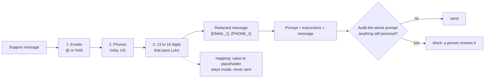

# Keep personal data out of prompts

Is any customer's email or phone number about to leave the building?

## Before you start

- Level 1 (beginner). About 2 hours.
- You can run a Python file and read a short function: [00-06 Python for spreadsheet people](../../00-start-here/06-python-for-spreadsheet-people/).
- Regular expressions are introduced from zero in [07-01 Read job postings like data](../../07-getting-hired/01-read-job-postings-like-data/) and used again in [05-01 Clean a messy CSV](../../05-python-for-analysts/01-clean-a-messy-csv/). The patterns here are explained piece by piece, so you can start here.
- [06-04 How LLMs work, for analysts](../04-how-llms-work-for-analysts/) explains what a prompt is.

## The problem

Farah runs customer operations at Tiffinbell, a fictional food delivery app in Maharashtra. Her team wants an LLM to summarise last week's 240 support messages for Thursday's review. The company's data policy says no customer email, phone number or card number may be sent to an outside service. Customers paste all three into chats, in every format: Indian mobiles with and without +91, US numbers from family abroad who order for parents in Pune, cards typed with spaces or hyphens, and emails inside links. Farah asks you to build the step that runs before anything is sent: replace personal data with placeholders, keep order ids and dates intact so the summaries are still useful, and stop any message that still looks risky.

The messages in `data/messages.csv` are synthetic, built by `make_data.py` with a fixed seed. **No real person's data is in them.** Every email address uses example.com, example.net or example.org, which [RFC 2606](https://www.rfc-editor.org/rfc/rfc2606) reserves for documentation (read 31 October 2026), so they cannot belong to anyone. Phone numbers are random digits in the right shape, invented for this lesson; never call or message a number from a dataset. Card numbers are random digits made to pass the Luhn check, not real cards. `data/pii_truth.csv` lists every value that was planted and `data/decoys.csv` lists the look-alikes that must survive, so the test can check your redactor against the truth.

## In plain words

Think of the photocopier at a bank branch. Before a customer's form is copied for head office, a clerk covers the account number and phone number with a sticker that says "Customer 1". The same customer gets the same sticker on every form, so head office can still see that one person wrote three times. The order number stays visible, because head office needs it. Then, at the door, a second person looks over every copy once more. If anything still looks like a phone number, the copy does not leave: it goes back to a person to check.

That is the whole lesson. The first clerk is the **redactor**. The person at the door is the **audit**. The audit does not fix anything. It blocks.

Words used in this lesson:

- **PII** (personally identifiable information): data that points to one person, such as an email address, a phone number or a card number.
- **Redact**: replace a piece of text so it can no longer be read.
- **Placeholder**: the text that replaces it, such as `[EMAIL_1]`. **Stable** means the same value always gets the same placeholder.
- **Normalise**: write a value in one standard form before comparing. `+91 98450 12345` and `09845012345` are one phone number.
- **Regular expression** (regex): a small pattern language for finding text. `\d` means one digit, `[6-9]` one digit from 6 to 9, `?` "optional", `{5}` "exactly five times".
- **Lookbehind** `(?<!...)`: "not preceded by". `(?<![\w-])9` finds a 9 that has no letter, digit or hyphen just before it.
- **Luhn check**: a simple sum that every real card number passes, used to tell card numbers from other long numbers.
- **Fail closed**: when a check is unsure, the safe answer is "stop", not "send".

## What you will build from scratch

- `IN_PHONE` and `US_PHONE`: patterns for Indian mobile and US numbers in the formats customers type.
- `luhn_ok`: the Luhn check, so a 16-digit voucher code is not mistaken for a card.
- `find_pii` and `redact`: find emails, phones and cards in that order, and replace each with a stable placeholder such as `[PHONE_2]`.
- `audit` and `send_or_block`: the last check on the whole prompt, which blocks instead of fixing.

## The idea



**What to find, and what to leave.** Each detector has look-alikes that must survive, because a summary that cannot name the order is useless:

| Find and replace | Leave alone |
|---|---|
| `asha.k@example.com`, `mailto:...`, `?user=asha.k%40example.com` | the handle `@tiffinbell_care` (no name before the @) |
| `+91 98450 12345`, `+91-9845012345`, `09845012345`, `0091 98450 12345` | the order id `TB-9845012345` (letters and a hyphen just before) |
| `(415) 555-0142`, `415.555.0142`, `+1 415 555 0142` | dates `2026-10-28` and `28/10/2026`, the amount `Rs 1,499` |
| `4760-7029-6800-7156` (passes Luhn) | voucher `1234 5678 9012 3456` (fails Luhn), tracking `7712345678902`, "card ending 4242" |

**The Indian phone pattern**, piece by piece:

```
(?<![\w#/.+-])            not inside an id, a word or a URL path
(?:\+91[\s-]?|0091[\s-]?|0)?   an optional +91 or 0091 (with an optional space or hyphen), or a 0
[6-9]\d{4}                five digits, the first one 6 to 9 (Indian mobiles start that way)
[\s-]?\d{5}               an optional space or hyphen, then five more digits
(?!\w)                    not followed by another letter or digit
```

The lookbehind is what keeps `TB-9845012345` safe: the 9 has a hyphen just before it. The lookahead stops a 13-digit tracking number from being read as a 10-digit phone.

**The Luhn check.** From the rightmost digit, double every second digit (the 2nd, 4th, 6th from the right). If a doubled digit is above 9, subtract 9. Add everything. A card number gives a total that ends in 0. Random 16-digit numbers pass about one time in ten, so most vouchers and tracking numbers fail and are left alone.

**The order matters.** Emails go first, because an email can hold digits. Phones go before cards: `0091 97281 38703` has 14 digits, and in this data it passes the Luhn check by chance, so a card-first redactor would call a phone number a card.

**Stable placeholders.** Before choosing a placeholder, normalise the value: lower-case emails and turn `%40` back into `@`, keep the last 10 digits of a phone, keep all digits of a card. The first new value of each kind gets `_1`, the next `_2`. The mapping from values to placeholders is the key to undo the redaction, so it never goes into a prompt.

**The audit** runs on the final prompt, instructions and all, exactly as it would be sent. It runs the same detectors again, plus one more that the redactor does not try to fix: spelled-out emails such as "asha dot k at example dot com". Anything found blocks the send.

## Walk through

Run these from the lesson folder.

Step 1. Look at the messages. `sys.path.insert(0, "solution")` lets Python find the worked answer, and `import solution as s` loads it.

```python
import sys
sys.path.insert(0, "solution")
import solution as s

msgs = {r["message_id"]: r["text"] for r in s.load_csv("messages.csv")}
for mid in ["M0001", "M0005", "M0009", "M0016"]:
    print(mid, msgs[mid])
```

```
M0001 Write to me at mailto:kabir.l45@example.org or call +91-7803148648 after 6 pm.
M0005 My son in the US placed it, his number is +1 206 555 0143. Reply to jay.e47@example.com.
M0009 The app said to DM @tiffinbell_care. My email is imran dot p76 at example dot com if you need it.
M0016 I paid Rs 249 with card 4760-7029-6800-7156 but TB-3128661629 still shows unpaid.
```

An email after `mailto:`, a US number with spaces, an email spelled out in words next to a social handle, a card with hyphens next to an order id.

Step 2. The quick patterns many people write first, checked against what was planted.

```python
import re
import sys
sys.path.insert(0, "solution")
import solution as s

msgs = {r["message_id"]: r["text"] for r in s.load_csv("messages.csv")}
truth = s.load_csv("pii_truth.csv")
decoys = s.load_csv("decoys.csv")
NAIVE_PHONE = re.compile(r"\b\d{10}\b")
NAIVE_EMAIL = re.compile(r"\S+@\S+")

def naive(text):
    return NAIVE_PHONE.sub("[PHONE]", NAIVE_EMAIL.sub("[EMAIL]", text))

out = {mid: naive(t) for mid, t in msgs.items()}
phones = [t for t in truth if t["kind"] == "phone"]
emails = [t for t in truth if t["kind"] == "email"]
print("phones leaked:", sum(t["value"] in out[t["message_id"]] for t in phones), "of", len(phones))
print("emails leaked:", sum(t["value"] in out[t["message_id"]] for t in emails), "of", len(emails))
orders = [d for d in decoys if d["kind"] == "order_id"]
print("order ids destroyed:", sum(d["value"] not in out[d["message_id"]] for d in orders), "of", len(orders))
print(out["M0002"])
```

```
phones leaked: 75 of 90
emails leaked: 9 of 84
order ids destroyed: 133 of 133
Please send the invoice for TB-[PHONE] to [EMAIL] thanks.
```

`\b\d{10}\b` means "ten digits as a whole word". It only catches phones typed as ten digits in a row, so 75 of the 90 phones would leave the building. It also eats every order id, because the hyphen in `TB-` counts as a word edge. `\S+@\S+` misses the 9 emails written with `%40` inside links, and swallows the comma after the others. Both errors at once: data leaks out, and the summaries lose the order numbers.

Step 3. The careful redactor on tricky cases.

```python
import sys
sys.path.insert(0, "solution")
import solution as s

for text in ["Call +91 98450 12345 or (415) 555-0142.",
             "Order TB-9845012345, tracking 7712345678902, delivered 2026-10-28.",
             "reset?user=asha.k%40example.com&ref=app, or DM @tiffinbell_care",
             "Card 4111 1111 1111 1111, voucher 1234 5678 9012 3456"]:
    print(s.redact(text, {}))
```

```
Call [PHONE_1] or [PHONE_2].
Order TB-9845012345, tracking 7712345678902, delivered 2026-10-28.
reset?user=[EMAIL_1]&ref=app, or DM @tiffinbell_care
Card [CARD_1], voucher 1234 5678 9012 3456
```

Both phone formats are caught. The order id, tracking number and date are untouched. The URL-encoded email is replaced, the handle is not. The card passes Luhn and is replaced; the voucher fails it and stays.

Step 4. Stable placeholders.

```python
import sys
sys.path.insert(0, "solution")
import solution as s

texts = ["Mail Asha.K@Example.com or 98450 12345", "Again: asha.k@example.com, +91-9845012345"]
out, mapping = s.redact_all(texts)
print(out)
print(mapping)
```

```
['Mail [EMAIL_1] or [PHONE_1]', 'Again: [EMAIL_1], [PHONE_1]']
{('email', 'asha.k@example.com'): '[EMAIL_1]', ('phone', '9845012345'): '[PHONE_1]'}
```

Two spellings of one email and two formats of one phone each get one placeholder, so the summary can still say "the same customer wrote twice". The `mapping` is the key that undoes the redaction. It stays on your machine.

Step 5. The whole week, checked against the truth.

```python
import sys
sys.path.insert(0, "solution")
import solution as s

rows = s.load_csv("messages.csv")
truth = s.load_csv("pii_truth.csv")
decoys = s.load_csv("decoys.csv")
redacted, mapping = s.redact_all([r["text"] for r in rows])
by_id = {r["message_id"]: t for r, t in zip(rows, redacted)}
leaked = [t for t in truth if t["kind"] != "spelled_email" and t["value"] in by_id[t["message_id"]]]
lost = [d for d in decoys if d["value"] not in by_id[d["message_id"]]]
blocked = [mid for mid, t in by_id.items() if s.audit(t)]
print(len(rows), len(truth), len(decoys), len(mapping))
print("leaked", len(leaked), "decoys lost", len(lost), "blocked", len(blocked))
print(blocked[0], by_id[blocked[0]])
print(s.audit(by_id[blocked[0]]))
```

```
240 216 291 113
leaked 0 decoys lost 0 blocked 20
M0009 The app said to DM @tiffinbell_care. My email is imran dot p76 at example dot com if you need it.
[('spelled_email', 'p76 at example dot com')]
```

240 messages hold 216 planted values and 291 look-alikes. The redactor replaces 113 distinct emails, phones and cards. None of the planted emails, phones or cards is left, and none of the look-alikes is lost. The audit blocks 20 messages, all with an email spelled out in words, which the redactor does not try to rewrite. A person reads those 20; the other 220 can be sent.

Step 6. The audit checks the whole prompt, not just the message.

```python
import sys
sys.path.insert(0, "solution")
import solution as s

prompt = "Example: if a customer writes from priya.n@example.com, call them Priya.\n\nMessage: [EMAIL_3] says the food was cold."
try:
    s.send_or_block(prompt)
except s.Blocked as e:
    print(e)
```

```
not sent, personal data found: email
```

The message was clean. The email is in the instructions, where someone pasted a real example to show the model. Only a check on the final prompt catches that.

### Honest limits

Regex redaction is a first line of defence, not a guarantee.

```python
import sys
sys.path.insert(0, "solution")
import solution as s

for text in ["This is Asha Kulkarni from Kothrud, Pune.",
             "My number is nine eight four five zero one two three four five.",
             "Tracking 7712345678901 says delivered."]:
    print(s.redact(text, {}), s.audit(s.redact(text, {})))
```

```
This is Asha Kulkarni from Kothrud, Pune. []
My number is nine eight four five zero one two three four five. []
Tracking [CARD_1] says delivered. []
```

- **Names and addresses pass.** A pattern cannot tell a surname from any other word. Finding names needs a different tool (a named-entity model), and even that misses some.
- **Numbers in words pass**, and so do numbers in a screenshot, a voice note or an attached file.
- **Some safe numbers are removed.** This tracking number passes Luhn by chance, so it is redacted as a card. That is the safe direction, but it costs the summary a detail. An order typed without its `TB-` prefix is redacted as a phone for the same reason.
- **Other formats exist.** Landlines, other countries, IBANs, Aadhaar or PAN numbers and passport numbers are not handled here. Add a detector and a test case before you trust it on them.
- **This is not the whole policy.** Your company's data policy and the law where you work decide what may be sent and to whom. Send only the fields a task needs, and use the provider's data agreements. Redaction is the last safety net, not the first decision.

## Common mistakes

1. **A phone pattern that only knows one format.** `\b\d{10}\b` leaks 75 of the 90 phone numbers in this week's messages and destroys all 133 order ids (Step 2). Test every pattern on the formats customers actually type, and on the look-alikes that must survive.
2. **Calling every long number a card.** Without the Luhn check, every 16-digit voucher and 13-digit tracking number would be redacted. Without the order "phones before cards", `0091 97281 38703` in message M0008 is labelled a card, so the same customer gets a `[CARD_1]` in one message and a `[PHONE_1]` in the next.
3. **Fixing in the audit.** If the audit quietly rewrites what it finds, a pattern bug becomes invisible. Block, log the reason, and let a person decide.
4. **Sending the mapping, or checking only the message.** The mapping is the key to every customer. The instructions, examples and any extra context are part of the prompt too, so audit the prompt as it will be sent.

## Your turn

Open `exercise.py`. Write `IN_PHONE` and `US_PHONE`, then fill in `luhn_ok`, `normalise`, `find_pii`, `redact`, `redact_all`, `audit` and `send_or_block`. `EMAIL`, `CARD_CANDIDATE` and `SPELLED_EMAIL` are written for you. Then run, from this folder:

```
python3 test_lesson.py
```

The test runs hand-made tricky cases (an empty message, emails in links and with `%40`, a handle, twelve phone formats, order ids, dates, a voucher that fails Luhn, a phone that passes it, PII in the instructions), then checks the committed messages and a second set built with another seed against what `make_data.py` planted: every email, phone and card gone, every look-alike kept, every spelled-out email blocked, one placeholder per person.

Stretch: add a detector for Indian landlines written as `020-2567 1234` (a city code, a hyphen, then 8 digits). Add two test cases that must be caught and one that must survive.

## Check yourself

1. Why does the audit block instead of redacting what it finds?
2. `TB-9845012345` looks exactly like a mobile number after the hyphen. What stops the phone pattern from matching it?
3. Why do the same email and the same phone need the same placeholder in every message?
4. Your redactor found nothing in 220 of 240 messages after redaction. Can you tell Farah that no personal data will be sent?

<details>
<summary>Answers</summary>

1. Because anything the audit finds is something the redactor missed, which means a pattern is wrong or a format is new. Blocking makes the miss visible to a person and stops the send. Quiet fixing hides the bug and keeps it.
2. The lookbehind `(?<![\w#/.+-])`: the 9 has a hyphen just before it, so the pattern cannot start there, and it cannot start at a later digit either, because each has a digit just before it.
3. So the summary stays useful: "the same customer wrote three times about one order" is a real finding. With a new placeholder every time, one angry customer looks like three.
4. No. You can say no email, phone or card in the formats you tested will be sent, and that 20 messages are held for review. Names, addresses and numbers written in words or in images still pass, so say that too.

</details>

## What to tell the stakeholder

"Of last week's 240 support messages, 220 are ready to summarise: every email, phone and card number in them, 113 distinct values, has been replaced with a placeholder such as [PHONE_3], and order ids, dates and tracking numbers are kept. 20 messages are held because a customer spelled out an email in words; someone on your team should read those before they are sent. This catches emails, Indian and US phone numbers and card numbers in the formats we tested; it does not catch names or addresses, so the prompt should still ask only for what the summary needs."

## In real job postings

Scripts like this one, which sit between the data and an AI tool, are written in Python. In the Real Analyst Jobs data drop of 25 October 2026, 76 of the 122 analyst postings in Germany that list a tool ask for Python (62.3%), as do 996 of the 2,056 in the US (48.4%). See [how to become an AI analyst](https://realanalystjobs.com/tools/how-to-become-an-ai-analyst) and [Python data analyst jobs](https://realanalystjobs.com/jobs/python-data-analyst-jobs).

## Next

The next lesson in this phase, RAG over the metrics glossary, is planned. See the [phase 06 overview](../README.md) for what comes next.
