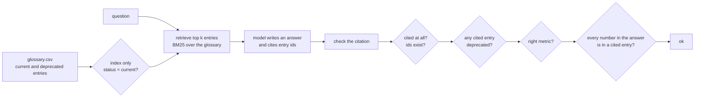

# RAG over the metrics glossary

Which definition of active user did the bot cite, and was it the right one?

## Before you start

- **Level:** 2 (you can read and run a short Python file with dictionaries and loops).
- **Time:** about 2 hours.
- **Builds on:** [Catch made-up numbers](../03-catch-made-up-numbers/) for checking every number against a source, [Grade an LLM classifier](../01-grade-an-llm-classifier/) for measuring a model against a trusted answer, and [Clean a messy CSV](../../05-python-for-analysts/01-clean-a-messy-csv/) for regular expressions.

## The problem

Tiffinbell, a fictional food delivery app, keeps a metrics glossary: one entry per metric, saying exactly how it is counted. In April the company changed what an active user is, from "opened the app in the last 30 days" to "placed a completed order in the last 28 days". The old entry was marked deprecated but never deleted. Last week a product manager asked the new glossary chatbot "What counts as an active user?", copied its answer into a board deck, and the active user number on slide 3 no longer matched the dashboard. Ravi, who owns the glossary, wants to know by Friday which entry the bot cited, whether it was the right one, and how often the bot gets definitions wrong in general.

The data in `data/` is synthetic, built by `make_data.py` with a fixed seed. **No model was called.** The bot's answers in `data/bot_answers.csv` are simulated, and `data/fixture.json` says so: each answer was built from a glossary entry, and some were damaged on purpose in the ways real chatbots go wrong.

## In plain words

Picture a librarian who answers questions by first fetching a few pages from the shelves and then writing a reply from those pages, with a note saying which pages they used. If the shelves still hold last year's rulebook next to this year's, the librarian may fetch the old one, and the answer will be confident, well written and wrong. The note saying which page was used is what lets you catch it.

So there are two things to check. Did the librarian fetch the right page? And does the reply match the page it claims to come from?

Terms used below:

- **RAG** (retrieval-augmented generation): a design where a program first retrieves a few relevant documents, then a language model writes the answer from them.
- **Retrieval**: finding the documents most relevant to a question. Here each glossary entry is one document.
- **Token**: a word or number after lower-casing; small words such as "the" and "what" (stopwords) are dropped.
- **BM25**: a standard way to score how well a document matches a question by the words they share, explained below.
- **recall@k**: the share of questions whose correct document is among the top k retrieved. Recall@1 asks "was it ranked first?".
- **Citation**: the document id the bot says its answer came from.
- **Deprecated**: replaced by a newer definition and no longer to be used.

## What you will build from scratch

- `build_index` and `bm25_score`: a BM25 search over the glossary, in plain Python.
- `retrieve` and `recall_at_k`: the top k entries for a question, and how often the right one is among them.
- `check_answer` and `audit`: one verdict per bot answer: no citation, unknown id, deprecated entry, wrong metric, changed number, or ok.

## The idea



**Scoring with BM25.** For a question and one entry, BM25 adds up a part for each distinct question token that appears in the entry:

```
idf(t)  = ln(1 + (n - df + 0.5) / (df + 0.5))
part(t) = idf(t) x tf x (k1 + 1) / (tf + k1 x (1 - b + b x length / average length))
```

- `n` is the number of entries and `df` the number of entries containing the token. A token found in many entries (such as "completed") says little, so its `idf` is small. A rare token (such as "churned") counts for a lot.
- `tf` is how often the token appears in this entry. The fraction grows with `tf` but levels off, so saying "active" ten times does not count ten times as much. `k1 = 1.5` sets how fast it levels off.
- The length part, with `b = 0.75`, gives short entries a boost and long ones a penalty, so a long entry does not win just by containing more words.

**Why the deprecated entry wins.** The old active user entry is short and says "active user" twice, plus the word "counts", which is in the question. The current entry is longer and says "active user" once. BM25 has no idea which is current. Nothing in the words does. So status has to be handled outside the scoring: leave deprecated entries out of the index the bot searches, and still check every citation, because an answer can come from anywhere.

**Measuring retrieval.** Each question here has one right entry. recall@k is the share of questions whose right entry is in the top k. If the right entry is not retrieved, the model cannot cite it, however good the model is. So measure retrieval on its own, before blaming the model.

**Checking an answer.** The checks run in a fixed order, and the first one that fails is the verdict: nothing cited, an id that is not in the glossary, a deprecated entry cited, no cited entry about the metric that was asked about, a number in the answer that is not in any cited entry. Only then is it ok.

## Walk through

Run these from the lesson folder. `sys.path.insert(0, "solution")` lets Python find the worked answer, and `import solution as s` loads it.

Step 1. The glossary, and the two active user entries.

```python
import sys
sys.path.insert(0, "solution")
import solution as s

glossary = s.load_csv("glossary.csv")
print(len(glossary), sum(g["status"] == "deprecated" for g in glossary))
for g in glossary:
    if g["metric"] == "active_user":
        print(g["doc_id"], g["status"], g["effective_from"], "|", g["text"])
print(s.tokenize("What counts as an active user?"))
```

```
24 4
G548 deprecated 2023-01-01 | Active user: any user who opened the app at least once in the last 30 days counts as an active user, whether or not the user ordered.
G917 current 2026-04-01 | Active user: a customer with at least one completed order in the last 28 days. Opening the app without ordering does not count. This replaced the app-open definition on 1 April 2026.
['counts', 'active', 'user']
```

The glossary has 24 entries, 4 of them deprecated. The question becomes three tokens: `counts`, `active`, `user`.

Step 2. Retrieve for the active user question, from all entries and from current entries only.

```python
import sys
sys.path.insert(0, "solution")
import solution as s

glossary = s.load_csv("glossary.csv")
status = {g["doc_id"]: g["status"] for g in glossary}
question = "What counts as an active user?"
for name, docs in [("all", glossary), ("current", [g for g in glossary if g["status"] == "current"])]:
    index = s.build_index(docs)
    print(name, [(d, status[d], round(score, 2)) for d, score in s.retrieve(index, question, 3)])
index = s.build_index(glossary)
for d in ["G548", "G917"]:
    print(d, len(index["tokens"][d]), index["tokens"][d].count("active"), index["tokens"][d].count("user"))
```

```
all [('G548', 'deprecated', 8.64), ('G917', 'current', 3.12), ('G805', 'current', 2.12)]
current [('G917', 'current', 3.47), ('G805', 'current', 2.29)]
G548 19 2 4
G917 24 1 1
```

With every entry indexed, the deprecated G548 scores 8.64 and the current G917 only 3.12. The last two lines show why: G548 has 19 tokens with "active" twice and "user" four times, while G917 has 24 tokens with each once. More matches in a shorter entry is exactly what BM25 rewards. Indexing current entries only puts G917 first. (Only two entries are returned because no other current entry shares a token with the question.)

Step 3. What did the bot cite?

```python
import sys
sys.path.insert(0, "solution")
import solution as s

glossary = s.load_csv("glossary.csv")
questions = {q["question_id"]: q for q in s.load_csv("questions.csv")}
answers = {a["question_id"]: a for a in s.load_csv("bot_answers.csv")}
by_id = {g["doc_id"]: g for g in glossary}
for qid in ["Q01", "Q05"]:
    a = answers[qid]
    print(qid, questions[qid]["question"])
    print("  bot:  ", a["answer"], "[%s]" % a["cited_doc_ids"])
    print("  cited:", by_id[a["cited_doc_ids"]]["status"], "|", by_id[a["cited_doc_ids"]]["text"])
    print("  verdict:", s.check_answer(a, questions[qid], glossary))
```

```
Q01 What counts as an active user?
  bot:   Active user: any user who opened the app at least once in the last 30 days counts as an active user, whether or not the user ordered. [G548]
  cited: deprecated | Active user: any user who opened the app at least once in the last 30 days counts as an active user, whether or not the user ordered.
  verdict: deprecated
Q05 What counts as a late delivery?
  bot:   Late delivery: an order delivered more than 24 minutes after the time promised in the app. [G854]
  cited: current | Late delivery: an order delivered more than 10 minutes after the time promised in the app.
  verdict: changed_number
```

This answers Ravi's question. The bot cited G548, the deprecated app-open definition with a 30-day window, faithfully quoted. The right entry is G917: a completed order in the last 28 days. Q05 shows a different failure: the citation is the current entry, but the answer says 24 minutes where the entry says 10. A citation is a claim, and it has to be checked against the text.

Step 4. Recall for every question, and a verdict for every answer.

```
python3 solution/solution.py
```

```
recall@1 all entries 0.70, current only 0.90
recall@3 all entries 0.90, current only 0.90
Q01 deprecated
Q02 wrong_metric
Q03 unknown_id
Q04 deprecated
Q05 changed_number
Q12 changed_number
Q17 no_citation
ok: 13 of 20
```

With deprecated entries in the index, the right entry is ranked first for only 14 of 20 questions (0.70). Removing them lifts that to 18 of 20 (0.90). In the top 3 both reach 0.90, which shows why recall@3 alone can look fine while the entry ranked first, the one a bot leans on most, is wrong. Of the bot's 20 answers, 13 pass every check. Two cite a deprecated definition, two changed a number, one cites another metric, one cites an id that does not exist, and one cites nothing.

### Honest limits

- The answers are simulated and the glossary is small, so the numbers teach the method. With 20 questions, a recall of 0.90 has a wide margin of error; see [How big must an eval set be?](../07-how-big-an-eval-set/).
- `changed_number` only compares numbers as text. An answer that writes "four weeks" for "28 days", or that changes a word ("opened" for "ordered"), passes. Checking meaning needs a person or a judge (see [LLM as judge](../09-llm-as-judge/)).
- Each question has one right entry here. Real questions can need two entries ("active users by AOV band"), and then recall@k should count each needed entry.
- BM25 matches words, not meaning. Production systems often add embedding search, which matches meaning; the checks in this lesson apply to it unchanged.

## Common mistakes

1. **Keeping deprecated entries searchable.** Step 2 shows it: the old definition outscores the new one, and recall@1 drops from 0.90 to 0.70. Mark entries with a status and an effective date, and filter on status before retrieval. Keep the old entries for history, outside the index the bot uses.
2. **Assuming the right words will be in the question.** BM25 only finds shared tokens:

    ```python
    import sys
    sys.path.insert(0, "solution")
    import solution as s

    glossary = [g for g in s.load_csv("glossary.csv") if g["status"] == "current"]
    questions = [q for q in s.load_csv("questions.csv") if q["question_id"] in ("Q18", "Q19")]
    index = s.build_index(glossary)
    for q in questions:
        print(q["question"], q["answer_doc_id"], [(d, round(score, 2)) for d, score in s.retrieve(index, q["question"], 3)])
    aliases = {"courier_utilisation": " Also called: couriers busy, courier load.",
               "prep_time": " Also called: preparation time, how long restaurants take to prepare food."}
    with_aliases = [dict(g, text=g["text"] + aliases.get(g["metric"], "")) for g in glossary]
    index = s.build_index(with_aliases)
    for q in questions:
        print(q["question"], [d for d, _ in s.retrieve(index, q["question"], 3)])
    ```

    ```
    How busy are couriers, as a metric? G987 []
    How long do restaurants take to prepare food, as a metric? G190 [('G361', 2.4)]
    How busy are couriers, as a metric? ['G987']
    How long do restaurants take to prepare food, as a metric? ['G190', 'G361']
    ```

    "couriers" is not the token "courier", and "prepare food" shares nothing with "Prep time" except "food", which sends the question to average order value. These are the 2 misses in recall@3. Adding the words people actually use as aliases to each entry fixes both. Read the misses: they tell you which aliases to add.
3. **Checking only that a citation exists.** All the Q01, Q02, Q04, Q05 and Q12 answers cite something, and every one of them is wrong. A citation must point to an existing, current entry about the right metric, and the answer must say what that entry says.
4. **Grading the bot only on its final answers.** If you only read answers, a retrieval miss and a model mistake look the same. Measure recall@k on its own; when the right entry was retrieved and the answer is still wrong, the problem is the model or the prompt. When it was not retrieved, fix the glossary or the search.

## Your turn

Open `exercise.py` and fill in `build_index`, `bm25_score`, `retrieve`, `recall_at_k`, `check_answer` and `audit`. `tokenize` is given. Then run, from this folder:

```
python3 test_lesson.py
```

The test checks your BM25 scores against a second implementation that works term by term from posting lists, on a tiny glossary, on the committed one and on a second one built with another seed (different ids, wordings and damage). It checks tie-breaking, an empty glossary, and a question with no matching words. It checks every verdict on small hand-made answers (several citations, a blank citation list, a number supported by a second citation), and on every bot answer against the answer key that `make_data.py` recorded when it planted each problem.

Stretch: instead of dropping deprecated entries, keep them in the index but multiply their score by 0.2. Does recall@1 recover? When would you want an old definition to be findable on purpose?

## Check yourself

1. The bot cited an entry, and the entry really says what the bot wrote. Can the answer still be wrong?
2. Why can BM25 rank a deprecated entry above the current one?
3. recall@3 is 0.90 with and without deprecated entries. Why is that not evidence that they are harmless?
4. A question gets a wrong answer. How do you tell whether to fix the retrieval or the prompt?

<details>
<summary>Answers</summary>

1. Yes. The cited entry can be deprecated (Q01), or about another metric (Q02). Faithful to the citation is not the same as right.
2. BM25 only looks at shared words and length. The old entry is shorter and repeats "active user", so it scores higher. Status is not a word in the question, so it has to be handled by filtering.
3. recall@3 only asks whether the right entry is somewhere in the top 3. With deprecated entries, the old definition sits above it at rank 1, recall@1 drops from 0.90 to 0.70, and a bot that leans on the top entry cites the wrong one.
4. Look at the retrieved list for that question. If the right entry was not retrieved, the model never saw it: fix the glossary text, aliases or search. If it was retrieved and the answer is still wrong, fix the prompt or the model.

</details>

## What to tell the stakeholder

"The bot cited entry G548, the old active user definition (opened the app in the last 30 days), which we retired in April. The right one is G917: a completed order in the last 28 days, so the number in the deck is on the old basis. It was not a one-off: of 20 test questions, 13 answers passed every check, 2 cited a retired definition, 2 changed a number, and 3 had citation problems. I have taken retired entries out of the bot's search, which puts the right entry first for 18 of 20 questions instead of 14, and I suggest every bot answer that goes into a deck is checked against the entry it cites."

## In real job postings

Owning metric definitions, and checking AI tools that use them, is analyst work done in Python and SQL. In the Real Analyst Jobs data drop of 25 October 2026, 76 of the 122 analyst postings in Germany that list a tool ask for Python (62.3%), and 98 ask for SQL (80.3%). See [how to become an AI analyst](https://realanalystjobs.com/tools/how-to-become-an-ai-analyst) and [Python data analyst jobs](https://realanalystjobs.com/jobs/python-data-analyst-jobs).

## Next

[An analytics agent loop from scratch](../13-agent-loop-from-scratch/)
