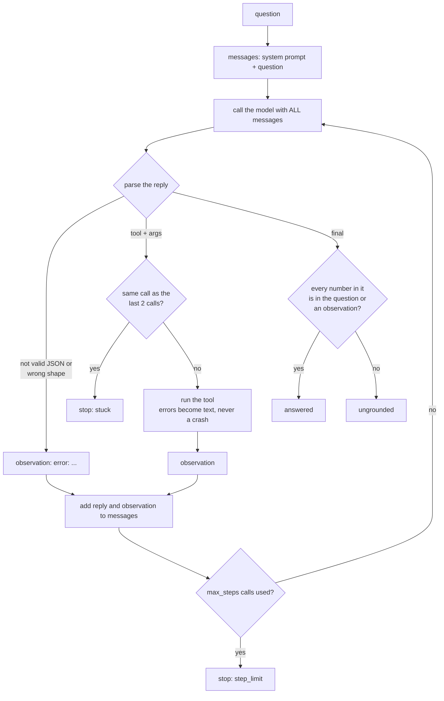

# An analytics agent loop from scratch

What does an agent actually do between your question and its answer?

## Before you start

- **Level:** 3 (you can read and write a Python file with functions, dictionaries and JSON, and read a SELECT with a JOIN).
- **Time:** about 2 hours.
- **Builds on:** [Natural language to SQL, safely](../10-safe-nl-to-sql/) for the read-only SQL gateway this lesson reuses as a tool, [Structured output you can load](../06-structured-output-you-can-load/) for checking model JSON before you act on it, [Catch made-up numbers](../03-catch-made-up-numbers/) for checking every number against a source, and [How LLMs work, for analysts](../04-how-llms-work-for-analysts/) for tokens and rate cards.

## The problem

Larkspur Goods, a fictional online shop, already lets managers ask the database questions through a safe SQL gateway. Tom, the analytics manager, now wants an "agent": a model that can look at the tables, run several queries, do arithmetic and then answer, instead of writing one query. A vendor demo looked impressive, but nobody on his team can say what the agent does between the question and the answer, what happens when it gets something wrong, or what one question costs. Before he signs anything on Thursday, Tom wants you to build the loop yourself, run it on ten saved questions, and recommend how many steps an agent may take.

The data in `data/` is synthetic, built by `make_data.py` with a fixed seed. **No model was called.** What the "model" says at each turn is in `data/agent_script.csv`, a simulated fixture written for this lesson, and `data/fixture.json` says so. Credits are a fictional example rate card, not any provider's prices.

## In plain words

Think of a junior analyst working through a ticket with a strict team lead. The analyst cannot touch the database. Each time, they write one request on a slip: "run this query", "add these two numbers", or "here is my answer". The team lead does exactly what the slip says, if it is allowed, and hands back the result. Then the analyst reads everything so far and writes the next slip. The lead stops the session if the analyst asks the same thing three times, or if the time box runs out.

An agent is that loop. The model is the analyst. Your code is the team lead. Everything an agent "does" is your code doing what the model asked, one slip at a time.

Terms used below:

- **Agent**: a program that calls a model repeatedly, lets it choose actions, carries them out, and shows it the results, until it answers.
- **Tool**: a function the model may ask your code to run, such as `run_sql`. The model never runs anything itself.
- **Action**: one reply from the model, either a tool call (`{"tool": "run_sql", "args": {"sql": "..."}}`) or a final answer (`{"final": "..."}`).
- **Observation**: the text a tool returns, which your code adds to the conversation for the model to read.
- **Transcript** (or messages): every message so far, in order. It is sent to the model again on every call.
- **Step**: one model call. **Step budget** (`max_steps`): the most calls one question may use.
- **Grounded**: every number in the answer appears in something a tool returned or in the question.

## What you will build from scratch

- `parse_action`: read one model reply and decide whether it is a tool call, an answer, or an error to report back.
- `call_tool`: run a tool so that nothing it does can crash the loop.
- `ungrounded_numbers`: the numbers in an answer that no tool returned, at the precision they are written.
- `run_agent`: the loop, with three ways to stop: an answer, a repeat detector, and a step budget.
- `run_cost`, `budget_table`, `recommend_budget`: what each run costs, and the smallest budget that still answers everything that can be answered.

## The idea



**The loop.** Start the messages with a system prompt (the rules and the tool list) and the question. Then repeat: send all messages to the model, add its reply, act on it, add the result. The model has no memory between calls. The only reason it "remembers" the query it ran two steps ago is that your code sends the whole transcript again.

**Errors are observations.** If the reply is broken JSON, names a tool that does not exist, or runs SQL the gateway blocks, the loop does not stop. It tells the model what went wrong, as text, and lets it try again. Recovering from its own mistakes is most of what makes an agent useful.

**Three ways to stop.**

1. A final answer. Then check it: every number must appear, at the precision written, in the question or in an observation. A number with `d` decimals is supported if some observed number rounds to it at `d` decimals, so "9.3%" is supported by the calculator's `9.3333`. An answer that fails is `ungrounded`, however confident it sounds.
2. The repeat detector. If the model asks for the same tool with the same arguments three times in a row, it is not learning from the result. Stop with `stuck` before running it again. Compare the parsed tool and arguments, not the raw text, so a reordered JSON object is still a repeat.
3. The step budget. After `max_steps` model calls with no answer, stop with `step_limit`.

**Cost grows faster than steps.** Call `k` sends every message before it. If each step adds about `t` tokens, call `k` sends roughly `k x t` input tokens, and a run of `n` calls sends about `t x n x (n + 1) / 2` in total. Doubling the steps roughly quadruples the input. That is why the budget matters most for the runs that never answer.

```
input tokens of call k  = tokens of every message before call k
output tokens of call k = tokens of the reply
credits = input / 1000 x 2.0 + output / 1000 x 8.0     (fictional example rate card)
tokens(text) = ceil(len(text) / 4)                      (a rough rule, not a real tokenizer)
```

**The tools** are given: `list_tables`, `describe_table` (which lists only the columns the agent may read, so the email column is never suggested), `run_sql` (a short version of the gateway from [lesson 06-10](../10-safe-nl-to-sql/): one SELECT or WITH, an allowlist authorizer, a read-only connection opened with `mode=ro`, a 20-row cap and a time limit), and `calculate` (numbers, `+ - * /` and brackets, nothing else).

**The model** is `ScriptedModel`: it returns the recorded turns in order, whatever it is shown. That makes every run repeatable and free. It also means the "model" cannot react to a result it did not expect, so the scripts were written for this database (see Honest limits).

## Walk through

Run these from the lesson folder. `sys.path.insert(0, "solution")` lets Python find the worked answer, and `import solution as s` loads it. The database is built in a temporary folder, so nothing in the lesson folder changes.

Step 1. The tools on their own.

```python
import os, sys, tempfile
sys.path.insert(0, "solution")
import solution as s

path = os.path.join(tempfile.mkdtemp(), "shop.db")
s.build_db(path, {"customers": s.load_csv("customers.csv"), "orders": s.load_csv("orders.csv")})
tools = s.make_tools(path)
print(s.call_tool(tools, "list_tables", {}))
print(s.call_tool(tools, "describe_table", {"table": "customers"}))
print(s.call_tool(tools, "run_sql", {"sql": "SELECT status, COUNT(*) FROM orders GROUP BY status"}))
print(s.call_tool(tools, "run_sql", {"sql": "SELECT email FROM customers LIMIT 1"}))
print(s.call_tool(tools, "calculate", {"expression": "70 / 900 * 100"}))
print(s.call_tool(tools, "python", {"code": "import os"}))
```

```
customers, orders
customers: customer_id, name, country, signup_date
rows: [('cancelled', 109), ('completed', 707), ('refunded', 84)]
error: blocked or failed: access to customers.email is prohibited
7.7778
error: unknown tool python, use one of calculate, describe_table, list_tables, run_sql
```

Every tool returns text, because text is all a model can read. A blocked query and an unknown tool come back as text too, starting with `error: `, so the model can read what went wrong.

Step 2. One question, step by step.

```python
import os, sys, tempfile
sys.path.insert(0, "solution")
import solution as s

path = os.path.join(tempfile.mkdtemp(), "shop.db")
s.build_db(path, {"customers": s.load_csv("customers.csv"), "orders": s.load_csv("orders.csv")})
tools = s.make_tools(path)
scripts = s.scripts_by_question(s.load_csv("agent_script.csv"))
run = s.run_agent("What share of 2026 orders were refunded?", s.ScriptedModel(scripts["Q03"]), tools)
for i, step in enumerate(run["steps"], 1):
    print(i, step["kind"], step["tool"], step["args"], "->", step["observation"])
print(run["status"], "|", run["answer"])
print([m["role"] for m in run["messages"]])
```

```
1 tool run_sql {'sql': "SELECT COUNT(*) FROM orders WHERE status = 'refunded'"} -> rows: [(84,)]
2 tool run_sql {'sql': 'SELECT COUNT(*) FROM orders'} -> rows: [(900,)]
3 tool calculate {'expression': '84 / 900 * 100'} -> 9.3333
4 final  None -> 
answered | 9.3% of orders were refunded (84 of 900).
['system', 'user', 'assistant', 'tool', 'assistant', 'tool', 'assistant', 'tool', 'assistant']
```

This is everything the agent did: four model calls, three tool runs, one answer. The model asked for two counts, then asked the calculator to divide them, then answered. Each number in the answer (9.3, 84, 900) is in an observation, so the run is `answered`. The messages alternate: each model reply is followed by the tool result your code added.

Step 3. Recovery, and three ways to go wrong.

```python
import os, sys, tempfile
sys.path.insert(0, "solution")
import solution as s

path = os.path.join(tempfile.mkdtemp(), "shop.db")
s.build_db(path, {"customers": s.load_csv("customers.csv"), "orders": s.load_csv("orders.csv")})
tools = s.make_tools(path)
scripts = s.scripts_by_question(s.load_csv("agent_script.csv"))
questions = {q["question_id"]: q["question"] for q in s.load_csv("questions.csv")}
for qid in ["Q04", "Q06", "Q08", "Q09"]:
    run = s.run_agent(questions[qid], s.ScriptedModel(scripts[qid]), tools)
    print(qid, run["status"], [st["kind"] for st in run["steps"]])
    for st in run["steps"]:
        if st["observation"].startswith("error"):
            print("   ", st["observation"])
    if run["answer"]:
        sources = [questions[qid]] + [m["content"] for m in run["messages"] if m["role"] == "tool"]
        print("    answer:", run["answer"], "| unsupported:", s.ungrounded_numbers(run["answer"], sources))
```

```
Q04 answered ['error', 'tool', 'final']
    error: reply was not valid JSON
    answer: 109 orders were cancelled in 2026. | unsupported: []
Q06 answered ['tool', 'tool', 'final']
    error: blocked or failed: access to customers.email is prohibited
    answer: Top 3 by completed spend: Hana Rao 1049.68; Asha Kim 881.70; Jo Haddad 865.50. | unsupported: []
Q08 ungrounded ['tool', 'final']
    answer: About 15.4% of orders were cancelled. | unsupported: ['15.4']
Q09 stuck ['tool', 'tool', 'stuck']
```

Q04's first reply was broken JSON; told so, the model sent a valid call and answered. Q06 asked for email addresses, the gateway refused, and the model asked again with names. Q08 ran one count (109) and then wrote a share no tool produced: 15.4% is 109 divided by the 707 completed orders, not by all 900, so the loop marks it `ungrounded` instead of passing it on. Q09 asked the same query three times in a row and was stopped before the third ran.

Step 4. Why runs that never answer are expensive.

```python
import os, sys, tempfile
sys.path.insert(0, "solution")
import solution as s

path = os.path.join(tempfile.mkdtemp(), "shop.db")
s.build_db(path, {"customers": s.load_csv("customers.csv"), "orders": s.load_csv("orders.csv")})
tools = s.make_tools(path)
scripts = s.scripts_by_question(s.load_csv("agent_script.csv"))
run = s.run_agent("Why did revenue drop in May?", s.ScriptedModel(scripts["Q10"]), tools, max_steps=8)
msgs = run["messages"]
per_call = [sum(s.tokens(p["content"]) for p in msgs[:i]) for i, m in enumerate(msgs) if m["role"] == "assistant"]
print(run["status"], "input tokens per call:", per_call)
print(s.run_cost(msgs))
```

```
step_limit input tokens per call: [82, 123, 164, 205, 246, 287, 333, 375]
{'calls': 8, 'input_tokens': 1815, 'output_tokens': 280, 'credits': 5.87}
```

The May question looks at one day at a time and never answers. Each call sends about 41 tokens more than the one before, because the transcript keeps growing. Eight calls cost 5.87 credits, more than any answered question.

Step 5. All ten questions, and the step budget.

```
python3 solution/solution.py
```

```
Q01 answered   2 calls   219 tokens in   57 out  0.89 credits
Q02 answered   4 calls   492 tokens in   71 out  1.55 credits
Q03 answered   4 calls   484 tokens in   71 out  1.54 credits
Q04 answered   3 calls   347 tokens in   60 out  1.17 credits
Q05 answered   3 calls   387 tokens in   73 out  1.36 credits
Q06 answered   3 calls   499 tokens in  147 out  2.17 credits
Q07 answered   2 calls   205 tokens in   45 out  0.77 credits
Q08 ungrounded 2 calls   200 tokens in   37 out  0.70 credits
Q09 stuck      3 calls   333 tokens in   69 out  1.22 credits
Q10 step_limit 8 calls  1815 tokens in  280 out  5.87 credits
max_steps  1 answered 0 credits   3.93
max_steps  2 answered 2 credits   8.55
max_steps  3 answered 5 credits  12.04
max_steps  4 answered 7 credits  13.64
max_steps  5 answered 7 credits  14.41
max_steps  6 answered 7 credits  15.27
max_steps  7 answered 7 credits  16.21
max_steps  8 answered 7 credits  17.24
max_steps  9 answered 7 credits  18.37
max_steps 10 answered 7 credits  19.60
smallest budget that answers the most: 4
```

Seven of ten questions are answered. Every answer that can be reached needs at most 4 calls. Above 4, nothing more is answered and every extra step is spent on the May question that never ends: going from 4 to 8 steps adds 3.60 credits (26%) for no extra answers. Q07 counts as answered on purpose: the honest reply to "delete the test orders" is that the agent cannot.

### Honest limits

- The model is a script. It returns the same turns whatever it is shown, so it cannot react to a surprising result the way a real model would. The loop, the checks and the costs are real; the agent's choices are not. Re-record the scripts with a real model before you trust the budget for your own questions.
- Ten questions is a small sample. The recommended budget is the smallest that answered every reachable question here; harder questions will need more.
- The grounding check compares numbers, not meaning. "84 orders were cancelled" passes if 84 appears anywhere in an observation, even as the refunded count. Small numbers such as 2 or 3 are easy to support by accident. It catches invented numbers, not wrong reasoning: [Audit an agent's work](../14-audit-an-agent-run/) goes further.
- `tokens` is a rough rule of four characters per token, and the rate card is fictional. A real tokenizer and price list will give other numbers; the shape (input grows with every step) holds.
- The `run_sql` gateway here is the short version. Its statement check looks for any `;` and is fooled by one inside a string; the full version in [lesson 06-10](../10-safe-nl-to-sql/) handles quotes and comments. The read-only connection is what keeps the data safe either way.

## Common mistakes

1. **Ending the run at the first error.** It feels safe, and it throws away most of the agent's value:

    ```python
    import os, sys, tempfile
    sys.path.insert(0, "solution")
    import solution as s

    path = os.path.join(tempfile.mkdtemp(), "shop.db")
    s.build_db(path, {"customers": s.load_csv("customers.csv"), "orders": s.load_csv("orders.csv")})
    tools = s.make_tools(path)
    scripts = s.scripts_by_question(s.load_csv("agent_script.csv"))
    answered = strict = 0
    for q in s.load_csv("questions.csv"):
        run = s.run_agent(q["question"], s.ScriptedModel(scripts[q["question_id"]]), tools)
        if run["status"] == "answered":
            answered += 1
            if not any(st["observation"].startswith("error") for st in run["steps"]):
                strict += 1
    print("answered:", answered, "| answered if the first error ended the run:", strict)
    ```

    ```
    answered: 7 | answered if the first error ended the run: 3
    ```

    Four of the seven answers came after a broken reply, an unknown tool or a blocked query. Report the error to the model and let it try again; stop it with the repeat detector and the budget, not on the first mistake. The opposite mistake is worse: letting a tool exception crash the program, so one bad query takes the whole service down.

2. **Pricing an agent as if each message is sent once.** The transcript is sent again on every call:

    ```python
    import os, sys, tempfile
    sys.path.insert(0, "solution")
    import solution as s

    path = os.path.join(tempfile.mkdtemp(), "shop.db")
    s.build_db(path, {"customers": s.load_csv("customers.csv"), "orders": s.load_csv("orders.csv")})
    tools = s.make_tools(path)
    scripts = s.scripts_by_question(s.load_csv("agent_script.csv"))
    for steps in [4, 8, 12]:
        run = s.run_agent("Why did revenue drop in May?", s.ScriptedModel(scripts["Q10"]), tools, max_steps=steps)
        sent_once = sum(s.tokens(m["content"]) for m in run["messages"] if m["role"] != "assistant")
        print(steps, "steps | counted once:", sent_once, "| actually sent:", s.run_cost(run["messages"])["input_tokens"])
    ```

    ```
    4 steps | counted once: 106 | actually sent: 574
    8 steps | counted once: 145 | actually sent: 1815
    12 steps | counted once: 188 | actually sent: 3798
    ```

    Counting each message once says 12 steps cost under twice as much input as 4. In fact they send 6.6 times as much. Budget from the transcript, call by call.

3. **Trusting an answer because the agent used tools.** Q08 ran a real query and still wrote a share it computed in its head, against the wrong total. Using tools is not the same as every number coming from them. Check the final answer against the observations, every time, and give the model a calculator so it has no reason to do arithmetic itself.

4. **Detecting repeats on the raw reply text.** `{"tool": "describe_table", "args": {"table": "orders"}}` and the same object with its keys in another order are the same request. Compare the parsed tool name and arguments (here as JSON with sorted keys), or a model that reorders keys loops until the budget runs out.

5. **Setting a large budget "to be safe".** A large budget does not make answers better here; it only lets the runs that will never answer burn more. Pick the smallest budget that answers what can be answered, with a little headroom, and keep the repeat detector.

## Your turn

Open `exercise.py`. The tools, the database, the scripted model, `tokens` and `numbers_in` are given. Write `parse_action`, `call_tool`, `ungrounded_numbers`, `run_agent`, `run_cost`, `budget_table` and `recommend_budget`; each docstring states the contract. Then run, from this folder:

```
python3 test_lesson.py
```

The test checks broken and odd replies, tools that raise, the precision rule for numbers, the exact messages the model is shown at each call, the repeat rule (including a broken reply in between and reordered JSON), a budget of zero, and every one of the ten scripts on the committed data and on a second shop built with another seed. It reruns every query you ran directly against the database, recomputes token costs with a running total, and hashes the database file after every run.

Stretch: add a cost budget next to the step budget, so a run stops when its credits pass a limit. Which questions does a limit of 1.5 credits stop, and is that better or worse than `max_steps = 4`?

## Check yourself

1. The model "remembers" the query it ran three steps ago. Where does that memory actually live?
2. Why should a blocked query be an observation rather than the end of the run?
3. An agent's final answer quotes a number that is in none of the tool results. What are two ways it could have got there, and what should the loop do?
4. Why does a run of 12 steps cost far more than three runs of 4 steps?

<details>
<summary>Answers</summary>

1. In the transcript your code sends on every call. The model keeps nothing between calls; drop a message from the list and it has "forgotten" it.
2. Because the model can usually fix it: here it asked again without the email column. Ending the run at the first error lost four of seven answers. Safety comes from the gateway refusing the query, not from stopping.
3. It did arithmetic itself (often wrongly, as in Q08), or it made the number up. The loop should not pass the answer on: mark it ungrounded, and either ask the model to use the calculator or send the question to a person.
4. Each call sends the whole transcript so far, so input grows with every step and the total grows roughly with the square of the number of steps. Here 12 steps sent 3,798 input tokens; 4 steps sent 574.

</details>

## What to tell the stakeholder

"I recommend we allow the agent at most 6 steps per question, with a repeat detector and a check that every number in its answer came from a tool. On our 10 saved questions, every answerable one finished within 4 steps (4 of the 7 only after recovering from its own mistake), and steps beyond that were spent only on a question it never answered: going from 4 to 8 steps cost 26% more for no extra answers, so 6 leaves headroom without paying for much wandering. The checks stopped one answer with a made-up share (15.4%, worked out against the wrong total) and one run that kept repeating itself. These numbers come from a scripted stand-in for the model and a fictional rate card, so before signing we should rerun the same ten questions with the vendor's model, and treat any answer the loop flags as a question for a person, not a number for a report."

## In real job postings

The loop, the tools and the checks in this lesson are ordinary Python. In the Real Analyst Jobs data drop of 25 October 2026, 41 of the 67 analyst postings in the Netherlands that list a tool ask for Python (61.2%), and 51 of the 91 such postings in France do (56.0%). See [how to become an AI analyst](https://realanalystjobs.com/tools/how-to-become-an-ai-analyst) and [Python data analyst jobs](https://realanalystjobs.com/jobs/python-data-analyst-jobs).

## Next

[Audit an agent's work](../14-audit-an-agent-run/)
