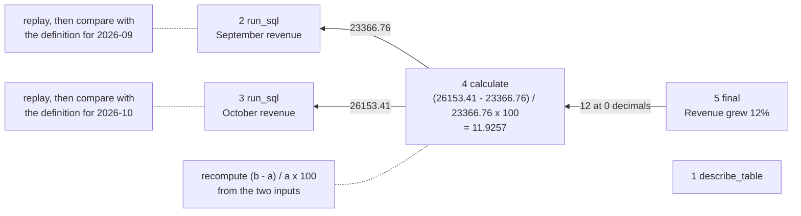

# Audit an agent's work

The agent says revenue grew 12%. Which step should we check, and was it right?

## Before you start

- **Level:** 3 (you can read an agent's step log, write Python with dictionaries and loops, and read a SELECT with WHERE and SUM).
- **Time:** about 2 hours.
- **Builds on:** [An analytics agent loop from scratch](../13-agent-loop-from-scratch/) for what an agent's steps are, [Catch made-up numbers](../03-catch-made-up-numbers/) for comparing numbers at the precision they are written, and [Check LLM-written SQL](../02-check-llm-written-sql/) for rerunning a model's query yourself.

## The problem

Larkspur Goods, the fictional online shop from the last lesson, now runs an agent that answers managers' revenue questions. On Monday it told Priya, the finance lead, "Revenue grew 12% from September to October", and she nearly put it in the board pack. Something felt off: October had a payment outage. The agent logs every step it takes, and the team has eight logged runs from last week. Priya wants you to find out by Wednesday whether 12% is right, which step to look at when it is not, and whether there is a way to check agent answers that does not mean rereading every log by hand.

The data in `data/` is synthetic, built by `make_data.py` with a fixed seed. **No model was called.** The run logs in `data/run_steps.csv` are simulated, written for this lesson to look like an agent's step log, and `data/fixture.json` says so. `data/runs.csv` records what was planted in each run, so the test can check your audit.

## In plain words

Imagine checking a restaurant bill that says "Total: 1,240". You do not recheck the whole menu. You find the lines that add up to the total, check that each one is a dish you actually ordered at the price on the menu, and check the addition. A line for a dish at the next table, which is not part of your total, does not matter.

An agent's answer is the total; its logged steps are the lines. Auditing means: follow the number in the answer back to the steps that produced it, then check only those steps, each in the way that fits it.

Terms used below:

- **Step log** (or trace): the list of steps an agent took, each with the tool, its arguments and the result it got back (the observation).
- **Lineage**: the steps a number depends on. The answer's 12 came from a calculation, whose inputs came from two queries, so those three steps are its lineage.
- **Replay**: running a logged query again and comparing the result with what was logged. A difference means the data changed since, or the log is wrong.
- **Metric definition**: the company's agreed rule for a number. Here, revenue is the sum of `amount` over orders with status `completed`, by `order_date`, for whole calendar months.
- **Stated precision**: the decimal places a number is written with. "12%" claims a whole number, so 11.93 supports it; "12.0%" claims one decimal, so it does not.

## What you will build from scratch

- `supports` and `trace_lineage`: link every number in the answer to the step that produced it, through any calculation, and list numbers that came from nowhere.
- `replay_matches`, `reference_revenue` and `correct_growth`: rerun a step, compute revenue by the definition, and compute the right answer.
- `audit_run` and `audit_all`: one verdict per run (ok, replay_mismatch, wrong_definition, arithmetic, unsupported or no_answer) and the first step that went wrong.

## The idea

Run R1, the 12% answer, has five steps. Its lineage is the part of the log the answer actually depends on:



**Step 1: trace the lineage.** Take each number in the final answer. Find the most recent earlier step whose observation contains a number that, rounded to the answer's precision, equals it. If that step is a calculation, do the same for each number in its expression (100, for per cent, is a constant). A number with no source is **unsupported**: the agent wrote something no tool returned. Step 1, `describe_table`, is not in the lineage, so it needs no check.

**Step 2: check each lineage step, in order, the way that fits it.**

| Step | Check | Verdict if it fails |
|---|---|---|
| any | every number in it has a source | unsupported |
| run_sql | rerun it now; same text as logged? | replay_mismatch |
| run_sql | its value equals the definition's value for the month in its first date | wrong_definition |
| calculate | its result equals `(b - a) / a x 100` for its two inputs, earlier month first | arithmetic |

The verdict is the problem at the earliest step: once September's number is wrong, everything after it is wrong too, and the fix starts there.

**Why replay before the definition?** If a logged result no longer matches a rerun of the same SQL, the query may be perfectly correct; the data changed after the agent ran (late refunds, a reload), or the log was edited. Calling that a wrong definition would send someone to fix a query that is not broken.

**Step 3: say what the right answer is.** `correct_growth` computes the answer from the definition directly, so the stakeholder gets the right number with the diagnosis, not only "the agent was wrong".

## Walk through

Run these from the lesson folder. `sys.path.insert(0, "solution")` lets Python find the worked answer, and `import solution as s` loads it.

Step 1. Read the log of the 12% run.

```python
import sys
sys.path.insert(0, "solution")
import solution as s

steps = s.steps_by_run(s.load_csv("run_steps.csv"))
for st in steps["R1"]:
    print(st["step"], st["tool"], st["args"], "->", st["observation"])
```

```
1 describe_table {'table': 'orders'} -> orders: order_id, customer_id, order_date, status, amount
2 run_sql {'sql': "SELECT ROUND(SUM(amount), 2) FROM orders WHERE status = 'completed' AND order_date >= '2026-09-01' AND order_date < '2026-10-01'"} -> rows: [(23366.76,)]
3 run_sql {'sql': "SELECT ROUND(SUM(amount), 2) FROM orders WHERE order_date >= '2026-10-01' AND order_date < '2026-11-01'"} -> rows: [(26153.41,)]
4 calculate {'expression': '(26153.41 - 23366.76) / 23366.76 * 100'} -> 11.9257
5 final {'answer': 'Revenue grew 12% from September to October.'} -> 
```

Read it slowly and the problem is visible: step 2 filters on `status = 'completed'`, step 3 does not. A reader skimming 40 logs a week will not read this slowly, which is why the next steps are code.

Step 2. Trace the lineage.

```python
import sys
sys.path.insert(0, "solution")
import solution as s

steps = s.steps_by_run(s.load_csv("run_steps.csv"))
for run_id in ["R1", "R3", "R7"]:
    print(run_id, s.trace_lineage(steps[run_id]))
print(s.supports("11.9257", 12, 0), s.supports("11.9257", 12.0, 1))
```

```
R1 {'depends_on': [2, 3, 4], 'unsupported': []}
R3 {'depends_on': [3, 4, 5], 'unsupported': []}
R7 {'depends_on': [], 'unsupported': [(5, '6.8')]}
True False
```

R1's answer depends on steps 2, 3 and 4. R3 has an extra exploratory query at step 2, and its answer does not depend on it. R7's answer contains 6.8, which no step returned. The last line is the precision rule: 11.9257 supports "12" but not "12.0".

Step 3. Check R1's two queries, and reproduce the wrong number.

```python
import os, sys, tempfile
sys.path.insert(0, "solution")
import solution as s

path = os.path.join(tempfile.mkdtemp(), "shop.db")
s.build_db(path, s.load_csv("orders.csv"))
conn = s.open_readonly(path)
steps = s.steps_by_run(s.load_csv("run_steps.csv"))
for st in steps["R1"][1:3]:
    sql = st["args"]["sql"]
    print(st["step"], "replay ok:", s.replay_matches(conn, st), "| logged:", st["observation"],
          "| reference for", s.month_of(sql), ":", s.reference_revenue(conn, s.month_of(sql)))
print(conn.execute("SELECT status, ROUND(SUM(amount), 2) FROM orders WHERE order_date >= '2026-10-01' "
                   "AND order_date < '2026-11-01' GROUP BY status").fetchall())
print("correct growth:", s.correct_growth(conn, "2026-09", "2026-10"))
```

```
2 replay ok: True | logged: rows: [(23366.76,)] | reference for 2026-09 : 23366.76
3 replay ok: True | logged: rows: [(26153.41,)] | reference for 2026-10 : 20626.77
[('cancelled', 3620.12), ('completed', 20626.77), ('refunded', 1906.52)]
correct growth: -11.7
```

Both queries replay exactly, so the log is honest. Step 2 matches the definition. Step 3 does not: 26,153.41 against 20,626.77. The status breakdown explains it: 20,626.77 + 3,620.12 + 1,906.52 = 26,153.41, so step 3 counted October's cancelled and refunded orders, and October is the month the outage caused extra cancellations. By the definition, revenue fell 11.7%.

Step 4. All eight runs.

```
python3 solution/solution.py
```

```
R1 wrong_definition step 3    checked 2,3,4     correct  -11.7% | Revenue grew 12% from September to October.
R2 ok               step None checked 2,3,4     correct    3.8% | Revenue grew 3.8% from August to September.
R3 ok               step None checked 3,4,5     correct  -11.7% | Revenue fell 11.7% from September to October.
R4 wrong_definition step 3    checked 2,3,4     correct  -11.7% | Revenue fell 14.6% from September to October.
R5 replay_mismatch  step 2    checked 2,3,4     correct    3.8% | Revenue fell 0.2% from August to September.
R6 arithmetic       step 4    checked 2,3,4     correct  -11.7% | Revenue fell 13.3% from September to October.
R7 unsupported      step 5    checked -         correct    3.8% | Revenue grew 6.8% from August to September.
R8 ok               step None checked 2,3,4     correct   -8.4% | Revenue fell 8% from August to October.
steps logged: 41 | steps the answers depend on: 21
```

Five of eight answers are wrong, each for a different reason: R4's October query stops before 31 October, R5's August number was logged before late refunds were loaded, R6 divided by October instead of September, and R7 wrote a number the calculator never returned. The audit checked 21 of the 41 logged steps, about half, and found the first bad step in every wrong run.

### Honest limits

- The traces are simulated and every question is the same kind (revenue growth between two months). A real agent's questions need a definition for each metric it touches; the audit is only as good as the definitions you give it.
- Linking numbers by value can link to the wrong step when two steps return the same number, and a source value of exactly 100 would be taken as the per-cent constant. Logging which step's output each step used (a step id in the arguments) removes the guessing.
- Signs are ignored when matching, because answers write "fell 11.7%" for -11.7. An answer that says "grew" for a fall passes the lineage check. Compare the word with the sign of the calculation as an extra check.
- Replay assumes the data has not changed. A replay mismatch says "look here", not "the agent lied": in R5 the data changed after the run.
- The audit finds the first bad step. A run can have more than one problem; fix the first and audit again.

## Common mistakes

1. **Checking every step instead of the lineage.** It sounds more thorough. It raises false alarms and misnames real problems:

    ```python
    import os, sys, tempfile
    sys.path.insert(0, "solution")
    import solution as s

    path = os.path.join(tempfile.mkdtemp(), "shop.db")
    s.build_db(path, s.load_csv("orders.csv"))
    conn = s.open_readonly(path)
    steps = s.steps_by_run(s.load_csv("run_steps.csv"))
    for run in s.load_csv("runs.csv"):
        flagged = [st["step"] for st in steps[run["run_id"]] if st["tool"] == "run_sql"
                   and s.numbers_in(st["observation"])[0][1] != s.reference_revenue(conn, s.month_of(st["args"]["sql"]))]
        if flagged:
            print(run["run_id"], "every-step check flags steps", flagged, "| planted:", run["planted_verdict"], run["planted_step"])
    ```

    ```
    R1 every-step check flags steps [3] | planted: wrong_definition 3
    R3 every-step check flags steps [2] | planted: ok 
    R4 every-step check flags steps [3] | planted: wrong_definition 3
    R5 every-step check flags steps [2] | planted: replay_mismatch 2
    ```

    It flags R3, whose answer is right (step 2 was exploration the answer never used), and misses R6 and R7 entirely, because their queries are fine and the problem is in the arithmetic and the final sentence. Check what the answer depends on, and check every kind of step, not only the SQL.

2. **Comparing the logged result with the definition without replaying it first.** R2 and R5 ran the identical August query:

    ```python
    import sys
    sys.path.insert(0, "solution")
    import solution as s

    steps = s.steps_by_run(s.load_csv("run_steps.csv"))
    for run_id in ["R2", "R5"]:
        st = steps[run_id][1]
        print(run_id, st["args"]["sql"][-60:], "->", st["observation"])
    ```

    ```
    R2 AND order_date >= '2026-08-01' AND order_date < '2026-09-01' -> rows: [(22510.72,)]
    R5 AND order_date >= '2026-08-01' AND order_date < '2026-09-01' -> rows: [(23411.15,)]
    ```

    Same SQL, different logged numbers. Without a replay, R5 looks like a wrong definition and someone "fixes" a correct query. Replay first: the SQL is right, and the data changed after R5 ran.

3. **Matching numbers exactly instead of at the precision written.**

    ```python
    import sys
    sys.path.insert(0, "solution")
    import solution as s

    steps = s.steps_by_run(s.load_csv("run_steps.csv"))
    calc, final = steps["R8"][3]["observation"], steps["R8"][4]["args"]["answer"]
    exact = [t for t, v, d in s.numbers_in(final) if v not in [abs(x) for _, x, _ in s.numbers_in(calc)]]
    print(calc, "|", final, "| exact match says unsupported:", exact, "| at stated precision:", s.supports(calc, 8, 0))
    ```

    ```
    -8.3691 | Revenue fell 8% from August to October. | exact match says unsupported: ['8'] | at stated precision: True
    ```

    "8%" is a fair rounding of -8.3691. An exact match raises an alarm on every rounded answer, and people learn to ignore the alarms.

4. **Recomputing only the final number.** Recomputing growth tells you R1 is wrong (-11.7, not 12). It does not tell you why, so the same broken query runs again next week. Find the first bad step and say what it did ("counted cancelled and refunded orders"), which is a fix someone can make in the agent's instructions or its metric tools.

## Your turn

Open `exercise.py`. Loading, the database, `numbers_in`, `month_of`, `next_month` and `step_text` are given. Write `supports`, `trace_lineage`, `replay_matches`, `reference_revenue`, `correct_growth`, `audit_run` and `audit_all`; each docstring states the contract. Then run, from this folder:

```
python3 test_lesson.py
```

The test runs your audit on hand-made logs (a side step the answer does not use, two problems in one run, a number in a calculation that came from nowhere, SQL that no longer runs, a run with no answer, an answer with no numbers) and on all eight logged runs for the committed data and a second seed. It checks each verdict, first bad step and lineage against the answer key `make_data.py` recorded, recomputes revenue and growth in plain Python from the order rows, and hashes the database file to make sure the audit only reads.

Stretch: add a sign check. Read "grew" or "fell" from the answer and compare it with the sign of the calculation that supports the number. Plant a run that says "grew 11.7%" for a fall: does your audit catch it?

## Check yourself

1. The agent's answer depends on 3 of its 6 steps. Why not check all 6?
2. A logged query result differs from what the same query returns today. Name two explanations, and say why the audit checks this before the metric definition.
3. An answer says "about 4%" and the calculator returned 3.87. Is that number supported? And "4.0%"?
4. Recomputing the right answer already shows the agent was wrong. Why find the first bad step as well?

<details>
<summary>Answers</summary>

1. Steps the answer does not depend on cannot make it wrong. Checking them raises false alarms (R3) and costs time, while the checks that matter (arithmetic, unsupported numbers) can still be missed if you only look at queries.
2. The data changed after the agent ran (late rows, a reload), or the logged result is not what the tool returned. Checked first because the query itself may be correct; calling it a wrong definition would send someone to fix the wrong thing.
3. "About 4%" is written as a whole number, and 3.87 rounds to 4, so yes. "4.0%" claims one decimal, and 3.87 rounds to 3.9, so no.
4. Because the fix lives at that step: the October query left out the status filter. Without the cause, the agent makes the same mistake on the next question.

</details>

## What to tell the stakeholder

"Revenue did not grow 12%: by our definition (completed orders only), it fell 11.7% from September to October, from 23,366.76 to 20,626.77. The agent's October query counted cancelled and refunded orders, which rose with the payment outage. Of last week's 8 logged runs, 5 had a wrong answer, and an automatic audit of each answer's own steps found the first wrong step in all 5. I recommend no agent number goes into a report until it passes this audit, and that we give the agent a revenue tool that applies the definition instead of letting it write its own filters. The audit only knows the revenue definition so far, and it checks numbers rather than wording, so a person still reads anything it passes before the board pack."

## In real job postings

Rerunning someone else's query and checking it against a definition is SQL work. In the Real Analyst Jobs data drop of 25 October 2026, 75 of the 103 analyst postings in Spain that list a tool ask for SQL (72.8%), and 109 of the 160 such postings in Canada do (68.1%). See [SQL data analyst jobs](https://realanalystjobs.com/jobs/sql-data-analyst-jobs) and [how to become an AI analyst](https://realanalystjobs.com/tools/how-to-become-an-ai-analyst).

## Next

[MCP for analysts](../15-mcp-for-analysts/)
