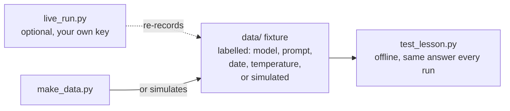

# AI for analysts

Use LLMs and agents for analysis, and measure, check and govern what they produce. The skill this phase teaches is not prompting. It is checking: grading a model's labels, testing the SQL it writes, and finding the numbers it made up, with the same care you would give a new colleague's work.

## Before you start

This phase assumes you can read and run a short Python file and read a SELECT with a JOIN. If you cannot yet, start with [Python for spreadsheet people](../00-start-here/06-python-for-spreadsheet-people/), [phase 01: SQL](../01-sql/) and [phase 05: Python for analysts](../05-python-for-analysts/). Lesson 01 also uses the margin of error from [Confidence interval by hand](../02-statistics-and-experiments/02-confidence-interval-by-hand/).

## Why an analyst needs this now

The evidence is in [2026-2027-ANALYTICS-SKILLS.md](../../2026-2027-ANALYTICS-SKILLS.md). In short:

- **AI is in the job description.** 45% of data and analytics postings on Indeed mentioned AI in December 2025, the highest of any sector ([Indeed Hiring Lab](https://hiringlab.indeed.com/2026/01/22/january-labor-market-update-jobs-mentioning-ai-are-growing-amid-broader-hiring-weakness/)). It is not yet in the job title: only 3.3% of the 9,044 analyst postings on the Real Analyst Jobs feed on 29 October 2026 had an AI word in the title.
- **The scarce skill is checking.** 72% of analytics engineers prioritise AI-assisted coding, and 71% name hallucinated output reaching stakeholders as a top concern ([dbt Labs, 2026 State of Analytics Engineering](https://www.getdbt.com/blog/new-dbt-labs-report-finds-ai-driven-acceleration-is-outpacing-trust-and-governance)). 66% of developers report AI answers that are almost right but not quite ([Stack Overflow 2025](https://survey.stackoverflow.co/2025/ai)).
- **Text-to-SQL is not solved on real data.** The best agent solved 21.3% of enterprise tasks in the [Spider 2.0 paper](https://arxiv.org/abs/2411.07763) (March 2025). Benchmark scores are a direction, not a promise on your database.

An analyst who can say "this output is right, this one is wrong, and here is how I know" is worth more than one who can only produce output faster.

## The course rule for AI lessons

**Tests run on recorded or simulated outputs that are labelled as such, never on live API calls.** A live call needs a network, a key and money, and it can give a different answer each time, so a test built on it cannot be trusted to mean the same thing twice.

- A **recorded** fixture is real model output saved to a file, labelled with the model name, the prompt version, the date and the temperature.
- A **simulated** fixture is made up by `make_data.py` to behave like model output, and says so in the README and next to the data. The three live lessons use simulated fixtures. Their numbers teach the method, not how good any real model is.
- A lesson may ship an optional `live_run.py` that re-records the fixture with the learner's own key. The test never calls it.

## Lessons

1. [Grade an LLM classifier](01-grade-an-llm-classifier/). Is the LLM good enough at spotting refund tickets that we can route them automatically? A confusion matrix, precision and recall, and a Wilson interval so the yes or no carries its margin of error.
2. [Check LLM-written SQL](02-check-llm-written-sql/). Which of the queries the LLM wrote can we trust? A read-only guard, then run and compare on two databases, so a query that is right by luck is caught.
3. [Catch made-up numbers](03-catch-made-up-numbers/). Every number in the AI-written summary: is it actually in the data? Extract, link to a metric, recompute and compare at the stated precision.
4. How LLMs work, for analysts *(planned)*. What is a token, what does a run cost, and why does the same prompt give different answers?
5. Prompt versions as experiments *(planned)*. Is prompt v2 better than v1 on the same 200 tickets?
6. Structured output you can load *(planned)*. Can we put the model's JSON straight into a table?
7. How big must an eval set be? *(planned)*. How many labelled examples do we need before we trust the score?
8. Human in the loop: confidence thresholds *(planned)*. How many tickets can we auto-route at 95% precision, and who reviews the rest?
9. LLM as judge, and judging the judge *(planned)*. Can a model grade answers, and does its grading agree with people?
10. Natural language to SQL, safely *(planned)*. Can we let people ask the database questions in English without breaking anything?
11. Keep personal data out of prompts *(planned)*. Is any customer's email or phone number about to leave the building?
12. RAG over the metrics glossary *(planned)*. Which definition of active user did the bot cite, and was it the right one?
13. An analytics agent loop from scratch *(planned)*. What does an agent actually do between your question and its answer?
14. Audit an agent's work *(planned)*. The agent says revenue grew 12%. Which step should we check, and was it right?
15. MCP for analysts *(planned)*. How does an assistant get safe, read-only access to your data?

Planned lessons are listed in [curriculum.json](../../curriculum.json) and get a link here when they are finished and pass their tests.
