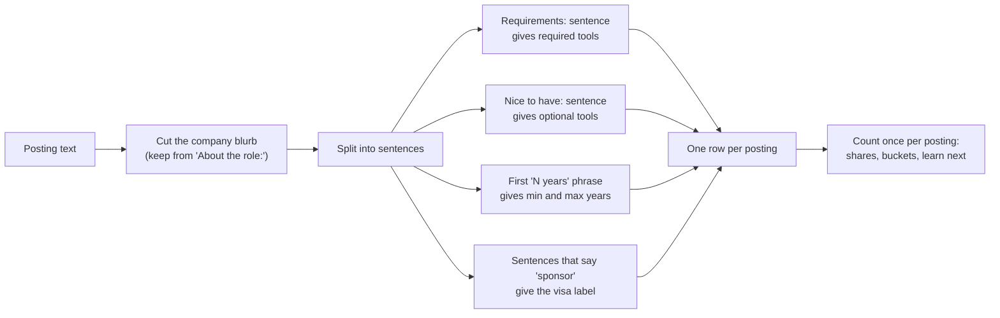
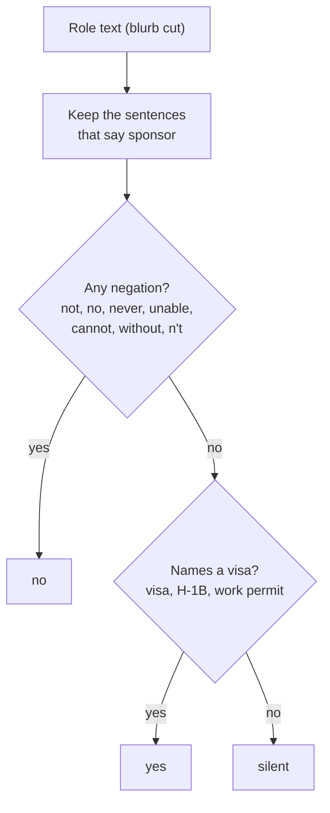

# Read job postings like data

Across 300 analyst job postings, which tools are required most, how much experience do they want, and what do they say about visa sponsorship?

## Before you start

- Level 1 (beginner). About 2 hours.
- You can run a Python file and read a short function: [00-06 Python for spreadsheet people](../../00-start-here/06-python-for-spreadsheet-people/).
- Regular expressions are introduced here from zero, and [05-01 Clean a messy CSV](../../05-python-for-analysts/01-clean-a-messy-csv/) uses them too if you want more practice.

## The problem

Priya is finishing a statistics degree and has eight weeks before graduate hiring starts. She knows SQL and Excel and wants to pick the next tool to learn, but every blog post gives a different answer. She saved 300 analyst postings from a job board into one file, and she needs visa sponsorship, so she also wants to know which postings are worth her time. You will treat those postings as a dataset: pull the tools, the years of experience and the visa line out of free text, count them, and tell Priya what to learn next with numbers behind it.

The file `data/postings.csv` is synthetic, generated by `make_data.py` with a fixed seed. Every company, title and sentence in it is invented. `data/labels.csv` holds what the generator put into each posting, so the tests can check your extractor against the truth. A real feed has no labels, which is why the extractor has to be right.

## In plain words

Think of 300 restaurant menus. You want to know which dish appears on most menus. You would not count how many times the word "biryani" is printed; you would tick each menu once if it serves biryani. You would also ignore the line at the top that says "Biryani House since 1985", because that is the restaurant's name, not a dish. And a dish under "Chef's specials, sometimes" is not the same as one on the main menu.

A job posting is the same. The company blurb at the top is the restaurant's name. "Requirements" is the main menu. "Nice to have" is the specials. Counting tools means ticking each posting once per tool, in the right part of the posting.

Words used in this lesson:

- **Free text**: writing in sentences, as opposed to a table with columns.
- **Extract**: pull one fact (a tool, a number of years, a visa answer) out of free text.
- **Regular expression (regex)**: a small pattern language for finding text. `\bSQL\b` means "the letters SQL as a whole word". `\b` is a **word boundary**: the edge between a letter and a space or punctuation.
- **False positive**: the extractor says yes and the truth is no. **False negative**: it says no and the truth is yes.
- **Visa sponsorship**: the employer applies for the work visa a foreign candidate needs.

## What you will build from scratch

- `TOOL_PATTERNS`: one regex per tool, safe against the classic false matches.
- `extract_tools`, `extract_asks`, `extract_years`, `visa_status`: turn one posting's text into fields.
- `skill_counts`: how many postings require each tool, and how many only list it as nice to have.
- `experience_buckets`: the experience distribution.
- `learn_next`: the most required tools you do not know yet.

## The idea

A posting is a document. To count anything you first turn each document into a row: the required tools, the nice to have tools, a minimum and maximum number of years, and one visa label. Counting is then easy:

    share(tool) = postings that require the tool / all postings

Count each tool once per posting. A posting that says SQL four times is one vote for SQL.



The hard part is extraction, and it fails in the same few ways every time:

1. **Boilerplate.** Postings start with a company blurb. "Our teams excel at service" contains the word excel, "for over 20 years" contains a number of years, and "We proudly sponsor the city marathon" contains the word sponsor. Cut the blurb off before you search. Here every posting has an `About the role:` marker, so `role_text` keeps the text from there on.
2. **Short names inside words.** The letter R is inside Reporting, and R&D is a department, not a language. Match R case sensitively, as a whole word, and not next to `&`: `(?<![\w&])R(?![\w&])`. `\b` does the same job for longer names: `\bSQL\b` matches "SQL" but not "SQLite".
3. **Spelling variants.** Power BI appears as Power BI, PowerBI and Power-BI. One pattern covers all three: `\bPower[\s-]?BI\b`. `[\s-]?` means "one space or one hyphen, or nothing".
4. **Required against nice to have.** A tool under "Nice to have" is not an ask. Count the two parts separately, and make decisions on the required count.
5. **Ranges and spellings of years.** "0 to 2 years" asks for zero years. A pattern that grabs the number right before "years" reads it as 2 and hides the entry level roles. Capture the low end and the high end. Postings also write "3-5 yrs" and "two years", and "a 2 year contract" is a contract length, not experience.
6. **Negation.** "We do not offer sponsorship" contains the word sponsor. So does "Sponsorship is not available". A list of refusal phrases ("unable to sponsor", "will not sponsor") is never complete, because people refuse in many ways.

For the visa label the costly mistake is a false "yes". A false "yes" sends Priya to apply for a role that will turn her down after weeks of interviews. A false "no" or "silent" only costs her a question to the recruiter. So the rule is built to say "yes" rarely:



Negation is checked first and wins. "We proudly sponsor local hackathons" says sponsor but names no visa, so it is silent, not yes.

## Walk through

Run these from the lesson folder.

Step 1. Look at one posting.

```python
import sys
sys.path.insert(0, "solution")
import solution as s

p = s.load_postings()[1]
print(p["text"])
print(s.extract_tools(p["text"]))
print(s.extract_asks(p["text"]))
print(s.extract_years(p["text"]), s.visa_status(p["text"]))
```

`sys.path.insert(0, "solution")` lets Python find the worked answer, and `import solution as s` loads it, so you can watch each function before you write your own. The last three lines print:

```
['Power BI', 'Python', 'SQL']
(['Python', 'SQL'], ['Power BI'])
(2, None) silent
```

"PowerBI" was caught, "excel at service" was not, and "40 years" in the blurb was not read as experience. Power BI is only a nice to have here, so it is not one of this posting's asks.

Step 2. See how much the tool traps cost on the whole file. `skill_counts(P, "any")` counts a tool named anywhere in the role text.

```python
import re, sys
sys.path.insert(0, "solution")
import solution as s

P = s.load_postings()
anywhere = s.skill_counts(P, "any")
print("excel anywhere:", sum(1 for p in P if re.search(r"\bexcel\b", p["text"], re.I)))
print("Excel in the role:", anywhere["Excel"])
print("plain \\bR\\b:", sum(1 for p in P if re.search(r"\bR\b", p["text"])))
print("R the language:", anywhere["R"])
print("exact 'Power BI':", sum(1 for p in P if "Power BI" in p["text"]))
print("Power BI any spelling:", anywhere["Power BI"])
naive = sum(1 for p in P if re.search(r"\b0\s*(?:to|-)\s*\d+ years", s.role_text(p["text"])))
print("ranges that start at 0:", naive)
```

| check | naive | correct |
|---|---|---|
| Excel | 300 | 120 |
| R | 98 | 43 |
| Power BI | 25 | 94 |

The naive Excel count is every posting, because every blurb says "excel at". The naive R count more than doubles R because of R&D. The exact string search misses most Power BI postings. On the ranges: 32 postings ask for 0 years at the low end ("0-2 years" or "0 to 2 years"), and a pattern that reads the last number before "years" would put all 32 in a higher bucket.

Step 3. Required against nice to have.

```python
import sys
sys.path.insert(0, "solution")
import solution as s

P = s.load_postings()
req, nice = s.skill_counts(P, "required"), s.skill_counts(P, "nice")
anywhere = s.skill_counts(P, "any")
for tool in sorted(anywhere, key=lambda t: (-anywhere[t], t)):
    print("%-9s any %3d  required %3d  nice %3d" % (tool, anywhere[tool], req.get(tool, 0), nice.get(tool, 0)))
print(s.experience_buckets(P))
```

| tool | named anywhere | required | nice to have only | required share |
|---|---|---|---|---|
| SQL | 222 | 222 | 0 | 74.0% |
| Python | 136 | 125 | 11 | 41.7% |
| Excel | 120 | 89 | 31 | 29.7% |
| Tableau | 101 | 47 | 54 | 15.7% |
| Power BI | 94 | 37 | 57 | 12.3% |
| R | 43 | 6 | 37 | 2.0% |
| Looker | 28 | 3 | 25 | 1.0% |
| dbt | 27 | 1 | 26 | 0.3% |

Counted anywhere, Tableau looks like a requirement in a third of postings (101 of 300). It is required in 47. More than half of its mentions are nice to haves. R drops from 43 to 6. The "named anywhere" column answers "what do postings mention"; the required column answers "what do employers insist on".

Experience by minimum years: 95 postings ask for 0 or 1, 93 for 2 or 3, 45 for 4 or 5, 22 for 6 or more, and 45 do not say.

Step 4. The visa trap. Here is the short list of refusal phrases many people write first, run on the whole file:

```python
import re, sys
sys.path.insert(0, "solution")
import solution as s

NAIVE_NO = re.compile(r"\b(?:unable to|cannot|can't|will not|won't|does not|do not|not able to)\s+sponsor"
                      r"|without (?:visa )?sponsorship|no (?:visa )?sponsorship", re.I)
NAIVE_YES = re.compile(r"\bsponsor", re.I)

def naive_visa(text):
    if NAIVE_NO.search(text):
        return "no"
    if NAIVE_YES.search(text):
        return "yes"
    return "silent"

P = s.load_postings()
naive_yes = [p for p in P if naive_visa(p["text"]) == "yes"]
careful = {}
for p in naive_yes:
    label = s.visa_status(p["text"])
    careful[label] = careful.get(label, 0) + 1
print("naive yes:", len(naive_yes), "careful label of those:", careful)
wrong = {x for p in naive_yes if s.visa_status(p["text"]) != "yes"
         for x in s.sentences(p["text"]) if "sponsor" in x.lower()}
for x in sorted(wrong):
    print(" ", x)
```

```
naive yes: 76 careful label of those: {'no': 20, 'silent': 32, 'yes': 24}
  Candidates must be authorized to work in India without the need for sponsorship.
  Candidates must be authorized to work in the US without the need for sponsorship.
  Sponsorship is not available for this role.
  We are not in a position to sponsor visas.
  We do not offer sponsorship.
  We proudly sponsor the city marathon every spring.
```

The naive version tells Priya 76 postings sponsor. Only 24 do. 20 of the 76 refuse in words the phrase list did not expect, and 32 are the marathon line in the company blurb. With the careful rule, the file has 244 silent postings, 32 refusals and 24 offers. Silence is not a yes. If you need sponsorship, the 24 are where to start and the 244 need a question to the recruiter.

The habit that catches this: print a sample of the "yes" rows and read them. A regex list is never complete, and reading 20 rows takes two minutes.

Step 5. Decide. Priya knows SQL and Excel.

```python
import sys
sys.path.insert(0, "solution")
import solution as s

P = s.load_postings()
print("by required:", s.learn_next(s.skill_counts(P, "required"), {"SQL", "Excel"}))
print("by any mention:", s.learn_next(s.skill_counts(P, "any"), {"SQL", "Excel"}))
```

Both print `['Python', 'Tableau']`. Python is required in 125 of 300 postings, far ahead of the rest. The BI tools are close and mostly nice to haves: Tableau is required in 47 and Power BI in 37. So the honest advice is: learn Python next, then one BI tool, and pick between Tableau and Power BI by the postings in the city or country you will apply to. The counts also show that 95 postings start at 0 or 1 year, so Priya should not skip postings that ask for "0 to 2 years".

## Common mistakes

- **Searching the company blurb.** Every naive Excel match in this file is "excel at" in a blurb (300 against 120), and 32 naive visa "yes" answers are a marathon sponsorship. Cut the blurb first.
- **A refusal list instead of a negation rule.** The phrase list in Step 4 reads 20 refusals as "yes", the most expensive error in the lesson. Check for any negation in a sentence that says sponsor, and say "yes" only when a visa is named and nothing is negated.
- **Counting nice to haves as asks.** Tableau goes from 47 required to 101 mentioned. Report both, and decide on the required count.
- **Reading the last number in a range.** "0 to 2 years" read as 2 hides 32 entry level postings.
- **Trusting the counts without reading rows.** Every pattern here was checked by printing matches. When a count surprises you, print five matching sentences before you explain it.

## Your turn

Open `exercise.py`. Write the patterns at the top, then fill in `extract_tools`, `extract_asks`, `extract_years`, `visa_status`, `skill_counts`, `experience_buckets` and `learn_next`. Then run, from this folder:

```
python3 test_lesson.py
```

The test checks your code on the committed file, on a second set of 300 postings built with another seed, and on refusal sentences that are not in either file. To see the reference solution pass: `CHECK_SOLUTION=1 python3 test_lesson.py`.

Once it passes, run `python3 exercise.py` and change the `known` set in `main` to your own tools.

Stretch: write five refusal sentences of your own, in the ways real postings phrase them, and run `visa_status` on each. If one comes back "yes", find the word your rule missed.

## Check yourself

1. Why count a tool once per posting instead of once per mention?
2. Your R count looks too high. What do you check first?
3. A posting says nothing about visas. How do you label it, and why not "yes"?
4. Why does the visa rule check negation before it checks for a visa word?

<details>
<summary>Answers</summary>

1. The question is how many employers want the tool. A posting that repeats SQL four times is still one employer. Counting mentions rewards long postings.
2. Print five matches with the text around them. Single letters match inside words (Reporting) and inside names (R&D), so the pattern needs case sensitivity and boundaries on both sides. Then check whether the matches are required or nice to have.
3. Silent. Silence means the posting does not answer the question, not that the employer sponsors. Most postings in this file are silent, so treating silence as yes would send a job seeker after hundreds of roles that may refuse.
4. Because a false "yes" is the expensive error. "We are not in a position to sponsor visas" names a visa and says sponsor, so a yes check that runs first would accept it. Letting any negation win means the rule can be wrong only in the cheap direction: a rare offer phrased with "no" becomes "no", and the job seeker asks.

</details>

## What to tell the stakeholder

"Priya, learn Python next: 125 of these 300 postings require it, against 47 for Tableau and 37 for Power BI, which are mostly listed as nice to have. For visas, only 24 postings offer sponsorship and 32 refuse; the other 244 say nothing clear, so ask those recruiters before you invest in an application. These are 300 postings you saved, not the whole market, and the visa rule says 'yes' only when a sentence names a visa and refuses nothing."

## In real job postings

In the Real Analyst Jobs data drop of 25 October 2026, of the 2,056 US analyst postings that list tools, 71.8% ask for SQL, 48.4% for Python, 36.0% for Tableau and 23.9% for Power BI; in India (900 postings that list tools) Power BI is at 38.9% and Tableau at 34.3% ([data/job-market/2026-10](../../../data/job-market/2026-10/)). The drop counts a tool when it is on the posting's tool list, with no split between required and nice to have, so read it like the "named anywhere" column above. On visas, the [visa sponsorship study](https://realanalystjobs.com/research/us-analyst-jobs-visa-sponsorship-2026) read 1,128 US analyst postings on 7 October 2026: 87% said nothing about sponsorship, 10% said no and 2.6% said they sponsor or will consider it. See the [US analyst jobs page](https://realanalystjobs.com/jobs/data-analyst-jobs-in-usa) and the [analyst job market report](https://realanalystjobs.com/analyst-job-market).

## Next

[02 SQL interview questions](../02-sql-interview-questions/)
