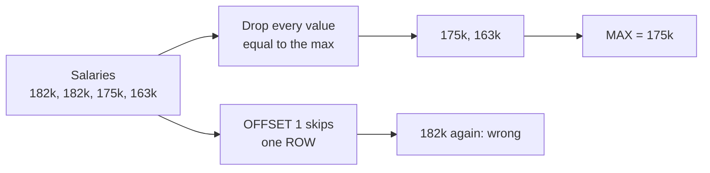
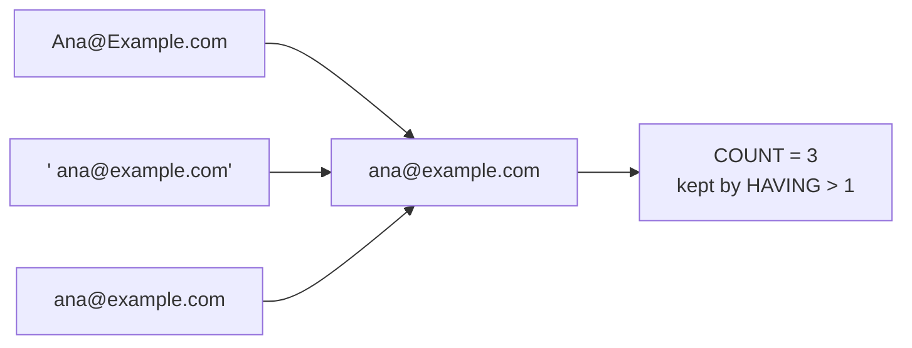
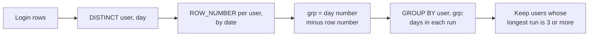
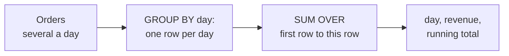
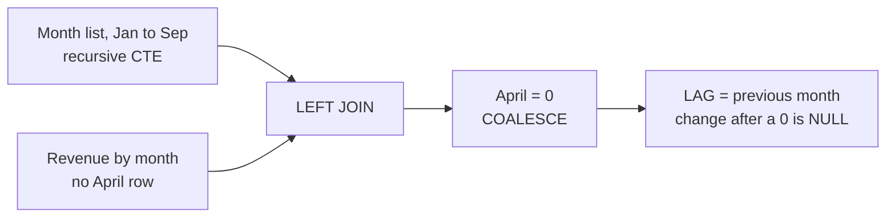

# SQL interview questions

Can you answer the six SQL questions that come up again and again in analyst interviews, and explain why the obvious answer is wrong?

## Before you start

- Level 2 (intermediate). About 2 hours.
- You can write GROUP BY, JOIN and a window function: [01-01 GROUP BY from raw rows](../../01-sql/01-group-by-from-raw-rows/), [01-02 Joins without losing rows](../../01-sql/02-joins-without-losing-rows/) and [01-03 Window functions](../../01-sql/03-window-functions/).
- New to SQL? Start with [00-04 Your first SQL query](../../00-start-here/04-your-first-sql-query/) and come back.

## The problem

Fernhill Software, a fictional company, runs a 45 minute SQL screen for every analyst candidate. Tomas, the analytics manager, uses the same six questions each time because each one has a wrong answer that looks right on a small table. You have an interview with him on Thursday. You get his four practice tables and write each answer as a named query, then check it against a test that knows the traps.

The files in `data/` are synthetic, generated by `make_data.py` with a fixed seed: 36 employees, 154 signups, 1,000 login rows and 285 orders. All names and emails are invented.

## In plain words

An interview SQL question is a small puzzle with one trap in it. The interviewer is not checking that you remember syntax. They are checking that you notice the trap before it gives a wrong number. Each of the six questions has an everyday version:

| Question | Everyday version | The trap |
|---|---|---|
| Second highest salary | Two runners tie for the fastest time. The second fastest time is the next different time, not the second runner's | Counting people instead of values |
| Duplicate emails | "Ana@Example.com" and " ana@example.com" on a guest list are one guest | Comparing the text exactly as typed |
| Three day streaks | A gym card stamped Monday, Tuesday and Wednesday is a streak; two stamps on Tuesday are still one day | Counting stamps instead of days |
| Top two per department | The top two batting averages per team, when two players tie | A ranking rule that drops or skips ties |
| Running total | The balance column on a bank statement | One line per payment instead of one per day |
| Month over month | This month's bill against last month's, when one month's bill is missing from the pile | Comparing with the previous bill instead of the previous month |

Words used in this lesson:

- **Window function**: a calculation over a group of rows that keeps every row, written with `OVER (...)`. `GROUP BY` squashes rows into one; a window does not.
- **PARTITION BY**: splits the rows into groups for a window, as `GROUP BY` does for a total.
- **CTE** (common table expression): a named step written `WITH name AS (...)`, so a long query reads top to bottom.
- **NULL**: "no value". It is not 0 and not an empty string.
- **LAG**: a window function that reads the value from the previous row.

## What you will build from scratch

- `second_highest_salary`: the second highest distinct value.
- `duplicate_emails`: rows that are the same person after cleaning.
- `three_day_streaks`: users active on 3 or more consecutive days (gaps and islands).
- `top_two_per_department`: top N per group with ties.
- `running_total`: a cumulative sum with a window function.
- `month_over_month`: change from the previous month, including a month with no data.

## The idea

Each question is one pattern. Learn the pattern and the trap, not the query.

### 1. Second highest

Remove the maximum, then take the maximum of what is left: `MAX(salary) WHERE salary < (SELECT MAX(salary) ...)`. The trap is `ORDER BY salary DESC LIMIT 1 OFFSET 1`, which returns the second row, and the second row is the top salary again when two people tie.



### 2. Duplicates

`GROUP BY key HAVING COUNT(*) > 1`. `HAVING` filters groups after they are counted, the way `WHERE` filters rows before. The trap is the key. `Ana@Example.com` and ` ana@example.com` are one person, so group by `LOWER(TRIM(email))`: `TRIM` removes spaces at both ends and `LOWER` makes every letter lower case.



### 3. Consecutive days (gaps and islands)

Number each user's distinct days in order. Inside a run of consecutive days, the date goes up by 1 and the row number goes up by 1, so `date - row_number` is the same for the whole run. Each run is an "island"; the missing days between runs are the "gaps". `julianday(date)` turns a date into a day number, so dates can be subtracted.

| day | row_number | julianday minus row_number |
|---|---|---|
| Oct 3 | 1 | constant A |
| Oct 4 | 2 | constant A |
| Oct 5 | 3 | constant A |
| Oct 9 | 4 | constant B (a new run) |



Group by that constant and count. The trap is duplicate days: two logins on Oct 4 add a row number without adding a day, which shifts the constant. Take `DISTINCT user_id, login_date` first.

### 4. Top N per group

Rank inside each group with a window function, then filter: `DENSE_RANK() OVER (PARTITION BY department ORDER BY salary DESC) <= 2`.

| salary | ROW_NUMBER | RANK | DENSE_RANK |
|---|---|---|---|
| 182,000 | 1 | 1 | 1 |
| 182,000 | 2 | 1 | 1 |
| 163,000 | 3 | 3 | 2 |

`ROW_NUMBER` gives tied people different numbers, and which of them gets 1 is arbitrary: it depends on the engine and can change between runs. `RANK` skips numbers after a tie (1, 1, 3), so `<= 2` returns no second level. `DENSE_RANK` gives 1, 1, 2. Say out loud which one the question means.

### 5. Running total

Aggregate to one row per day, then `SUM(revenue) OVER (ORDER BY order_date ROWS BETWEEN UNBOUNDED PRECEDING AND CURRENT ROW)`. That **frame** means "from the first row up to this one". The trap is running the window over order rows: you get one row per order, not per day.



### 6. Month over month

`LAG(revenue) OVER (ORDER BY month)` gives the previous row. The trap is that the previous row is not always the previous month. Fernhill had no orders in April 2026, so `GROUP BY month` has no April row and May is compared to March. Build the full list of months with a **recursive CTE** (a CTE that adds one row at a time until a condition stops it), `LEFT JOIN` the revenue to it, and fill missing months with 0. Divide by `NULLIF(prev, 0)`, which turns a 0 into NULL, so a zero month gives NULL instead of an error.



**SQLite note.** `julianday`, `strftime` and `substr` are SQLite functions. In PostgreSQL you would write `login_date - ROW_NUMBER() OVER (...) * INTERVAL '1 day'` for the island key, `generate_series` for the month list and `to_char(order_date, 'YYYY-MM')` for the month; BigQuery has `DATE_SUB`, `GENERATE_DATE_ARRAY` and `FORMAT_DATE`. The patterns are the same.

## Walk through

Each block below is one query you can run against the four tables. The test file has a `load_db()` helper that builds them in memory:

    python3 -c "import test_lesson as t; con = t.load_db(); print(con.execute('SELECT COUNT(*) FROM orders').fetchall())"

That prints `[(285,)]`. Swap in any query from this page.

Step 1. The tie that breaks `OFFSET`.

```sql
SELECT salary FROM employees ORDER BY salary DESC LIMIT 3;
```

It returns 182,000, 182,000 and 175,000. `LIMIT 1 OFFSET 1` gives 182,000. The answer is 175,000.

Step 2. Duplicates before and after cleaning.

```sql
SELECT
  (SELECT COUNT(*) FROM (SELECT email FROM signups GROUP BY email HAVING COUNT(*) > 1)) AS raw_dups,
  (SELECT COUNT(*) FROM (SELECT LOWER(TRIM(email)) FROM signups GROUP BY 1 HAVING COUNT(*) > 1)) AS clean_dups;
```

Grouping by the raw email finds 2 duplicated people. Grouping by the cleaned email finds 14. There are 154 signup rows from 140 people.

Step 3. Islands, with and without `DISTINCT`.

```sql
WITH raw AS (
  SELECT user_id, julianday(login_date) - ROW_NUMBER() OVER (PARTITION BY user_id ORDER BY login_date) AS grp
  FROM logins
),
dedup AS (
  SELECT user_id, julianday(login_date) - ROW_NUMBER() OVER (PARTITION BY user_id ORDER BY login_date) AS grp
  FROM (SELECT DISTINCT user_id, login_date FROM logins)
)
SELECT
  (SELECT COUNT(DISTINCT user_id) FROM (SELECT user_id FROM raw GROUP BY user_id, grp HAVING COUNT(*) >= 3)) AS raw_users,
  (SELECT COUNT(DISTINCT user_id) FROM (SELECT user_id FROM dedup GROUP BY user_id, grp HAVING COUNT(*) >= 3)) AS distinct_users;
```

Without `DISTINCT` the islands are wrong in both directions. A repeated day adds a row number without a day, so it can split a real run, or fill a one day gap and join two short runs into a fake one (days 5, 6, 8 and 8 give the same `grp` to 5, 6 and the second 8). Here 34 users pass the raw version. The right answer is 29.

A second wrong answer counts logins in a 3 day window. User 41 logged in twice on 5 October and twice on 6 October, so the window holds 4 logins and the user looks like a 3 day streak, but it is only 2 days:

```sql
SELECT user_id, login_date,
       COUNT(*) OVER (PARTITION BY user_id ORDER BY julianday(login_date)
                      RANGE BETWEEN 2 PRECEDING AND CURRENT ROW) AS logins_in_3_days
FROM logins
WHERE user_id = 41
ORDER BY login_date;
```

Both 6 October rows show `logins_in_3_days` = 4.

Step 4. Ranking functions side by side, in the Marketing department where two people share the top salary.

```sql
SELECT name, salary,
       ROW_NUMBER() OVER (ORDER BY salary DESC) AS row_num,
       RANK()       OVER (ORDER BY salary DESC) AS rnk,
       DENSE_RANK() OVER (ORDER BY salary DESC) AS dense
FROM employees
WHERE department = 'Marketing'
ORDER BY salary DESC
LIMIT 4;
```

Two people earn 182,000 and Quinn Hart earns 163,000. `ROW_NUMBER <= 2` returns the two top earners and no one else. `RANK <= 2` does the same, because Quinn's rank is 3. `DENSE_RANK <= 2` returns all three. In Finance two people share second place at 162,000, and `DENSE_RANK` keeps both.

Step 5. The running total, by order row and by day.

```sql
SELECT COUNT(*) AS order_rows, COUNT(DISTINCT order_date) AS days
FROM orders
WHERE order_date BETWEEN '2026-09-01' AND '2026-09-30';
```

September has 40 order rows on 20 days. A window over the order rows returns 40 rows, three of them for 1 September alone. Group to one row per day first and the result has 20 rows: 1 September is 603.81, and by 3 September the running total is 1,424.30.

Step 6. The month over month trap.

```sql
WITH m AS (SELECT substr(order_date, 1, 7) AS month, ROUND(SUM(amount), 2) AS revenue FROM orders GROUP BY 1)
SELECT month, revenue, LAG(revenue) OVER (ORDER BY month) AS prev_revenue FROM m
WHERE month BETWEEN '2026-03' AND '2026-06';
```

There is no April row. May (7,801.40) is compared to March (8,973.21) and shows a 13.1% fall. With April filled in as 0, April shows a 100% fall and May has no percentage, because growth from zero is undefined. Both are more honest than a fake month over month number.

## Common mistakes

- **`LIMIT 1 OFFSET 1` for second highest.** On this table it returns 182,000, the top salary, instead of 175,000.
- **Grouping emails as typed.** 2 duplicated people instead of 14.
- **Islands without `DISTINCT`.** 34 streak users instead of 29.
- **`RANK` or `ROW_NUMBER` for "the top two salary levels".** Both return two Marketing people; `DENSE_RANK` returns three, because two share the top.
- **A running total over order rows.** 40 rows for 20 days.
- **`LAG` without a month list.** May compared to March, a 13.1% fall between months that are not neighbours.
- **Hard coding the answer.** Typing the expected rows into a `VALUES (...)` list passes on one table and fails on the next. The test runs your queries on a second dataset built with another seed, and on tiny hand-made tables, for this reason.

## Your turn

Open `exercise.sql` and write the six queries under their markers. Then run, from this folder:

    python3 test_lesson.py

The test runs each query on the committed data, on a second dataset, and on tiny tables for the edge cases: everyone earning the same salary, a tie at the top, duplicate login days, a single September day and a month with zero revenue. To see the reference solution pass: `CHECK_SOLUTION=1 python3 test_lesson.py`. The worked answers are in `solution/solution.sql`; try each one yourself before you open it.

Stretch: say each answer out loud in under a minute: the pattern, the trap, and how you would check the result. For more practice, try the [SQL case study](https://realanalystjobs.com/tools/sql-case-study).

## Check yourself

1. Your second highest salary query must return NULL when everyone earns the same. Does the `MAX ... WHERE salary <` version do that?
2. When would you use `ROW_NUMBER` instead of `DENSE_RANK` for top N per group?
3. Why does `julianday(login_date) - ROW_NUMBER()` stay constant inside a streak?
4. An interviewer asks for a 7 day rolling sum of revenue. What changes from the running total?

<details>
<summary>Answers</summary>

1. Yes. The subquery returns the maximum, no row is below it, and `MAX` of no rows is NULL. `LIMIT 1 OFFSET 1` would return the same top salary again, or no row at all on a one row table. The test checks this case.
2. When you need exactly N rows per group, for example one sample row per customer, and ties do not matter. Break ties with a second sort column so the result is the same on every run.
3. Each next day in a streak adds 1 to the date and 1 to the row number, so the difference does not change. A gap adds more than 1 to the date but still 1 to the row number, so the difference jumps and a new group starts.
4. The frame. A running total uses `ROWS BETWEEN UNBOUNDED PRECEDING AND CURRENT ROW`. A 7 day rolling sum over daily rows uses `ROWS BETWEEN 6 PRECEDING AND CURRENT ROW`, and only if every day has a row. If days can be missing, fill them first, or use a `RANGE` frame on the date number.

</details>

## What to tell the stakeholder

In an interview the stakeholder is the interviewer, and the sentence is the one you say after the query runs: "The second highest distinct salary is 175,000. I took the maximum below the maximum rather than using OFFSET, because two people share 182,000, and the query returns NULL if everyone earns the same." Give the number, the pattern, and the trap you avoided.

## In real job postings

In the Real Analyst Jobs data drop of 25 October 2026, 71.8% of the 2,056 US analyst postings that list tools ask for SQL, and so do 70.4% of the 900 India postings that list tools ([data/job-market/2026-10](../../../data/job-market/2026-10/)). SQL is the most requested tool in both. See [SQL data analyst jobs](https://realanalystjobs.com/jobs/sql-data-analyst-jobs), and worked answers to more questions on the [data analyst interview questions](https://realanalystjobs.com/tools/data-analyst-interview-questions) page.

## Next

[03 Portfolio project end to end](../03-portfolio-project-end-to-end/)
