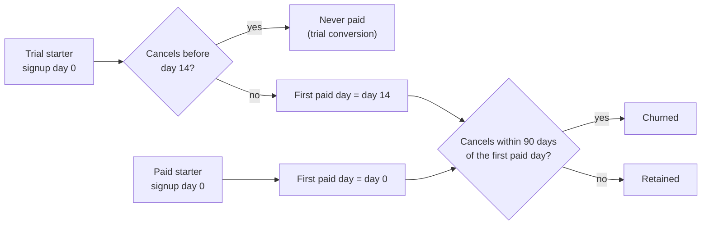
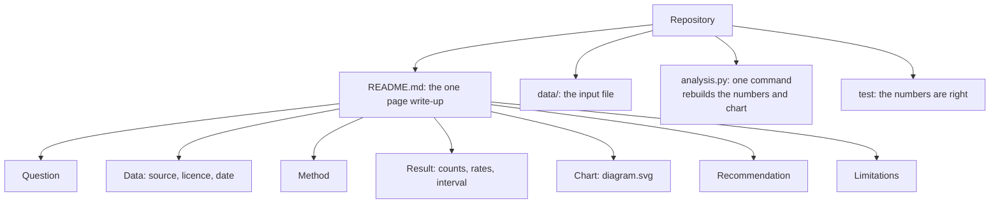
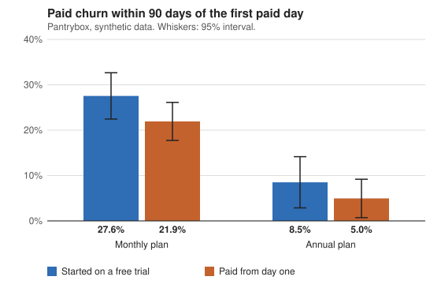

# Portfolio project end to end

Do customers who start on a free trial cancel within 90 days more often than customers who pay from day one?

## Before you start

- Level 2 (intermediate). About 2 hours.
- You can compare two rates with a z test: [02-03 A/B test from scratch](../../02-statistics-and-experiments/03-ab-test-from-scratch/).
- You know why a recent customer cannot be counted as retained yet: [01-04 Cohort retention](../../01-sql/04-cohort-retention/).
- The chart uses the same idea as [04-04 Draw a chart from scratch](../../04-dashboards/04-draw-a-chart-from-scratch/): an SVG file is text you can write with Python.

## The problem

Pantrybox, a fictional meal kit subscription, offers a 14 day free trial. Joanna, the head of growth, thinks trial customers leave faster and wants to know before the 2027 budget review on 6 November. You have one table of 1,400 customers, as of 1 October 2026. You will do the whole case the way a portfolio project should look: a clear question, a SQL pull, a comparison with a significance test you write yourself, a chart, and a one page write-up that the script generates. This is the shape a hiring manager wants to see: a question someone cares about, an honest method, and a recommendation with its limits.

The file `data/subscriptions.csv` is synthetic, generated by `make_data.py` with a fixed seed. Pantrybox and its customers are invented.

## In plain words

Think of a gym that offers a free first fortnight. Some people try it and never sign up. Others sign up and quit after a few months. Both are "people who left", but they are different problems. The first is a sales problem: the free fortnight did not convince them. The second is a service problem: they paid and were not happy. If you lump them together, the free fortnight looks terrible, because it is the only door that people who never paid come through.

Joanna's question has the same two parts. So the analysis answers it in two numbers: how many trial starters never paid, and, among people who did pay, whether trial starters cancel sooner.

Words used in this lesson:

- **Churn**: a paying customer cancelling. Here, cancelling within 90 days of the **first paid day**.
- **Trial conversion**: the share of trial starters who reach their first paid day.
- **Censoring**: a customer whose outcome is not known yet, because not enough time has passed.
- **Observational comparison**: comparing groups that chose themselves, as opposed to an **experiment**, where a coin flip decides who gets what.
- **Confidence interval (CI)**: a range of values for the true gap that the data is consistent with.

## What you will build from scratch

- `CONVERSION_SQL`: trial starters who had the whole trial, and how many cancelled inside it.
- `CHURN_SQL`: paying customers and 90 day cancellations, counted from the first paid day, by plan and start type.
- `two_proportion_test`: a z test and a 95% confidence interval for the gap between two rates.
- `write_up`: a markdown page with Question, Data, Method, Result, Recommendation and Limitations, and the chart.

## The idea

**Separate the two events.** A trial starter's first charge is on day 14. A cancel before day 14 means the customer never paid: that is a trial that did not convert, not churn. A cancel after it is churn. A paid starter's first paid day is the signup day.



**Define churn so everyone has the same chance.** "Cancelled within 90 days of the first paid day" is only fair for customers whose first paid day is at least 90 days before the data date. A customer who started paying last week has not had time to cancel, and counting them as retained makes churn look lower. So the query keeps only customers with 90 paid days of history.

**SQLite note.** The queries count days with `julianday(a) - julianday(b)`, which is SQLite. In PostgreSQL `a - b` on two dates gives days directly, and in BigQuery it is `DATE_DIFF(a, b, DAY)`.

**Compare two proportions.** Trial churn is p1 = x1 / n1, paid churn is p2 = x2 / n2. Under the null hypothesis that both groups churn at the same rate, the best estimate of that shared rate is the pooled rate:

    p_pool = (x1 + x2) / (n1 + n2)
    se_pool = sqrt(p_pool * (1 - p_pool) * (1/n1 + 1/n2))
    z = (p1 - p2) / se_pool

For a two sided test, the p value is the chance of a z at least this far from 0 in either direction under a standard normal: `p = erfc(|z| / sqrt(2))`. The `math` module has `erfc`, so no stats library is needed. If nobody churned in either group, `se_pool` is 0; there is no evidence of a gap, so return z = 0 and p = 1.

For the confidence interval you do not assume the rates are equal, so you use the unpooled standard error:

    se = sqrt(p1 * (1 - p1) / n1 + p2 * (1 - p2) / n2)
    95% CI = (p1 - p2) +/- 1.96 * se

**Write for the reader.** A hiring manager reads the question, skips to the result, looks at the chart, and then reads the limitations to see whether you understand what the numbers cannot say. Put the counts next to the rates, so the reader can see the sample size. A portfolio project is a small repository with this shape:



## Walk through

Run these from the lesson folder.

Step 1. The trap: one "churn" number that mixes two events.

```python
import sys
sys.path.insert(0, "solution")
import solution as s

con = s.load_db()
mixed = """SELECT start_type, COUNT(*),
       SUM(cancel_date IS NOT NULL AND julianday(cancel_date) - julianday(signup_date) <= 90)
       FROM subscriptions WHERE julianday('2026-10-01') - julianday(signup_date) >= 90
       GROUP BY start_type ORDER BY start_type"""
print("cancel within 90 days of signup:", con.execute(mixed).fetchall())
print("trial starters, never paid:", s.conversion(con))
print("paid churn:", s.by_start(s.pull(con)))
```

`sys.path.insert(0, "solution")` lets Python find the worked answer and `import solution as s` loads it, so you can run each step before you write your own. It prints:

```
cancel within 90 days of signup: [('paid', 475, 87), ('trial', 593, 248)]
trial starters, never paid: (779, 224)
paid churn: {'paid': (475, 87), 'trial': (388, 89)}
```

Counted from signup, trial starters "churn" at 248 of 593 (41.8%) against 87 of 475 (18.3%) for paid starters: a 23.5 point gap. But 224 of 779 trial starters (28.8%) cancelled inside the free trial and never paid. Among customers who did pay, trial converters churned at 89 of 388 (22.9%) and paid starters at 87 of 475 (18.3%). Most of the headline gap is trials that did not convert.

Step 2. The second trap: customers who have not had 90 paid days yet.

```python
import sys
sys.path.insert(0, "solution")
import solution as s

con = s.load_db()
everyone = s.CHURN_SQL.replace("WHERE julianday(:as_of) - first_paid >= :window", "")
rows = con.execute(everyone, s.PARAMS).fetchall()
print("everyone:", s.by_start({(p, t): (n, c) for p, t, n, c in rows}))
print("90 paid days of history:", s.by_start(s.pull(con)))
```

With every paying customer, trial converters churn at 125 of 555 (22.5%) and paid starters at 108 of 621 (17.4%). With only customers who had 90 paid days, it is 89 of 388 (22.9%) and 87 of 475 (18.3%). Both rates were too low, because recent customers were counted as staying when their outcome is not known.

Step 3. The test.

```python
import sys
sys.path.insert(0, "solution")
import solution as s

g = s.by_start(s.pull(s.load_db()))
t = s.two_proportion_test(g["trial"][1], g["trial"][0], g["paid"][1], g["paid"][0])
print({k: round(v, 4) for k, v in t.items()})
```

The paid churn gap is 4.6 percentage points, z is 1.68 and the p value is 0.0936. The 95% interval for the gap is -0.8 to 10.1 points. The interval is more useful than the p value: the gap could be zero, or as large as 10 points. This data cannot tell those apart.

Step 4. A check a careful analyst adds. Plan also drives churn, so compare within each plan.

```python
import sys
sys.path.insert(0, "solution")
import solution as s

for key, (n, c) in sorted(s.pull(s.load_db()).items()):
    print(key, "%d of %d" % (c, n), s.pct(c / n))
```

Monthly: trial 81 of 294 (27.6%), paid 82 of 374 (21.9%). Annual: trial 8 of 94 (8.5%), paid 5 of 101 (5.0%). The gap points the same way inside both plans, so plan mix does not explain it. The annual groups are small, so their rates are less certain.



Step 5. Generate the page and the chart.

```
python3 solution/solution.py > writeup.md
```

This writes `diagram.svg`, the chart above, and the one page write-up. `churn_chart_svg` draws the chart with plain string formatting: a `<rect>` per bar, a `<line>` per whisker, and a `<title>` on each bar with its rate and counts. Put the page and the chart at the top of your project's repository. The recommendation does not say "remove the trial". The clear loss is the 28.8% of trial starters who never pay, so the next step is work on trial conversion, and an A/B test before changing the trial itself.

## Common mistakes

- **One churn number for two events.** Counting from signup puts trial churn at 41.8% against 18.3%. Among paying customers it is 22.9% against 18.3%. The difference is the 224 trial starters who never paid.
- **Counting customers whose outcome is not known.** Without the 90 day history filter, both paid churn rates come out lower (22.5% and 17.4%).
- **Reading a small p value, or a large one, as the answer.** Here p is 0.0936, and the interval of -0.8 to 10.1 points is what tells Joanna how big the gap could be.
- **Saying the trial causes churn.** Customers chose how to start. Trial starters may differ from paid starters in ways the table does not show.
- **A portfolio page with no chart, or a chart with no counts.** The reader needs both the picture and the sample size.

## Your turn

Open `exercise.py`. Write `CONVERSION_SQL` and `CHURN_SQL`, then fill in `two_proportion_test` and `write_up`. Then run, from this folder:

```
python3 test_lesson.py
```

The test checks your queries on the committed data, on a second dataset built with another seed, and on tiny tables that sit on the boundaries: a cancel on day 13 and on day 14 of the trial, on day 90 and day 91 of the paid window. To see the reference solution pass: `CHECK_SOLUTION=1 python3 test_lesson.py`. Once yours passes, `python3 exercise.py` prints your write-up and draws your chart to `my_diagram.svg`.

Then make it yours. A hiring manager recognises course datasets, so pick your own:

1. Find a dataset whose licence says public domain or CC0, and write the licence and the download date in your Data section. Check the licence on each dataset you use; an open data portal can hold datasets under different licences.
2. Ask one question someone would pay to have answered, with a number as the answer.
3. Lay the repository out as in the diagram above: the write-up as `README.md`, the data in `data/`, and one command that rebuilds every number and the chart.
4. Keep all six sections and the chart.

When you describe the project on your resume, the [resume bullet builder](https://realanalystjobs.com/tools/resume-bullet-builder) helps you turn it into one line with a number.

## Check yourself

1. Why is a trial starter who cancels on day 5 not counted as churn?
2. Why use the pooled rate for the z test but not for the confidence interval?
3. The p value is 0.09. What do you tell Joanna about the trial and paid churn?
4. A hiring manager has two minutes. Which two sections do they read?

<details>
<summary>Answers</summary>

1. They never paid. Churn is a paying customer leaving; a trial that does not convert is a different event with a different fix (onboarding and the trial offer, not the paid product). Mixing them makes the trial group look much worse than its paying customers are.
2. The test asks what happens if the two rates are equal, so it estimates one shared rate. The interval describes the real gap, so it uses each group's own rate.
3. That once customers pay, trial converters churn 4.6 points more in this data, but the interval runs from -0.8 to 10.1 points, so it could be no gap at all. The clear finding is that 28.8% of trial starters never pay. Even a clear gap would not prove the trial causes it, because customers chose how to start.
4. Usually the result and the limitations. The result shows you can get to a number; the limitations show you know what the number does not prove.

</details>

## What to tell the stakeholder

"Joanna, the trial's problem is conversion, not churn: 224 of 779 trial starters (28.8%) cancel inside the 14 days and never pay. Once customers pay, trial converters cancel within 90 days at 22.9% against 18.3% for paid starters, but that 4.6 point gap could be anywhere from -0.8 to 10.1 points, so it is not a reason to cut the trial. Customers chose how to start, so test any change to the trial with an A/B test before the budget depends on it."

## In real job postings

In the Real Analyst Jobs data drop of 25 October 2026, 375 of the 2,789 US analyst postings (13.4%) are labelled entry level ([data/job-market/2026-10](../../../data/job-market/2026-10/), `by_country_seniority.csv`), so most junior candidates compete for a small share of roles, and a finished project with a clear write-up is evidence you can do the job. See the [US analyst jobs page](https://realanalystjobs.com/jobs/data-analyst-jobs-in-usa), and the [SQL case study](https://realanalystjobs.com/tools/sql-case-study) and [how to become a data analyst](https://realanalystjobs.com/tools/how-to-become-a-data-analyst) pages for more on building one.

## Next

[04 Match your resume to a posting](../04-match-your-resume-to-a-posting/)
