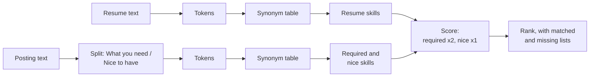

# Match your resume to a posting

Of five open roles, which ones fit this resume best, and which missing skills stand between the candidate and the rest?

## Before you start

- Level 1 (beginner). About 2 hours.
- You can run a Python file and read a short function: [00-06 Python for spreadsheet people](../../00-start-here/06-python-for-spreadsheet-people/).
- [01 Read job postings like data](../01-read-job-postings-like-data/) shows the same traps (R&D, PowerBI, required against nice to have) with regular expressions. This lesson solves them a second way, with tokens.

## The problem

Maya is a junior analyst in Pune with one internship and one project. She has five postings open in browser tabs and time to write two strong applications this week. She wants to know which two match her best and, for the others, what is missing. You will build a matcher from scratch: split text into tokens, map the many spellings of a skill to one name, weight the required skills above the nice to haves, and rank the five postings with the matched and missing skills next to each score.

The files `data/resume.txt` and `data/postings.csv` are synthetic, written by `make_data.py`. Maya, her internship and all five companies are invented.

## In plain words

Think of a shopping list against a shop's shelves. You tick off each item the shop has. "Coriander" and "cilantro" are the same herb, so you treat them as one item. Milk and bread matter more than the chocolate you would like, so a shop that has milk and bread but no chocolate is a better trip than one with only chocolate. And the useful output is not "this shop scores 60" but "this shop has no bread".

A posting is the shop's list of what it wants; the resume is what Maya has. The matcher ticks off the skills, treats spellings of one skill as one, counts required skills double, and reports what is missing.

Words used in this lesson:

- **Token**: one word after the text is split up and lower cased. "Power-BI" becomes the two tokens `power` and `bi`.
- **Substring**: any run of letters inside a longer text. "r" is a substring of "reporting".
- **Synonym table**: a dictionary from one **canonical** (standard) name to all the ways people write it.
- **Weight**: how much one item counts towards the score.

## What you will build from scratch

- `tokenize`: lower case word tokens that keep `a/b` and `r&d` whole.
- `extract_skills`: canonical skill names from text, through a synonym table.
- `score`: a weighted match score with matched and missing lists.
- `rank`: the five postings, best first.

## The idea



**Tokens, not substrings.** Searching for `"r"` inside the text finds it in nearly every word. Split the text into tokens first, then compare whole tokens. The pattern `[a-z0-9]+(?:[/+#&][a-z0-9]+)*` reads as "letters and digits, optionally joined to more letters and digits by one of `/ + # &`". It keeps `a/b` and `r&d` as single tokens, so "R&D" never looks like the R language, and "Reporting" is the token `reporting`, not `r`.

**Normalize synonyms.** People write PowerBI, Power BI and Power-BI. They write PostgreSQL when the posting says SQL, and pandas when it says Python. A synonym table maps every form to one canonical name. Multi word forms are matched as runs of tokens: join the tokens with spaces, pad both ends, and look for `" power bi "`. "Power-BI" tokenizes to `power bi`, so it matches without its own entry.

**Weight what the posting needs.** Missing a required skill hurts more than missing a nice to have. With required skills R and nice to haves N, and your skills S:

    score = 100 * (2 * |R and S| + 1 * |N and S|) / (2 * |R| + |N|)

`|R and S|` means "how many required skills you have". The weight 2 is a choice, not a law. What matters is that it is above 1 and that you use the same weights for every posting so the scores compare. A posting that names no skills scores 0, so the code never divides by zero.

**Report the gaps, not just the score.** A score of 60 says little. "Missing: Tableau" tells Maya what to learn or what to explain in a cover letter.

## Walk through

Run these from the lesson folder.

Step 1. Tokens.

```python
import sys
sys.path.insert(0, "solution")
import solution as s

print(s.tokenize("Power-BI, A/B tests and our R&D team. Reporting to the CFO."))
print(sorted(s.extract_skills("Power-BI, A/B tests and our R&D team. Reporting to the CFO.")))
```

`sys.path.insert(0, "solution")` lets Python find the worked answer, and `import solution as s` loads it. It prints:

```
['power', 'bi', 'a/b', 'tests', 'and', 'our', 'r&d', 'team', 'reporting', 'to', 'the', 'cfo']
['a/b testing', 'power bi']
```

The skills are `a/b testing` and `power bi`. No R.

Step 2. What the synonym table is worth.

```python
import sys
sys.path.insert(0, "solution")
import solution as s

resume, postings = s.load()
print("with synonyms:", sorted(s.extract_skills(resume)))
s.SYNONYMS = {k: [k] for k in s.SYNONYMS}
print("exact names only:", sorted(s.extract_skills(resume)))
for pid, r in s.rank(resume, postings):
    print(pid, r["score"])
```

The fourth line replaces every synonym list with just the canonical name, to see what happens without the table. With synonyms, Maya's resume has 7 skills. With exact names only it has 4: PowerBI, A/B tests and GA4 are lost. The marketing role at Elmstead Media (P4) falls from 100.0 to 42.9, though it asks for exactly what she has.

Step 3. Rank.

```python
import sys
sys.path.insert(0, "solution")
import solution as s

s.main()
```

| posting | role | score | missing required | missing nice to have |
|---|---|---|---|---|
| P1 | Data Analyst, Brightmoor Retail | 100.0 | none | none |
| P4 | Marketing Analyst, Elmstead Media | 100.0 | none | none |
| P2 | Product Analyst, Calloway Health | 60.0 | tableau | dbt, looker |
| P3 | Risk Analyst, Darnell Bank | 60.0 | sas | machine learning, r |
| P5 | Senior Data Analyst, Fairhaven Logistics | 50.0 | dbt, looker, snowflake | none |

P2 and P3 tie at 60.0 and each misses one required skill, so the tie is broken by posting id.

**Why this is a starting point and not the whole story.** Keyword matching sees words, not meaning. It cannot tell "used Tableau once" from "built and owned the Tableau reporting layer". It ignores level: P5 is senior and the score does not know. It only knows the synonyms you gave it, so a skill written a new way is a miss. And a person reads the resume after any screen. Use the missing list to decide what to learn and which true experience to describe in the posting's own words. Do not paste in skills you do not have: an interviewer will ask about them.

**Screening in 2026: meaning, not only keywords.** Many hiring tools no longer stop at keyword lists. Some use **semantic matching**: each text is turned into a list of numbers (an **embedding**) so that texts with similar meaning sit close together, which can relate "built BI dashboards" to a posting that asks for Power BI. Some use a large language model (LLM) to read the resume against the posting and write a judgment or a score. What that means for you, without guessing at how any one employer configures its tools:

- Synonyms matter less to those tools, and evidence matters more. "Built a PowerBI dashboard for late deliveries used by 30 depot managers" says the skill and what it did; a bare list of tool names says less.
- These tools can be wrong in ways a keyword list is not: they can read meaning that is not there, give different answers on different runs, and repeat biases in the data they learned from. New York City requires bias audits of automated hiring tools (Local Law 144), and the EU AI Act treats AI used to screen job applicants as high risk.
- Hidden keywords in white text, or instructions to the screening model written into the resume, are dishonest, and a human reviewer who finds them will reject the application.
- Many employers still use keyword filters, and a person still decides. The keyword matcher in this lesson remains a good way to see your own gaps.

## Common mistakes

- **Matching substrings.** "r" is inside "reporting" and "R&D", so a substring search finds the R language in almost every posting. Tokenize first.
- **No synonym table.** Without it Maya's resume loses 3 of 7 skills, and P4 drops from 100.0 to 42.9.
- **Equal weights.** A posting where you have only the nice to haves then ranks as high as one where you have every requirement.
- **Reading the score without the missing list.** P2 and P3 both score 60.0; one needs Tableau, which is close to Power BI, and the other needs SAS.
- **Treating 100 as "you will get an interview".** The score knows nothing of level, years, location or visa status.

## Your turn

Open `exercise.py` and fill in `tokenize`, `extract_skills`, `score` and `rank`. Then run, from this folder:

```
python3 test_lesson.py
```

The test checks your code on the committed files, on three generated resumes and postings that spell skills in other ways, and on edge cases: empty text, an empty resume, a posting with only nice to haves, and ties in the ranking. To see the reference solution pass: `CHECK_SOLUTION=1 python3 test_lesson.py`.

Then put your own resume in `data/resume.txt` and paste five real postings into `data/postings.csv`, each with a `What you need:` and a `Nice to have:` part. Add the synonyms your field uses. To compare with a ready-made tool, try the [resume job matcher](https://realanalystjobs.com/tools/resume-job-matcher), and use the [analyst skills checklist](https://realanalystjobs.com/tools/analyst-skills-checklist) to plan what to learn.

## Check yourself

1. Why tokenize before matching instead of searching for substrings?
2. A posting says "PowerBI" and your resume says "Power BI". What makes them match here?
3. Why weight required skills above nice to haves?
4. Your score is 100 for a role. Does that mean you should get an interview?

<details>
<summary>Answers</summary>

1. Substrings match inside other words: "r" is inside almost everything, "sql" is inside "nosql". Whole tokens only match whole words, and the tokenizer decides what a word is, for example keeping `a/b` and `r&d` together.
2. The synonym table maps both `powerbi` and `power bi` to the canonical name `power bi`, and "Power-BI" splits into the same two tokens.
3. A missing requirement often ends the application; a missing nice to have rarely does. Equal weights would rank a posting where you have only the extras above one where you have every requirement.
4. No. It means the words line up. Level, years, location, visa status and how well your experience shows the skill all matter, and none of them is in the score.

</details>

## What to tell the stakeholder

"Maya, apply to P1 at Brightmoor Retail and P4 at Elmstead Media this week: you have every required and nice to have skill in both. P2 at Calloway Health needs Tableau; you know Power BI, which is close, so a sentence in the cover letter and a small Tableau dashboard would answer it. P5 is a senior role missing three required tools, so it is the weakest fit. The score only compares words, so read each posting for level and location before you apply."

## In real job postings

In the Real Analyst Jobs data drop of 25 October 2026, of the 2,056 US analyst postings that list tools, 71.8% ask for SQL and 23.9% for Power BI, while in India (900 postings that list tools) Power BI is at 38.9% ([data/job-market/2026-10](../../../data/job-market/2026-10/)). The same resume can match very differently by market, so score it against the roles you will actually apply to. Browse [Python data analyst jobs](https://realanalystjobs.com/jobs/python-data-analyst-jobs) or [SQL data analyst jobs](https://realanalystjobs.com/jobs/sql-data-analyst-jobs) to pick five.

## Next

This is the last live lesson in [Getting hired](../). You have written SQL, statistics, metrics, dashboards, Python and AI workflows by hand, and now you can read the job market like data and show your work. The [learning roadmap](../../../LEARNING_ROADMAP.md) lists the lessons still to come, and [Real Analyst Jobs](https://realanalystjobs.com) lists live analyst roles.
