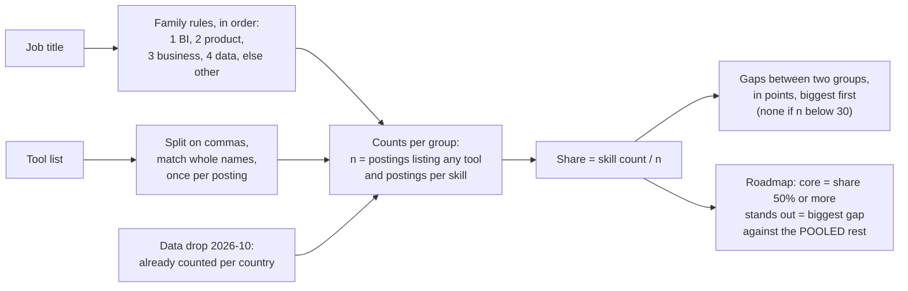

# Role roadmaps from postings

Data, business, product or BI analyst: which skills differ?

## Before you start

- Level 1 (beginner). About 2 hours.
- You can run a Python file and read a short function: [00-06 Python for spreadsheet people](../../00-start-here/06-python-for-spreadsheet-people/).
- [07-01 Read job postings like data](../01-read-job-postings-like-data/) counts tools once per posting and introduces regular expressions. [07-04 Match your resume to a posting](../04-match-your-resume-to-a-posting/) compares skill lists. This lesson compares whole groups of postings.
- Percentage points are explained below. [03-06 Percent, points and averages of ratios](../../03-metrics-and-product-analytics/06-percent-points-and-averages-of-ratios/) goes deeper.

## The problem

Nikhil is a career coach at Lanternway Courses, a fictional online course platform. Learners keep asking him the same thing: "Should I aim for data analyst, business analyst, product analyst or BI analyst, and what do I learn for each?" He wants one short roadmap per role, built from postings rather than opinion, for a webinar next Thursday. He also wants to know whether the answer changes between the US and India, where most of his learners apply.

There are two sources, and it matters which is which:

- **Real counts, by country.** The [Real Analyst Jobs data drop](../../../data/job-market/2026-10/) of 25 October 2026 (CC BY 4.0, credit "Real Analyst Jobs (realanalystjobs.com)") counts, for each country, how many analyst postings list each of eight tools. **It has no job title field**, so it cannot split postings into data, business, product and BI roles. This lesson uses it for the question it can answer: how the tool mix differs between countries.
- **Synthetic postings, with titles.** For the role question, `data/postings.csv` holds 600 synthetic postings with a title and a tool list, built by `make_data.py` with a fixed seed. Every title and tool mix in it is invented to teach the method. Its numbers say nothing about the real market. Run the same code on postings you save yourself to get real role numbers.

## In plain words

Picture four restaurants and their menus: a dosa place, a pizza place, a thali place and a cafe. To say how they differ, you would not count how many times "cheese" appears across all menus, because the pizza place has the longest menu and wins every count. You would ask, for each restaurant, what share of its dishes use cheese, and then compare the shares. The biggest gaps in share are what makes each one different. "All four use salt" is true, and useless for choosing.

Postings work the same way. Group them by role, work out the share of each group's postings that list a tool, and compare the shares. A tool every role wants is a foundation. A tool one role lists far more often than the others is that role's signature.

Words used in this lesson:

- **Role family**: a group of job titles that mean the same kind of job. "Senior Data Analyst" and "Junior Data Analyst" are both in the data family.
- **Share**: postings in a group that list a tool, divided by postings in the group that list any tool, as a percent.
- **Percentage point**: the unit for the difference between two percents. 76% against 27% is a gap of 49 points (not 49%).
- **Pooled**: several groups added together before dividing, so the share is a ratio of sums.
- **Minimum group size**: the fewest postings a group needs before you compare it. Below that, one posting moves the share a lot.

## What you will build from scratch

- `title_family`: put each title in the data, business, product, BI or other family, with the rules checked in the right order.
- `parse_tools` and `count_by_group`: count each tool once per posting, per group, with the data drop's denominator.
- `share`, `pool` and `gaps`: shares, pooled shares and the skills that differ most between two groups, in percentage points, with a minimum group size.
- `roadmap`: per role, the core skills and the skills that stand out against the other roles.

## The idea



**Titles to families.** Each family has a rule, and the first rule that matches wins, so the order is part of the logic:

1. **bi**: "business intelligence" or the word "BI". This must come before business, or every "Business Intelligence Analyst" becomes a business analyst.
2. **product**: the word "product". `\bproduct\b` matches "Product Data Analyst" but not "Production Planning Analyst", because `\b` is a word edge and "production" carries on after "product".
3. **business**: the word "business".
4. **data**: the word "data" or "analytics".
5. Anything else is **other** (financial, supply chain, credit risk).

**Shares, with the drop's denominator.** The data drop divides by postings that list at least one tool, not by all postings, because a posting with no tool list says nothing either way. This lesson does the same, so the two sources mean the same thing:

```
share(group, tool) = postings in the group that list the tool / postings in the group that list any tool x 100
gap(a, b, tool)    = share(a, tool) - share(b, tool)        in percentage points
```

**Against the rest, pooled.** To find what makes BI different from everything else, compare it with all the other roles added together. Add their counts first, then divide. Averaging their shares instead gives a small group the same weight as a big one.

**Small groups.** A share from 5 postings can swing by 20 points on one posting. `gaps` and `roadmap` return `None` when a group has fewer than 30 postings that list a tool. The cut-off is a choice; what matters is having one and saying what it is.

## Walk through

Run these from the lesson folder.

Step 1. Families and tool lists. `sys.path.insert(0, "solution")` lets Python find the worked answer, and `import solution as s` loads it.

```python
import sys
sys.path.insert(0, "solution")
import solution as s

for title in ["Senior Business Analyst", "Business Intelligence Analyst", "Product Data Analyst",
              "Production Planning Analyst", "People Analytics Analyst"]:
    print(title, "->", s.title_family(title))
skills, any_tool = s.parse_tools(" sql , SQL, power bi, RStudio, Jira")
print(sorted(skills), any_tool)
print(s.parse_tools(""))
```

```
Senior Business Analyst -> business
Business Intelligence Analyst -> bi
Product Data Analyst -> product
Production Planning Analyst -> other
People Analytics Analyst -> data
['Power BI', 'SQL'] True
(set(), False)
```

"sql" and "SQL" are one tool, counted once. "RStudio" is not the language R, because items are compared whole. Jira is not one of the eight tools, but it still means the posting lists a tool, so the posting is in the denominator. An empty list is not.

Step 2. The share table.

```python
import sys
sys.path.insert(0, "solution")
import solution as s

P = s.load_postings()
counts = s.count_by_group(P, lambda p: s.title_family(p["title"]))
print(len(P), sum(g["n"] for g in counts.values()))
for fam in ["data", "business", "bi", "product", "other"]:
    print("%-8s n=%3d" % (fam, counts[fam]["n"]), {k: round(s.share(counts, fam, k)) for k in s.SKILLS})
```

```
600 507
data     n=188 {'SQL': 80, 'Python': 54, 'Excel': 49, 'Tableau': 34, 'Power BI': 34, 'Looker': 11, 'R': 20, 'dbt': 9}
business n=116 {'SQL': 51, 'Python': 17, 'Excel': 78, 'Tableau': 10, 'Power BI': 27, 'Looker': 4, 'R': 1, 'dbt': 0}
bi       n= 94 {'SQL': 78, 'Python': 19, 'Excel': 57, 'Tableau': 51, 'Power BI': 76, 'Looker': 17, 'R': 3, 'dbt': 11}
product  n= 69 {'SQL': 83, 'Python': 51, 'Excel': 19, 'Tableau': 30, 'Power BI': 3, 'Looker': 33, 'R': 17, 'dbt': 14}
other    n= 40 {'SQL': 38, 'Python': 25, 'Excel': 95, 'Tableau': 15, 'Power BI': 28, 'Looker': 0, 'R': 5, 'dbt': 0}
```

93 of the 600 postings list no tool, so 507 are counted. In this synthetic sample SQL is listed by most data, BI and product postings, and by half of business postings. Excel leads for business analysts. Power BI and Tableau are where BI postings stand apart, and Looker and Python where product postings do.

Step 3. The skills that differ most between two roles.

```python
import sys
sys.path.insert(0, "solution")
import solution as s

counts = s.count_by_group(s.load_postings(), lambda p: s.title_family(p["title"]))
for a, b in [("bi", "business"), ("product", "data")]:
    print(a, "vs", b, [(k, round(d, 1)) for k, _, _, d in s.gaps(counts, a, b)[:3]])
```

```
bi vs business [('Power BI', 48.8), ('Tableau', 40.7), ('SQL', 26.8)]
product vs data [('Power BI', -30.6), ('Excel', -30.1), ('Looker', 22.7)]
```

BI analysts list Power BI 48.8 points more often than business analysts. Product analysts list Power BI 30.6 points and Excel 30.1 points less often than data analysts, and Looker 22.7 points more often. A negative gap is a skill the first role needs less.

Step 4. One roadmap per role.

```python
import sys
sys.path.insert(0, "solution")
import solution as s

counts = s.count_by_group(s.load_postings(), lambda p: s.title_family(p["title"]))
for fam in s.FAMILIES:
    print(fam, s.roadmap(counts, fam, s.FAMILIES))
```

```
data {'core': ['SQL', 'Python'], 'stands_out': ['Python', 'R']}
business {'core': ['Excel', 'SQL'], 'stands_out': ['Excel']}
bi {'core': ['SQL', 'Power BI', 'Excel', 'Tableau'], 'stands_out': ['Power BI', 'Tableau']}
product {'core': ['SQL', 'Python'], 'stands_out': ['Looker', 'Python']}
```

"core" is what at least half the role's postings list. "stands_out" is what the role lists more often than the other three roles pooled. Business analysts have only one skill that stands out, Excel: every other tool is listed less often in business postings than in the rest. That is a finding too: the business analyst roadmap is lighter on tools, and the gap is in Excel depth and in what the tools cannot show, such as requirements work.

Step 5. The real data drop, by country. Same functions, real counts.

```python
import sys
sys.path.insert(0, "solution")
import solution as s

drop = s.load_drop()
print(drop["US"]["n"], drop["IN"]["n"], drop["KE"]["n"])
for k, us, india, d in s.gaps(drop, "US", "IN")[:4]:
    print("%-9s US %.1f%%  IN %.1f%%  gap %+.1f points" % (k, us, india, d))
print(s.gaps(drop, "US", "KE"))
```

```
2056 900 2
Power BI  US 23.9%  IN 38.9%  gap -15.0 points
Excel     US 41.8%  IN 45.7%  gap -3.8 points
dbt       US 7.6%  IN 4.7%  gap +3.0 points
Looker    US 11.3%  IN 9.1%  gap +2.2 points
None
```

`load_drop` reads `data/job-market/2026-10/by_country_skill.csv` into the same shape as `count_by_group`, so nothing else changes. On 25 October 2026, 2,056 US and 900 India analyst postings listed a tool. Power BI is the tool that differs most: 38.9% of the India postings list it against 23.9% in the US, a 15.0 point gap. Every other tool is within 4 points. The Excel gap is -3.8 because the shares are computed from the raw counts; subtracting the drop's rounded `share_pct` column (41.8 and 45.7) would give -3.9. Kenya has 2 postings that list a tool, so the comparison is refused.

### Honest limits

- **The role numbers are synthetic.** They show how to build a roadmap, not what the market wants. The real drop has no titles, so it cannot rank roles. If a later monthly drop adds titles, `load_drop` is the only function that changes.
- **A tool list is not a requirement.** The drop counts a tool when it is on the posting's tool list, with no split between required and nice to have ([07-01](../01-read-job-postings-like-data/) shows why that matters).
- **Eight tools are not the job.** Statistics, experiments, stakeholder work and writing do not appear in a tool list, and they are often what separates product and business roles most.
- **One board, one day.** The drop is one board's postings on one day, and its README lists more limits.

## Common mistakes

1. **Checking "business" before "BI".** It looks harmless, since both rules are right on their own:

    ```python
    import re
    import sys
    sys.path.insert(0, "solution")
    import solution as s

    NAIVE_RULES = [("business", re.compile(r"\bbusiness\b", re.I)), ("bi", re.compile(r"\bbusiness intelligence\b|\bbi\b", re.I)),
                   ("product", re.compile(r"\bproduct\b", re.I)), ("data", re.compile(r"\bdata\b|\banalytics\b", re.I))]

    def naive_family(title):
        for family, pattern in NAIVE_RULES:
            if pattern.search(title):
                return family
        return "other"

    P = s.load_postings()
    naive = s.count_by_group(P, lambda p: naive_family(p["title"]))
    right = s.count_by_group(P, lambda p: s.title_family(p["title"]))
    print("business n", naive["business"]["n"], "vs", right["business"]["n"], "| bi n", naive["bi"]["n"], "vs", right["bi"]["n"])
    print("business Power BI %.0f%% vs %.0f%%" % (s.share(naive, "business", "Power BI"), s.share(right, "business", "Power BI")))
    print(s.roadmap(naive, "business", s.FAMILIES))
    ```

    ```
    business n 170 vs 116 | bi n 40 vs 94
    business Power BI 44% vs 27%
    {'core': ['Excel', 'SQL'], 'stands_out': ['Excel', 'Power BI']}
    ```

    54 BI postings move into business. Business analysts now seem to list Power BI in 44% of postings instead of 27%, and the roadmap tells business analyst learners that Power BI is their signature tool. It is the BI analysts' signature. Print a sample of titles from each family before you trust a rule order.
2. **Comparing counts instead of shares.**

    ```python
    import sys
    sys.path.insert(0, "solution")
    import solution as s

    counts = s.count_by_group(s.load_postings(), lambda p: s.title_family(p["title"]))
    print({f: counts[f]["skills"]["Tableau"] for f in s.FAMILIES})
    print({f: round(s.share(counts, f, "Tableau")) for f in s.FAMILIES})
    others = ["data", "business", "product"]
    avg = sum(s.share(counts, f, "Looker") for f in others) / 3
    pooled = s.pool(counts, others)
    print(round(avg, 1), round(100 * pooled["skills"]["Looker"] / pooled["n"], 1))
    ```

    ```
    {'data': 64, 'business': 12, 'bi': 48, 'product': 21}
    {'data': 34, 'business': 10, 'bi': 51, 'product': 30}
    16.1 12.9
    ```

    By count, data postings list Tableau most (64 against 48), only because there are twice as many data postings. By share, BI leads (51% against 34%).
3. **Averaging the shares of the other roles.** The last line above: the average of the three Looker shares is 16.1%, but the pooled share is 12.9%, because the average gives the 69 product postings the same weight as the 188 data postings. Pool the counts, then divide.
4. **Reading a share from a handful of postings.** Kenya's 2 postings give shares of 0% or 50% for every tool. Set a minimum group size and report the groups you left out.

## Your turn

Open `exercise.py`. Write `FAMILY_RULES`, then fill in `title_family`, `parse_tools`, `count_by_group`, `share`, `pool`, `gaps` and `roadmap`. `load_drop` is written for you. Then run, from this folder:

```
python3 test_lesson.py
```

The test checks your family rules on the tricky titles and on every title the generator writes, your tool parsing on an empty list, a list with only other tools, a repeated tool and RStudio, your shares on a group with no postings, your pool on two groups of very different size, and your gaps on a tie and on a group below 30. Then it checks the committed postings, a second set built with another seed, and the real data drop, where Power BI must come out as the biggest US against India gap.

Stretch: use `gaps` on the drop to find, for each of GB, DE and CA, the tool that differs most from the US. Then save 30 postings for one role yourself, write them in the same CSV shape as `data/postings.csv`, and build that role's real roadmap.

## Check yourself

1. Why is BI checked before business in the family rules?
2. SQL is in the core of three roadmaps. Why does it not appear in any "stands out" list for those three?
3. What is the difference between "BI postings list Power BI 48.8% more often" and "48.8 points more often"?
4. Nikhil asks the data drop which skills a product analyst needs. What do you tell him?

<details>
<summary>Answers</summary>

1. "Business Intelligence Analyst" contains the word business. With business first, every such title becomes a business analyst, and BI's tools inflate the business numbers. The more specific rule must come first.
2. "Stands out" compares a role with the other roles pooled. SQL is common everywhere, so the gap is small or negative. It belongs on every roadmap as a foundation, not as what makes a role different.
3. The gap is a difference of two percents, 75.5% minus 26.7%, so it is 48.8 percentage points. "48.8% more often" would mean the BI share is 1.488 times the business share, about 40%, which is a different and wrong statement. In relative terms the BI share is 2.8 times the business share.
4. The drop counts tools by country and has no job titles, so it cannot answer by role. It can say which tools differ between countries, such as Power BI at 38.9% in India against 23.9% in the US. For roles, use posting-level data with titles, like the saved postings this lesson's code runs on.

</details>

## What to tell the stakeholder

"SQL is the foundation for every analyst role, so every roadmap starts there. What differs is the second tool: in our sample of postings, BI roles stand out for Power BI and Tableau, product roles for Looker and Python, and business roles for Excel, with fewer tools overall. The sample is illustrative, not market data: the public data drop of 25 October 2026 counts tools by country, not by title. What it does show is that market matters too: 38.9% of India postings that list tools ask for Power BI, against 23.9% in the US, so a learner applying in India should move Power BI up the list."

## In real job postings

In the Real Analyst Jobs data drop of 25 October 2026, Power BI is the tool that differs most between the 2,056 US and the 900 India analyst postings that list tools: 23.9% against 38.9% ([data/job-market/2026-10](../../../data/job-market/2026-10/)). The drop has no title field, so for roles, read live postings: [business analyst jobs](https://realanalystjobs.com/jobs/business-analyst-jobs), [product analyst jobs](https://realanalystjobs.com/jobs/product-analyst-jobs) and [Power BI](https://realanalystjobs.com/skills/power-bi).

## Next

[Explain findings to leadership](../06-explain-findings-to-leadership/)
