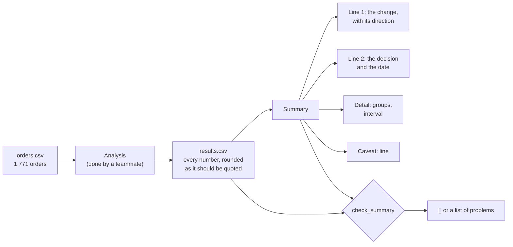

# Explain findings to leadership

Can the VP act on your summary after reading only the first two lines?

## Before you start

- Level 1 (beginner). About 2 hours.
- You can run a Python file and read a short function: [00-06 Python for spreadsheet people](../../00-start-here/06-python-for-spreadsheet-people/).
- You know that a question comes with a decision and a deadline: [00-02 Think like an analyst](../../00-start-here/02-think-like-an-analyst/).
- The summary quotes a 95% interval. [02-02 Confidence interval by hand](../../02-statistics-and-experiments/02-confidence-interval-by-hand/) explains what one is; you do not need to compute one here.

## The problem

Tiffinbell, a fictional food delivery app in four cities of Maharashtra, tried a new dispatch rule in Pune: for four weeks every order was sent at random to the current rule or to the new one. A teammate ran the analysis and saved the numbers in `data/results.csv`. Sanjana, the VP of operations, decides on 13 November whether all four cities switch. She reads email between meetings on her phone, and she will act on the first two lines. You will write her summary, then build a checker that tells you whether any summary would let her act, and a function that drafts one from any results file.

The files in `data/` are synthetic, generated by `make_data.py` with a fixed seed. `orders.csv` has 1,771 orders and `results.csv` is the analysis of them. Tiffinbell, Sanjana and the orders are invented.

## In plain words

Think of a cricket score on a phone notification: "India won by 4 wickets. Final on Sunday." You know the result and what happens next before you open the app. Nobody puts "The toss was at 9:30 and the pitch was dry" first.

An executive summary works the same way. Line 1 is the answer: the number and which way it moved. Line 2 is what you need from the reader: the decision and when. Everything else (how you did it, how sure you are) comes after, for the reader who wants it. And every number in it has to be one you can point to in your results, rounded exactly as there, because a VP who forwards "rose 4 points" will be asked "where is that from?".

Words used in this lesson:

- **Executive summary**: the few lines at the top of a report or email that a senior reader acts on. Here, at most 100 words.
- **Headline number**: the one number the decision depends on. Here, the change in the on-time rate.
- **Percentage point (point)**: the gap between two percentages. 80.5% to 84.5% is 4.0 points. It is not 4.0%: as a percent of 80.5, a 4.0 point gain is about 5%.
- **Caveat**: the one limit the reader must know before acting on the number.
- **Traceable**: a number you can find, as written, in the results file.
- **Bottom line up front**: putting the answer before the method. Some teams call it BLUF.

## What you will build from scratch

- `SUMMARY`: your summary for Sanjana, for the committed results.
- `untraceable_numbers`: every number in a summary that is not in the results file.
- `check_summary`: a list of problems, from "the answer is not in the first two lines" to "this number is not in the results".
- `draft_summary`: a summary drafted from any results file, which must pass the checker on results it has never seen.

## The idea

The work goes in one direction: orders become results, results become a summary, and the checker compares the summary with the results it came from.



**The rules, one by one.** A summary passes when:

1. **Headline**: the size of the change (`change_pts` without its minus sign) is a number in the first two non-blank lines.
2. **Direction**: those lines have a word that says which way it moved (`rose`, `up`, `higher` when the change is above 0; `fell`, `down`, `lower` below 0; `unchanged` or `flat` at 0), and no word for another direction.
3. **Decision**: those lines have a decision word: `approve`, `decide`, `decision`, `choose` or `agree`.
4. **Units**: the change is written in points. "4.0%" next to the headline size is a different claim.
5. **Traceable**: every number in the summary is in a value of `results.csv`, exactly as written. One exception: the headline change is written as its size, because the direction word carries the sign.
6. **Caveat**: some line starts with `Caveat:`.
7. **Length**: at most 100 words.

**Why exact, not "close enough".** The results file is already rounded the way the numbers should be quoted. Rounding again can change what the number says. The interval for the change is 0.4 to 7.5 points: above zero, so the new rule is better. Rounded to whole numbers, it is "0 to 8 points", which reads as "might be no better at all". The checker cannot judge meaning, so it uses the strict rule: copy the number, do not re-round it. If you need a new number, such as the total of 1,771 orders, add it to the results file first, so it has a source.

**What a number is.** A number is a run of digits with optional thousands commas and decimals, with a minus sign in front when it is directly attached: `-0.4`, `1,240`, `84.5`. Digits that are part of a name, such as `GA4` or `Q3`, are not numbers. The pattern, in Python's `re` module:

    (?<![\w.,])-?\d+(?:,\d{3})*(?:\.\d+)?(?!\.?\w)

`(?<![\w.,])` means "not straight after a letter, digit, dot or comma", and `(?!\.?\w)` means "not straight before a letter or digit, with or without a dot in between", so `4.5x` is not read as `4`.

## Walk through

Run these from the lesson folder: type `python3`, then paste each block.

Step 1. Read the results file.

```python
import sys
sys.path.insert(0, "solution")
import solution as s

r = s.load_results()
for name in ("control_rate_pct", "pilot_rate_pct", "change_pts", "ci_low_pts", "ci_high_pts", "recommendation"):
    print(name, "=", r[name])
```

`sys.path.insert(0, "solution")` lets Python find the worked answer, and `import solution as s` loads it. `load_results` reads `results.csv` into a dictionary of text values. It prints:

```
control_rate_pct = 80.5
pilot_rate_pct = 84.5
change_pts = 4.0
ci_low_pts = 0.4
ci_high_pts = 7.5
recommendation = switch all four cities
```

On the new rule, 84.5% of orders arrived on time, against 80.5% on the current rule: a change of 4.0 points. The 95% interval runs from 0.4 to 7.5 points, so the gain is above zero but could be small.

Step 2. The trap: the method first, the answer last.

```python
import sys
sys.path.insert(0, "solution")
import solution as s

r = s.load_results()
buried = """We took 1,771 Pune orders from 5 October to 1 November 2026 and split them at random between the two rules.
On time means delivered by the promised minute, and we used a two proportion interval.
The new rule came out 4.0 points higher, 84.5% against 80.5%, with a 95% interval of 0.4 to 7.5 points.
Caveat: Pune only.
"""
print(s.check_summary(buried, r))
print(s.untraceable_numbers(buried, r))
```

This is how most first drafts look: the order the work was done in. It prints:

```
['decision', 'direction', 'headline', 'untraceable']
['1771']
```

Sanjana reads two lines of method and stops. The answer is on line 3 and the decision is nowhere. And 1,771 is a number the analyst added up in their head: it is right, but it is not in the results file, so nobody can check it from there.

Step 3. The second trap: rounding that changes the claim.

```python
import sys
sys.path.insert(0, "solution")
import solution as s

r = s.load_results()
rounded = """On-time deliveries rose 4 points, from 80% to 85%, on the new rule.
Please approve switching all four cities by 13 November.
Caveat: the gain could be anywhere from 0 to 8 points.
"""
print(s.check_summary(rounded, r))
print(s.untraceable_numbers(rounded, r))
```

It prints:

```
['headline', 'untraceable']
['80', '85', '0', '8']
```

"0 to 8 points" says the new rule might be no better, which is not what the analysis found. 80% to 85% is a 5 point gap, not 4. Notice that "4" is not in the untraceable list: the results say the test ran for 4 weeks, so the checker accepts any 4. A checker only catches what it can see. It flags `headline` because 4.0 is not on the first two lines.

Step 4. A summary that passes, and a draft for results the code has never seen.

```python
import sys
sys.path.insert(0, "solution")
import solution as s
import make_data

print(s.check_summary(s.SUMMARY, s.load_results()))
other = make_data.build(seed=45)["results"]
text = s.draft_summary(other)
print(s.check_summary(text, other))
print(text)
```

`make_data.build(seed=45)` runs the same analysis on another four weeks of made-up orders, where the new rule did worse. It prints:

```
[]
[]
On-time deliveries in Pune fell 5.8 points, from 81.3% to 75.5%, on the new dispatch rule.
Decision needed by 13 November on whether all four cities switch to the new rule: I recommend we keep the current rule.

Orders were split at random over 4 weeks (5 October to 1 November 2026): 878 on the new rule, 946 on the current one. The 95% interval for the change is -9.6 to -2.0 points.
Caveat: This is Pune in ordinary weeks; the other cities and the festival peak may differ.
```

The draft takes every number and phrase from the results, so the same code writes a correct summary when the rule won, lost or tied. The direction word comes from the sign of `change_pts`, and the recommendation comes from the interval: above zero, switch; below zero, keep the current rule; across zero, test for longer.

## Common mistakes

- **The answer under the method.** The buried draft in Step 2 fails on `headline`, `direction` and `decision`: a reader who stops after two lines learns how you worked, not what you found.
- **Rounding again.** "0 to 8 points" for an interval of 0.4 to 7.5 turns "better, maybe by a little" into "maybe no better". Quote the results as written.
- **Percent for points.** "On-time rose 4.0%" fails on `units`: the gain is 4.0 points, which is about 5% of the old rate. Lesson [03-06 Percent vs points](../../03-metrics-and-product-analytics/06-percent-points-and-averages-of-ratios/) goes deeper.
- **The wrong direction word.** On a fall, "the rate moved 5.8 points" or "improved by 5.8 points" both fail on `direction`. When the metric is "bad when high", such as late deliveries, say which metric you mean so "fell" is good news the reader can trust.
- **No caveat, or ten caveats.** One line, the limit that could change the decision. Here: one city, ordinary weeks.
- **Trusting the checker as the whole review.** It sees numbers and words, not meaning. A summary can pass and still mislead, for example by saying the rule "causes" a gain in a city it was never tested in. Read it once as Sanjana would.

## Your turn

Open `exercise.py`. Write `SUMMARY` for the committed results, then fill in `untraceable_numbers`, `check_summary` and `draft_summary`. Then run, from this folder:

```
python3 test_lesson.py
```

The test checks your checker on hand-made summaries (a buried answer, the wrong direction, rounded numbers, percent for points, a missing caveat, an empty summary, a fall, no change at all), checks your `SUMMARY` with its own checker, and runs your `draft_summary` on the committed results and on results from four other seeds, where the new rule wins, loses or cannot be told apart. To see the reference solution pass: `CHECK_SOLUTION=1 python3 test_lesson.py`.

Stretch: add a rule that flags causal words such as "caused" or "because of" when the results file says the comparison was not randomised, and add a `randomised` row to `results.csv` to drive it.

## Check yourself

1. Why does the summary put the decision on line 2 and not at the end?
2. The interval is 0.4 to 7.5 points. Why not write "0 to 8 points" to keep it simple?
3. On-time went from 80.5% to 84.5%. Is that a 4.0% rise?
4. The VP asks "how sure are you?". What do you say?

<details>
<summary>Answers</summary>

1. A senior reader decides from the top of the message and may not read on. If the ask is at the end, the email gets a reply like "thanks, interesting" and no decision. The decision line also tells them why the message is in their inbox at all.
2. Because it changes the claim. 0.4 to 7.5 is above zero: the data says the new rule is better. 0 to 8 includes zero: it says the rule might not help. Quote the numbers the analysis produced.
3. No. It is a 4.0 point rise. As a share of the old rate it is 4.0 / 80.5, about 5%. Use points for the gap between two percentages, and say "percent" only for a relative change.
4. Give the interval in plain words: the gain is somewhere between 0.4 and 7.5 points, so it is real but could be small. Then the caveat: it was measured in Pune in ordinary weeks, and the other cities may differ.

</details>

## What to tell the stakeholder

"On-time deliveries in Pune rose 4.0 points, from 80.5% to 84.5%, on the new dispatch rule. Please approve switching all four cities by 13 November. Caveat: this is Pune in ordinary weeks, and the gain could be as small as 0.4 points (the 95% interval runs to 7.5), so we will check the first two weeks in each city after the switch."

## In real job postings

In the Real Analyst Jobs data drop of 25 October 2026, 1,048 of the 2,789 US analyst postings (37.6%) are labelled Mid Level, the largest labelled group ([data/job-market/2026-10](../../../data/job-market/2026-10/), `by_country_seniority.csv`). Beyond entry level, you are often the person who writes the summary a manager forwards. The [analyst job market report](https://realanalystjobs.com/analyst-job-market) is an example of a page that leads with its numbers.

## Next

[07 Resume bullets that are true](../07-resume-bullets-that-are-true/)
