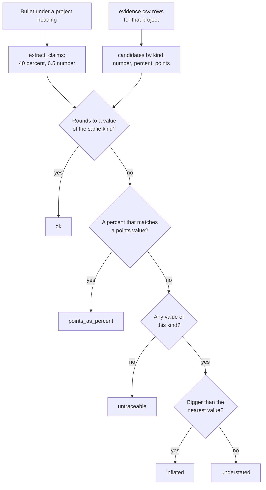

# Resume bullets that are true

Does every number on your resume come from work you can show?

## Before you start

- Level 1 (beginner). About 2 hours.
- [04 Match your resume to a posting](../04-match-your-resume-to-a-posting/) builds Maya's resume and its skill list. This lesson checks the numbers on it.
- [03 Portfolio project end to end](../03-portfolio-project-end-to-end/) and [06 Explain findings to leadership](../06-explain-findings-to-leadership/) produced two of the projects on the resume, and the numbers in this lesson's evidence file are the ones they computed.
- The difference between percent and percentage points is explained in [03-06 Percent vs points](../../03-metrics-and-product-analytics/06-percent-points-and-averages-of-ratios/). You only need the idea here, and it is explained again below.

## The problem

Maya Okafor, a junior analyst in Pune, has a first-round interview at a logistics company on Friday. Her resume has seven bullets and sixteen numbers. The interviewer will pick the most impressive one and ask "how did you measure that?", and Maya wants every answer to be a file she can open. You will build a checker that reads each bullet, pulls out every number, and traces it to an evidence file: a list of the numbers she can show, with where each one came from. The checker flags numbers it cannot find, numbers bigger than the evidence, and percentage points written as percent.

The files `data/resume.txt` and `data/evidence.csv` are synthetic, written by `make_data.py`. Maya, Lumen Freight and every number are invented.

## In plain words

Think of a bank statement and an expense claim. Every line on the claim should match a line on the statement. A claim for 40 when the statement says 34.62 is not "roughly right": it is a claim the statement does not back. Rounding 34.62 to 35 is fine; everyone rounds. Rounding it to 40 is not.

A resume bullet is a claim. The evidence file is the statement. Each number on the resume must match a number you can show, or a number you can compute from them in one step, such as "from 6.5 to 4.25 hours is a 34.6% cut".

Words used in this lesson:

- **Claim**: one number in a bullet, with what follows it: a plain number, a percent or points.
- **Evidence**: a number you can show, from a file, a query, a log or a write-up. Here, one row of `evidence.csv`.
- **Relative change**: how much something changed as a share of where it started: (new - old) / old * 100, in percent. From 6.5 to 4.25 hours is 2.25 / 6.5 = 34.6%.
- **Percentage point (point)**: the gap between two percentages. A payment rate from 61.0% to 64.2% rose 3.2 points, which is a 5.2% relative rise. "Rose 3.2%" is a different, smaller claim, so writing it is wrong even though it sounds modest.
- **Inflated**: a claim bigger than the evidence. **Understated**: smaller than the evidence by more than rounding.
- **Traceable**: the claim matches a value in the evidence.

## What you will build from scratch

- `extract_claims`: every number in a bullet, and whether it is a number, a percent or points.
- `candidates`: the values one project's evidence supports, by kind.
- `trace`: a status for one claim: ok, inflated, understated, points written as percent, or untraceable.
- `check_resume`: one finding per number on the resume.

## The idea



**The resume format.** A heading line that ends with a project id in brackets, such as `Pantrybox churn analysis (pantrybox-churn)`, starts a project. The `- ` bullets under it are claims about that project. A bullet under any other heading, such as a Summary line, has no project, so none of its numbers can be traced.

**What a claim is.** Every number in a bullet, with thousands commas removed (`1,400` is `1400`). The words right after it give its kind: `points`, `pts`, `pp` or `percentage points` mean points; `%` or `percent` mean percent; anything else is a plain number. Check for points first, because "percentage points" starts with "percent". Digits inside a name, such as `GA4` or `Q3`, are not claims.

**What the evidence supports.** Each evidence row has a unit: `number`, `pct` (a rate in percent) or `pts` (a gap in points). A row with only `to_value` is a single fact. A row with `from_value` too is a comparison, and it supports a few values computed in one step:

| Row | number values | percent values | points values |
|---|---|---|---|
| fact, unit number | the value | | |
| fact, unit pct | | the value | |
| fact, unit pts | | | the value |
| comparison, unit number (6.5 to 4.25 hours) | 6.5, 4.25, change 2.25 | relative change 34.6 | |
| comparison, unit pct (61.0% to 64.2%) | | 61.0, 64.2, relative change 5.2 | change 3.2 |

The relative change is |to - from| / from * 100, and it is skipped when `from_value` is 0, because a change from zero has no relative size.

**Rounding is allowed, inflating is not.** A claim written with d decimals matches a value when the value rounds to it: |value - claim| <= 0.5 / 10^d. So 34.62 supports "35%" (0.38 away) and "34.6%", but not "34%" (0.62 away) or "40%". When nothing matches, the claim is compared with the nearest value of its kind: above it is **inflated**, below it is **understated**. If two values are equally near, the smaller one is used, so a doubtful claim reads as inflated.

**Why points written as percent gets its own status.** It is the most common honest-looking error on analyst resumes, because the number is real. The payment rate really moved by 3.2, but by 3.2 points. "Lifted on-time payment by 3.2%" claims a 3.2% relative rise, which the evidence does not show (it shows 5.2%). An interviewer who knows the difference will ask which one you meant.

## Walk through

Run these from the lesson folder: type `python3`, then paste each block.

Step 1. Pull the claims out of a bullet.

```python
import sys
sys.path.insert(0, "solution")
import solution as s

bullet = "Automated the weekly late-delivery report in Python, cutting it from 6.5 to 4.25 hours, a 40% saving."
print(s.extract_claims(bullet))
print(s.extract_claims("Showed that trial converters churn 4.6% more, or 4.6 percentage points, in Q3."))
```

`sys.path.insert(0, "solution")` lets Python find the worked answer, and `import solution as s` loads it. It prints:

```
[('6.5', 'number'), ('4.25', 'number'), ('40', 'percent')]
[('4.6', 'percent'), ('4.6', 'points')]
```

The same 4.6 is a percent claim in one place and a points claim in the other, because the word after it is different. The 3 in "Q3" is not a claim.

Step 2. What the internship's evidence supports.

```python
import sys
sys.path.insert(0, "solution")
import solution as s

resume, evidence = s.load()
lumen = [r for r in evidence if r["project"] == "lumen-freight"]
cands = s.candidates(lumen)
for kind in ("number", "percent", "points"):
    for value, label in cands[kind]:
        print("%-8s %8.2f  %s" % (kind, value, label))
```

`load` reads both files. The list comprehension keeps the three evidence rows for the Lumen Freight internship. It prints:

```
number      30.00  depot managers using the dashboard
number       6.50  hours to build the weekly report (from)
number       4.25  hours to build the weekly report (to)
number       2.25  hours to build the weekly report (change)
percent     34.62  hours to build the weekly report (relative change)
percent     61.00  on-time payment rate, old email to new email (from)
percent     64.20  on-time payment rate, old email to new email (to)
percent      5.25  on-time payment rate, old email to new email (relative change)
points       3.20  on-time payment rate, old email to new email (change in points)
```

Step 3. The trap: a round number that is not the number you computed.

```python
import sys
sys.path.insert(0, "solution")
import solution as s

resume, evidence = s.load()
cands = s.candidates([r for r in evidence if r["project"] == "lumen-freight"])
for text, kind in [("40", "percent"), ("35", "percent"), ("34", "percent"), ("3.2", "percent"), ("3.2", "points"), ("5", "percent")]:
    status, value = s.trace(text, kind, cands)
    print(text, kind, status, round(value, 2))
```

It prints:

```
40 percent inflated 34.62
35 percent ok 34.62
34 percent understated 34.62
3.2 percent points_as_percent 3.2
3.2 points ok 3.2
5 percent ok 5.25
```

Maya's resume says "a 40% saving". The time sheet says 6.5 to 4.25 hours: 34.62%. 40 feels like a fair rounding of "about a third", and it is 5.4 points too high. "35%" is the honest round number. "3.2%" for the email test is a points gap written as percent; "3.2 points" or "5%" are both true.

Step 4. The whole resume.

```python
import sys
sys.path.insert(0, "solution")
import solution as s

s.main()
```

It prints one line per claim:

```
bullet 1  100      number   untraceable
bullet 2  30       number   ok  evidence 30.00
bullet 3  6.5      number   ok  evidence 6.50
bullet 3  4.25     number   ok  evidence 4.25
bullet 3  40       percent  inflated  evidence 34.62
bullet 4  3.2      percent  points_as_percent  evidence 3.20
bullet 5  1400     number   ok  evidence 1400.00
bullet 5  224      number   ok  evidence 224.00
bullet 5  779      number   ok  evidence 779.00
bullet 5  28.8     percent  ok  evidence 28.80
bullet 6  4.6      percent  points_as_percent  evidence 4.60
bullet 6  90       number   ok  evidence 90.00
bullet 7  4.0      points   ok  evidence 4.00
bullet 7  80.5     percent  ok  evidence 80.50
bullet 7  84.5     percent  ok  evidence 84.50
bullet 7  1771     number   ok  evidence 1771.00
```

Twelve of sixteen numbers trace. Four do not. Bullet 1, "Saved teams over 100 hours", sits under Summary with no project and no evidence. It might even be true: 2.25 hours a week for a year is over 100 hours. But Maya has not computed it or written it down, so she cannot show it. If she wants the claim, she adds a row to the evidence file with the weeks counted, and puts the bullet under the project.

Step 5. Fix the bullets and check again.

```python
import sys
sys.path.insert(0, "solution")
import solution as s

resume, evidence = s.load()
fixed = resume.replace("- Saved teams over 100 hours of manual reporting.\n", "")
fixed = fixed.replace("a 40% saving", "a 35% saving")
fixed = fixed.replace("lifted on-time payment by 3.2%", "lifted on-time payment from 61.0% to 64.2%, 3.2 points")
fixed = fixed.replace("churn 4.6% more", "churn 4.6 points more")
bad = [f for f in s.check_resume(fixed, evidence) if f["status"] != "ok"]
print(len(s.check_resume(fixed, evidence)), "claims,", len(bad), "problems")
```

It prints:

```
17 claims, 0 problems
```

The fixed resume has one more number than before and every one traces. Writing "from 61.0% to 64.2%" next to the points also lets the reader check the gap in their head.

## Common mistakes

- **Rounding up to a nicer number.** 34.62% becomes "40%" because 40 sounds like a third. It fails as inflated. Round to the nearest whole number (35%) or keep one decimal.
- **Points written as percent.** "Lifted on-time payment by 3.2%" and "churn 4.6% more" both fail. Write "3.2 points", or give both rates, or give the relative change (5%) and say it is relative.
- **A number with no project.** Summary lines like "saved teams over 100 hours" have no evidence behind them. Put the project in the bullet and the number in the evidence.
- **Claiming the decision, not the analysis.** "Increased on-time deliveries by 4.0 points" says you caused it. Maya measured it in a test; "measured a 4.0 point rise" is what she did. The checker cannot see verbs, so read each one yourself.
- **Trusting "ok" as "true".** The checker only knows the evidence file. A number in the file that was computed wrongly still passes. The evidence is only as good as the work behind it, which is why each row names its source.

## Your turn

Open `exercise.py` and fill in `extract_claims`, `candidates`, `trace` and `check_resume`. Then run, from this folder:

```
python3 test_lesson.py
```

The test checks your code on the committed resume, on three generated resumes and evidence files (another seed each, built in memory) that between them have every status, and on small cases: no numbers, a full stop after a number, "percentage points", a change from 0, a tie between two evidence values, and an empty resume. To see the reference solution pass: `CHECK_SOLUTION=1 python3 test_lesson.py`.

Then do it for your own resume. Write `data/evidence.csv` first: one row per number you can show, with the file or query it came from in `source`. Then put your resume in `data/resume.txt` with a project id at the end of each heading, and run `python3 exercise.py`. The [resume bullet builder](https://realanalystjobs.com/tools/resume-bullet-builder) helps you write the line once the number is right.

Stretch: add a `ratio` kind for claims such as "3x faster", supported by to / from and from / to of each comparison.

## Check yourself

1. A report went from 6.5 to 4.25 hours. Which of "35%", "34%" and "40%" can Maya write?
2. A conversion rate went from 20.0% to 26.8%. What is wrong with "raised conversion by 6.8%"?
3. Why does a number under the Summary heading fail even when it might be true?
4. The interviewer asks about your 35% bullet. What do you say?

<details>
<summary>Answers</summary>

1. "35%": 2.25 / 6.5 is 34.62%, which rounds to 35. "34%" is 0.62 away, more than rounding, so it is understated. "40%" is inflated.
2. The rate rose 6.8 points. As a relative change it rose 6.8 / 20.0 = 34%. "6.8%" is neither. Write "from 20.0% to 26.8%" or "6.8 points".
3. Because there is nothing to trace it to. A number you cannot show is a number you cannot defend in an interview. Compute it, write it in the evidence file with its source, and put it under the project.
4. The before and after, how you measured them, and what you did: "The report took 6.5 hours a week by hand. I automated the joins and the chart in Python and it took 4.25 hours, from my time sheet over four weeks before and after: a 35% cut."

</details>

## What to tell the stakeholder

Here the stakeholder is Maya: "Change three bullets before Friday. The report cut is 35%, not 40% (6.5 to 4.25 hours). The email test and the churn gap are 3.2 and 4.6 points, not percent. Drop the 100 hours line unless you count the weeks and add it to the evidence. The other twelve numbers trace to your files, so you can open the source for any of them in the interview."

## In real job postings

In the Real Analyst Jobs data drop of 25 October 2026, 375 of the 2,789 US analyst postings (13.4%) and 183 of the 1,174 India postings (15.6%) are labelled entry level ([data/job-market/2026-10](../../../data/job-market/2026-10/), `by_country_seniority.csv`). For those roles the resume often has projects rather than jobs, so every number in a project bullet should come with a file you can open. Browse [entry level data analyst jobs](https://realanalystjobs.com/jobs/entry-level-data-analyst-jobs) to see what they ask for.

## Next

Back to [Getting hired](../README.md) for the full list of lessons in this phase.
