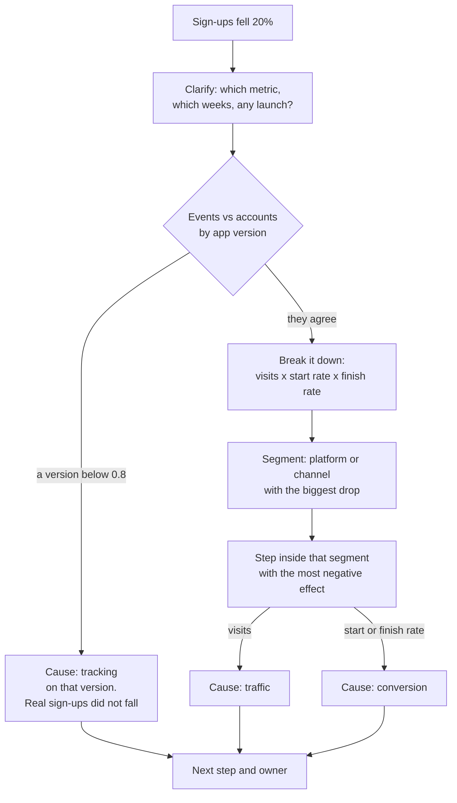

# The metrics case interview

Signups fell 20%. Walk me through it.

## Before you start

- Level 2 (intermediate). About 2 hours.
- You can split a change into the parts of a product with the logarithmic mean: [03-01 Metric trees](../../03-metrics-and-product-analytics/01-metric-trees/). This lesson uses the same method on a sign-up funnel.
- You know what a funnel step and a conversion rate are: [03-02 Funnel conversion](../../03-metrics-and-product-analytics/02-funnel-conversion/).
- You have seen a total move because the mix of groups moved: [03-09 Segmentation and mix effects](../../03-metrics-and-product-analytics/09-segmentation-and-mix-effects/).

## The problem

Maya Okafor has a final-round interview at Lanternway Courses, a fictional online course platform, on 5 November. The analytics lead, Grace, opens with one sentence: "Sign-ups fell 20% last week. Walk me through it." She has two tables ready: the daily sign-up funnel from the product event tracker, and the accounts the production database created each day. She is not looking for the answer in the first minute. She is watching the order of the questions, and whether the candidate checks the data before blaming marketing. You will build the case as code, so the same steps find the cause in data where a different thing broke.

The files in `data/` are synthetic, generated by `make_data.py` with a fixed seed. `funnel_daily.csv` has 168 rows (one per day, app version and traffic channel, 12 to 25 October 2026) and `accounts_daily.csv` has 56 rows. Lanternway Courses, Grace and Maya are invented.

## In plain words

Your favourite street stall sold 20% fewer plates on Saturday. Before you blame the cook, you ask three plain questions. Did fewer people walk past? Did fewer of them stop and look at the menu? Did fewer of the people who looked actually order? And before any of that: is the till broken, so sales happened and were not rung up?

A metrics case interview is that conversation, out loud, with an interviewer who has the numbers. The order matters more than speed:

1. **Clarify** what the metric means and over which period, and whether anything was launched on purpose.
2. **Check the data**: is the drop real, or did the counting break?
3. **Break it down** into the funnel steps that multiply to the metric.
4. **Segment**: find the platform or channel where the drop happened.
5. **Name the cause**: the step inside that segment that moved.
6. **Next step**: what you would check or ask next, and who owns it.

Words used in this lesson:

- **Funnel**: the steps from arriving to finishing. Here: a visit, then starting the sign-up form, then completing it.
- **Start rate**: sign-up starts divided by visits.
- **Finish rate**: completed sign-ups divided by sign-up starts.
- **Event**: a row the app sends to the tracker when something happens, such as "signup completed". If the app stops sending it, the thing still happens but is not counted.
- **Source of truth**: a second count that does not depend on the tracker. Here, accounts in the production database.
- **Segment**: one value of a dimension, such as `web` for platform or `paid_search` for channel.
- **Instrumentation bug** (tracking bug): the counting broke, not the business.
- **Share of the drop**: one segment's change divided by the total change.

## What you will build from scratch

- `decompose`: sign-up change split into visits, start rate and finish rate, adding up exactly.
- `tracking_gaps`: app versions where events fell below the accounts the database created.
- `segment_changes`: sign-ups by segment in both weeks, biggest drop first.
- `diagnose`: the whole case as one function: cause, segment and step.
- `ANSWER`: what you would say to Grace, one line per step of the case.

## The idea

**The tree.** Sign-ups multiply out from three numbers that different teams own:

    signups = visits x (starts / visits) x (signups / starts)
            = visits x start rate x finish rate

Marketing owns visits, the landing page owns the start rate, the form owns the finish rate. When sign-ups change, the change is split between the three with the logarithmic mean (LMDI, from [03-01](../../03-metrics-and-product-analytics/01-metric-trees/)):

    L(a, b)       = (a - b) / (ln a - ln b), and L(a, a) = a
    effect(step)  = L(current signups, prior signups) x ln(current step / prior step)

The three effects add up exactly to the change. If any count is 0 in either week, the logs do not exist, so the effects are `None`.

**The order of the case.**



**Why the data check comes first.** A tracking bug and a real drop look the same in the event table. The only way to tell them apart is a second count that does not use the tracker. If the database created as many accounts as last week, nothing happened to the business, and an hour spent on channels is an hour wasted. So `tracking_gaps` compares, for each app version in the current week, events with accounts. A ratio near 1 is normal (a few events are always lost to ad blockers and closed tabs). Below 0.8 is a broken release.

**Why segment by platform and channel, not by app version.** Every release moves users from the old version to the new one. The old version's sign-ups fall by design, the new one's rise from zero. App version is the right grain for the tracking check (a bug ships with a release) and the wrong grain for "where did the drop happen": compare platforms, which hold old and new versions together.

**The rule for the segment.** Across platform and channel values, take the one with the biggest drop in sign-ups. A drop concentrated in one place shows up as one segment holding most of the total change; a drop that is everywhere shows up as every segment falling by a similar share. Then decompose that segment alone: the step with the most negative effect is the cause.

## Walk through

Run these from the lesson folder: type `python3`, then paste each block.

Step 1. Clarify. No code. Maya asks, and Grace answers:

- "Sign-ups means the 'signup completed' event?" Yes.
- "Last week is 19 to 25 October, against 12 to 18 October?" Yes, whole weeks, so the weekend is in both.
- "Did we launch anything?" New app releases went out on 19 October for iOS (4.9) and Android (5.2). Nothing else on purpose.

Write the answers down. The release date is the first clue: it is the same day the drop starts.

Step 2. Confirm the number.

```python
import sys
sys.path.insert(0, "solution")
import solution as s

funnel = s.load("funnel_daily.csv")
accounts = s.load("accounts_daily.csv")
t = s.weekly_funnel(funnel)
print(t["prior"])
print(t["current"])
change = t["current"]["signups"] - t["prior"]["signups"]
print(change, round(100 * change / t["prior"]["signups"], 1))
```

`weekly_funnel` adds up visits, starts and sign-ups for the days before 19 October (prior) and from 19 October on (current). It prints:

```
{'visits': 21622, 'starts': 2980, 'signups': 1666}
{'visits': 21706, 'starts': 2943, 'signups': 1343}
-323 -19.4
```

The "20%" is 19.4%: 323 fewer sign-ups. Visits did not fall, which already rules out the most common first guess.

Step 3. Check the data before trusting it.

```python
import sys
sys.path.insert(0, "solution")
import solution as s

funnel = s.load("funnel_daily.csv")
accounts = s.load("accounts_daily.csv")
print(s.tracking_gaps(funnel, accounts))
print(s.tracking_gaps(funnel, accounts, threshold=1.5))
```

The first call uses the 0.8 threshold and finds nothing. The second sets a threshold no version can pass, just to print every ratio:

```
[]
[('android-5.1', 0.97), ('ios-4.8', 0.97), ('ios-4.9', 0.98), ('web', 0.98), ('android-5.2', 0.99)]
```

Every version, including the two new releases, sends an event for 97% to 99% of the accounts it creates. The tracker is fine; the drop is real.

Step 4. Break it down into the funnel.

```python
import sys
sys.path.insert(0, "solution")
import solution as s

t = s.weekly_funnel(s.load("funnel_daily.csv"))
for week in ("prior", "current"):
    r = s.rates(t[week])
    print(week, r["visits"], round(100 * r["start_rate"], 1), round(100 * r["finish_rate"], 1))
effects = s.decompose(t["prior"], t["current"])
print({k: round(v, 1) for k, v in effects.items()})
```

`rates` turns the totals into visits, start rate and finish rate, and `decompose` hands out the change. It prints (visits, start rate %, finish rate %):

```
prior 21622 13.8 55.9
current 21706 13.6 45.6
{'total': -323, 'visits': 5.8, 'start_rate': -24.5, 'finish_rate': -304.3}
```

Of the 323 lost sign-ups, the finish rate explains 304. People still arrive and still start the form; they stop finishing it. The three effects add to -323 exactly.

Step 5. Segment.

```python
import sys
sys.path.insert(0, "solution")
import solution as s

funnel = s.load("funnel_daily.csv")
for dim in ("platform", "channel"):
    for row in s.segment_changes(funnel, dim):
        print(dim, row)
```

Each row is (segment, prior sign-ups, current sign-ups, change), biggest drop first:

```
platform ('web', 795, 493, -302)
platform ('ios', 441, 424, -17)
platform ('android', 430, 426, -4)
channel ('organic', 798, 625, -173)
channel ('paid_search', 625, 497, -128)
channel ('referral', 243, 221, -22)
```

Web lost 302 of the 323. The apps barely moved. By channel the drop is spread out, organic and paid search each lose about a fifth, which is what a website problem looks like when you slice it by where people came from.

Step 6. The step inside the segment, and the whole case in one call.

```python
import sys
sys.path.insert(0, "solution")
import solution as s

funnel = s.load("funnel_daily.csv")
web = s.weekly_funnel(funnel, dimension="platform", value="web")
for week in ("prior", "current"):
    r = s.rates(web[week])
    print(week, r["visits"], round(100 * r["start_rate"], 1), round(100 * r["finish_rate"], 1))
print({k: round(v, 1) for k, v in s.decompose(web["prior"], web["current"]).items()})
print(s.diagnose(funnel, s.load("accounts_daily.csv")))
```

It prints:

```
prior 12212 12.2 53.3
current 12231 12.3 32.8
{'total': -302, 'visits': 1.0, 'start_rate': 4.1, 'finish_rate': -307.1}
{'cause': 'conversion', 'dimension': 'platform', 'segment': 'web', 'step': 'finish_rate', 'share': 0.93}
```

On web, the finish rate fell from 53.3% to 32.8% while visits and the start rate held. Something in the web sign-up form changed on 19 October: a new required field, a broken button on one browser, a captcha. The analyst's job ends with that sentence and a person to ask; it does not end with a guess about which one.

Step 7. The same code on a week where the counting broke.

```python
import sys
sys.path.insert(0, "solution")
import solution as s
import make_data

d = make_data.build(seed=3)
funnel = [dict(zip(make_data.FUNNEL_HEADER, map(str, r))) for r in d["funnel"]]
accounts = [dict(zip(make_data.ACCOUNTS_HEADER, map(str, r))) for r in d["accounts"]]
t = s.weekly_funnel(funnel)
print(t["prior"]["signups"], t["current"]["signups"])
print(s.tracking_gaps(funnel, accounts))
print(s.diagnose(funnel, accounts))
```

`make_data.build(seed=3)` makes another two weeks in memory, with a different planted cause. It prints:

```
1643 1309
[('ios-4.9', 0.04)]
{'cause': 'tracking', 'dimension': 'app_version', 'segment': 'ios-4.9', 'step': None, 'share': None}
```

Events fell 20% again, but iOS 4.9 sent an event for only 4% of the accounts it created. The new release stopped firing "signup completed". Accounts in the database fell 5.1% (1,679 to 1,594), not 20%: most of the drop is the dashboard, not the business. The answer to Grace is "fix the event in 4.9 and restate last week", not a channel review.

## Common mistakes

- **Slicing by app version and blaming the old release.** This is the plausible wrong answer on this data:

  ```python
  import sys
  sys.path.insert(0, "solution")
  import solution as s

  funnel = s.load("funnel_daily.csv")
  for row in s.segment_changes(funnel, "app_version"):
      print(row)
  ```

  ```
  ('web', 795, 493, -302)
  ('android-5.1', 430, 143, -287)
  ('ios-4.8', 441, 154, -287)
  ('ios-4.9', 0, 270, 270)
  ('android-5.2', 0, 283, 283)
  ```

  Android 5.1 and iOS 4.8 each "lost" 287 sign-ups, almost as many as web. They did not: their users upgraded to 5.2 and 4.9. A segment whose membership changes between the weeks moves for reasons that have nothing to do with the metric. Compare segments that hold the same people in both weeks.
- **Skipping the data check.** On seed 3 the event table shows the same 20% drop. Without the accounts table, the whole case would be built on a broken counter.
- **Jumping to a cause before the breakdown.** "Probably a paid campaign ended" is the first thing many candidates say. Here visits went up. Say what you would check, check it, then say what it means.
- **Percent changes of small segments.** A segment with 20 sign-ups that falls to 10 is "down 50%" and explains 10 sign-ups. Rank segments by their change in sign-ups (their share of the drop), not by their percent change.
- **Week boundaries that do not match.** Comparing Monday to Sunday against Wednesday to Tuesday moves a weekend between the weeks, and weekends here have 20% fewer visits. Clarify the dates first.

## Your turn

Open `exercise.py`. `load`, `weekly_funnel`, `rates` and `log_mean` are done. Write `decompose`, `tracking_gaps`, `segment_changes` and `diagnose` from their docstrings, then run your code on the committed data and write `ANSWER`: six lines, each starting with its label (`Clarify:`, `Check the data:`, `Break it down:`, `Segment:`, `Cause:`, `Next step:`). Then run, from this folder:

```
python3 test_lesson.py
```

The test checks each function on small hand-made tables (an empty table, a tie, a version with no events, a segment with 0 in one week), then runs your `diagnose` on the committed data and on five other seeds, where the cause is a tracking bug, a traffic loss in a channel or a conversion drop on web. It also checks that `ANSWER` has the six steps in order, mentions accounts in the data check, gives the sign-ups for both weeks, and names the segment and the step. To see the reference solution pass: `CHECK_SOLUTION=1 python3 test_lesson.py`.

Stretch: add a daily view of the web finish rate and confirm the drop starts on 19 October and not partway through the week. A cause that starts on a release day points at the release.

## Check yourself

1. Grace asks "what is the first thing you would check?". What do you answer, and why?
2. Android 5.1 lost 287 sign-ups. Why is that not a finding?
3. Visits went up 0.4% while sign-ups fell 19.4%. What does that rule out, and what does it not rule out?
4. Grace says "we cannot get the accounts table". How else could you test for a tracking bug?

<details>
<summary>Answers</summary>

1. Whether the drop is real: compare the events with a count that does not use the tracker, such as accounts in the database, by app version. A tracking bug and a real drop look identical in the event table, and a release went out on the day the drop started.
2. Its users moved to Android 5.2 during the week. Old version plus new version is flat for Android (430 to 426). A segment whose membership changes between the two weeks is not comparable.
3. It rules out "fewer people arrived" for the total. It does not rule out a traffic problem in one channel hidden by growth in another, which is why you still segment by channel.
4. Look for the signature of a broken event: a drop that starts on a release day, sits on one app version, and leaves the step before it (sign-up starts) unchanged. Then look at other events that follow a sign-up, such as "first course opened": if they did not fall, the users are there.

</details>

## What to tell the stakeholder

"Sign-ups fell 19.4% (1,666 to 1,343) in the week of 19 October, and the drop is real: the database created 19.4% fewer accounts too (1,702 to 1,371). Web lost 302 of the 323; on web the share of people who finish the sign-up form fell from 53.3% to 32.8% from 19 October, while visits and form starts held. Caveat: this says where and when, not why; the web team should check what changed in the form that day before anyone changes marketing spend."

## In real job postings

In the Real Analyst Jobs data drop of 25 October 2026, 1,048 of the 2,789 US analyst postings (37.6%) are labelled Mid Level, the largest labelled group ([data/job-market/2026-10](../../../data/job-market/2026-10/), `by_country_seniority.csv`). Case rounds like this one are common for those roles and for [product analyst jobs](https://realanalystjobs.com/jobs/product-analyst-jobs); the [data analyst interview questions](https://realanalystjobs.com/tools/data-analyst-interview-questions) page lists more to practise.

## Next

[09 The statistics interview round](../09-statistics-interview-round/)
