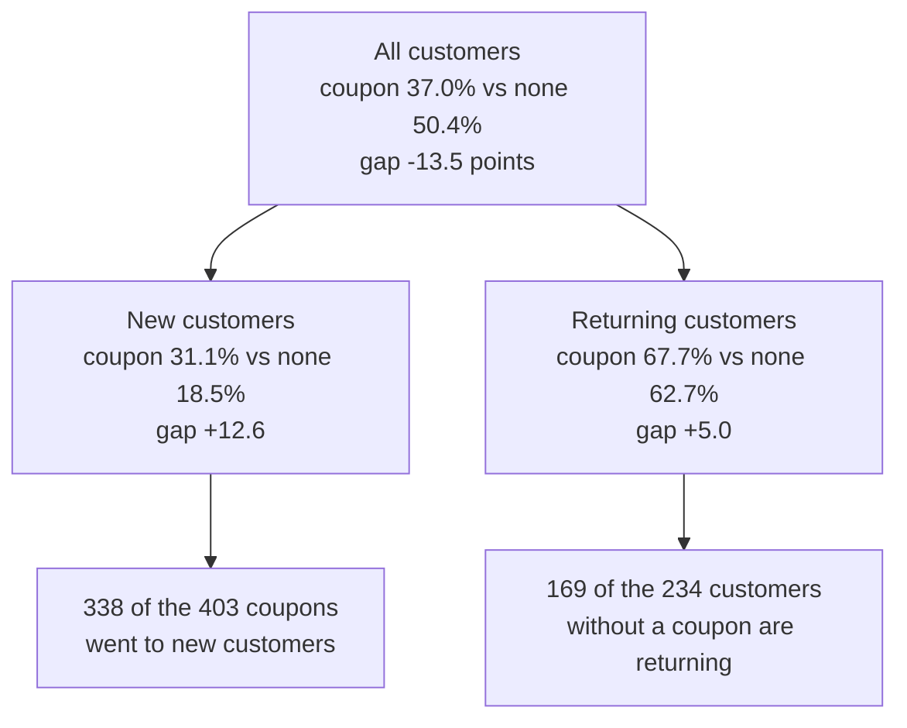

# The statistics interview round

Can you explain power, p-values and Simpson's paradox on real numbers?

## Before you start

- Level 2 (intermediate). About 2 hours.
- You have run a two-proportion z-test and read its p-value: [02-03 A/B test from scratch](../../02-statistics-and-experiments/03-ab-test-from-scratch/).
- You have sized a test before running it: [02-04 Sample size before you test](../../02-statistics-and-experiments/04-sample-size-before-you-test/). This lesson runs the same formula backwards to get power.
- You have seen a p-value come from shuffling labels: [02-08 Hypothesis test by permutation](../../02-statistics-and-experiments/08-hypothesis-test-by-permutation/). Helpful, not required.

## The problem

Harbor Mealkits, a fictional meal kit delivery startup, runs a 45 minute statistics round for analyst candidates. Omar, who leads experimentation, hands you two small tables and asks three questions. "We tested a new checkout page for two weeks: did it work?" Then: "Was the test big enough to tell?" And last: "Customers who got a coupon reordered less than customers who did not. Should we stop sending coupons?" Between questions he reads out statements about p-values and asks "true or false?". Your interview is on 10 November. You will answer each question with code you wrote, so the numbers are yours and you can explain every one.

The files in `data/` are synthetic, generated by `make_data.py` with a fixed seed: `experiment.csv` has 1,600 visitors and `coupons.csv` has 637 customers. Harbor Mealkits and Omar are invented.

## In plain words

Three ideas, three everyday versions.

- **The p-value** is a "how surprising?" number. You toss a coin 10 times and get 7 heads. If the coin were fair, how often would 10 tosses give a result at least that lopsided? Quite often, so 7 heads is weak evidence the coin is unfair. The p-value does not say how likely it is that the coin is fair.
- **Power** is the size of your net. A net with big holes misses small fish. A test with few users misses small effects. Before you say "there are no fish here", ask how big the holes were.
- **Simpson's paradox** is a total that points the other way from every part. A cricket team can have the better batting average in every season and still the worse average over all seasons, if it played most of its matches in the season where everyone scored less. The mix of who is in each group drives the total.

Words used in this lesson:

- **Conversion rate**: the share of visitors who ordered.
- **Null hypothesis**: the "nothing is going on" assumption, here that both pages have the same true conversion rate.
- **p-value**: if the null hypothesis were true, the chance of a gap at least as large as the one seen, in either direction (two-sided).
- **Significant at 0.05**: p is below 0.05. This threshold is called alpha. A result is "not significant" when p is above it.
- **False positive**: the test says "different" when there is no real difference. With alpha 0.05, it happens in about 5% of tests with no effect, if you look once.
- **Power**: the chance the test finds a real effect of a given size. 80% is the usual target.
- **Minimum detectable effect**: the smallest lift worth finding. Here, Harbor Mealkits says 1.5 points.
- **Confounder**: a third thing that drives both who gets the treatment and the outcome. Here, being a new customer.

## What you will build from scratch

- `two_proportion_z`: the gap in points, z and the two-sided p-value.
- `power`: the chance a test with n users per group finds a given lift.
- `n_per_group`: users per group for a target power.
- `rates_by_segment`: rates by segment and group, with an "all" row.
- `simpson_reversal`: whether the "all" row points the other way from every segment.
- `VERDICTS`: true or false for Omar's eight statements.

## The idea

**The z-test** (from [02-03](../../02-statistics-and-experiments/03-ab-test-from-scratch/)). With x converted out of n in each group:

    p1 = x1 / n1,  p2 = x2 / n2,  pooled = (x1 + x2) / (n1 + n2)
    se = sqrt(pooled * (1 - pooled) * (1/n1 + 1/n2))
    z  = (p2 - p1) / se
    p-value = 2 * (1 - Phi(|z|))

Phi is the normal cumulative distribution function: the share of a standard bell curve to the left of a point. The standard error uses the pooled rate because the question is "how surprising is this gap if both groups share one rate?". If every user or no user converted, there is no gap and nothing to test: z is 0 and p is 1.

**Power** is the sample size formula from [02-04](../../02-statistics-and-experiments/04-sample-size-before-you-test/) solved for the other unknown. With true rates p1 and p2, n users per group and pbar = (p1 + p2) / 2:

    power = Phi( (|p2 - p1| * sqrt(n) - z_a * sqrt(2 * pbar * (1 - pbar))) / sqrt(p1(1-p1) + p2(1-p2)) )
    n     = ceil( (z_a * sqrt(2 * pbar * (1 - pbar)) + z_b * sqrt(p1(1-p1) + p2(1-p2)))^2 / (p2 - p1)^2 )

z_a is the z for 1 - alpha/2 (1.96 for alpha 0.05) and z_b the z for the target power (0.84 for 80%). Power ignores the tiny chance of a significant result in the wrong direction, as the sample size formula does.

**Simpson's paradox.** Compare the gap (coupon rate minus no-coupon rate) in each segment with the gap in the total. When every segment says one thing and the total says the opposite, a third variable decides who is in which group. The total is a weighted average, and the weights differ between the two groups:



New customers reorder less whatever you do, and they got most of the coupons. So the coupon group is mostly new customers and the no-coupon group mostly returning ones. The total compares the two kinds of customer, not coupon against no coupon. Within each kind, coupon customers reorder more.

Which answer is right depends on the question. To ask "does a coupon help a customer like this one?", compare within the segment, where the confounder is held still. The total is right for "what share of last month's customers reordered?". And even within a segment, coupons were not given at random, so a test that assigns coupons at random is the only clean answer.

## Walk through

Run these from the lesson folder: type `python3`, then paste each block.

Step 1. "Did the new page work?"

```python
import sys
sys.path.insert(0, "solution")
import solution as s

groups = s.conversions(s.load("experiment.csv"))
print(groups)
(xc, nc), (xt, nt) = groups["control"], groups["treatment"]
print(round(100 * xc / nc, 1), round(100 * xt / nt, 1))
diff, z, p = s.two_proportion_z(xc, nc, xt, nt)
print(round(diff, 2), round(z, 2), round(p, 3))
```

`conversions` counts (converted, users) per group. It prints:

```
{'treatment': (87, 802), 'control': (74, 798)}
9.3 10.8
1.57 1.05 0.295
```

The new page converted 10.8% against 9.3%, a gap of 1.57 points. z is 1.05 and p is 0.295. The honest answer: "The new page is ahead by 1.6 points, but a gap this size would turn up in about 30% of tests like this one even if the pages were identical, so this test does not show the page works." That is not the same as "it does not work". Step 3 shows why.

Step 2. What the p-value means, by shuffling.

```python
import random
import sys
sys.path.insert(0, "solution")
import solution as s

rows = s.load("experiment.csv")
outcomes = [int(r["converted"]) for r in rows]
n_treat = sum(1 for r in rows if r["group"] == "treatment")
observed = s.two_proportion_z(74, 798, 87, 802)[0]
rng = random.Random(1)
hits = 0
for _ in range(2000):
    rng.shuffle(outcomes)
    t, c = outcomes[:n_treat], outcomes[n_treat:]
    gap = 100 * (sum(t) / len(t) - sum(c) / len(c))
    hits += abs(gap) >= abs(observed) - 1e-9
print(hits, hits / 2000)
```

If the page made no difference, the group labels are arbitrary. So shuffle the 161 conversions across the 1,600 visitors 2,000 times and count how often the gap is at least 1.57 points either way. `- 1e-9` keeps a gap exactly equal to the observed one from being lost to rounding. It prints:

```
656 0.328
```

About a third of the no-difference worlds give a gap this large. The z-test's 0.295 is a smooth bell-curve approximation of the same count, which is why the two are close but not equal. This is the sentence to say in the interview: the p-value is about the data, assuming no effect. It is not the chance that there is no effect.

Step 3. "Was the test big enough?"

```python
import sys
sys.path.insert(0, "solution")
import solution as s

base = 74 / 798
print(round(s.power(base, base + 0.015, 798), 2))
print(s.n_per_group(base, base + 0.015))
for n in (798, 2000, 4000, 6291):
    print(n, round(s.power(base, base + 0.015, n), 2))
```

The baseline is the control rate, 9.3%, and the lift that matters is 1.5 points. The test had 798 users in its smaller group. It prints:

```
0.17
6291
798 0.17
2000 0.35
4000 0.61
6291 0.8
```

The test had a 17% chance of finding a real 1.5 point lift. It would miss one about 83% of the time. To reach 80% power it needed 6,291 users per group, nearly eight times as many. So "not significant" here means "too small to tell", and the right next step is a longer test (or accepting a larger minimum lift), not dropping the page.

Step 4. "Coupon customers reorder less. Stop coupons?"

```python
import sys
sys.path.insert(0, "solution")
import solution as s

table = s.rates_by_segment(s.load("coupons.csv"), "customer_type", "coupon", "reordered")
for seg in ("all", "new", "returning"):
    yes, no = table[seg]["yes"], table[seg]["no"]
    print(seg, "coupon", yes[:2], round(100 * yes[2], 1), "| none", no[:2], round(100 * no[2], 1))
print(s.simpson_reversal(table, "no", "yes"))
```

`rates_by_segment` returns (reordered, customers, rate) per segment and coupon group, plus an "all" row. It prints:

```
all coupon (149, 403) 37.0 | none (118, 234) 50.4
new coupon (105, 338) 31.1 | none (12, 65) 18.5
returning coupon (44, 65) 67.7 | none (106, 169) 62.7
True
```

Overall, coupon customers reordered 13.5 points less. Within new customers they reordered 12.6 points more, and within returning customers 5.0 points more. The "all" row reverses. The answer to Omar: "No. Coupons went mostly to new customers, who reorder less anyway. Within each type, coupon customers reorder more. But coupons were not handed out at random, so to measure what a coupon really adds, give it to a random half of new customers next month."

Step 5. Omar's statements. The reasoning for each is in Check yourself and Common mistakes; `VERDICTS` in the solution holds the answers. The one that catches most candidates is statement 1: "p = 0.30 means there is a 30% chance the new page makes no difference." False: the p-value is computed assuming no difference, so it cannot be the chance of no difference.

## Common mistakes

- **Peeking.** Checking the p-value every day and stopping the first day it dips below 0.05 finds "effects" that are not there. This simulation runs 500 tests where both pages convert at exactly 10%, with 57 users per group per day for 14 days, and stops at the first p below 0.05:

  ```python
  import random
  import sys
  sys.path.insert(0, "solution")
  import solution as s

  rng = random.Random(7)
  stopped_early = 0
  for test in range(500):
      xa = na = xb = nb = 0
      for day in range(14):
          for _ in range(57):
              na += 1
              xa += rng.random() < 0.10
              nb += 1
              xb += rng.random() < 0.10
          if s.two_proportion_z(xa, na, xb, nb)[2] < 0.05:
              stopped_early += 1
              break
  print(stopped_early, stopped_early / 500)
  ```

  ```
  103 0.206
  ```

  103 of 500 identical-page tests, 20.6%, were declared winners: four times the 5% the threshold promises. Fix the sample size in advance and look once, or use a method built for repeated looks.
- **"Not significant" read as "no effect".** With 17% power, a real 1.5 point lift is missed most of the time. Report the gap and its uncertainty, and say the test was too small.
- **A tiny p-value read as a big effect.** With millions of users, a 0.01 point gap can have p = 0.001. The p-value measures surprise, not size; report the gap in points next to it.
- **Power computed from the observed gap.** "Post-hoc power" at the gap you happened to see adds nothing to the p-value: a non-significant gap always gives low power. Compute power for the lift that matters, chosen before you look.
- **Trusting the total when groups were not assigned at random.** The coupon total says the opposite of every segment. Before comparing two groups, ask what decided who is in which group.

## Your turn

Open `exercise.py`. `load`, `normal_cdf`, `z_quantile` and `conversions` are done. Write `two_proportion_z`, `power`, `n_per_group`, `rates_by_segment` and `simpson_reversal` from their docstrings, and replace each `None` in `VERDICTS` with `True` or `False`. Then run, from this folder:

```
python3 test_lesson.py
```

The test checks your z-test, power and sample size against its own versions built on Python's `statistics.NormalDist`, on the committed data and on three other seeds. It checks the Simpson table on a classic hand-made reversal, a table without one, a segment with a gap of exactly 0, a segment missing a group and an empty table, then on four seeds where the coupon table does and does not reverse. To see the reference solution pass: `CHECK_SOLUTION=1 python3 test_lesson.py`.

Stretch: add a 95% confidence interval for the checkout gap (unpooled standard error, as in 02-03) and say in one sentence what it adds to p = 0.295.

## Check yourself

1. p = 0.295. Omar asks: "So there is a 70% chance the new page is better?" What do you say?
2. Why compute power for 1.5 points and not for the 1.57 points the test saw?
3. In the coupon table, which comparison answers "does a coupon help a new customer reorder?", and what would make the answer trustworthy?
4. Omar asks you to read statement 6: "To halve the margin of error you need about four times as many users." True or false, and why?

<details>
<summary>Answers</summary>

1. No. The p-value is the chance of a gap at least this large if the pages were the same. It says nothing directly about the chance the page is better. What the data says: the page is ahead by 1.6 points, and a test this size cannot tell that apart from no difference.
2. Power answers "could this test find the effect we care about?". The lift that matters is a business choice made before the test. Power at the observed gap is a restatement of the p-value: a gap that was not significant always comes out with low power.
3. Within new customers: 31.1% with a coupon against 18.5% without. It is trustworthy only if coupons were given at random within new customers; here the team chose who got them, so a random test is the clean answer.
4. True. The margin of error shrinks with the square root of n: 1.96 x sqrt(p(1-p)/n). Four times the users gives sqrt(4) = 2 times smaller.

</details>

## What to tell the stakeholder

"The new checkout page converted 10.8% against 9.3%, but with 800 users per group a gap this size is common even when pages are identical (p = 0.295), and the test had only a 17% chance of detecting the 1.5 point lift we care about. Do not drop the page: rerun it with about 6,300 users per group. Separately, coupons look harmful overall only because they went mostly to new customers; within each customer type coupon customers reorder more, and a randomised coupon test next month would measure the real effect. Caveat: the coupon comparison is not randomised, so it shows direction, not size."

## In real job postings

In the Real Analyst Jobs data drop of 25 October 2026, 996 of the 2,056 US analyst postings that list a tool (48.4%) ask for Python, and 324 (15.8%) ask for R, the two usual tools for this round ([data/job-market/2026-10](../../../data/job-market/2026-10/), `by_country_skill.csv`). Try your power numbers in the [sample size calculator](https://realanalystjobs.com/tools/sample-size-calculator) and the [A/B test calculator](https://realanalystjobs.com/tools/ab-test-calculator).

## Next

[10 The take-home assignment](../10-the-take-home-assignment/)
