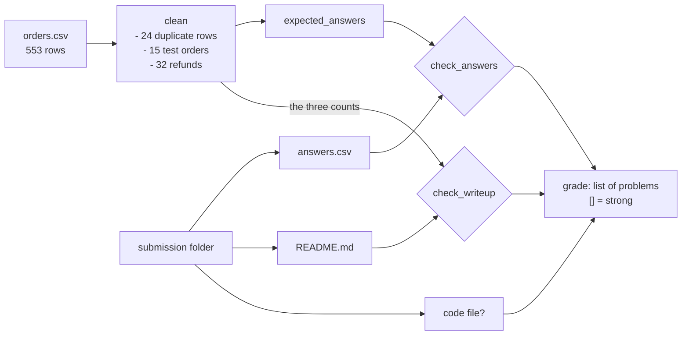

# The take-home assignment

Four hours, one dataset: what does a strong submission contain?

## Before you start

- Level 2 (intermediate). About 2 hours.
- You can find repeated rows and reconcile a total: [01-08 Duplicates and reconciliation](../../01-sql/08-duplicates-and-reconciliation/).
- You write the answer before the method: [06 Explain findings to leadership](../06-explain-findings-to-leadership/).
- You have built a small project from question to write-up: [03 Portfolio project end to end](../03-portfolio-project-end-to-end/). A take-home is the same job with a deadline.

## The problem

Kestrel Home, a fictional online furniture shop, sends analyst candidates a four-hour take-home: one CSV of September and October orders, a one-page brief with four questions, and a request for a write-up for Hana, the head of growth, who will choose which region gets next quarter's marketing budget. Rohan, the analytics manager, grades about 30 submissions a round and wants every grader on the panel to apply the same checks. You will build his grader and run it on three real-looking submissions: one strong and two weak, weak in different ways. By the end you know what Rohan looks for, so your own take-home passes his checks.

Everything in `data/` is synthetic, generated by `make_data.py` with a fixed seed. `data/takehome/` is what a candidate receives (`BRIEF.md` and `orders.csv`, 553 rows). `data/submissions/` holds the three answers to grade. Kestrel Home, Hana, Rohan and the candidates are invented.

## In plain words

Think of a cooking test for a new chef. The judge tastes the dish (is the answer right?), looks at the plate first (does the most important thing face the diner?), checks that the chef washed the vegetables (did they clean the data?), and reads the recipe card (can someone else make it again?). A beautiful plate of unwashed vegetables fails. So does a perfect dish served cold, an hour late, with no recipe.

A take-home is graded the same way. The questions in the brief have right answers, and the grader computes them from the same file. But the brief is also testing things it does not say: whether you found the problems in the data, whether you lead with the answer for a busy reader, whether you said what you assumed, and whether your code is there to rerun.

Words used in this lesson:

- **Take-home assignment**: a task a candidate does on their own time, usually with a dataset, a brief and a deadline.
- **Brief**: the instructions: questions, what to send, who the reader is.
- **Rubric**: the list of checks a grader applies to every submission, so two graders give the same result.
- **Data check**: a test of the raw data before using it, with what you found and what you did about it.
- **Duplicate row**: the same order exported twice. Counting it twice inflates revenue.
- **Test order**: an order placed by the company's own staff to test the checkout. Not a customer.
- **Refund**: an order whose money was returned. Net revenue leaves it out.
- **Assumption**: a choice you made where the brief was silent, written down so the reader can disagree.

## What you will build from scratch

- `clean`: remove duplicate rows, test orders and refunds, and count each.
- `expected_answers`: the four answers to the brief, from cleaned rows.
- `check_answers`: which submitted answers are missing or wrong.
- `check_writeup`: rubric checks on the write-up: answer first, data checks with counts, assumptions, length.
- `grade`: every problem code for one submission folder. An empty list is a strong submission.

## The idea

The grader does two different jobs. It recomputes the answers from the raw data, which catches wrong numbers however well they are written up. Then it reads the write-up against a rubric, which catches right numbers presented so the reader cannot use them.



**The rubric, as problem codes.**

| Code | The submission fails when | Why Rohan cares |
|---|---|---|
| `answers_wrong` | an answer is missing or does not match the recomputed value | Hana will spend money on it |
| `no_code` | there is no `.py`, `.sql`, `.ipynb` or `.r` file | Nobody can rerun or check it |
| `no_readme` | there is no `README.md` | There is nothing for Hana to read |
| `answer_not_first` | the first line of text under the title does not name the top region and give a number | Hana reads the top and decides |
| `data_checks` | the "## Data checks" section has no line with each problem's word (duplicate, test, refund) and the count found in the data | It shows the candidate looked, and how much it mattered |
| `no_assumptions` | no "## Assumptions" section with at least one "- " bullet | Where the brief was silent, say what you chose |
| `too_long` | more than 500 words | One page for a VP |

**The cleaning order matters.** Remove repeated order ids first (keep the first row of each), then test orders (email ending `@kestrelhome.test`), then refunds (`status` other than `paid`). In this order each row is counted once, under the first problem it has: a test order exported twice counts once as a duplicate and once as a test order.

**Why the data checks need counts.** "I checked for duplicates" is a sentence anyone can write. "24 rows were duplicates" is a claim the grader can test against the file. A count that matches the data shows the candidate actually ran the check.

**The answer-first check uses the submission's own answer.** If a candidate leads with the wrong region, that is a wrong answer (`answers_wrong`), not a buried one. The first line is checked against the region in the candidate's own `answers.csv`.

## Walk through

Run these from the lesson folder: type `python3`, then paste each block.

Step 1. The first ten minutes of any take-home: look before you add up.

```python
import sys
sys.path.insert(0, "solution")
import solution as s

rows = s.load_orders()
print(len(rows), "rows,", len({r["order_id"] for r in rows}), "order ids")
print(sorted({r["status"] for r in rows}))
print(sorted({r["customer_email"].split("@")[1] for r in rows}))
print(sorted({r["order_date"][:7] for r in rows}))
```

Four questions about the raw file: is `order_id` unique, what statuses exist, which email domains appear, which months are covered. It prints:

```
553 rows, 529 order ids
['paid', 'refunded']
['kestrelhome.test', 'mail.example']
['2026-09', '2026-10']
```

Three problems in four lines. 553 rows but 529 order ids, so 24 rows repeat an order. Some orders are refunded. And one email domain is the company's own test domain. The brief mentioned none of them.

Step 2. Clean, then answer, and see what skipping it costs.

```python
import sys
sys.path.insert(0, "solution")
import solution as s

rows = s.load_orders()
paid, counts = s.clean(rows)
print(len(paid), counts)
print(s.expected_answers(paid))
print(s.expected_answers(rows))
```

`clean` returns the paid customer orders and the three counts. The last line runs the same answers on the raw rows, as a rushed candidate would. It prints:

```
482 {'duplicates': 24, 'test_orders': 15, 'refunded': 32}
{'oct_revenue': 64581.98, 'top_growth_region': 'North', 'top_growth_amount': 3353.18, 'repeat_rate_pct': 30.2}
{'oct_revenue': 88672.58, 'top_growth_region': 'South', 'top_growth_amount': 19947.65, 'repeat_rate_pct': 34.0}
```

Every answer changes. October revenue is overstated by $24,090.60, and the top region flips from North to South: the internal team tested checkout with 15 large orders in South in October, and on the raw file South "grows" by $19,947.65 against a real $2,827.44. A candidate who skips the checks recommends the wrong region to Hana.

Step 3. Grade the three submissions.

```python
import os
import sys
sys.path.insert(0, "solution")
import solution as s

rows = s.load_orders()
for name in ("strong", "weak_fast", "weak_buried"):
    folder = os.path.join("data", "submissions", name)
    print(name, sorted(os.listdir(folder)), s.grade(folder, rows))
```

It prints each folder's files and its problems:

```
strong ['README.md', 'analysis.py', 'answers.csv'] []
weak_fast ['README.md', 'answers.csv', 'notebook_export.py'] ['answers_wrong', 'data_checks']
weak_buried ['README.md', 'answers.csv'] ['answer_not_first', 'no_assumptions', 'no_code', 'too_long']
```

Open `data/submissions/strong/README.md` and read it as Hana would. The first line names North and the dollar growth; the second line is the recommendation with its caveat; the data checks give the three counts; assumptions and limits are bullets; it is 276 words, and `analysis.py` reproduces every number with `python3 data/submissions/strong/analysis.py`.

Step 4. Why the fast submission fails.

```python
import os
import sys
sys.path.insert(0, "solution")
import solution as s

rows = s.load_orders()
paid, counts = s.clean(rows)
expected = s.expected_answers(paid)
fast = s.read_answers(os.path.join("data", "submissions", "weak_fast"))
print(fast)
print(s.check_answers(fast, expected))
with open(os.path.join("data", "submissions", "weak_fast", "README.md")) as f:
    print(s.sections(f.read())["## Data checks"].strip())
```

It prints:

```
{'oct_revenue': '88672.58', 'top_growth_region': 'South', 'top_growth_amount': '19947.65', 'repeat_rate_pct': '34.0'}
['oct_revenue', 'repeat_rate_pct', 'top_growth_amount', 'top_growth_region']
The file looked clean. No duplicates, test orders or refunds needed removing.
```

All four answers are the raw-file answers from Step 2. The write-up is short, leads with its answer and has assumptions, so it reads well. Its data checks section even uses the right words. Only recomputing the numbers shows it is wrong, and only asking for counts shows the checks were never run.

Step 5. Why the buried submission fails, with every number right.

```python
import os
import sys
sys.path.insert(0, "solution")
import solution as s

with open(os.path.join("data", "submissions", "weak_buried", "README.md")) as f:
    text = f.read()
print(len(text.split()), "words")
print(list(s.sections(text)))
print([line for line in text.splitlines() if line.strip() and not line.startswith("#")][0])
```

It prints:

```
709 words
['# Kestrel Home take-home', '## Approach', '## Data checks', '## Detailed working', '## Results']
Synthetic data from a course exercise. Kestrel Home is a fictional company.
```

709 words, the answer in the last section, no assumptions and no code ("screenshots available on request"). This candidate did the work: their data checks have the right counts and their answers are all correct. Hana would still have to read to the bottom to find the recommendation, and Rohan cannot rerun any of it.

## Common mistakes

- **Answering the brief from the raw file.** The plausible wrong answer: South, growing $19,947.65. It is the test orders. Step 2 shows every answer moving. The first ten minutes of a take-home go on Step 1, not on the first question.
- **Grading by keywords.** A grader that looks for the words "duplicates", "test" and "refund" passes the fast submission. Ask for counts and recompute the answers.
- **The answer at the bottom.** A write-up in the order the work was done ("first I opened the file...") makes the reader dig. Answer, recommendation, then evidence.
- **No code, or code that does not match.** Screenshots cannot be rerun. Code that computes something other than the answers in the write-up is worse than none: check that it reproduces your numbers before you send it ([12 Publish your portfolio](../12-publish-your-portfolio/) builds that check).
- **Doing more than was asked, and less of what was.** A dashboard, a model and three extra questions do not make up for a wrong top region. Answer the four questions well first; one clearly labelled extra idea is plenty.
- **Silent assumptions.** "Net revenue" could include or exclude refunds, tax and shipping. Pick one, write it down, and move on: the grader checks that you noticed, not that you guessed their definition.

## Your turn

Open `exercise.py`. `load_orders`, `read_answers`, `sections` and `numbers_in` are done. Write `clean`, `expected_answers`, `check_answers`, `check_writeup` and `grade` from the docstrings and the rubric table above. Then run, from this folder:

```
python3 test_lesson.py
```

The test grades the three committed submissions, then builds a new dataset and three new submissions from two other seeds in a temporary folder and grades those. It also checks hand-made cases: a duplicate, a test order and a refund in a few rows, a tie between two regions, no October customers, an empty folder, a data check with a wrong count, assumptions without bullets, an answer buried under one line of method, a write-up over 500 words, and answers written as `$260.00` or `east`. To see the reference solution pass: `CHECK_SOLUTION=1 python3 test_lesson.py`.

Stretch: write your own submission for `data/takehome/` in a new folder under `data/submissions/`, run `grade` on it, and fix what it finds. Then add a rubric check of your own, for example that the recommendation line contains a word such as "recommend" or "suggest".

## Check yourself

1. You have four hours. How do you spend the first twenty minutes?
2. Your numbers are right but the grader says `answer_not_first`. What do you change?
3. Why does the grader ask for counts in the data checks, not just a mention?
4. The brief says "net revenue" and nothing else. What do you do?

<details>
<summary>Answers</summary>

1. Read the brief twice, then look at the raw file before computing anything: is the id unique, what values do the category columns take, which dates are covered, are there accounts that look internal. Write down each problem as you find it; those notes become the data checks section.
2. Move the answer to the first line under the title: the region and the number, then the recommendation on the next line. Method, checks and detail go below.
3. A count can be checked against the data; a mention cannot. It also tells the reader how much the problem mattered: 15 test orders worth $15,267.13, all in one region, change the answer.
4. Choose the most sensible reading (paid orders, without refunds), write it under Assumptions, and if it is cheap, say in one line how the answer changes under the other reading.

</details>

## What to tell the stakeholder

Your message to Rohan after grading: "Of the three, only the strong submission passes: correct answers, the recommendation in the first two lines, counted data checks and code that reruns. The fast one recommends South, which only leads because of 15 internal test orders; the buried one has every number right but no code and the answer at the bottom of 709 words. Caveat: the grader checks structure and numbers, not judgement, so a person still reads the recommendation of any submission that passes."

## In real job postings

In the Real Analyst Jobs data drop of 25 October 2026, 375 of the 2,789 US analyst postings (13.4%) are labelled Entry Level and 1,048 (37.6%) Mid Level ([data/job-market/2026-10](../../../data/job-market/2026-10/), `by_country_seniority.csv`). Take-homes are common at both levels because they show the whole job at once. The [SQL case study](https://realanalystjobs.com/tools/sql-case-study) page has more practice tasks of this shape.

## Next

[11 Behavioural answers that show analysis](../11-behavioural-answers/)
