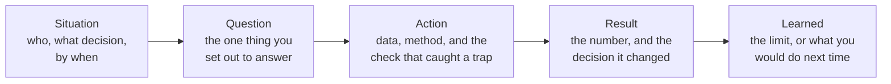

# Behavioural answers that show analysis

Tell me about a time your analysis changed a decision.

## Before you start

- Level 1 (beginner). About 1 hour. Guide, no test: there is nothing to compute, so there is no `test_lesson.py`. The Check yourself questions at the end are the check.
- The worked answers use two course projects. Do them first, or at least read their results: [03 Portfolio project end to end](../03-portfolio-project-end-to-end/) and [06 Explain findings to leadership](../06-explain-findings-to-leadership/).
- Every number in an answer must be one you can show: [07 Resume bullets that are true](../07-resume-bullets-that-are-true/) builds the checker you will reuse here.

## The problem

Maya Okafor passed the SQL screen at Fernhill Software, a fictional company. The next round on Thursday is 30 minutes with Tomas, the analytics manager, and it is behavioural: questions that start with "Tell me about a time". Maya has one internship and three course projects. Her first try at "tell me about a time your analysis changed a decision" was four minutes on how she cleaned the data, and it never said what changed. You will turn her projects into three short answers that each give a question, a method, a number and a decision, and that are true as told.

Fernhill Software, Tomas and Maya are invented. The projects and their numbers are the course's own synthetic datasets.

## In plain words

Think of telling a friend about a cricket match they missed. You do not describe every ball. You say where the game stood ("we needed 40 off 3 overs"), what one player did ("she moved the field and bowled short"), and how it ended ("we won by 6 runs"). Then maybe one thing you would have done differently.

A behavioural answer is the same shape. The interviewer is not checking that you remember the project. They are checking that you think like an analyst under real conditions: that you start from a decision, pick a method that fits, notice a trap, give a number, and know what the number does not prove.

Words used in this lesson:

- **Behavioural question**: a question about something you did in the past, usually starting "Tell me about a time". The idea behind them is that how you acted before says a lot about how you will act again.
- **STAR**: a common shape for an answer: Situation, Task, Action, Result.
- **Stakeholder**: the person who will act on your analysis, such as a head of growth or a VP.
- **Answer bank**: a short file of your best stories, written down once, so each one is ready for several questions.
- **Reflection**: one sentence on what you learned or would do differently. Interviewers often ask for it if you do not offer it.

## What you will build from scratch

- A version of STAR for analysts, with a question and a check in it.
- Three worked answers built from course projects, each with its weak first draft beside it.
- Your own answer bank: three stories, each mapped to the questions it can answer, with every number traced to a file you can open.

## The idea

Plain STAR misses what makes an analyst's answer convincing. "Action: I analysed the data" says nothing. Two parts are added, and the Result is split in two:

| Part | Say | About |
|---|---|---|
| Situation | Who needed what, by when. One or two sentences | 15 seconds |
| Question | The question as a sentence with a number for an answer | 10 seconds |
| Action | The data, the method in plain words, and the one check or trap that mattered | 45 seconds |
| Result | The number with its comparison, and the decision before and after | 30 seconds |
| Learned | The caveat, or what you would change | 15 seconds |

The times add to about two minutes. They are a guide, not a rule: the point is that Action is not the whole answer, and Result is never left out.

**Three rules that keep it honest.**

1. **Say what it was.** A course or portfolio project is a project, not a job. Start with "In a portfolio project on a synthetic subscription dataset" and the interviewer will judge your thinking, which is what they want. Presenting it as work for a real company is a lie that one follow-up question exposes.
2. **"I", with the right verb.** Say what you did: "I split the cancellations", "I recommended". Do not claim the outcome ("I cut churn") when what you did was measure it or recommend a change.
3. **Every number traces.** If you say "28.8%", you can open the file that says 28.8%. The rule from [lesson 07](../07-resume-bullets-that-are-true/) applies to spoken answers too.

**One story, several questions.** Most behavioural questions for analysts are a handful of themes in different words: a decision you changed, a mistake you caught, explaining a result to a non-technical person, a disagreement, unclear or messy data. A good story usually covers two or three of them, so an answer bank of three stories is enough to start.

## Walk through

Each answer below has the question, a weak first draft, the analyst version, and why it works. The numbers are the course projects' own. Tell a story only as you did it: if you skipped a step, do not say you did it. Read them aloud with a timer.

### Answer 1. "Tell me about a time your analysis changed a decision."

From [03 Portfolio project end to end](../03-portfolio-project-end-to-end/).

**Weak first draft.** "I did a churn project. I wrote SQL to pull the subscriptions, filtered the dates, ran a z test and made a chart. The p value was 0.09. It was really interesting."

It has no situation, no question and no decision. The one number, a p value, is the least useful thing to lead with.

**Analyst version.**

- *Situation.* "In a portfolio project on a synthetic meal kit dataset, the head of growth believed free trial customers cancel faster and wanted an answer before the budget review."
- *Question.* "So the question was: do trial starters cancel within 90 days more often than customers who pay from day one?"
- *Action.* "Counting from signup, trial starters looked terrible: 41.8% against 18.3%. But a trial starter who cancels on day 5 never paid, so I split the two events. I counted trial conversion on its own, and churn only from the first paid day, and only for customers with 90 paid days of history, so recent customers were not counted as staying."
- *Result.* "224 of 779 trial starters, 28.8%, never paid. Among paying customers, trial converters churned at 22.9% against 18.3%, but the 95% interval for that gap ran from -0.8 to 10.1 points, so it could be zero. So the conversation moved from whether the trial makes people leave to how to get more trial starters to pay. I recommended work on trial conversion, and an A/B test before any change to the trial itself."
- *Learned.* "The comparison was observational: customers chose how to start, so even a clear gap would not prove the trial causes churn. That is why I recommended a test."

**Why it works.** The trap (one churn number for two events) is the heart of the story, and it is stated in one sentence. The result has counts, rates and an interval. The decision changes from one thing to another, and the reflection shows the analyst knows what the numbers cannot say.

**Other questions this story answers.** "Tell me about a time the obvious number was wrong." "Tell me about a time you pushed back on a stakeholder's belief." "How do you handle incomplete data?" (the 90 day history rule).

### Answer 2. "Tell me about a time you explained a technical result to a senior person."

From [06 Explain findings to leadership](../06-explain-findings-to-leadership/).

**Weak first draft.** "I always try to keep it simple. I made a dashboard and explained the confidence interval to the VP, and she understood it."

It has no evidence and no specific result. "I always" answers a question about habits, not a time.

**Analyst version.**

- *Situation.* "In a course project on a synthetic food delivery dataset, a VP of operations had to decide by 13 November whether four cities switch to a new dispatch rule. She reads email between meetings."
- *Question.* "She needed one thing: did on-time deliveries go up on the new rule, by how much, and should she approve it?"
- *Action.* "A summary in the order I did the work would have put the answer on line 3. I wrote it so line 1 was the result and line 2 the decision, and I wrote a small checker that fails a summary if the first two lines miss the number, the direction or the ask, or if any number is not in the results file. It also catches rounding: written as 0 to 8 points, the interval reads as 'maybe no better', which is not what the test found."
- *Result.* "The summary said on-time rose 4.0 points, from 80.5% to 84.5%, with a 95% interval of 0.4 to 7.5, and asked her to approve the switch, with one caveat: it was measured in one city in ordinary weeks."
- *Learned.* "Rounding is not neutral. I now copy numbers from the results file instead of retyping them."

**Why it works.** It shows the craft (answer first, decision second) through a specific before and after. The rounding detail is small and concrete, and it shows care with numbers, which is what a manager is really asking about.

**Other questions this story answers.** "How do you communicate with non-technical stakeholders?" "Tell me about a time you improved your own work."

### Answer 3. "Tell me about a mistake you made."

Also from [03 Portfolio project end to end](../03-portfolio-project-end-to-end/), Step 2: the trap of counting customers whose outcome is not known yet. Tell this story only if you made this mistake yourself when you did the lesson; otherwise use a mistake you did make. The shape is what to copy.

**Weak first draft.** "I am a perfectionist, so I do not really make mistakes. I double check everything."

It refuses the question. Interviewers ask about mistakes to see whether you notice and fix them, so "none" is the weakest possible answer.

**Analyst version.**

- *Situation.* "In the same churn project, my first churn query counted every paying customer, including people who had started paying a few weeks before the data date."
- *Question.* "I was trying to measure how many paying customers cancel within 90 days of their first payment."
- *Action.* "The rates looked plausible, which is what made it dangerous: 22.5% and 17.4%. Then I checked the newest customers and saw they had not had 90 days yet, so they could not have churned in the window. They were being counted as staying. I added a filter: only customers with at least 90 paid days of history."
- *Result.* "Both rates went up, to 22.9% and 18.3%. The direction of the gap did not change, but the levels did, and the levels are what a budget uses."
- *Learned.* "Before I count an outcome, I write down the window everyone needs to have had. It is the first line of my method now."

**Why it works.** It is a real mistake with a real size (both rates were too low), found by a specific check, fixed with a specific rule, and turned into a habit. It is told without drama.

**Other questions this story answers.** "Tell me about a time the data was not what you expected." "How do you check your own work?"

## Common mistakes

- **All method, no result.** Four minutes on cleaning and joins, and the interviewer never hears what changed. Keep Action to the one check that mattered, and always say the number and the decision.
- **Passing off a course project as a job.** Say "a portfolio project on synthetic data". Your thinking is what is being judged, and it is just as visible.
- **"We" all the way through.** The interviewer cannot hire your team. Say what you did, and name what others did if it matters.
- **Claiming the outcome.** "I increased on-time deliveries by 4.0 points" when you measured a test. Say "I measured", "I found", "I recommended".
- **A number you cannot show.** If you would not put it on your resume, do not say it in an interview. Interviewers often ask "how did you get that number?".
- **No reflection.** "What would you do differently?" is a common follow-up. Have one honest sentence ready: a limit of the data, a check you would add, a test you would run.

## Your turn

Guide, no test. Write your answer bank in a file of your own, for example `my_answers.md` in this folder.

1. Pick three stories: one where your analysis changed or shaped a decision, one where you found a mistake (yours or the data's), and one where you explained a result to someone non-technical. Course projects are fine, labelled as such.
2. Write each one in the five parts: Situation, Question, Action, Result, Learned. Two to four sentences per part at most.
3. Under each story, list the three or four questions it can answer.
4. Check every number. Put each story's numbers into the evidence file from [lesson 07](../07-resume-bullets-that-are-true/), paste each answer's Result as a bullet under its project heading, and run that lesson's checker. Fix anything inflated, untraceable or written as percent when it is points.
5. Say each answer aloud with a timer. If it runs over about two and a half minutes, cut Action first.

Stretch: ask a friend to interrupt you after 60 seconds with "so what happened?". If you have not given the number yet, move it earlier.

## Check yourself

1. Why add a Question part to STAR for an analyst?
2. Your story comes from a course project with synthetic data. How do you introduce it?
3. In Answer 1, why lead the Result with "224 of 779 never paid" and not the p value of 0.09?
4. The interviewer asks "and what would you do differently?". What makes a good answer?

Answers

1. Because the question is where an analyst's judgment starts. Saying it shows you turned a vague worry ("trial customers leave faster") into something with a number for an answer, and it lets the interviewer judge whether your method fits it.
2. Say what it is at the start: "In a portfolio project on a synthetic subscription dataset". Then tell it exactly as you would a job story. The interviewer is judging your reasoning, which is the same either way, and the honesty itself counts.
3. Because it is the finding that changes the decision: the clear loss is trial starters who never pay, which points to working on conversion. The p value says the churn gap could be noise, which belongs after the main finding, as the reason not to cut the trial.
4. One specific, honest point about the work: a limit of the data, a check you would add earlier, or a test you would run before acting. "Nothing" or a disguised boast ("I would work even harder") are the weak answers.

## What to tell the stakeholder

Here the stakeholder is the interviewer, and the first sentence matters most. For Answer 1: "In a portfolio project, my analysis moved a recommendation from cutting a free trial to fixing trial conversion: 224 of 779 trial starters (28.8%) never paid, while the churn gap among paying customers could have been zero. The comparison was observational, so I recommended an A/B test before any change to the trial."

## In real job postings

In the Real Analyst Jobs data drop of 25 October 2026, the 2,789 US analyst postings come from 667 companies ([data/job-market/2026-10](../../../data/job-market/2026-10/), `by_country.csv`). Each company runs its own interviews, so you will tell the same few stories many times, and writing them down once pays back quickly. The [data analyst interview questions](https://realanalystjobs.com/tools/data-analyst-interview-questions) page collects questions to practise against.

## Next

[12 Publish your portfolio](../12-publish-your-portfolio/)
