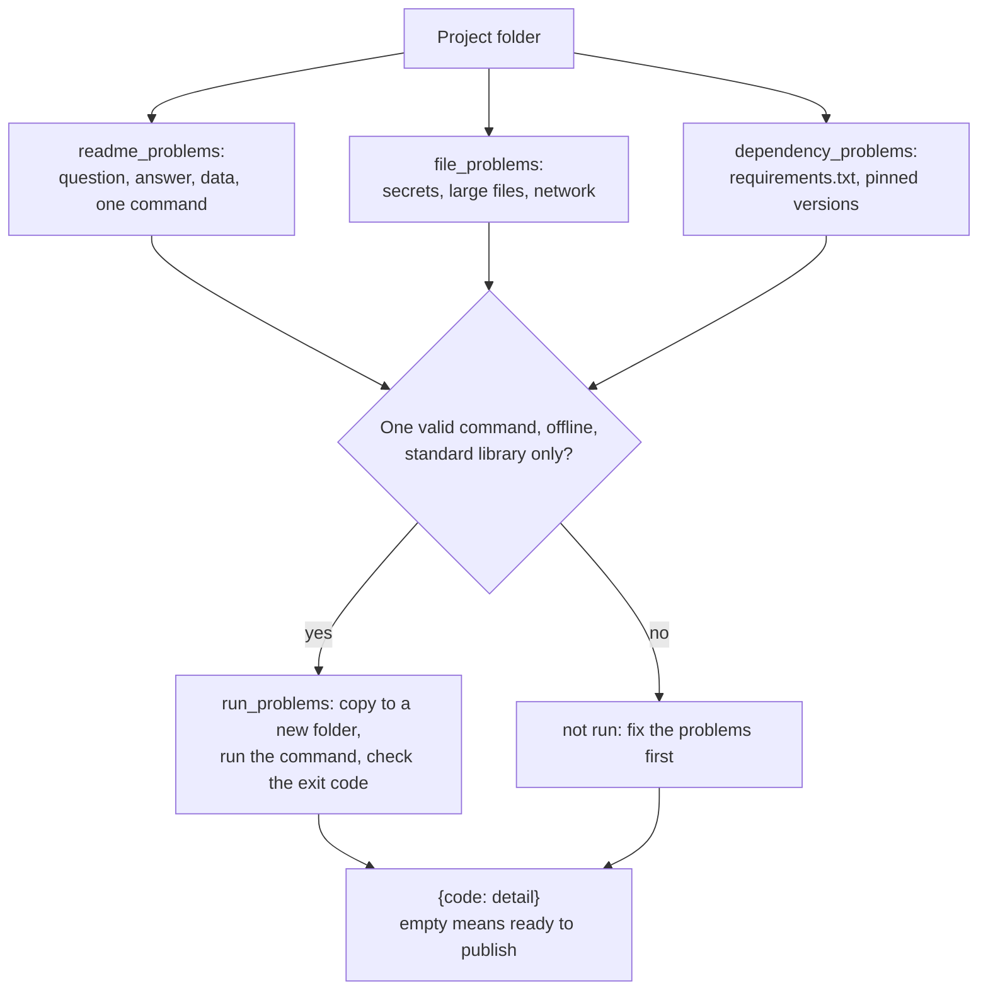

# Publish your portfolio

Can a hiring manager run your project in one command?

## Before you start

- Level 1 (beginner). About 2 hours.
- You have built a portfolio project with a write-up: [03 Portfolio project end to end](../03-portfolio-project-end-to-end/). This lesson checks it before it goes public.
- You can run a Python file and read a short function: [00-06 Python for spreadsheet people](../../00-start-here/06-python-for-spreadsheet-people/).
- No git or GitHub account is needed for the lesson. The checker works on any folder.

## The problem

Maya Okafor has finished her churn project and wants to put it on GitHub before she applies to five roles on Monday. She has five copies of it on her laptop, from different evenings, and is not sure which one is safe to publish. A hiring manager who opens her link will give it a few minutes: read the README, try the run command, look at the code. You will build a checker that looks at a project folder the way that hiring manager would, and also the way an attacker scanning public code for keys would. It runs the project on a clean copy, so "it works on my laptop" does not count.

The folders in `data/projects/` are synthetic, written by `make_data.py`. Maya, her data and every key in them are invented; the keys are random strings that only look like keys.

## In plain words

Think of handing a recipe to a friend. They need to know what dish it makes (the question), what it tastes like (the answer), where to buy the ingredients (the data source), and one clear first step. If the recipe says "use the sauce in my fridge", it only works in your kitchen. If you left your house key taped to the page, you have a different problem.

A portfolio project is a recipe a stranger follows without you in the room. The checker reads it as that stranger would.

Words used in this lesson:

- **Repository (repo)**: a project folder kept in git and usually published on a site such as GitHub.
- **README**: the page a repository shows first. Here it must have the sections Question, Answer, Data and How to run.
- **Provenance**: where the data came from, and the licence that says you may share it.
- **Run command**: the one line a reader types to rebuild your numbers, such as `python3 analysis.py`.
- **Secret**: anything that gives access: an API key (a password for a web service), a token, a password. A `.env` file is a common place to keep them on your own machine, and it should never be published.
- **Pinned requirement**: a package with an exact version, such as `pandas==2.2.3`, so the reader installs what you tested with.
- **Clean copy**: a fresh copy of only the project's files, in a new folder, with nothing from your laptop.
- **Standard library**: the modules that come with Python, such as `csv` and `json`. Code that only uses them needs nothing installed.

## What you will build from scratch

- `readme_problems`: the four sections, a question with a question mark, an answer with a number, provenance, and exactly one run command that names a file in the project.
- `file_problems`: secrets, files over 1,000,000 bytes, and code that reaches the internet.
- `dependency_problems`: packages imported with no `requirements.txt`, and versions that are not pinned.
- `run_problems`: run the command on a clean copy and report a failure.

## The idea



Every check gives a **problem code** and a one-line detail that says what to fix. The rules:

| Code | The project fails when |
|---|---|
| `readme` | there is no README.md (the README checks are then skipped) |
| `question` | there is no `## Question` section, or it has no question mark |
| `answer` | there is no `## Answer` section, or it has no number |
| `provenance` | `## Data` does not mention a licence, or has neither a link nor the word synthetic |
| `run_command` | `## How to run` does not have exactly one fenced block with exactly one line of the form `python3 <file>.py`, or that file is missing |
| `secret` | there is a file named `.env` (an `.env.example` with no values is fine), or a line that assigns a key, secret, token or password a value of 16 or more letters, digits, `_` or `-` |
| `large_file` | a file is over 1,000,000 bytes |
| `network` | a line of Python code (not a comment) contains `http://`, `https://`, `urlopen(`, `requests.` or `socket.` |
| `requirements` | the code imports a module that is neither in the standard library list nor a file in the project, and there is no requirements.txt |
| `unpinned` | a line in requirements.txt has no `==` |
| `runs` | the command, run on a clean copy, exits with a code other than 0 or takes over 30 seconds |

**Why run it on a clean copy.** On your laptop the project can read a file that is not in the project, use a package you installed months ago, or find a setting in your shell. A clean copy has none of that, which is what the hiring manager has. The checker copies the folder into a new temporary folder, runs the command there with the same Python, and reads the **exit code**: 0 means the program finished without an error.

**Why some projects are not run.** A project that needs packages would have to install them, and one that reaches the internet would not run offline, so the checker reports those problems and stops there. This also keeps the checker's answer the same on every machine: whether pandas happens to be installed does not change it.

**Why a secret is never "just a test key".** Public code is read by programs that search it for keys, so a key in a public repository should be treated as found. Deleting the file in a later commit does not remove it from the repository's history. Keep keys in environment variables, read them with `os.environ.get("API_KEY")`, list `.env` in a `.gitignore` file so git never adds it, and publish an `.env.example` with the names and no values. The checker's pattern is deliberately simple. Real scanners also know the exact formats that many providers use for their keys.

## Walk through

Run these from the lesson folder: type `python3`, then paste each block.

Step 1. Look at the project that is ready.

```python
import sys
sys.path.insert(0, "solution")
import solution as s

folder = "data/projects/churn-ready"
print(s.project_files(folder))
print(sorted(s.sections(s.read_text(folder, "README.md"))))
print(s.run_command(folder))
```

`sys.path.insert(0, "solution")` lets Python find the worked answer, and `import solution as s` loads it. `project_files` lists every file, `sections` splits the README at its `## ` headings, and `run_command` returns the one line under How to run. It prints:

```
['README.md', 'analysis.py', 'data/customers.csv']
['Answer', 'Data', 'How to run', 'Method', 'Question']
python3 analysis.py
```

Three files, the four required sections plus Method, and one command. Running that command from `data/projects/churn-ready` prints `trial: 16 of 30 churned (53.3%)` and `paid: 9 of 33 churned (27.3%)`, the numbers in its Answer.

Step 2. The README checks.

```python
import sys
sys.path.insert(0, "solution")
import solution as s

for name in ("churn-ready", "churn-no-answer", "churn-two-commands"):
    print(name, s.readme_problems("data/projects/" + name))
```

It prints:

```
churn-ready {}
churn-no-answer {'question': 'add a ## Question section that asks one question, with a question mark', 'answer': 'add a ## Answer section that gives the answer as a number'}
churn-two-commands {'run_command': '## How to run needs exactly one fenced block with exactly one command'}
```

`churn-no-answer` has a method and a run command, but a reader cannot tell what it answers. `churn-two-commands` asks the reader to install packages first, in the same block. If a project needs packages, say so in a separate Setup section and pin them; better still, use only the standard library, as the ready project does.

Step 3. The trap: it works on my laptop.

```python
import sys
sys.path.insert(0, "solution")
import solution as s

for name in ("churn-ready", "churn-my-laptop"):
    print(name, s.run_problems("data/projects/" + name, "python3 analysis.py"))
```

It prints:

```
churn-ready {}
churn-my-laptop {'runs': "python3 analysis.py failed on a clean copy: FileNotFoundError: [Errno 2] No such file or directory: '/Users/maya/Downloads/customers.csv'"}
```

`churn-my-laptop` passes every README and file check. On Maya's laptop it runs, because the file is in her Downloads folder. Anywhere else it fails on the first line that opens the data. The fix is the line the ready project uses: build the path from the script's own folder, `os.path.join(HERE, "data", "customers.csv")`, and keep the data file in the project.

Step 4. Files and dependencies.

```python
import sys
sys.path.insert(0, "solution")
import solution as s

for code, detail in sorted(s.file_problems("data/projects/churn-leaked-key").items()):
    print(code, "-", detail)
print(s.dependency_problems("data/projects/churn-two-commands"))
```

It prints:

```
network - analysis.py line 20 reaches the internet; the project must run offline
secret - remove it, and replace the key if it was ever pushed: .env, .env line 1, analysis.py line 6
{'unpinned': 'pin every version with ==, for example pandas==2.2.3: pandas, matplotlib>=3.0'}
```

The leaked-key project has the key twice: in `.env`, and pasted into the code "while testing". The network call is why the key was there. A reader without the key cannot run it, and nobody can run it offline. `matplotlib>=3.0` counts as unpinned: it allows any later version, so a reader can install one you never tested.

Step 5. All five projects.

```python
import sys
sys.path.insert(0, "solution")
import solution as s

s.main("data/projects")
```

It prints:

```
churn-leaked-key: network, secret
    network: analysis.py line 20 reaches the internet; the project must run offline
    secret: remove it, and replace the key if it was ever pushed: .env, .env line 1, analysis.py line 6
churn-my-laptop: runs
    runs: python3 analysis.py failed on a clean copy: FileNotFoundError: [Errno 2] No such file or directory: '/Users/maya/Downloads/customers.csv'
churn-no-answer: answer, question
    answer: add a ## Answer section that gives the answer as a number
    question: add a ## Question section that asks one question, with a question mark
churn-ready: ready to publish
churn-two-commands: run_command, unpinned
    run_command: ## How to run needs exactly one fenced block with exactly one command
    unpinned: pin every version with ==, for example pandas==2.2.3: pandas, matplotlib>=3.0
```

One of five is ready. Maya publishes `churn-ready` and deletes the others.

## Common mistakes

- **Checking on your own machine only.** `churn-my-laptop` passes every check you can do by reading it, and fails the moment it runs anywhere else. Run on a clean copy.
- **A key in the code "for now".** Even a key you think is a test key gives access to something. Read keys from the environment and publish an `.env.example`.
- **A README with the method and no answer.** The reader came for the answer. Put the question and the number at the top, as in [06 Explain findings to leadership](../06-explain-findings-to-leadership/).
- **Unpinned or missing requirements.** `pandas` alone installs whatever is newest on the day someone reads your project. Pin it, or use the standard library.
- **Committing a large raw export.** Keep the data the analysis needs, small, in the repository, and link to the source for the rest. Say in the Data section how to rebuild it.
- **Treating "ready to publish" as "good".** The checker proves the project can be read and run. Whether the question matters and the analysis is right is the work of [lesson 03](../03-portfolio-project-end-to-end/).

## Your turn

Open `exercise.py` and fill in `readme_problems`, `file_problems`, `dependency_problems` and `run_problems`. Then run, from this folder:

```
python3 test_lesson.py
```

The test checks your code on the five committed projects, on fifteen projects built from three other seeds with a random mix of problems (written to a temporary folder, including a file over the size limit), and on small hand-made folders: an empty folder, a command that names a missing file, a command that is not Python, a script that exits with code 1, and a project with safe patterns (a URL in a comment, a key read from the environment, a local module, an `.env.example`, an empty file). To see the reference solution pass: `CHECK_SOLUTION=1 python3 test_lesson.py`.

Then check your own project: `python3 -c "import exercise; exercise.main('/path/to/your/projects')"`, where that folder holds one or more project folders. Fix every problem before you push. If you have ever pushed a key, replace it at the provider: deleting it from the repository does not remove it from the history.

Stretch: add a check that every number in the README's Answer section appears in what the run command prints, so the write-up and the code cannot drift apart.

## Check yourself

1. Why does the checker run the project on a copy in a new folder instead of where it is?
2. You deleted `.env` in a new commit. Is the key safe now?
3. Why is `matplotlib>=3.0` flagged when it does name a version?
4. A hiring manager has five minutes with your repository. What should they see in the first one?

<details>
<summary>Answers</summary>

1. Because the original folder may have files that are not part of the project (outputs from earlier runs, a data file you forgot to add), and your laptop may have files outside it that the code reads. A new folder with only the project's files is what a reader gets when they download it.
2. No. The key is still in the repository's history, and anyone who copied the repository has it. Replace the key with the provider, then remove it from the code and keep it in the environment.
3. `>=3.0` allows any later version, including ones released after you tested. A reader can install a version that behaves differently. `==` names the one version you ran.
4. The question, the answer with its number, and one command they could run. Then the data source and its licence, so they know you are allowed to share it.

</details>

## What to tell the stakeholder

Here the stakeholder is Maya: "Publish `churn-ready` only. It answers its question with a number, says where the data came from, and runs in one command on a clean copy with no installs. Two of the others would fail for a reviewer, one would publish a key, and one has no answer. If any of them has ever been pushed with the key, replace that key first."

## In real job postings

In the Real Analyst Jobs data drop of 25 October 2026, 996 of the 2,056 US analyst postings that list tools (48.4%) ask for Python ([data/job-market/2026-10](../../../data/job-market/2026-10/), `by_country_skill.csv`). A project a reviewer can run in one command is direct evidence for that line of the posting. Browse [Python data analyst jobs](https://realanalystjobs.com/jobs/python-data-analyst-jobs), and see [how to become a data analyst](https://realanalystjobs.com/tools/how-to-become-a-data-analyst) for what to put in a portfolio.

## Next

Back to [Getting hired](../README.md) for the full list of lessons in this phase, or move on to the [modern data stack](../../08-modern-data-stack/README.md).
