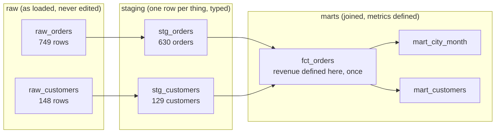

# Warehouse layers: raw, staging and marts

Why do we never edit raw data, and where should a metric be computed?

## Before you start

- **Level 2** (intermediate). About 2 hours.
- **Builds on:** [01-01 GROUP BY from raw rows](../../01-sql/01-group-by-from-raw-rows/), [01-02 Joins without losing rows](../../01-sql/02-joins-without-losing-rows/), [01-03 Window functions](../../01-sql/03-window-functions/) (ROW_NUMBER for "latest row wins") and [03-05 Define a metric precisely](../../03-metrics-and-product-analytics/05-define-a-metric-precisely/).
- **You need:** Python 3.9 or later. Nothing to install. The warehouse is SQLite, run by `warehouse.py` in this folder.

## The problem

Brightcart, the fictional online grocery from earlier lessons, now loads its order system and its customer list into a warehouse every night. Two dashboards read from it, and on Friday they disagreed: the city dashboard says August to October revenue was 257,281.76, the customer value dashboard says 333,425.99. Maya, the operations lead, asks you to make them agree before Monday's review, and asks why last week's "fix" (someone edited a city name straight in the loaded table) came undone overnight. You have the two raw tables as they landed: 749 order rows and 148 customer rows.

## In plain words

Think of a restaurant kitchen. Deliveries arrive in crates: muddy carrots, a sack of rice, a box with one broken egg. Nobody scrubs the carrots inside the delivery crate and then throws the delivery note away. The crates stay as they came, so you can always check what the supplier actually sent. Prep cooks wash, peel and portion everything onto labelled trays. Chefs cook dishes from the trays, and every dish that uses "the house sauce" uses the same tray of sauce, made once.

A warehouse is organised the same way, in **layers** (groups of tables, one group built from the one below):

- **Raw**: the tables exactly as the source systems sent them. Messy, repeated, never edited. In the kitchen, the crates.
- **Staging**: one cleaned table per raw table. Same rows, now with one row per real thing (one per order, one per customer), typed columns (a date is a date, money is a number) and consistent names. The labelled trays.
- **Marts**: tables built for a use, by joining staging tables and defining the business metrics. The dishes. A mart that holds one row per event (one per order) is called a **fact table**, usually named `fct_`.
- A **model** is one SELECT that builds one table in staging or marts from the layers below it.
- A **rebuild** drops every staging and mart table and builds them again from raw. If raw is untouched, a rebuild always gives the same tables. That property is called **deterministic**.
- A **load** is one run of the nightly copy from a source into raw. Each row here carries the `load_id` of the run that brought it.

## What you will build from scratch

- `stg_orders`: one row per order out of 749 raw rows, the latest load wins, dates in one format, money as numbers.
- `fct_orders`: every order with its city, and the one and only definition of revenue.
- `mart_city_month` and `mart_customers`: the two dashboards' tables, both reading revenue from `fct_orders`, so they cannot disagree.
- A rebuild that you run twice and get byte-for-byte the same tables.

`stg_customers` is written for you in `exercise.sql` as the pattern. The data in `data/` is synthetic, made by `make_data.py` with a fixed seed.

## The idea

Data flows one way, up the layers. Each arrow is a model. Nothing ever flows back down into raw.



**Rule 1: never edit raw.** Raw is your only copy of what the source said. If you fix a value there, three things go wrong: the next load sends the original row again and your fix disappears; nobody can tell any more what the source really sent; and a colleague who reloads raw from the source gets different numbers from yours. A fix is written as a rule in a staging model (`TRIM(city)`, "latest load wins"), so it is applied again on every rebuild.

**Rule 2: every layer is rebuilt from the one below.** So the whole warehouse is a function of raw:

    staging = f(raw)        marts = g(staging)        so marts = g(f(raw))

Same raw in, same marts out. A model must not depend on the time it runs or on the order rows happen to come back in.

**Rule 3: define each metric once, as low as it can go.** Revenue at Brightcart is "amount minus discount, for delivered orders" (finance's definition from [08-06](../06-git-for-analysts/)). Put that CASE expression in one column of the fact table. Every mart sums that column. If two marts each write their own revenue expression, they will drift apart the first time someone edits one of them, which is exactly Friday's problem.

**Latest load wins.** The loader re-sends an order when it changes, so one order can have several raw rows. An order that was cancelled first landed as `pending`. The staging rule is: for each `order_id`, keep the row with the highest `load_id`:

```sql
ROW_NUMBER() OVER (PARTITION BY order_id ORDER BY load_id DESC) = 1
```

**ELT, not ETL.** Older pipelines cleaned the data before loading it (Extract, Transform, Load). If the cleaning had a bug, the original was gone. Modern warehouses are cheap enough to load first and transform inside the warehouse (Extract, Load, Transform), which is exactly what keeping raw makes possible: a bug in staging is fixed by editing the model and rebuilding.

## Walk through

Run each block in Python from this folder (type `python3`, then paste), in order, because later blocks use names from earlier ones. The blocks use only `warehouse.py` and plain SQL.

Step 1. Load raw and look at one order's history.

```python
import sqlite3, warehouse

con = warehouse.load_raw(sqlite3.connect(":memory:"))
print(con.execute("SELECT COUNT(*), COUNT(DISTINCT order_id) FROM raw_orders").fetchone())
for row in con.execute("SELECT * FROM raw_orders WHERE order_id = 1201 ORDER BY load_id"):
    print(row)
```

```text
(749, 630)
(1, 1201, 63, '2026-08-01 04:33:00', 'PENDING', '', '0.00')
(3, 1201, 63, '2026-08-01 04:33:00', 'Refunded', '1199.72', '0.00')
```

749 rows hold 630 distinct orders. Order 1201 landed on load 1 as `PENDING` with no amount (the payment system had not answered), then again on load 3 as refunded, with its amount. Count raw rows and you count this order twice.

Step 2. The messy columns, side by side.

```python
for row in con.execute("""
    SELECT ordered_at, status, amount FROM raw_orders
    WHERE order_id IN (1224, 1018) OR amount LIKE '%,%' LIMIT 4"""):
    print(row)
print(con.execute("SELECT DISTINCT status FROM raw_orders ORDER BY status").fetchall())
```

```text
('2026-08-01 14:48:00', 'PENDING', '1586.25')
('01/08/2026 08:45', 'Delivered', '828.71')
('02/08/2026 23:41', 'Refunded', '1,401.64')
('04/08/2026 02:21', 'DELIVERED', '1,085.56')
[('CANCELLED',), ('Cancelled',), ('DELIVERED',), ('Delivered',), ('PENDING',), ('Pending',), ('REFUNDED',), ('Refunded',), ('cancelled',), ('delivered',), ('pending',), ('refunded',)]
```

Two date formats (the old app wrote day first), twelve spellings of four statuses, and amounts stored as text with thousands commas. None of that is an error to fix in raw. Each is a rule for staging.

Step 3. The staging rules, one at a time, on a few rows.

```python
print(con.execute("""
    SELECT ordered_at,
           CASE WHEN ordered_at LIKE '__/__/____%'
                THEN SUBSTR(ordered_at, 7, 4) || '-' || SUBSTR(ordered_at, 4, 2) || '-' || SUBSTR(ordered_at, 1, 2)
                ELSE SUBSTR(ordered_at, 1, 10) END AS order_date
    FROM (SELECT DISTINCT ordered_at FROM raw_orders WHERE order_id IN (1224, 1018))""").fetchall())
print(con.execute("SELECT CAST(NULLIF(REPLACE(TRIM('1,234.50'), ',', ''), '') AS REAL), "
                  "CAST(NULLIF(REPLACE(TRIM(''), ',', ''), '') AS REAL)").fetchone())
```

```text
[('2026-08-01 14:48:00', '2026-08-01'), ('01/08/2026 08:45', '2026-08-01')]
(1234.5, None)
```

`LIKE '__/__/____%'` matches two characters, a slash, two, a slash, four (`_` is any one character). `SUBSTR(text, start, length)` counts from 1. The amount rule removes the comma, turns an empty string into NULL with `NULLIF`, then casts. An unknown amount must stay NULL: 0 would claim the order was free. In PostgreSQL, Snowflake and BigQuery you would write `TO_DATE(ordered_at, 'DD/MM/YYYY')` (or `PARSE_DATE` in BigQuery) instead of the SUBSTR pieces.

Step 4. Build the given staging model and check it has one row per customer.

```python
models = warehouse.read_models("exercise.sql")
print([name for name, sql in models])
warehouse.build(con, models[:1])
print(con.execute("SELECT COUNT(*), COUNT(DISTINCT customer_id) FROM stg_customers").fetchone())
print(con.execute("SELECT * FROM raw_customers WHERE customer_id = 19").fetchall())
print(con.execute("SELECT * FROM stg_customers WHERE customer_id = 19").fetchall())
```

```text
['stg_customers', 'stg_orders', 'fct_orders', 'mart_city_month', 'mart_customers']
(129, 129)
[(1, 19, ' nashik', '2026-08-11'), (30, 19, 'Nagpur', '2026-08-11')]
[(19, 'Nagpur', '2026-08-11')]
```

`read_models` splits the file at each `-- model:` line. `build` runs `CREATE TABLE stg_customers AS <your SELECT>`. Customer 19 moved from Nashik to Nagpur: raw has both rows, staging keeps only the latest, cleaned.

Step 5. Why the fact table uses a LEFT JOIN.

```python
print(con.execute("""
    SELECT COUNT(DISTINCT o.customer_id)
    FROM raw_orders o LEFT JOIN stg_customers c ON c.customer_id = o.customer_id
    WHERE c.customer_id IS NULL""").fetchone())
```

```text
(4,)
```

Four customers ordered before their customer row landed (the customer load runs after the order load). An inner join would silently drop their orders and their revenue. A LEFT JOIN keeps the orders and labels the city `'Unknown'` with `COALESCE(c.city, 'Unknown')`, so the gap is visible on the dashboard instead of missing from it.

Step 6. Rebuild from raw and prove the build is deterministic.

```python
sol = warehouse.read_models("solution/solution.sql")
a = warehouse.rebuild(sol)
b = warehouse.rebuild(sol)
for t in ["raw_orders", "stg_orders", "fct_orders", "mart_city_month", "mart_customers"]:
    print(t.ljust(16), warehouse.fingerprint(a, t), warehouse.fingerprint(b, t))
print(a.execute("SELECT SUM(revenue) FROM mart_city_month").fetchone(),
      a.execute("SELECT SUM(revenue) FROM mart_customers").fetchone())
```

```text
raw_orders       c031165a2ff1 c031165a2ff1
stg_orders       070bb36242f7 070bb36242f7
fct_orders       8ae60e2086a8 8ae60e2086a8
mart_city_month  778d28d82fc3 778d28d82fc3
mart_customers   5d725b341cde 5d725b341cde
(257281.76,) (257281.76,)
```

This peeks at the solution only to show the property you are aiming for: two rebuilds from the same raw give the same fingerprint for every table, raw included, and the two marts now agree on total revenue because both sum `fct_orders.revenue`. Your own models must do the same.

**The real tools.** In dbt (lesson [08-02](../02-dbt-from-scratch/)) each model is a `.sql` file in `models/staging/` or `models/marts/`, and `dbt build` drops and recreates them in dependency order, exactly what `warehouse.rebuild` does here. In Snowflake or BigQuery the layers are usually separate schemas or datasets (`raw`, `staging`, `marts`), and analysts get read access to raw but no write access. `SUM(status = 'delivered')` works in SQLite because a comparison is 0 or 1; elsewhere write `SUM(CASE WHEN status = 'delivered' THEN 1 ELSE 0 END)` or `COUNT_IF`.

## Common mistakes

**1. Computing the metric in two marts (the trap).** This is how the customer dashboard was built. Its author wrote revenue again, from staging, as "the amount of every order that was not cancelled":

```python
a.execute("""CREATE TABLE mart_customers_v0 AS
    SELECT customer_id, ROUND(SUM(amount), 2) AS revenue
    FROM stg_orders WHERE status != 'cancelled' GROUP BY customer_id""")
print(a.execute("SELECT ROUND(SUM(revenue), 2) FROM mart_customers_v0").fetchone(),
      a.execute("SELECT ROUND(SUM(revenue), 2) FROM mart_city_month").fetchone())
```

```text
(333425.99,) (257281.76,)
```

333,425.99 against 257,281.76. Both are "revenue" and both look reasonable, but the second dashboard counts refunded and pending orders and ignores discounts. Nobody can see that from the chart. The fix is not to correct one formula; it is to delete the second formula and read `fct_orders.revenue`, so there is one definition to review and change.

**2. Fixing data in raw.** Last week someone "fixed" a city by editing the loaded table:

```python
print(warehouse.fingerprint(a, "raw_customers"))
a.execute("UPDATE raw_customers SET city = 'Pune' WHERE customer_id = 19")
print(warehouse.fingerprint(a, "raw_customers"), "after the edit")
warehouse.load_raw(a)                     # the nightly load lands the source rows again
print(warehouse.fingerprint(a, "raw_customers"), "after the next load")
print(a.execute("SELECT city FROM raw_customers WHERE customer_id = 19").fetchall())
```

```text
8f512d488724
2e9e0cd26df3 after the edit
8f512d488724 after the next load
[(' nashik',), ('Nagpur',)]
```

The edit changed raw, so for one day this warehouse disagreed with everyone else's, and then the next load put the source rows back and the fix vanished. Worse, while it lasted nobody could tell which city the source actually sent. If the city really is wrong, fix it at the source, or add a documented correction in staging (for example a small `city_corrections` table that the staging model joins).

**3. Counting raw rows.** `SELECT COUNT(*) FROM raw_orders` is 749, but there are 630 orders. Every re-sent row inflates counts and revenue. Query staging or marts, never raw, unless you are debugging the loader.

**4. Treating an unknown amount as 0.** `COALESCE(amount, 0)` in staging hides that 6 delivered orders have no amount yet. Keep NULL in staging, sum with `SUM` (which skips NULL), and show the count in a `missing_amount` column so the gap is reported, not buried.

## Your turn

Open `exercise.sql`. `stg_customers` is done. Write the SELECT for `stg_orders`, `fct_orders`, `mart_city_month` and `mart_customers` under their markers. The comments say which columns each needs; how you get there is up to you.

```
python3 test_lesson.py
```

Run it from this folder. The test rebuilds every expected table in plain Python from the raw rows. It runs your models on the committed data, on a second raw layer made with another seed, and on tiny hand-made tables: empty raw tables, a delivered order whose amount is still empty, a city and month with only a cancelled order (revenue 0, not NULL), an order whose customer has not landed, a customer who moved, a thousands comma and the old date format. It also checks that raw is unchanged after your build, that two rebuilds give identical tables, and that both marts give the same total revenue.

Stretch: add a `city_corrections(customer_id, city)` table to the raw layer in your own copy and change `stg_customers` so a correction, when present, wins over the loaded city. Why is that safe where the UPDATE in mistake 2 was not?

## Check yourself

1. A colleague wants to delete the duplicate rows from `raw_orders` to "clean it up". What do you say?
2. Where should "revenue" be defined, and why there?
3. Why does `fct_orders` use a LEFT JOIN to customers, and what shows up on the dashboard because of it?
4. What makes a rebuild deterministic, and name one thing in a model that would break it.

<details>
<summary>Answers</summary>

1. No. The duplicates are the history of what the loader sent (an order that went from pending to cancelled), and the next load would add more anyway. Deduplicate in staging with "latest load wins", which runs again on every rebuild.
2. Once, in the fact table that every mart reads (`fct_orders.revenue`), as low in the layers as it can be computed. Then every dashboard sums the same column and a change to the definition is one edit, reviewed once. Two formulas in two marts drift apart.
3. Some orders arrive before their customer row. An inner join drops those orders and their revenue without any error. The LEFT JOIN keeps them with city `'Unknown'`, so the dashboard shows an Unknown row that tells you the customer load is behind.
4. Every table is built only from raw by SELECTs, and raw is not edited. Anything that depends on when or how it runs breaks it: `date('now')` in a model, `ROW_NUMBER()` with an ORDER BY that has ties, or `LIMIT` without ORDER BY.

</details>

## What to tell the stakeholder

> Maya, the two dashboards now agree: August to October revenue is 257,281.76 on both. The customer dashboard had its own revenue formula that counted refunded and pending orders and ignored discounts (333,425.99); it now reads the same revenue column as the city dashboard, defined once as delivered orders net of discount.

The caveat: 21 delivered orders worth 10,601.15 show city "Unknown" because their customer had not loaded yet or has no city on file, and 6 delivered orders have no amount yet, so the total will rise slightly when those land. Last week's city edit was lost because it was made in the raw table, which every load rewrites; corrections now go in a staging rule so they survive rebuilds.

## In real job postings

The layer pattern is how dbt projects are organised. In the Real Analyst Jobs data drop of 25 October 2026 ([data/job-market/2026-10](../../../data/job-market/2026-10/)), 157 of the 2,056 US analyst postings that list a tool (7.6%) ask for dbt, and 43 of 413 in the UK (10.4%), while SQL appears in 71.8% of the US ones. Browse them at [SQL data analyst jobs](https://realanalystjobs.com/jobs/sql-data-analyst-jobs).

## Next

[08-02 dbt from scratch](../02-dbt-from-scratch/): build these models in dependency order automatically, and test them.
