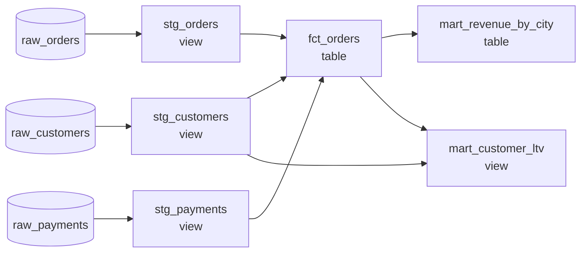

# dbt from scratch

In what order must these six models build, and what do their tests prove?

## Before you start

- **Level 2** (intermediate). About 2 hours.
- **Builds on:** [08-01 Warehouse layers](../01-warehouse-layers/) (raw, staging and marts, and one SELECT per model), [01-02 Joins without losing rows](../../01-sql/02-joins-without-losing-rows/) (why a join can multiply rows) and [05-06 Join files and prove nothing was lost](../../05-python-for-analysts/06-join-files-and-prove-nothing-was-lost/) (checking a join in code).
- **You need:** Python 3.9 or later. Nothing to install. dbt is **not** needed: you write the parts of it that matter in about 100 lines of Python, and the warehouse is SQLite.

## The problem

Brightcart, the fictional online grocery from [08-01](../01-warehouse-layers/), has six SQL models in a `models/` folder. Today Kiran, a junior analyst, rebuilds them every morning by opening each file and running it by hand, in an order he keeps in his head. Last Tuesday he was ill, a colleague ran the files in the order the folder lists them, and the city revenue table failed to build. Rohan, the head of data, wants a runner that works out the order by itself and runs the project's ten data tests after every build, in time for Thursday's finance pack. The finance pack will quote September and October revenue by city from `mart_revenue_by_city`, which today says 130,317.41.

## In plain words

Think of cooking a dinner from several recipes. The curry needs the onion paste, and the onion paste needs chopped onions. Nobody writes down the order of the whole evening: each recipe just says what it needs, and you work out that onions come first, paste second, curry third. If two recipes needed each other (the sauce needs the gravy and the gravy needs the sauce), no order could ever work, and you want to find that out before you start cooking. After cooking, you taste: is there salt, is anything burnt. The tasting does not cook anything; it only tells you whether the food is right.

**dbt** (data build tool) is the program many teams use for exactly this, with SQL instead of recipes:

- A **project** is a folder of **models**. A model is one `.sql` file holding one SELECT, and its file name is the name of the table or view it builds.
- A model names the models it reads with **`{{ ref('stg_orders') }}`** instead of the bare table name. The double braces are a **template** tag: dbt replaces it with the real table name before running the SQL. That step is called **compiling**.
- Because every model says what it reads, dbt can draw the **DAG** (directed acyclic graph): an arrow from each model to every model that reads it. "Directed" means the arrows have a direction. "Acyclic" means you can never follow arrows back to where you started.
- A **topological order** is any order of the models in which every model comes after everything it reads. Building in that order is what `dbt run` does.
- A **cycle** is a loop of refs (a reads b, b reads a). A project with a cycle has no topological order.
- **`{{ config(materialized='table') }}`** says how to store the result. A **view** stores only the SELECT and runs it every time someone reads it. A **table** runs the SELECT once and stores the rows.
- A **data test** (a **schema test**) is a query that returns the rows that break a rule. Zero rows means the test passes. dbt ships four: `unique`, `not_null`, `accepted_values` and `relationships`. `dbt test` runs them; `dbt build` builds and tests in one go.

## What you will build from scratch

- `parse_refs`, `parse_config` and `compile_sql`: read the template tags out of a model and turn it into SQL that SQLite can run.
- `build_dag`: the dependency graph of the whole project, rejecting a ref to a model that does not exist.
- `topo_order`: Kahn's algorithm with a fixed tie-break, so the order is the same on every run, and a `CycleError` that names every model that can never be built.
- `run_project`: build every model as a view or a table, in order.
- `run_tests`: dbt's four generic tests, counting failing rows the way dbt does.

The tables in `data/` are synthetic, made by `make_data.py` with a fixed seed. The models in `models/` and the tests in `models/schema.json` are the project; you do not edit them for the test.

## The idea

The six models and their refs, drawn as the DAG. Raw tables are not models: staging reads them by name.



**Kahn's algorithm** finds a topological order. Keep, for every model, a count of the models it is still waiting for.

1. Every model waiting for nothing is **ready**.
2. Take one ready model, put it next in the order, and tell each model that reads it: one less to wait for. Any model whose count reaches 0 becomes ready.
3. Repeat until nothing is ready.
4. If every model is in the order, done. If some are left, they can never become ready: they are in a cycle or downstream of one. Raise an error that names them all.

Several models are often ready at once (the three staging models here). Any of them is a correct next step, so a runner must pick by a fixed rule or two runs may build in different orders, and a bug that depends on order shows up only some days. This runner takes the alphabetically first, using a heap (`heapq`, a list that always pops its smallest item).

**A test is a query for the bad rows.** dbt compiles each generic test into SQL and counts what comes back:

| Test | Rule | The query returns |
|---|---|---|
| `unique` | no value appears twice | one row per non-NULL value seen more than once |
| `not_null` | no NULL | one row per NULL |
| `accepted_values` | only the listed values | one row per distinct non-NULL value not in the list |
| `relationships` | every child value exists in the parent | one row per non-NULL child value with no match |

NULL is not tested by `unique`, `accepted_values` or `relationships`: that is `not_null`'s job. A test proves one rule about one column, on the data that is there today. It does not prove that the number in a mart is right.

## Walk through

Run each block in Python from this folder (type `python3`, then paste), in order: later blocks use names from earlier ones. `exercise.py` gives the helpers that load the data and read the project; the blocks write the rest inline.

Step 1. Read the project and look at one model.

```python
import re, sqlite3, heapq
import exercise as ex

models = ex.read_project()
print(sorted(models))
print(models["fct_orders"])
```

```text
['fct_orders', 'mart_customer_ltv', 'mart_revenue_by_city', 'stg_customers', 'stg_orders', 'stg_payments']
{{ config(materialized='table') }}
-- One row per order, with what was paid and the customer's city.
SELECT
  o.order_id,
  o.customer_id,
  c.city,
  o.order_date,
  o.status,
  o.amount,
  COALESCE(p.paid_amount, 0) AS paid_amount,
  CASE WHEN o.status = 'delivered' THEN o.amount END AS revenue
FROM {{ ref('stg_orders') }} AS o
LEFT JOIN (
  SELECT order_id, SUM(paid_amount) AS paid_amount
  FROM {{ ref('stg_payments') }}
  GROUP BY order_id
) AS p ON p.order_id = o.order_id
LEFT JOIN {{ ref('stg_customers') }} AS c ON c.customer_id = o.customer_id

```

`read_project` returns `{name: sql}`, one entry per file. Sorted by name, `fct_orders` comes first, but it reads three other models, so it cannot be built first. SQLite cannot run this text yet: `{{ ... }}` is not SQL.

Step 2. Find the refs and draw the DAG.

```python
REF = re.compile(r"""\{\{\s*ref\(\s*['"](\w+)['"]\s*\)\s*\}\}""")
dag = {name: set(REF.findall(sql)) for name, sql in models.items()}
for name in sorted(dag):
    print(name.ljust(21), sorted(dag[name]))
```

```text
fct_orders            ['stg_customers', 'stg_orders', 'stg_payments']
mart_customer_ltv     ['fct_orders', 'stg_customers']
mart_revenue_by_city  ['fct_orders']
stg_customers         []
stg_orders            []
stg_payments          []
```

The pattern reads: `{{`, any spaces (`\s*`), `ref(`, spaces, a quote of either kind (`['"]`), a name (`\w+`, captured), the closing quote, `)`, spaces, `}}`. `findall` returns each captured name; the `set` drops repeats. `mart_customer_ltv` writes `{{ ref( "fct_orders" ) }}` with double quotes and extra spaces, and the pattern still finds it.

Step 3. Kahn's algorithm, printing what is ready after each step.

```python
waiting = {n: len(deps) for n, deps in dag.items()}
children = {n: sorted(m for m in dag if n in dag[m]) for n in dag}
ready = sorted(n for n in dag if waiting[n] == 0)
order = []
while ready:
    n = heapq.heappop(ready)
    order.append(n)
    for c in children[n]:
        waiting[c] -= 1
        if waiting[c] == 0:
            heapq.heappush(ready, c)
    print(n.ljust(21), "ready now:", sorted(ready))
print(len(order) == len(dag))
```

```text
stg_customers         ready now: ['stg_orders', 'stg_payments']
stg_orders            ready now: ['stg_payments']
stg_payments          ready now: ['fct_orders']
fct_orders            ready now: ['mart_customer_ltv', 'mart_revenue_by_city']
mart_customer_ltv     ready now: ['mart_revenue_by_city']
mart_revenue_by_city  ready now: []
True
```

`waiting` counts unbuilt dependencies; `children` is the arrows turned round (who reads me). A sorted list is already a valid heap, and `heappop` always gives the smallest name. `fct_orders` became ready only when its third dependency, `stg_payments`, was built. Every model got into the order, so there is no cycle. That is the answer to the first half of the question: the three staging models, then `fct_orders`, then the two marts.

Step 4. Compile one model.

```python
CONFIG = re.compile(r"\{\{\s*config\((.*?)\)\s*\}\}", re.S)
sql = models["mart_revenue_by_city"]
print(CONFIG.search(sql).group(1))
print(REF.sub(lambda m: m.group(1), CONFIG.sub("", sql)).strip())
```

```text
materialized='table'
SELECT city, COUNT(revenue) AS delivered_orders, ROUND(COALESCE(SUM(revenue), 0), 2) AS revenue
FROM fct_orders
GROUP BY city
```

`CONFIG.sub("", sql)` removes the config tag. `REF.sub` replaces each whole ref tag with the name it captured. Real dbt puts the schema in front (`analytics.fct_orders`); here everything lives in one SQLite database, so the bare name is enough.

Step 5. Build every model in order, as a view or a table.

```python
con = ex.load_raw(sqlite3.connect(":memory:"))
for name in order:
    kind = "table" if "materialized='table'" in models[name] else "view"
    body = REF.sub(lambda m: m.group(1), CONFIG.sub("", models[name])).strip()
    ex.drop_relation(con, name)
    con.execute("CREATE %s %s AS %s" % (kind.upper(), name, body))
print(con.execute("SELECT name, type FROM sqlite_master ORDER BY type, name").fetchall())
```

```text
[('fct_orders', 'table'), ('mart_revenue_by_city', 'table'), ('raw_customers', 'table'), ('raw_orders', 'table'), ('raw_payments', 'table'), ('mart_customer_ltv', 'view'), ('stg_customers', 'view'), ('stg_orders', 'view'), ('stg_payments', 'view')]
```

`sqlite_master` is SQLite's list of everything in the database. `drop_relation` drops a view or a table of that name first, so the block can run twice. The `kind` line here is a shortcut that only works for this exact spelling; your `parse_config` must also accept double quotes and spaces. In PostgreSQL, Snowflake and BigQuery the statements are the same, `CREATE VIEW x AS ...` and `CREATE TABLE x AS ...`, usually with `OR REPLACE` instead of a separate drop.

Step 6. The first test: is `stg_customers.customer_id` unique?

```python
tests = ex.read_tests()
print(len(tests), tests[0])
unique_sql = """SELECT customer_id FROM stg_customers WHERE customer_id IS NOT NULL
                GROUP BY customer_id HAVING COUNT(*) > 1"""
print(con.execute(unique_sql).fetchall())
print(con.execute("SELECT * FROM stg_customers WHERE customer_id IN ('8', '15', '127')").fetchall())
```

```text
10 {'model': 'stg_customers', 'column': 'customer_id', 'test': 'unique'}
[('127',), ('15',), ('8',)]
[('8', 'Nagpur', '2026-07-23'), ('8', 'Nagpur', '2026-07-23'), ('15', 'Nashik', '2026-05-07'), ('15', 'Nashik', '2026-05-07'), ('127', 'Nashik', '2026-08-20'), ('127', 'Nashik', '2026-08-20')]
```

Three failing rows: three customers appear twice. The CRM export repeated them with spaces around the city, and the staging model trims the city but does not deduplicate. (The ids print as text because `load_raw` loads every raw column as text, as a loader would.)

Step 7. Three more tests, as queries.

```python
checks = {
    "accepted_values stg_orders.status": "SELECT status FROM stg_orders WHERE status NOT IN ('delivered', 'cancelled', 'refunded', 'pending') GROUP BY status",
    "relationships stg_payments.order_id": "SELECT p.order_id FROM stg_payments p LEFT JOIN stg_orders o ON o.order_id = p.order_id WHERE p.order_id IS NOT NULL AND o.order_id IS NULL",
    "unique fct_orders.order_id": "SELECT order_id FROM fct_orders GROUP BY order_id HAVING COUNT(*) > 1",
}
for label, q in checks.items():
    print(label.ljust(36), len(con.execute(q).fetchall()), con.execute(q).fetchall()[:3])
```

```text
accepted_values stg_orders.status    1 [('returned',)]
relationships stg_payments.order_id  3 [('9840',), ('9230',), ('9028',)]
unique fct_orders.order_id           15 [('2039',), ('2063',), ('2064',)]
```

- `accepted_values` fails once: one distinct new status, `returned`, that nobody has defined. Is a returned order revenue? The test cannot say; someone in the business must.
- `relationships` fails three times: three payments point at orders that do not exist (made in the test shop).
- `unique` on `fct_orders.order_id` fails fifteen times. This one is caused by the first failure: every order of a duplicated customer joins to two customer rows, so the fact table has two rows for it. That is called **fan-out**.

Step 8. What the fan-out does to the number finance will quote.

```python
print(con.execute("SELECT COUNT(*) FROM stg_orders").fetchone(), con.execute("SELECT COUNT(*) FROM fct_orders").fetchone())
print(con.execute("SELECT ROUND(SUM(revenue), 2) FROM mart_revenue_by_city").fetchone())
print(con.execute("SELECT ROUND(SUM(amount), 2) FROM stg_orders WHERE status = 'delivered'").fetchone())
```

```text
(397,) (412,)
(130317.41,)
(124308.93,)
```

397 orders became 412 fact rows. The mart says 130,317.41; delivered revenue counted once per order is 124,308.93. The build succeeded, every model exists, and the number is 6,008.48 too high. Only the test said so. That is the answer to the second half of the question: the tests prove that the grain is broken (more than one row per order), that a status exists nobody defined, and that some payments have no order. They do not prove 124,308.93 is right; they prove 130,317.41 is wrong.

Step 9. Python's own topological sorter, as a cross-check.

```python
import graphlib
g = list(graphlib.TopologicalSorter(dag).static_order())
print(all(g.index(d) < g.index(n) for n in dag for d in dag[n]))
try:
    graphlib.TopologicalSorter({"a": {"b"}, "b": {"a"}, "c": {"b"}}).prepare()
except graphlib.CycleError as e:
    print("cycle:", e.args[1])
```

```text
True
cycle: ['a', 'b', 'a']
```

`graphlib` (standard library since Python 3.9) takes the same `{node: dependencies}` shape, and its order is valid: every model comes after what it reads. Print `g` a few times in new Python sessions, though, and the three staging models can come out in a different order each time, because `graphlib` follows the order of the sets it was given, and Python shuffles the order of a set of strings from one run to the next. That is why your runner fixes its own tie-break. Its cycle error shows only the loop, `a -> b -> a`. Your `CycleError` must list `c` as well, because `c` reads `b` and so can never be built either.

**The real tool.** The same project in real dbt has `models/stg_orders.sql` and so on, unchanged, and the tests in a `schema.yml` file next to them (this lesson keeps them in `models/schema.json` so the standard library can read them):

```yaml
version: 2
models:
  - name: stg_orders
    columns:
      - name: order_id
        tests: [unique, not_null]
      - name: status
        tests:
          - accepted_values:
              values: ['delivered', 'cancelled', 'refunded', 'pending']
  - name: stg_payments
    columns:
      - name: order_id
        tests:
          - relationships:
              to: ref('stg_orders')
              field: order_id
```

`dbt build` runs every model and its tests in DAG order, and skips the models downstream of a failed test. `dbt ls --select +mart_revenue_by_city` lists a model and everything upstream of it, read straight from the DAG you built here. This block is reference only: nothing in the lesson runs it.

## Common mistakes

**1. Believing the mart because the build succeeded (the trap).** Every model built, `mart_revenue_by_city` has four tidy rows, and 130,317.41 looks like a revenue figure. It is 6,008.48 too high because of fan-out, and nothing in the build output says so:

```python
for row in con.execute("SELECT city, delivered_orders, revenue FROM mart_revenue_by_city ORDER BY city"):
    print(row)
print(con.execute("SELECT SUM(delivered_orders) FROM mart_revenue_by_city").fetchone(),
      con.execute("SELECT COUNT(*) FROM stg_orders WHERE status = 'delivered'").fetchone())
```

```text
('Mumbai', 58, 27450.21)
('Nagpur', 97, 46811.45)
('Nashik', 52, 23659.26)
('Pune', 70, 32396.49)
(277,) (264,)
```

The mart counts 277 delivered orders; there are 264. The 13 extra are delivered orders of the three duplicated customers, counted twice, and their amounts are counted twice too. Reconcile a mart against the layer below it before anyone reads it, and when `unique` fails on a fact table's key, stop: every sum built on that table is wrong.

**2. Running the files in the order the folder lists them.** That is what happened last Tuesday:

```python
fresh = ex.load_raw(sqlite3.connect(":memory:"))
try:
    for name in sorted(models):
        fresh.execute("CREATE TABLE %s AS %s" % (name, REF.sub(lambda m: m.group(1), CONFIG.sub("", models[name]))))
except sqlite3.OperationalError as e:
    print(name, "->", e)
```

```text
fct_orders -> no such table: stg_orders
```

On a fresh database this fails loudly. On yesterday's database it is worse: the old tables are still there, so `fct_orders` builds silently from yesterday's staging. The order must come from the refs, never from file names or memory.

**3. Writing a table name instead of a ref.** If `fct_orders` said `FROM stg_orders` instead of `FROM {{ ref('stg_orders') }}`, the SQL would still run, but the DAG would not know `fct_orders` reads `stg_orders`. The runner would then be free to build `fct_orders` first. It might work for months because the alphabetical tie-break happens to put staging first, and break the day someone renames a model. Every model-to-model read goes through `ref`; only raw tables (dbt calls them **sources**) are read by name here.

**4. Testing `relationships` with `NOT IN`.** `WHERE order_id NOT IN (SELECT order_id FROM stg_orders)` looks the same as the LEFT JOIN in step 7, but if the parent column holds a single NULL, `NOT IN` is never true and the test passes with every orphan still there:

```python
t = sqlite3.connect(":memory:")
t.execute("CREATE TABLE parent (id)"); t.executemany("INSERT INTO parent VALUES (?)", [(1,), (None,)])
t.execute("CREATE TABLE child (pid)"); t.executemany("INSERT INTO child VALUES (?)", [(1,), (4,), (5,)])
print(t.execute("SELECT pid FROM child WHERE pid NOT IN (SELECT id FROM parent)").fetchall())
print(t.execute("SELECT c.pid FROM child c LEFT JOIN parent p ON p.id = c.pid WHERE c.pid IS NOT NULL AND p.id IS NULL").fetchall())
```

```text
[]
[(4,), (5,)]
```

`4 NOT IN (1, NULL)` is "4 is not 1 and 4 is not NULL", and "4 is not NULL" as a comparison is unknown, so the whole condition is unknown and the row is dropped. Use the LEFT JOIN (or `NOT EXISTS`).

## Your turn

Open `exercise.py`. The helpers at the top are done. Write the seven functions marked TODO: `parse_refs`, `parse_config`, `compile_sql`, `build_dag`, `topo_order`, `run_project` and `run_tests`. Their docstrings give the contract; the walk through gives the pieces, but not the edge cases.

```
python3 test_lesson.py
```

Run it from this folder. The test runs your runner on the project over the committed data and over a second dataset from `make_data.build(seed=2027)`, where the number of duplicate customers and orphan payments changes and the new status is gone. It also checks hand-made cases: an empty project, a diamond (two models that both read one and are both read by a fourth), a cycle with a model downstream of it, a model that refs itself, a ref to a missing model, odd quoting and spacing, no config, an unsupported config, and every test over NULLs.

Stretch: fix the project in your own copy. Deduplicate `stg_customers` (one row per `customer_id`, as in 08-01), decide with a short comment what `returned` should mean, and run the project again. Which tests now pass, and what does `mart_revenue_by_city` say?

## Check yourself

1. Why does dbt need `{{ ref('stg_orders') }}` rather than just `stg_orders`?
2. Three models are ready at the same time. Does it matter which one is built first?
3. Every test passes. Is the revenue in the mart now correct?
4. `unique` failed on `stg_customers` and on `fct_orders`. Which do you fix first, and why?

<details>
<summary>Answers</summary>

1. The ref is how dbt learns the dependency. Without it the SQL still runs, but the DAG is missing an arrow, so the runner may build the model before what it reads. The ref also lets dbt swap in the right schema for each environment (development or production).
2. For correctness, no: any topological order builds every model after its inputs. For reliability, yes: if the choice depends on dictionary or file order, two runs can differ, and a hidden ordering bug appears only some days. Fix a tie-break (here alphabetical) so the order is the same every run.
3. Not necessarily. Tests prove the rules they state (keys unique, no unknown statuses, no orphans) on today's data. A wrong definition, such as counting refunded orders as revenue, passes all four tests. Tests rule out whole classes of error; they do not prove a number.
4. `stg_customers`. The duplicate customers are the cause; the fan-out in `fct_orders` is the effect, and it disappears when staging has one row per customer. Fixing the fact table with `DISTINCT` would hide the cause and leave `mart_customer_ltv` still wrong.

</details>

## What to tell the stakeholder

> Rohan, the runner now builds the six models in dependency order (the three staging models, then fct_orders, then the two marts) and runs the ten tests after every build. Four tests fail today, and one of them matters for Thursday: three customers are duplicated in the CRM export, which doubles 15 orders in the fact table and overstates September and October revenue by city at 130,317.41 instead of 124,308.93.

The caveat: 124,308.93 counts delivered orders once each. Four orders have a new status, `returned`, that finance needs to define (today they count as no revenue), and three payments point at test-shop orders that should be filtered at the source. Until the duplicate customers are fixed in staging, the city figures should not go in the finance pack.

## In real job postings

dbt is the tool this lesson rebuilds. In the Real Analyst Jobs data drop of 25 October 2026 ([data/job-market/2026-10](../../../data/job-market/2026-10/)), 157 of the 2,056 US analyst postings that list a tool (7.6%) ask for dbt, and 43 of 413 in the UK (10.4%). Browse them at [SQL data analyst jobs](https://realanalystjobs.com/jobs/sql-data-analyst-jobs).

## Next

[08-03 Incremental models and backfills](../03-incremental-models-and-backfills/): rebuild only the days that changed, and prove the result equals a full rebuild.
